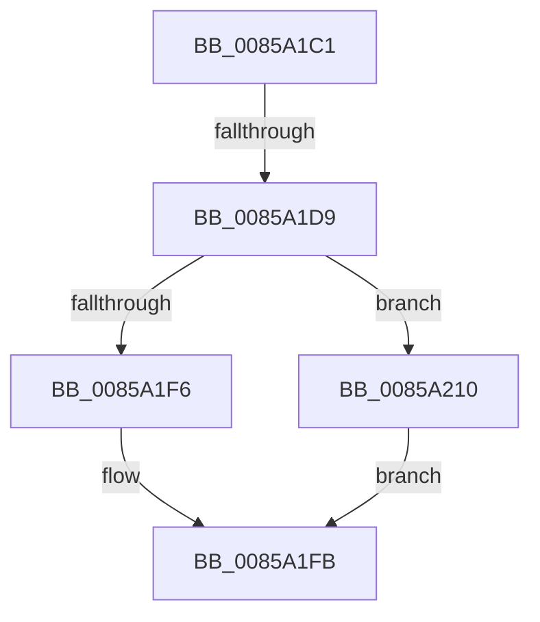

# sub_0085A1C1

- RVA: `0x0085A1C1`–`0x0085A217` (길이 `86` bytes)
- VA: `0x000000014085A1C1`
- 실행 섹션: `PAGE`
- PDB 이름 있음: `아니요`; PDB Function 태그: `아니요`
- unwind 정보 RVA: `0x0006AB7C`
- 디코드: `24`개 명령, `86/86` bytes 표시
- 미해석 바이트: `0` (있으면 어셈블리에 `.byte`로 보존)

> 이 문서는 커널 이미지의 기계어와 PDB 기호를 분석해 생성했습니다. 4번과 5번은 함수 원형과 자료형을 바이너리 사용 방식에서 추정한 C 해석이며 원본 소스 복구 결과는 아닙니다.

## 1. Dependencies

- 직접 호출 지점: **3**; 고유 호출 대상: **3**
- 직접 호출자로 확인된 함수: **0**
- RIP 상대 이미지 참조: **0**

### Outgoing calls
- `0x0085A1CE` → [HvpAddBin](../AF/HvpAddBin_function_00AF7D48.md) (function, `0x00AF7D48`)
- `0x0085A1F6` → [HvpGetCellFlat](HvpGetCellFlat_function_00854C60.md) (function, `0x00854C60`)
- `0x0085A210` → [HvpGetCellPaged](HvpGetCellPaged_function_00854CB0.md) (function, `0x00854CB0`)

### Direct callers
- 이 함수 시작 RVA로 연결되는 직접 call은 확인되지 않았습니다. 간접 호출은 완전히 역산할 수 없습니다.

### Static image references
- 디코드된 RIP-relative 메모리 참조가 없습니다.

## 2. Other-region calls and transfers

- 다른 실행 섹션으로 향하는 call: **0**
- call이 아닌 외부 분기/꼬리 이동: **2**
  - `0x0085A1D7` → [sub_0085A221 + 0x15](Unknown_function_0085A221.md) (`tail-transfer`)
  - `0x0085A20B` → [sub_00859FB9 + 0x95](Unknown_function_00859FB9.md) (`tail-transfer`)

## 3. Assembly (complete function range)

```asm
0085A1C1  4C 8D 4C 24 30                  lea r9, [rsp + 0x30]
0085A1C6  45 8B C7                        mov r8d, r15d
0085A1C9  8B D7                           mov edx, edi
0085A1CB  49 8B CE                        mov rcx, r14
0085A1CE  E8 75 DB 29 00                  call 0x140af7d48
0085A1D3  8B F0                           mov esi, eax
0085A1D5  85 C0                           test eax, eax
0085A1D7  78 5D                           js 0x14085a236
0085A1D9  44 8B 64 24 30                  mov r12d, dword ptr [rsp + 0x30]
0085A1DE  4C 8D 44 24 38                  lea r8, [rsp + 0x38]
0085A1E3  41 83 C4 20                     add r12d, 0x20
0085A1E7  49 8B CE                        mov rcx, r14
0085A1EA  41 8B D4                        mov edx, r12d
0085A1ED  41 84 AE 8C 00 00 00            test byte ptr [r14 + 0x8c], bpl
0085A1F4  74 1A                           je 0x14085a210
0085A1F6  E8 65 AA FF FF                  call 0x140854c60
0085A1FB  48 8B C8                        mov rcx, rax
0085A1FE  33 DB                           xor ebx, ebx
0085A200  48 85 C9                        test rcx, rcx
0085A203  48 8D 40 FC                     lea rax, [rax - 4]
0085A207  48 0F 45 D8                     cmovne rbx, rax
0085A20B  E9 3E FE FF FF                  jmp 0x14085a04e
0085A210  E8 9B AA FF FF                  call 0x140854cb0
0085A215  EB E4                           jmp 0x14085a1fb
```

## 4. C-style interpretation (structured pseudocode)

```c
__int64 __fastcall sub_0085A1C1(__int64 a1, __int64 a2, __int64 a3, __int64 a4, __int64 a5, unsigned int a6, __int64 a7)
{
    __int64 result;
    __int64 v_r12;
    __int64 v_rbx;

    result = HvpAddBin(v_r14, (unsigned int)((unsigned int)(v_rdi)), (unsigned int)((unsigned int)(v_r15)), a6);
    v_r12 = (unsigned int)(((unsigned int)(a6)) + (32));
    if (((*(unsigned __int8 *)(v_r14 + 140)) & ((unsigned __int8)(v_rbp))) == 0) goto loc_0085A210;
    result = HvpGetCellFlat(v_r14, (unsigned int)((unsigned int)(v_r12)), a7, a6);
loc_0085A1FB:
    v_rbx = 0;
    if (result != 0) { v_rbx = result - 4; }
loc_0085A210:
    result = HvpGetCellPaged(result, (unsigned int)((unsigned int)(v_r12)), a7, a6);
    goto loc_0085A1FB;
}
```

## 5. (Beta) C Style

```c
int64_t sub_0085A1C1(int64_t Arg1, int64_t Arg2, int64_t Arg3, int64_t Arg4, uint64_t Arg5, uint32_t Arg6, int64_t Arg7)
{
    int64_t result;
    int64_t local_r12;
    int64_t local_rbx;

    result = HvpAddBin(local_r14, (uint32_t)((uint32_t)(local_rdi)), (uint32_t)((uint32_t)(local_r15)), Arg6);
    local_r12 = (uint32_t)(((uint32_t)(Arg6)) + (32));
    if (((*(uint8_t *)(local_r14 + 0x8C)) & ((uint8_t)(local_rbp))) == 0) goto loc_0085A210;
    result = HvpGetCellFlat(local_r14, (uint32_t)((uint32_t)(local_r12)), Arg7, Arg6);
loc_0085A1FB:
    local_rbx = 0;
    if (result != 0) { local_rbx = result - 4; }
loc_0085A210:
    result = HvpGetCellPaged(result, (uint32_t)((uint32_t)(local_r12)), Arg7, Arg6);
    goto loc_0085A1FB;
}
```

## 6. Execution-region graph

[열기: 2D/3D 그래프와 함수 탐색 컨트롤 패널](../../../control-panel.html?section=page&rva=0x0085A1C1&view=graph)

- 2D 그래프는 위에서 아래로 흐르고, 3D 그래프는 빈 공간을 드래그해 회전합니다. Shift+드래그는 이동, 휠은 확대·축소, 함수 노드 선택은 대상 보고서 이동입니다.

### Static fallback


