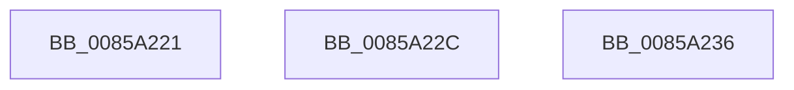

# sub_0085A221

- RVA: `0x0085A221`–`0x0085A240` (길이 `31` bytes)
- VA: `0x000000014085A221`
- 실행 섹션: `PAGE`
- PDB 이름 있음: `아니요`; PDB Function 태그: `아니요`
- unwind 정보 RVA: `0x0006ABD0`
- 디코드: `6`개 명령, `31/31` bytes 표시
- 미해석 바이트: `0` (있으면 어셈블리에 `.byte`로 보존)

> 이 문서는 커널 이미지의 기계어와 PDB 기호를 분석해 생성했습니다. 4번과 5번은 함수 원형과 자료형을 바이너리 사용 방식에서 추정한 C 해석이며 원본 소스 복구 결과는 아닙니다.

## 1. Dependencies

- 직접 호출 지점: **0**; 고유 호출 대상: **0**
- 직접 호출자로 확인된 함수: **0**
- RIP 상대 이미지 참조: **0**

### Outgoing calls
- 직접 디코드된 call 명령이 없습니다.

### Direct callers
- 이 함수 시작 RVA로 연결되는 직접 call은 확인되지 않았습니다. 간접 호출은 완전히 역산할 수 없습니다.

### Static image references
- 디코드된 RIP-relative 메모리 참조가 없습니다.

## 2. Other-region calls and transfers

- 다른 실행 섹션으로 향하는 call: **0**
- call이 아닌 외부 분기/꼬리 이동: **3**
  - `0x0085A227` → [sub_00859FB9 + 0xD1](Unknown_function_00859FB9.md) (`tail-transfer`)
  - `0x0085A231` → [sub_00859FB9 + 0xE9](Unknown_function_00859FB9.md) (`tail-transfer`)
  - `0x0085A23B` → [sub_00859FB9 + 0x14D](Unknown_function_00859FB9.md) (`tail-transfer`)

## 3. Assembly (complete function range)

```asm
0085A221  41 B8 17 00 00 00               mov r8d, 0x17
0085A227  E9 5E FE FF FF                  jmp 0x14085a08a
0085A22C  B8 17 00 00 00                  mov eax, 0x17
0085A231  E9 6C FE FF FF                  jmp 0x14085a0a2
0085A236  48 8B 5C 24 40                  mov rbx, qword ptr [rsp + 0x40]
0085A23B  E9 C6 FE FF FF                  jmp 0x14085a106
```

## 4. C-style interpretation (structured pseudocode)

```c
__int64 __fastcall sub_0085A221(void)
{
    unsigned __int64 v_stack_p40;
}
```

## 5. (Beta) C Style

```c
void sub_0085A221(void)
{
    uint64_t v_stack_p40;
}
```

## 6. Execution-region graph

[열기: 2D/3D 그래프와 함수 탐색 컨트롤 패널](../../../control-panel.html?section=page&rva=0x0085A221&view=graph)

- 2D 그래프는 위에서 아래로 흐르고, 3D 그래프는 빈 공간을 드래그해 회전합니다. Shift+드래그는 이동, 휠은 확대·축소, 함수 노드 선택은 대상 보고서 이동입니다.

### Static fallback


