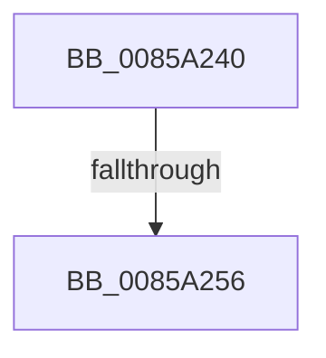

# sub_0085A240

- RVA: `0x0085A240`–`0x0085A260` (길이 `32` bytes)
- VA: `0x000000014085A240`
- 실행 섹션: `PAGE`
- PDB 이름 있음: `아니요`; PDB Function 태그: `아니요`
- unwind 정보 RVA: `0x0006ABFC`
- 디코드: `6`개 명령, `32/32` bytes 표시
- 미해석 바이트: `0` (있으면 어셈블리에 `.byte`로 보존)

> 이 문서는 커널 이미지의 기계어와 PDB 기호를 분석해 생성했습니다. 4번과 5번은 함수 원형과 자료형을 바이너리 사용 방식에서 추정한 C 해석이며 원본 소스 복구 결과는 아닙니다.

## 1. Dependencies

- 직접 호출 지점: **1**; 고유 호출 대상: **1**
- 직접 호출자로 확인된 함수: **0**
- RIP 상대 이미지 참조: **0**

### Outgoing calls
- `0x0085A256` → [HvpReleaseCellFlat](HvpReleaseCellFlat_function_0085CC20.md) (function, `0x0085CC20`)

### Direct callers
- 이 함수 시작 RVA로 연결되는 직접 call은 확인되지 않았습니다. 간접 호출은 완전히 역산할 수 없습니다.

### Static image references
- 디코드된 RIP-relative 메모리 참조가 없습니다.

## 2. Other-region calls and transfers

- 다른 실행 섹션으로 향하는 call: **0**
- call이 아닌 외부 분기/꼬리 이동: **2**
  - `0x0085A250` → [sub_00B16D36](../B1/Unknown_function_00B16D36.md) (`tail-transfer`)
  - `0x0085A25B` → [sub_0085A12B](Unknown_function_0085A12B.md) (`tail-transfer`)

## 3. Assembly (complete function range)

```asm
0085A240  41 F6 86 8C 00 00 00 01         test byte ptr [r14 + 0x8c], 1
0085A248  48 8D 54 24 38                  lea rdx, [rsp + 0x38]
0085A24D  49 8B CE                        mov rcx, r14
0085A250  0F 84 E0 CA 2B 00               je 0x140b16d36
0085A256  E8 C5 29 00 00                  call 0x14085cc20
0085A25B  E9 CB FE FF FF                  jmp 0x14085a12b
```

## 4. C-style interpretation (structured pseudocode)

```c
__int64 __fastcall sub_0085A240(__int64 a1, __int64 a2, __int64 a3, __int64 a4, __int64 a5, __int64 a6, __int64 a7)
{
    __int64 result;

    result = HvpReleaseCellFlat(v_r14, a7, a3, a4);
}
```

## 5. (Beta) C Style

```c
int64_t sub_0085A240(int64_t Arg1, int64_t Arg2, int64_t Arg3, int64_t Arg4, uint64_t Arg5, uint64_t Arg6, int64_t Arg7)
{
    int64_t result;

    result = HvpReleaseCellFlat(local_r14, Arg7, Arg3, Arg4);
}
```

## 6. Execution-region graph

[열기: 2D/3D 그래프와 함수 탐색 컨트롤 패널](../../../control-panel.html?section=page&rva=0x0085A240&view=graph)

- 2D 그래프는 위에서 아래로 흐르고, 3D 그래프는 빈 공간을 드래그해 회전합니다. Shift+드래그는 이동, 휠은 확대·축소, 함수 노드 선택은 대상 보고서 이동입니다.

### Static fallback


