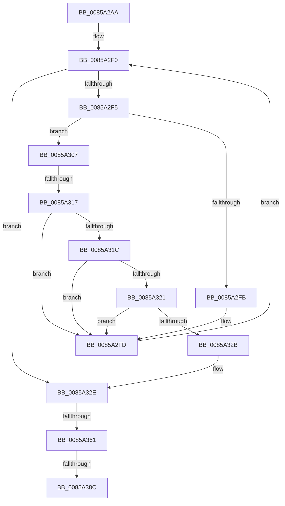

# sub_0085A2AA

- RVA: `0x0085A2AA`–`0x0085A3BB` (길이 `273` bytes)
- VA: `0x000000014085A2AA`
- 실행 섹션: `PAGE`
- PDB 이름 있음: `아니요`; PDB Function 태그: `아니요`
- unwind 정보 RVA: `0x0006AC3C`
- 디코드: `75`개 명령, `273/273` bytes 표시
- 미해석 바이트: `0` (있으면 어셈블리에 `.byte`로 보존)

> 이 문서는 커널 이미지의 기계어와 PDB 기호를 분석해 생성했습니다. 4번과 5번은 함수 원형과 자료형을 바이너리 사용 방식에서 추정한 C 해석이며 원본 소스 복구 결과는 아닙니다.

## 1. Dependencies

- 직접 호출 지점: **3**; 고유 호출 대상: **3**
- 직접 호출자로 확인된 함수: **0**
- RIP 상대 이미지 참조: **0**

### Outgoing calls
- `0x0085A2C9` → [HvpMapEntryGetBinAddress](../../pagecmrc/BC/HvpMapEntryGetBinAddress_function_00BC9770.md) (function, `0x00BC9770`)
- `0x0085A368` → [RtlClearBits](../../text/3E/RtlClearBits_function_003E1A90.md) (function, `0x003E1A90`)
- `0x0085A37C` → [RtlFindSetBits](../../text/3F/RtlFindSetBits_function_003F0610.md) (function, `0x003F0610`)

### Direct callers
- 이 함수 시작 RVA로 연결되는 직접 call은 확인되지 않았습니다. 간접 호출은 완전히 역산할 수 없습니다.

### Static image references
- 디코드된 RIP-relative 메모리 참조가 없습니다.

## 2. Other-region calls and transfers

- 다른 실행 섹션으로 향하는 call: **3**
  - `0x0085A2C9` → [HvpMapEntryGetBinAddress](../../pagecmrc/BC/HvpMapEntryGetBinAddress_function_00BC9770.md) (`PAGE` → `PAGECMRC`)
  - `0x0085A368` → [RtlClearBits](../../text/3E/RtlClearBits_function_003E1A90.md) (`PAGE` → `.text`)
  - `0x0085A37C` → [RtlFindSetBits](../../text/3F/RtlFindSetBits_function_003F0610.md) (`PAGE` → `.text`)
- call이 아닌 외부 분기/꼬리 이동: **3**
  - `0x0085A311` → [sub_0085A3BC](Unknown_function_0085A3BC.md) (`tail-transfer`)
  - `0x0085A35F` → [sub_0085A3BC + 0x16](Unknown_function_0085A3BC.md) (`tail-transfer`)
  - `0x0085A38A` → [sub_0085A3BC + 0x32](Unknown_function_0085A3BC.md) (`tail-transfer`)

## 3. Assembly (complete function range)

```asm
0085A2AA  48 89 6C 24 70                  mov qword ptr [rsp + 0x70], rbp
0085A2AF  4C 8D 44 24 30                  lea r8, [rsp + 0x30]
0085A2B4  4C 89 64 24 78                  mov qword ptr [rsp + 0x78], r12
0085A2B9  48 8B D0                        mov rdx, rax
0085A2BC  4C 89 AC 24 80 00 00 00         mov qword ptr [rsp + 0x80], r13
0085A2C4  4C 89 74 24 40                  mov qword ptr [rsp + 0x40], r14
0085A2C9  E8 A2 F4 36 00                  call 0x140bc9770
0085A2CE  8B CF                           mov ecx, edi
0085A2D0  4C 8B E8                        mov r13, rax
0085A2D3  C1 E1 1F                        shl ecx, 0x1f
0085A2D6  44 8B 70 04                     mov r14d, dword ptr [rax + 4]
0085A2DA  48 8D 50 20                     lea rdx, [rax + 0x20]
0085A2DE  44 8B 60 08                     mov r12d, dword ptr [rax + 8]
0085A2E2  45 8D 46 20                     lea r8d, [r14 + 0x20]
0085A2E6  44 0B C1                        or r8d, ecx
0085A2E9  4D 8D 0C 04                     lea r9, [r12 + rax]
0085A2ED  0F 1F 00                        nop dword ptr [rax]
0085A2F0  49 3B D1                        cmp rdx, r9
0085A2F3  73 39                           jae 0x14085a32e
0085A2F5  8B 02                           mov eax, dword ptr [rdx]
0085A2F7  85 C0                           test eax, eax
0085A2F9  79 0C                           jns 0x14085a307
0085A2FB  F7 D8                           neg eax
0085A2FD  8B C8                           mov ecx, eax
0085A2FF  48 03 D1                        add rdx, rcx
0085A302  44 03 C0                        add r8d, eax
0085A305  EB E9                           jmp 0x14085a2f0
0085A307  8B C8                           mov ecx, eax
0085A309  C1 E9 03                        shr ecx, 3
0085A30C  FF C9                           dec ecx
0085A30E  83 F9 10                        cmp ecx, 0x10
0085A311  0F 83 A5 00 00 00               jae 0x14085a3bc
0085A317  44 3B D1                        cmp r10d, ecx
0085A31A  75 E1                           jne 0x14085a2fd
0085A31C  44 3B C3                        cmp r8d, ebx
0085A31F  74 DC                           je 0x14085a2fd
0085A321  44 3B 84 24 90 00 00 00         cmp r8d, dword ptr [rsp + 0x90]
0085A329  74 D2                           je 0x14085a2fd
0085A32B  41 B7 01                        mov r15b, 1
0085A32E  48 69 D7 78 02 00 00            imul rdx, rdi, 0x278
0085A335  41 8B CA                        mov ecx, r10d
0085A338  41 C1 EE 0C                     shr r14d, 0xc
0085A33C  BB 01 00 00 00                  mov ebx, 1
0085A341  D3 E3                           shl ebx, cl
0085A343  4B 8D 0C 52                     lea rcx, [r10 + r10*2]
0085A347  48 8D 3C CA                     lea rdi, [rdx + rcx*8]
0085A34B  49 03 FB                        add rdi, r11
0085A34E  4A 8D 34 1A                     lea rsi, [rdx + r11]
0085A352  41 8B D6                        mov edx, r14d
0085A355  48 8D 8F 40 01 00 00            lea rcx, [rdi + 0x140]
0085A35C  45 84 FF                        test r15b, r15b
0085A35F  75 71                           jne 0x14085a3d2
0085A361  41 C1 EC 0C                     shr r12d, 0xc
0085A365  45 8B C4                        mov r8d, r12d
0085A368  E8 23 77 B8 FF                  call 0x1403e1a90
0085A36D  45 8B C6                        mov r8d, r14d
0085A370  48 8D 8F 40 01 00 00            lea rcx, [rdi + 0x140]
0085A377  BA 01 00 00 00                  mov edx, 1
0085A37C  E8 8F 62 B9 FF                  call 0x1403f0610
0085A381  8B 8E 88 03 00 00               mov ecx, dword ptr [rsi + 0x388]
0085A387  83 F8 FF                        cmp eax, -1
0085A38A  74 62                           je 0x14085a3ee
0085A38C  0B CB                           or ecx, ebx
0085A38E  89 8E 88 03 00 00               mov dword ptr [rsi + 0x388], ecx
0085A394  89 87 3C 01 00 00               mov dword ptr [rdi + 0x13c], eax
0085A39A  4C 8B AC 24 80 00 00 00         mov r13, qword ptr [rsp + 0x80]
0085A3A2  4C 8B 64 24 78                  mov r12, qword ptr [rsp + 0x78]
0085A3A7  48 8B 6C 24 70                  mov rbp, qword ptr [rsp + 0x70]
0085A3AC  4C 8B 74 24 40                  mov r14, qword ptr [rsp + 0x40]
0085A3B1  48 83 C4 48                     add rsp, 0x48
0085A3B5  41 5F                           pop r15
0085A3B7  5F                              pop rdi
0085A3B8  5E                              pop rsi
0085A3B9  5B                              pop rbx
0085A3BA  C3                              ret
```

## 4. C-style interpretation (structured pseudocode)

```c
__int64 __fastcall sub_0085A2AA(__int64 a1, __int64 a2, __int64 a3, __int64 a4, __int64 a5, __int64 a6, __int64 a7, __int64 a8, __int64 a9, __int64 a10, __int64 a11, __int64 a12, __int64 a13, __int64 a14, __int64 a15, __int64 a16, __int64 a17, unsigned int a18)
{
    __int64 result;
    __int64 v_r12;
    __int64 v_r14;
    __int64 v_rbx;
    __int64 v_rdi;
    __int64 v_rsp;
    unsigned __int64 v_stack_p40;
    unsigned __int64 v_stack_p70;
    unsigned __int64 v_stack_p78;
    unsigned __int64 v_stack_p80;

    v_stack_p70 = v_rbp;
    v_stack_p78 = v_r12;
    v_stack_p80 = v_r13;
    v_stack_p40 = v_r14;
    result = HvpMapEntryGetBinAddress(a1, result, a6, a4);
    a1 = (unsigned int)(((unsigned int)((unsigned int)(v_rdi))) << (31));
    a3 = (unsigned int)(((unsigned int)(*(unsigned int *)(result + 4)) + 32) | ((unsigned int)(a1)));
loc_0085A2F0:
    if ((result + 32) >= ((unsigned int)(*(unsigned int *)(result + 8)) + result * 1)) goto loc_0085A32E;
    if (!sign_flag) goto loc_0085A307;
    result = (unsigned int)(-((unsigned int)(*(unsigned int *)(result + 32))));
loc_0085A2FD:
    a2 = (result + 32) + ((unsigned int)((unsigned int)(result)));
    a3 = (unsigned int)((a3) + ((unsigned int)(result)));
    goto loc_0085A2F0;
loc_0085A307:
    a1 = (unsigned int)(((unsigned int)((unsigned int)(result))) >> (3));
    a1 = (unsigned int)((a1) - 1);
    if (((unsigned int)(v_r10)) != ((unsigned int)(a1))) goto loc_0085A2FD;
    if (((unsigned int)(a3)) == ((unsigned int)(v_rbx))) goto loc_0085A2FD;
    if (((unsigned int)(a3)) == a18) goto loc_0085A2FD;
loc_0085A32E:
    a2 = (a2) * (v_rdi);
    v_r14 = (unsigned int)(((unsigned int)(*(unsigned int *)(result + 4))) >> (12));
    v_rbx = (unsigned int)((1) << ((unsigned __int8)((unsigned int)((unsigned int)(v_r10)))));
    v_rdi = (a2 + v_r10 + v_r10 * 2 * 8) + (v_r11);
    v_r12 = (unsigned int)(((unsigned int)(*(unsigned int *)(result + 8))) >> (12));
    result = RtlClearBits(v_rdi + 320, (unsigned int)((unsigned int)(v_r14)), (unsigned int)((unsigned int)(v_r12)), (unsigned int)(*(unsigned int *)(result + 8)) + result * 1);
    result = RtlFindSetBits(v_rdi + 320, 1, (unsigned int)((unsigned int)(v_r14)), (unsigned int)(*(unsigned int *)(result + 8)) + result * 1);
    a1 = (unsigned int)(((unsigned int)(*(unsigned int *)(a2 + v_r11 * 1 + 904))) | ((unsigned int)(v_rbx)));
    *(unsigned int *)(a2 + v_r11 * 1 + 904) = (unsigned int)(a1);
    *(unsigned int *)(v_rdi + 316) = (unsigned int)(result);
    v_rsp = (v_rsp) + (72);
    return result;
}
```

## 5. (Beta) C Style

```c
int64_t sub_0085A2AA(int64_t Arg1, int64_t Arg2, int64_t Arg3, int64_t Arg4, uint64_t Arg5, int64_t Arg6, uint64_t Arg7, int64_t Arg8, uint64_t Arg9, uint64_t Arg10, uint64_t Arg11, uint64_t Arg12, uint64_t Arg13, int64_t Arg14, int64_t Arg15, int64_t Arg16, uint64_t Arg17, uint32_t Arg18)
{
    int64_t result;
    int64_t local_r12;
    int64_t local_r14;
    int64_t local_rbx;
    int64_t local_rdi;
    int64_t local_rsp;
    uint64_t v_stack_p40;
    uint64_t v_stack_p70;
    uint64_t v_stack_p78;
    uint64_t v_stack_p80;

    v_stack_p70 = local_rbp;
    v_stack_p78 = local_r12;
    v_stack_p80 = local_r13;
    v_stack_p40 = local_r14;
    result = HvpMapEntryGetBinAddress(Arg1, result, Arg6, Arg4);
    Arg1 = (uint32_t)(((uint32_t)((uint32_t)(local_rdi))) << (31));
    Arg3 = (uint32_t)(((uint32_t)(*(uint32_t *)(result + 0x4)) + 32) | ((uint32_t)(Arg1)));
loc_0085A2F0:
    if ((result + 32) >= ((uint32_t)(*(uint32_t *)(result + 0x8)) + result * 1)) goto loc_0085A32E;
    if (!sign_flag) goto loc_0085A307;
    result = (uint32_t)(-((uint32_t)(*(uint32_t *)(result + 0x20))));
loc_0085A2FD:
    Arg2 = (result + 32) + ((uint32_t)((uint32_t)(result)));
    Arg3 = (uint32_t)((Arg3) + ((uint32_t)(result)));
    goto loc_0085A2F0;
loc_0085A307:
    Arg1 = (uint32_t)(((uint32_t)((uint32_t)(result))) >> (3));
    Arg1 = (uint32_t)((Arg1) - 1);
    if (((uint32_t)(local_r10)) != ((uint32_t)(Arg1))) goto loc_0085A2FD;
    if (((uint32_t)(Arg3)) == ((uint32_t)(local_rbx))) goto loc_0085A2FD;
    if (((uint32_t)(Arg3)) == Arg18) goto loc_0085A2FD;
loc_0085A32E:
    Arg2 = (Arg2) * (local_rdi);
    local_r14 = (uint32_t)(((uint32_t)(*(uint32_t *)(result + 0x4))) >> (12));
    local_rbx = (uint32_t)((1) << ((uint8_t)((uint32_t)((uint32_t)(local_r10)))));
    local_rdi = (Arg2 + local_r10 + local_r10 * 2 * 8) + (local_r11);
    local_r12 = (uint32_t)(((uint32_t)(*(uint32_t *)(result + 0x8))) >> (12));
    result = RtlClearBits(local_rdi + 320, (uint32_t)((uint32_t)(local_r14)), (uint32_t)((uint32_t)(local_r12)), (uint32_t)(*(uint32_t *)(result + 0x8)) + result * 1);
    result = RtlFindSetBits(local_rdi + 320, 1, (uint32_t)((uint32_t)(local_r14)), (uint32_t)(*(uint32_t *)(result + 0x8)) + result * 1);
    Arg1 = (uint32_t)(((uint32_t)(*(uint32_t *)(Arg2 + local_r11 * 1 + 0x388))) | ((uint32_t)(local_rbx)));
    *(uint32_t *)(Arg2 + local_r11 * 1 + 0x388) = (uint32_t)(Arg1);
    *(uint32_t *)(local_rdi + 0x13C) = (uint32_t)(result);
    local_rsp = (local_rsp) + (72);
    return result;
}
```

## 6. Execution-region graph

[열기: 2D/3D 그래프와 함수 탐색 컨트롤 패널](../../../control-panel.html?section=page&rva=0x0085A2AA&view=graph)

- 2D 그래프는 위에서 아래로 흐르고, 3D 그래프는 빈 공간을 드래그해 회전합니다. Shift+드래그는 이동, 휠은 확대·축소, 함수 노드 선택은 대상 보고서 이동입니다.

### Static fallback


