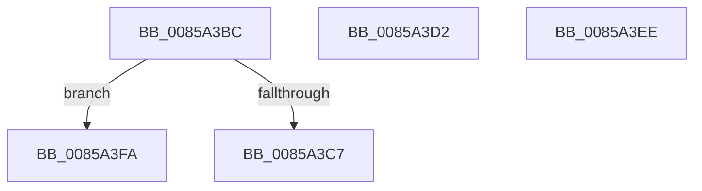

# sub_0085A3BC

- RVA: `0x0085A3BC`–`0x0085A404` (길이 `72` bytes)
- VA: `0x000000014085A3BC`
- 실행 섹션: `PAGE`
- PDB 이름 있음: `아니요`; PDB Function 태그: `아니요`
- unwind 정보 RVA: `0x0006AC70`
- 디코드: `18`개 명령, `72/72` bytes 표시
- 미해석 바이트: `0` (있으면 어셈블리에 `.byte`로 보존)

> 이 문서는 커널 이미지의 기계어와 PDB 기호를 분석해 생성했습니다. 4번과 5번은 함수 원형과 자료형을 바이너리 사용 방식에서 추정한 C 해석이며 원본 소스 복구 결과는 아닙니다.

## 1. Dependencies

- 직접 호출 지점: **1**; 고유 호출 대상: **1**
- 직접 호출자로 확인된 함수: **0**
- RIP 상대 이미지 참조: **0**

### Outgoing calls
- `0x0085A3E7` → [RtlSetBits](../../text/3E/RtlSetBits_function_003E1610.md) (function, `0x003E1610`)

### Direct callers
- 이 함수 시작 RVA로 연결되는 직접 call은 확인되지 않았습니다. 간접 호출은 완전히 역산할 수 없습니다.

### Static image references
- 디코드된 RIP-relative 메모리 참조가 없습니다.

## 2. Other-region calls and transfers

- 다른 실행 섹션으로 향하는 call: **1**
  - `0x0085A3E7` → [RtlSetBits](../../text/3E/RtlSetBits_function_003E1610.md) (`PAGE` → `.text`)
- call이 아닌 외부 분기/꼬리 이동: **4**
  - `0x0085A3CD` → [sub_0085A2AA + 0x6D](Unknown_function_0085A2AA.md) (`tail-transfer`)
  - `0x0085A3EC` → [sub_0085A2AA + 0xF0](Unknown_function_0085A2AA.md) (`tail-transfer`)
  - `0x0085A3F8` → [sub_0085A2AA + 0xF0](Unknown_function_0085A2AA.md) (`tail-transfer`)
  - `0x0085A3FF` → [sub_0085A2AA + 0x6D](Unknown_function_0085A2AA.md) (`tail-transfer`)

## 3. Assembly (complete function range)

```asm
0085A3BC  C1 E9 04                        shr ecx, 4
0085A3BF  81 F9 FF 00 00 00               cmp ecx, 0xff
0085A3C5  77 33                           ja 0x14085a3fa
0085A3C7  0F BD C9                        bsr ecx, ecx
0085A3CA  83 C1 10                        add ecx, 0x10
0085A3CD  E9 45 FF FF FF                  jmp 0x14085a317
0085A3D2  09 9E 88 03 00 00               or dword ptr [rsi + 0x388], ebx
0085A3D8  44 89 B7 3C 01 00 00            mov dword ptr [rdi + 0x13c], r14d
0085A3DF  45 8B 45 08                     mov r8d, dword ptr [r13 + 8]
0085A3E3  41 C1 E8 0C                     shr r8d, 0xc
0085A3E7  E8 24 72 B8 FF                  call 0x1403e1610
0085A3EC  EB AC                           jmp 0x14085a39a
0085A3EE  F7 D3                           not ebx
0085A3F0  23 D9                           and ebx, ecx
0085A3F2  89 9E 88 03 00 00               mov dword ptr [rsi + 0x388], ebx
0085A3F8  EB A0                           jmp 0x14085a39a
0085A3FA  B9 17 00 00 00                  mov ecx, 0x17
0085A3FF  E9 13 FF FF FF                  jmp 0x14085a317
```

## 4. C-style interpretation (structured pseudocode)

```c
__int64 __fastcall sub_0085A3BC(int a1)
{
    a1 = (unsigned int)((a1) >> (4));
    if (a1 > 255) goto loc_0085A3FA;
    a1 = (unsigned int)((a1) + (16));
loc_0085A3FA:
}
```

## 5. (Beta) C Style

```c
int64_t sub_0085A3BC(int32_t Arg1)
{
    Arg1 = (uint32_t)((Arg1) >> (4));
    if (Arg1 > 255) goto loc_0085A3FA;
    Arg1 = (uint32_t)((Arg1) + (16));
loc_0085A3FA:
}
```

## 6. Execution-region graph

[열기: 2D/3D 그래프와 함수 탐색 컨트롤 패널](../../../control-panel.html?section=page&rva=0x0085A3BC&view=graph)

- 2D 그래프는 위에서 아래로 흐르고, 3D 그래프는 빈 공간을 드래그해 회전합니다. Shift+드래그는 이동, 휠은 확대·축소, 함수 노드 선택은 대상 보고서 이동입니다.

### Static fallback


