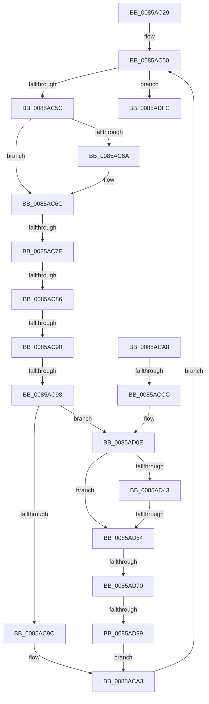

# sub_0085AC29

- RVA: `0x0085AC29`–`0x0085AE2A` (길이 `513` bytes)
- VA: `0x000000014085AC29`
- 실행 섹션: `PAGE`
- PDB 이름 있음: `아니요`; PDB Function 태그: `아니요`
- unwind 정보 RVA: `0x0006AD3C`
- 디코드: `130`개 명령, `513/513` bytes 표시
- 미해석 바이트: `0` (있으면 어셈블리에 `.byte`로 보존)

> 이 문서는 커널 이미지의 기계어와 PDB 기호를 분석해 생성했습니다. 4번과 5번은 함수 원형과 자료형을 바이너리 사용 방식에서 추정한 C 해석이며 원본 소스 복구 결과는 아닙니다.

## 1. Dependencies

- 직접 호출 지점: **9**; 고유 호출 대상: **7**
- 직접 호출자로 확인된 함수: **0**
- RIP 상대 이미지 참조: **0**

### Outgoing calls
- `0x0085ACBB` → [HvpMarkDirty](HvpMarkDirty_function_008593C0.md) (function, `0x008593C0`)
- `0x0085ACD2` → [memset](../../text/6C/memset_function_006C6C40.md) (function, `0x006C6C40`)
- `0x0085AD06` → [SetFailureLocation](../../text/46/SetFailureLocation_function_0046EF54.md) (function, `0x0046EF54`)
- `0x0085AD1E` → [HvpGetCellMap](../../pagecmrc/BC/HvpGetCellMap_function_00BC9710.md) (function, `0x00BC9710`)
- `0x0085AD32` → [HvpGetCellMap](../../pagecmrc/BC/HvpGetCellMap_function_00BC9710.md) (function, `0x00BC9710`)
- `0x0085AD81` → [HvpGetBinContextInitialize](../../pagecmrc/BC/HvpGetBinContextInitialize_function_00BC98D0.md) (function, `0x00BC98D0`)
- `0x0085AD8B` → [HvpGetCellMap](../../pagecmrc/BC/HvpGetCellMap_function_00BC9710.md) (function, `0x00BC9710`)
- `0x0085ADA4` → [HvpMapEntryGetBinAddress](../../pagecmrc/BC/HvpMapEntryGetBinAddress_function_00BC9770.md) (function, `0x00BC9770`)
- `0x0085ADCB` → [RtlSetBits](../../text/3E/RtlSetBits_function_003E1610.md) (function, `0x003E1610`)

### Direct callers
- 이 함수 시작 RVA로 연결되는 직접 call은 확인되지 않았습니다. 간접 호출은 완전히 역산할 수 없습니다.

### Static image references
- 디코드된 RIP-relative 메모리 참조가 없습니다.

## 2. Other-region calls and transfers

- 다른 실행 섹션으로 향하는 call: **8**
  - `0x0085ACD2` → [memset](../../text/6C/memset_function_006C6C40.md) (`PAGE` → `.text`)
  - `0x0085AD06` → [SetFailureLocation](../../text/46/SetFailureLocation_function_0046EF54.md) (`PAGE` → `.text`)
  - `0x0085AD1E` → [HvpGetCellMap](../../pagecmrc/BC/HvpGetCellMap_function_00BC9710.md) (`PAGE` → `PAGECMRC`)
  - `0x0085AD32` → [HvpGetCellMap](../../pagecmrc/BC/HvpGetCellMap_function_00BC9710.md) (`PAGE` → `PAGECMRC`)
  - `0x0085AD81` → [HvpGetBinContextInitialize](../../pagecmrc/BC/HvpGetBinContextInitialize_function_00BC98D0.md) (`PAGE` → `PAGECMRC`)
  - `0x0085AD8B` → [HvpGetCellMap](../../pagecmrc/BC/HvpGetCellMap_function_00BC9710.md) (`PAGE` → `PAGECMRC`)
  - `0x0085ADA4` → [HvpMapEntryGetBinAddress](../../pagecmrc/BC/HvpMapEntryGetBinAddress_function_00BC9770.md) (`PAGE` → `PAGECMRC`)
  - `0x0085ADCB` → [RtlSetBits](../../text/3E/RtlSetBits_function_003E1610.md) (`PAGE` → `.text`)
- call이 아닌 외부 분기/꼬리 이동: **8**
  - `0x0085AC78` → [sub_0085AE2B + 0x1E](Unknown_function_0085AE2B.md) (`tail-transfer`)
  - `0x0085AC80` → [sub_0085AE2B + 0x1E](Unknown_function_0085AE2B.md) (`tail-transfer`)
  - `0x0085AC8A` → [sub_0085AE2B + 0x1E](Unknown_function_0085AE2B.md) (`tail-transfer`)
  - `0x0085AC92` → [sub_0085AE2B + 0x1E](Unknown_function_0085AE2B.md) (`tail-transfer`)
  - `0x0085ACC6` → [sub_0085AE2B + 0x149](Unknown_function_0085AE2B.md) (`tail-transfer`)
  - `0x0085AD4E` → [sub_0085AE2B + 0x85](Unknown_function_0085AE2B.md) (`tail-transfer`)
  - `0x0085AD6A` → [sub_0085AE2B](Unknown_function_0085AE2B.md) (`tail-transfer`)
  - `0x0085AD93` → [sub_0085AE2B + 0x12C](Unknown_function_0085AE2B.md) (`tail-transfer`)

## 3. Assembly (complete function range)

```asm
0085AC29  48 89 74 24 50                  mov qword ptr [rsp + 0x50], rsi
0085AC2E  45 33 D2                        xor r10d, r10d
0085AC31  4C 89 6C 24 30                  mov qword ptr [rsp + 0x30], r13
0085AC36  4C 8B F9                        mov r15, rcx
0085AC39  C6 84 24 90 00 00 00 00         mov byte ptr [rsp + 0x90], 0
0085AC41  41 BE 20 00 00 00               mov r14d, 0x20
0085AC47  48 89 7C 24 48                  mov qword ptr [rsp + 0x48], rdi
0085AC4C  0F 1F 40 00                     nop dword ptr [rax]
0085AC50  8B 4D 08                        mov ecx, dword ptr [rbp + 8]
0085AC53  44 3B F1                        cmp r14d, ecx
0085AC56  0F 83 A0 01 00 00               jae 0x14085adfc
0085AC5C  41 8B DE                        mov ebx, r14d
0085AC5F  48 03 DD                        add rbx, rbp
0085AC62  8B 03                           mov eax, dword ptr [rbx]
0085AC64  8B F0                           mov esi, eax
0085AC66  85 C0                           test eax, eax
0085AC68  79 02                           jns 0x14085ac6c
0085AC6A  F7 DE                           neg esi
0085AC6C  C1 E8 1F                        shr eax, 0x1f
0085AC6F  42 8D 14 36                     lea edx, [rsi + r14]
0085AC73  34 01                           xor al, 1
0085AC75  41 3B D6                        cmp edx, r14d
0085AC78  0F 82 CB 01 00 00               jb 0x14085ae49
0085AC7E  3B D1                           cmp edx, ecx
0085AC80  0F 87 C3 01 00 00               ja 0x14085ae49
0085AC86  40 F6 C6 07                     test sil, 7
0085AC8A  0F 85 B9 01 00 00               jne 0x14085ae49
0085AC90  85 F6                           test esi, esi
0085AC92  0F 84 B1 01 00 00               je 0x14085ae49
0085AC98  84 C0                           test al, al
0085AC9A  75 72                           jne 0x14085ad0e
0085AC9C  41 01 B7 98 00 00 00            add dword ptr [r15 + 0x98], esi
0085ACA3  44 03 F6                        add r14d, esi
0085ACA6  EB A8                           jmp 0x14085ac50
0085ACA8  8B 75 08                        mov esi, dword ptr [rbp + 8]
0085ACAB  43 8D 14 26                     lea edx, [r14 + r12]
0085ACAF  41 2B F6                        sub esi, r14d
0085ACB2  45 33 C9                        xor r9d, r9d
0085ACB5  44 8B C6                        mov r8d, esi
0085ACB8  49 8B CF                        mov rcx, r15
0085ACBB  E8 00 E7 FF FF                  call 0x1408593c0
0085ACC0  33 D2                           xor edx, edx
0085ACC2  8B F8                           mov edi, eax
0085ACC4  85 C0                           test eax, eax
0085ACC6  0F 88 A8 02 00 00               js 0x14085af74
0085ACCC  44 8B C6                        mov r8d, esi
0085ACCF  48 8B CB                        mov rcx, rbx
0085ACD2  E8 69 BF E6 FF                  call 0x1406c6c40
0085ACD7  89 33                           mov dword ptr [rbx], esi
0085ACD9  BA 01 00 00 00                  mov edx, 1
0085ACDE  49 8B 47 40                     mov rax, qword ptr [r15 + 0x40]
0085ACE2  41 B9 09 00 00 40               mov r9d, 0x40000009
0085ACE8  49 8B CD                        mov rcx, r13
0085ACEB  C6 84 24 90 00 00 00 01         mov byte ptr [rsp + 0x90], 1
0085ACF3  C7 44 24 20 20 00 00 00         mov dword ptr [rsp + 0x20], 0x20
0085ACFB  44 8D 42 19                     lea r8d, [rdx + 0x19]
0085ACFF  83 88 F8 0F 00 00 04            or dword ptr [rax + 0xff8], 4
0085AD06  E8 49 42 C1 FF                  call 0x14046ef54
0085AD0B  45 33 D2                        xor r10d, r10d
0085AD0E  41 01 B7 94 00 00 00            add dword ptr [r15 + 0x94], esi
0085AD15  43 8D 3C 26                     lea edi, [r14 + r12]
0085AD19  8B D7                           mov edx, edi
0085AD1B  49 8B CF                        mov rcx, r15
0085AD1E  E8 ED E9 36 00                  call 0x140bc9710
0085AD23  8B DF                           mov ebx, edi
0085AD25  49 8B CF                        mov rcx, r15
0085AD28  81 E3 00 F0 FF FF               and ebx, 0xfffff000
0085AD2E  2B 18                           sub ebx, dword ptr [rax]
0085AD30  8B D3                           mov edx, ebx
0085AD32  E8 D9 E9 36 00                  call 0x140bc9710
0085AD37  44 8B 60 10                     mov r12d, dword ptr [rax + 0x10]
0085AD3B  45 8D 2C 1C                     lea r13d, [r12 + rbx]
0085AD3F  85 DB                           test ebx, ebx
0085AD41  74 11                           je 0x14085ad54
0085AD43  8B CB                           mov ecx, ebx
0085AD45  48 83 C1 20                     add rcx, 0x20
0085AD49  8B C7                           mov eax, edi
0085AD4B  48 3B C1                        cmp rax, rcx
0085AD4E  0F 84 5C 01 00 00               je 0x14085aeb0
0085AD54  44 8B E6                        mov r12d, esi
0085AD57  44 89 94 24 98 00 00 00         mov dword ptr [rsp + 0x98], r10d
0085AD5F  41 C1 EC 03                     shr r12d, 3
0085AD63  41 FF CC                        dec r12d
0085AD66  41 83 FC 10                     cmp r12d, 0x10
0085AD6A  0F 83 BB 00 00 00               jae 0x14085ae2b
0085AD70  48 8D 8C 24 98 00 00 00         lea rcx, [rsp + 0x98]
0085AD78  66 44 89 94 24 98 00 00 00      mov word ptr [rsp + 0x98], r10w
0085AD81  E8 4A EB 36 00                  call 0x140bc98d0
0085AD86  8B D7                           mov edx, edi
0085AD88  49 8B CF                        mov rcx, r15
0085AD8B  E8 80 E9 36 00                  call 0x140bc9710
0085AD90  48 85 C0                        test rax, rax
0085AD93  0F 84 BE 01 00 00               je 0x14085af57
0085AD99  4C 8D 84 24 98 00 00 00         lea r8, [rsp + 0x98]
0085ADA1  48 8B D0                        mov rdx, rax
0085ADA4  E8 C7 E9 36 00                  call 0x140bc9770
0085ADA9  41 8B D4                        mov edx, r12d
0085ADAC  8B 78 04                        mov edi, dword ptr [rax + 4]
0085ADAF  4C 8D 04 52                     lea r8, [rdx + rdx*2]
0085ADB3  C1 EF 0C                        shr edi, 0xc
0085ADB6  4B 8D 1C C7                     lea rbx, [r15 + r8*8]
0085ADBA  8B D7                           mov edx, edi
0085ADBC  44 8B 40 08                     mov r8d, dword ptr [rax + 8]
0085ADC0  48 8D 8B 40 01 00 00            lea rcx, [rbx + 0x140]
0085ADC7  41 C1 E8 0C                     shr r8d, 0xc
0085ADCB  E8 40 68 B8 FF                  call 0x1403e1610
0085ADD0  4C 8B 6C 24 30                  mov r13, qword ptr [rsp + 0x30]
0085ADD5  41 8B CC                        mov ecx, r12d
0085ADD8  44 8B A4 24 A0 00 00 00         mov r12d, dword ptr [rsp + 0xa0]
0085ADE0  B8 01 00 00 00                  mov eax, 1
0085ADE5  D3 E0                           shl eax, cl
0085ADE7  89 BB 3C 01 00 00               mov dword ptr [rbx + 0x13c], edi
0085ADED  41 09 87 88 03 00 00            or dword ptr [r15 + 0x388], eax
0085ADF4  45 33 D2                        xor r10d, r10d
0085ADF7  E9 A7 FE FF FF                  jmp 0x14085aca3
0085ADFC  80 BC 24 90 00 00 00 00         cmp byte ptr [rsp + 0x90], 0
0085AE04  41 8B FA                        mov edi, r10d
0085AE07  B8 09 00 00 40                  mov eax, 0x40000009
0085AE0C  0F 45 F8                        cmovne edi, eax
0085AE0F  48 8B 74 24 50                  mov rsi, qword ptr [rsp + 0x50]
0085AE14  8B C7                           mov eax, edi
0085AE16  48 8B 7C 24 48                  mov rdi, qword ptr [rsp + 0x48]
0085AE1B  48 83 C4 58                     add rsp, 0x58
0085AE1F  41 5F                           pop r15
0085AE21  41 5E                           pop r14
0085AE23  41 5D                           pop r13
0085AE25  41 5C                           pop r12
0085AE27  5D                              pop rbp
0085AE28  5B                              pop rbx
0085AE29  C3                              ret
```

## 4. C-style interpretation (structured pseudocode)

```c
__int64 __fastcall sub_0085AC29(__int64 a1, __int64 a2, __int64 a3, int a4, __int64 a5, __int64 a6, __int64 a7, __int64 a8, __int64 a9, __int64 a10, __int64 a11, __int64 a12, __int64 a13, __int64 a14, __int64 a15, __int64 a16, __int64 a17, unsigned __int8 a18, __int64 a19, unsigned int a20)
{
    __int64 result;
    __int64 v_r10;
    __int64 v_r12;
    __int64 v_r14;
    __int64 v_rbx;
    __int64 v_rdi;
    __int64 v_rsi;
    __int64 v_rsp;
    unsigned int v_stack_p20;
    unsigned __int64 v_stack_p30;
    unsigned __int64 v_stack_p48;
    unsigned __int64 v_stack_p50;
    unsigned __int8 v_stack_p90;
    unsigned int v_stack_p98;

    v_stack_p50 = v_rsi;
    v_r10 = 0;
    v_stack_p30 = v_r13;
    v_stack_p90 = 0;
    v_stack_p48 = v_rdi;
loc_0085AC50:
    if (32 >= ((unsigned int)((unsigned int)(*(unsigned int *)(v_rbp + 8))))) goto loc_0085ADFC;
    v_rbx = (32) + (v_rbp);
    v_rsi = (unsigned int)((unsigned int)((unsigned int)(*(unsigned int *)(v_rbx))));
    if (sign_flag) {
        v_rsi = (unsigned int)(-((unsigned int)((unsigned int)((unsigned int)(*(unsigned int *)(v_rbx))))));
    }
    result = (unsigned int)(((unsigned int)(*(unsigned int *)(v_rbx))) >> (31));
    result = (unsigned __int8)((result) ^ (1));
    if ((unsigned __int8)(result) != 0) goto loc_0085AD0E;
loc_0085ACA3:
    v_r14 = (unsigned int)((32) + ((unsigned int)(v_rsi)));
    goto loc_0085AC50;
loc_0085AD0E:
    result = HvpGetCellMap(a1, (unsigned int)((unsigned int)(v_r14 + v_r12 * 1)), a3, a4);
    v_rbx = (unsigned int)(((unsigned int)((unsigned int)(v_r14 + v_r12 * 1))) & (0xFFFFF000ULL));
    v_rbx = (unsigned int)((v_rbx) - (*(unsigned int *)(result)));
    result = HvpGetCellMap(a1, (unsigned int)((unsigned int)(v_rbx)), a3, a4);
    if ((unsigned int)(v_rbx) == 0) goto loc_0085AD54;
    a1 = ((unsigned int)((unsigned int)(v_rbx))) + (32);
loc_0085AD54:
    v_stack_p98 = 0;
    v_r12 = (unsigned int)(((unsigned int)((unsigned int)(v_rsi))) >> (3));
    v_r12 = (unsigned int)((v_r12) - 1);
    v_stack_p98 = 0;
    result = HvpGetBinContextInitialize(a19, (unsigned int)((unsigned int)(v_rbx)), a3, a4);
    result = HvpGetCellMap(a1, (unsigned int)((unsigned int)(v_r14 + v_r12 * 1)), a3, a4);
    result = HvpMapEntryGetBinAddress(a1, result, a19, a4);
    v_rdi = (unsigned int)(((unsigned int)(*(unsigned int *)(result + 4))) >> (12));
    a3 = (unsigned int)(((unsigned int)(*(unsigned int *)(result + 8))) >> (12));
    result = RtlSetBits(a1 + (unsigned int)((unsigned int)(v_r12)) + (unsigned int)((unsigned int)(v_r12)) * 2 * 8 + 320, (unsigned int)((unsigned int)(v_rdi)), a3, a4);
    result = (unsigned int)((1) << ((unsigned __int8)((unsigned int)((unsigned int)(v_r12)))));
    *(unsigned int *)(a1 + (unsigned int)((unsigned int)(v_r12)) + (unsigned int)((unsigned int)(v_r12)) * 2 * 8 + 316) = (unsigned int)(v_rdi);
    v_r10 = 0;
    goto loc_0085ACA3;
loc_0085ADFC:
    v_rdi = 0;
    if (a18 != 0) { v_rdi = (unsigned int)((unsigned int)(0x40000009ULL)); }
    v_rsp = (v_rsp) + (88);
    return (unsigned int)((unsigned int)(v_rdi));
}
```

## 5. (Beta) C Style

```c
int64_t sub_0085AC29(void *Arg1, int64_t Arg2, int64_t Arg3, int32_t Arg4, uint64_t Arg5, int64_t Arg6, uint64_t Arg7, uint64_t Arg8, int64_t Arg9, int64_t Arg10, uint64_t Arg11, uint64_t Arg12, uint64_t Arg13, uint64_t Arg14, uint64_t Arg15, uint64_t Arg16, uint64_t Arg17, uint8_t Arg18, int64_t Arg19, uint32_t Arg20)
{
    uint8_t *arg1 = (uint8_t *)Arg1;

    int64_t result;
    int64_t local_r10;
    int64_t local_r12;
    int64_t local_r14;
    int64_t local_rbx;
    int64_t local_rdi;
    int64_t local_rsi;
    int64_t local_rsp;
    uint32_t v_stack_p20;
    uint64_t v_stack_p30;
    uint64_t v_stack_p48;
    uint64_t v_stack_p50;
    uint8_t v_stack_p90;
    uint32_t v_stack_p98;

    v_stack_p50 = local_rsi;
    local_r10 = 0;
    v_stack_p30 = local_r13;
    v_stack_p90 = 0;
    v_stack_p48 = local_rdi;
loc_0085AC50:
    if (32 >= ((uint32_t)((uint32_t)(*(uint32_t *)(local_rbp + 0x8))))) goto loc_0085ADFC;
    local_rbx = (32) + (local_rbp);
    local_rsi = (uint32_t)((uint32_t)((uint32_t)(*(uint32_t *)(local_rbx))));
    if (sign_flag) {
        local_rsi = (uint32_t)(-((uint32_t)((uint32_t)((uint32_t)(*(uint32_t *)(local_rbx))))));
    }
    result = (uint32_t)(((uint32_t)(*(uint32_t *)(local_rbx))) >> (31));
    result = (uint8_t)((result) ^ (1));
    if ((uint8_t)(result) != 0) goto loc_0085AD0E;
loc_0085ACA3:
    local_r14 = (uint32_t)((32) + ((uint32_t)(local_rsi)));
    goto loc_0085AC50;
loc_0085AD0E:
    result = HvpGetCellMap(Arg1, (uint32_t)((uint32_t)(local_r14 + local_r12 * 1)), Arg3, Arg4);
    local_rbx = (uint32_t)(((uint32_t)((uint32_t)(local_r14 + local_r12 * 1))) & (0xFFFFF000ULL));
    local_rbx = (uint32_t)((local_rbx) - (*(uint32_t *)(result)));
    result = HvpGetCellMap(Arg1, (uint32_t)((uint32_t)(local_rbx)), Arg3, Arg4);
    if ((uint32_t)(local_rbx) == 0) goto loc_0085AD54;
    Arg1 = ((uint32_t)((uint32_t)(local_rbx))) + (32);
loc_0085AD54:
    v_stack_p98 = 0;
    local_r12 = (uint32_t)(((uint32_t)((uint32_t)(local_rsi))) >> (3));
    local_r12 = (uint32_t)((local_r12) - 1);
    v_stack_p98 = 0;
    result = HvpGetBinContextInitialize(Arg19, (uint32_t)((uint32_t)(local_rbx)), Arg3, Arg4);
    result = HvpGetCellMap(Arg1, (uint32_t)((uint32_t)(local_r14 + local_r12 * 1)), Arg3, Arg4);
    result = HvpMapEntryGetBinAddress(Arg1, result, Arg19, Arg4);
    local_rdi = (uint32_t)(((uint32_t)(*(uint32_t *)(result + 0x4))) >> (12));
    Arg3 = (uint32_t)(((uint32_t)(*(uint32_t *)(result + 0x8))) >> (12));
    result = RtlSetBits(Arg1 + (uint32_t)((uint32_t)(local_r12)) + (uint32_t)((uint32_t)(local_r12)) * 2 * 8 + 320, (uint32_t)((uint32_t)(local_rdi)), Arg3, Arg4);
    result = (uint32_t)((1) << ((uint8_t)((uint32_t)((uint32_t)(local_r12)))));
    *(uint32_t *)(arg1 + (uint32_t)((uint32_t)(local_r12)) + (uint32_t)((uint32_t)(local_r12)) * 2 * 8 + 0x13C) = (uint32_t)(local_rdi);
    local_r10 = 0;
    goto loc_0085ACA3;
loc_0085ADFC:
    local_rdi = 0;
    if (Arg18 != 0) { local_rdi = (uint32_t)((uint32_t)(0x40000009ULL)); }
    local_rsp = (local_rsp) + (88);
    return (uint32_t)((uint32_t)(local_rdi));
}
```

### 관측된 메모리 오프셋

구조체 형식이 확인되지 않은 접근은 인자 기준의 오프셋으로만 기록했습니다.

| 기준 인자 | 오프셋 표현 | 폭 (bit) | 접근 |
|---|---:|---:|---|
| `Arg1` | `+ 0x0 + r8*8` | `64` | `R` |
| `Arg1` | `+ 0x94` | `32` | `R/W` |
| `Arg1` | `+ 0x98` | `32` | `R/W` |
| `Arg1` | `+ 0x13C` | `32` | `W` |
| `Arg1` | `+ 0x140` | `64` | `R` |
| `Arg1` | `+ 0x388` | `32` | `R/W` |

## 6. Execution-region graph

[열기: 2D/3D 그래프와 함수 탐색 컨트롤 패널](../../../control-panel.html?section=page&rva=0x0085AC29&view=graph)

- 2D 그래프는 위에서 아래로 흐르고, 3D 그래프는 빈 공간을 드래그해 회전합니다. Shift+드래그는 이동, 휠은 확대·축소, 함수 노드 선택은 대상 보고서 이동입니다.

### Static fallback


