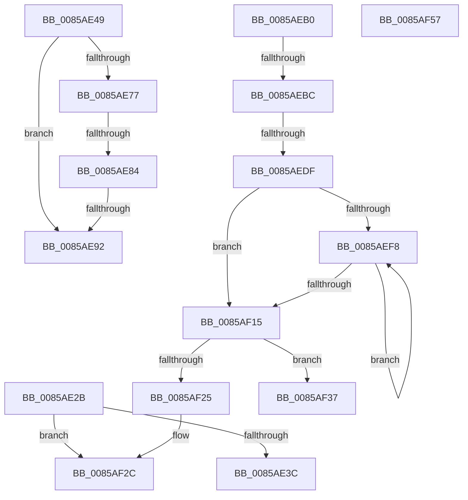

# sub_0085AE2B

- RVA: `0x0085AE2B`–`0x0085AF92` (길이 `359` bytes)
- VA: `0x000000014085AE2B`
- 실행 섹션: `PAGE`
- PDB 이름 있음: `아니요`; PDB Function 태그: `아니요`
- unwind 정보 RVA: `0x0006AD6C`
- 디코드: `83`개 명령, `359/359` bytes 표시
- 미해석 바이트: `0` (있으면 어셈블리에 `.byte`로 보존)

> 이 문서는 커널 이미지의 기계어와 PDB 기호를 분석해 생성했습니다. 4번과 5번은 함수 원형과 자료형을 바이너리 사용 방식에서 추정한 C 해석이며 원본 소스 복구 결과는 아닙니다.

## 1. Dependencies

- 직접 호출 지점: **6**; 고유 호출 대상: **4**
- 직접 호출자로 확인된 함수: **0**
- RIP 상대 이미지 참조: **2**

### Outgoing calls
- `0x0085AE65` → [SetFailureLocation](../../text/46/SetFailureLocation_function_0046EF54.md) (function, `0x0046EF54`)
- `0x0085AEA6` → [SetFailureLocation](../../text/46/SetFailureLocation_function_0046EF54.md) (function, `0x0046EF54`)
- `0x0085AECB` → [guard_dispatch_icall](../../text/6B/guard_dispatch_icall_function_006BAAD0.md) (function, `0x006BAAD0`)
- `0x0085AEFD` → [HvpGetCellMap](../../pagecmrc/BC/HvpGetCellMap_function_00BC9710.md) (function, `0x00BC9710`)
- `0x0085AF6E` → [KeBugCheckEx](../../text/4F/KeBugCheckEx_function_004FD660.md) (function, `0x004FD660`)
- `0x0085AF88` → [SetFailureLocation](../../text/46/SetFailureLocation_function_0046EF54.md) (function, `0x0046EF54`)

### Direct callers
- 이 함수 시작 RVA로 연결되는 직접 call은 확인되지 않았습니다. 간접 호출은 완전히 역산할 수 없습니다.

### Static image references
- `0x0085AE77` → RVA `0x00FD8002` (`PAGEDATA`; read)
- `0x0085AE84` → RVA `0x00EF7C60` (`.data`; read)

## 2. Other-region calls and transfers

- 다른 실행 섹션으로 향하는 call: **6**
  - `0x0085AE65` → [SetFailureLocation](../../text/46/SetFailureLocation_function_0046EF54.md) (`PAGE` → `.text`)
  - `0x0085AEA6` → [SetFailureLocation](../../text/46/SetFailureLocation_function_0046EF54.md) (`PAGE` → `.text`)
  - `0x0085AECB` → [guard_dispatch_icall](../../text/6B/guard_dispatch_icall_function_006BAAD0.md) (`PAGE` → `.text`)
  - `0x0085AEFD` → [HvpGetCellMap](../../pagecmrc/BC/HvpGetCellMap_function_00BC9710.md) (`PAGE` → `PAGECMRC`)
  - `0x0085AF6E` → [KeBugCheckEx](../../text/4F/KeBugCheckEx_function_004FD660.md) (`PAGE` → `.text`)
  - `0x0085AF88` → [SetFailureLocation](../../text/46/SetFailureLocation_function_0046EF54.md) (`PAGE` → `.text`)
- call이 아닌 외부 분기/꼬리 이동: **9**
  - `0x0085AE44` → [sub_0085AC29 + 0x147](Unknown_function_0085AC29.md) (`tail-transfer`)
  - `0x0085AE7E` → [sub_0085AC29 + 0x7F](Unknown_function_0085AC29.md) (`tail-transfer`)
  - `0x0085AE8C` → [sub_0085AC29 + 0x7F](Unknown_function_0085AC29.md) (`tail-transfer`)
  - `0x0085AEAB` → [sub_0085AC29 + 0x1E6](Unknown_function_0085AC29.md) (`tail-transfer`)
  - `0x0085AEB6` → [sub_0085AC29 + 0x12B](Unknown_function_0085AC29.md) (`tail-transfer`)
  - `0x0085AED9` → [sub_0085AC29 + 0x12B](Unknown_function_0085AC29.md) (`tail-transfer`)
  - `0x0085AF32` → [sub_0085AC29 + 0x147](Unknown_function_0085AC29.md) (`tail-transfer`)
  - `0x0085AF52` → [sub_0085AC29 + 0x7A](Unknown_function_0085AC29.md) (`tail-transfer`)
  - `0x0085AF8D` → [sub_0085AC29 + 0x1E6](Unknown_function_0085AC29.md) (`tail-transfer`)

## 3. Assembly (complete function range)

```asm
0085AE2B  41 C1 EC 04                     shr r12d, 4
0085AE2F  41 81 FC FF 00 00 00            cmp r12d, 0xff
0085AE36  0F 87 F0 00 00 00               ja 0x14085af2c
0085AE3C  45 0F BD E4                     bsr r12d, r12d
0085AE40  41 83 C4 10                     add r12d, 0x10
0085AE44  E9 27 FF FF FF                  jmp 0x14085ad70
0085AE49  BA 01 00 00 00                  mov edx, 1
0085AE4E  C7 44 24 20 08 00 00 00         mov dword ptr [rsp + 0x20], 8
0085AE56  BF 4C 01 00 C0                  mov edi, 0xc000014c
0085AE5B  49 8B CD                        mov rcx, r13
0085AE5E  44 8B CF                        mov r9d, edi
0085AE61  44 8D 42 19                     lea r8d, [rdx + 0x19]
0085AE65  E8 EA 40 C1 FF                  call 0x14046ef54
0085AE6A  F7 84 24 A8 00 00 00 00 00 02 00  test dword ptr [rsp + 0xa8], 0x20000
0085AE75  75 1B                           jne 0x14085ae92
0085AE77  80 3D 84 D1 77 00 00            cmp byte ptr [rip + 0x77d184], 0
0085AE7E  0F 85 24 FE FF FF               jne 0x14085aca8
0085AE84  8B 05 D6 CD 69 00               mov eax, dword ptr [rip + 0x69cdd6]
0085AE8A  A8 06                           test al, 6
0085AE8C  0F 85 16 FE FF FF               jne 0x14085aca8
0085AE92  33 D2                           xor edx, edx
0085AE94  C7 44 24 20 00 00 00 00         mov dword ptr [rsp + 0x20], 0
0085AE9C  44 8B CF                        mov r9d, edi
0085AE9F  49 8B CD                        mov rcx, r13
0085AEA2  44 8D 42 1A                     lea r8d, [rdx + 0x1a]
0085AEA6  E8 A9 40 C1 FF                  call 0x14046ef54
0085AEAB  E9 5F FF FF FF                  jmp 0x14085ae0f
0085AEB0  8D 04 37                        lea eax, [rdi + rsi]
0085AEB3  41 3B C5                        cmp eax, r13d
0085AEB6  0F 85 98 FE FF FF               jne 0x14085ad54
0085AEBC  49 8B 47 18                     mov rax, qword ptr [r15 + 0x18]
0085AEC0  33 D2                           xor edx, edx
0085AEC2  41 B8 43 4D 37 20               mov r8d, 0x20374d43
0085AEC8  8D 4A 18                        lea ecx, [rdx + 0x18]
0085AECB  E8 00 FC E5 FF                  call 0x1406baad0
0085AED0  45 33 D2                        xor r10d, r10d
0085AED3  4C 8B C0                        mov r8, rax
0085AED6  48 85 C0                        test rax, rax
0085AED9  0F 84 75 FE FF FF               je 0x14085ad54
0085AEDF  4C 89 10                        mov qword ptr [rax], r10
0085AEE2  8B CB                           mov ecx, ebx
0085AEE4  0F BA F1 1F                     btr ecx, 0x1f
0085AEE8  4C 89 50 08                     mov qword ptr [rax + 8], r10
0085AEEC  44 89 60 10                     mov dword ptr [rax + 0x10], r12d
0085AEF0  89 48 14                        mov dword ptr [rax + 0x14], ecx
0085AEF3  41 3B DD                        cmp ebx, r13d
0085AEF6  73 1D                           jae 0x14085af15
0085AEF8  8B D3                           mov edx, ebx
0085AEFA  49 8B CF                        mov rcx, r15
0085AEFD  E8 0E E8 36 00                  call 0x140bc9710
0085AF02  81 C3 00 10 00 00               add ebx, 0x1000
0085AF08  48 83 48 08 02                  or qword ptr [rax + 8], 2
0085AF0D  4C 89 00                        mov qword ptr [rax], r8
0085AF10  41 3B DD                        cmp ebx, r13d
0085AF13  72 E3                           jb 0x14085aef8
0085AF15  49 8D 87 78 03 00 00            lea rax, [r15 + 0x378]
0085AF1C  48 8B 08                        mov rcx, qword ptr [rax]
0085AF1F  48 39 41 08                     cmp qword ptr [rcx + 8], rax
0085AF23  74 12                           je 0x14085af37
0085AF25  B9 03 00 00 00                  mov ecx, 3
0085AF2A  CD 29                           int 0x29
0085AF2C  41 BC 17 00 00 00               mov r12d, 0x17
0085AF32  E9 39 FE FF FF                  jmp 0x14085ad70
0085AF37  4C 8B 6C 24 30                  mov r13, qword ptr [rsp + 0x30]
0085AF3C  44 8B A4 24 A0 00 00 00         mov r12d, dword ptr [rsp + 0xa0]
0085AF44  49 89 08                        mov qword ptr [r8], rcx
0085AF47  49 89 40 08                     mov qword ptr [r8 + 8], rax
0085AF4B  4C 89 41 08                     mov qword ptr [rcx + 8], r8
0085AF4F  4C 89 00                        mov qword ptr [rax], r8
0085AF52  E9 4C FD FF FF                  jmp 0x14085aca3
0085AF57  BA 01 00 00 00                  mov edx, 1
0085AF5C  44 8B CF                        mov r9d, edi
0085AF5F  4D 8B C7                        mov r8, r15
0085AF62  48 C7 44 24 20 B9 02 00 00      mov qword ptr [rsp + 0x20], 0x2b9
0085AF6B  8D 4A 50                        lea ecx, [rdx + 0x50]
0085AF6E  E8 ED 26 CA FF                  call 0x1404fd660
0085AF73  CC                              int3
0085AF74  44 8B C8                        mov r9d, eax
0085AF77  C7 44 24 20 10 00 00 00         mov dword ptr [rsp + 0x20], 0x10
0085AF7F  41 B8 1A 00 00 00               mov r8d, 0x1a
0085AF85  49 8B CD                        mov rcx, r13
0085AF88  E8 C7 3F C1 FF                  call 0x14046ef54
0085AF8D  E9 7D FE FF FF                  jmp 0x14085ae0f
```

## 4. C-style interpretation (structured pseudocode)

```c
__int64 __fastcall sub_0085AE2B(void)
{
    __int64 v_r12;
    unsigned int v_stack_p20;
    unsigned __int64 v_stack_p30;
    unsigned int v_stack_pA0;
    unsigned int v_stack_pA8;

    v_r12 = (unsigned int)((v_r12) >> (4));
    if (((unsigned int)(v_r12)) > 255) goto loc_0085AF2C;
    v_r12 = (unsigned int)((v_r12) + (16));
loc_0085AF2C:
}
```

## 5. (Beta) C Style

```c
void sub_0085AE2B(void)
{
    int64_t local_r12;
    uint32_t v_stack_p20;
    uint64_t v_stack_p30;
    uint32_t v_stack_pA0;
    uint32_t v_stack_pA8;

    local_r12 = (uint32_t)((local_r12) >> (4));
    if (((uint32_t)(local_r12)) > 255) goto loc_0085AF2C;
    local_r12 = (uint32_t)((local_r12) + (16));
loc_0085AF2C:
}
```

## 6. Execution-region graph

[열기: 2D/3D 그래프와 함수 탐색 컨트롤 패널](../../../control-panel.html?section=page&rva=0x0085AE2B&view=graph)

- 2D 그래프는 위에서 아래로 흐르고, 3D 그래프는 빈 공간을 드래그해 회전합니다. Shift+드래그는 이동, 휠은 확대·축소, 함수 노드 선택은 대상 보고서 이동입니다.

### Static fallback


