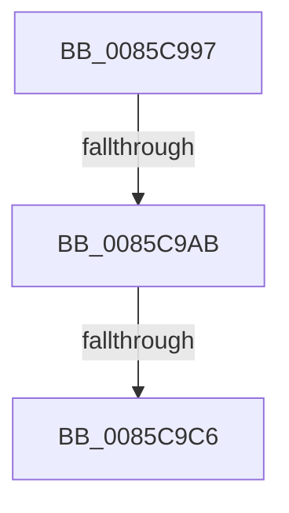

# sub_0085C997

- RVA: `0x0085C997`–`0x0085C9E8` (길이 `81` bytes)
- VA: `0x000000014085C997`
- 실행 섹션: `PAGE`
- PDB 이름 있음: `아니요`; PDB Function 태그: `아니요`
- unwind 정보 RVA: `0x0006AED8`
- 디코드: `19`개 명령, `81/81` bytes 표시
- 미해석 바이트: `0` (있으면 어셈블리에 `.byte`로 보존)

> 이 문서는 커널 이미지의 기계어와 PDB 기호를 분석해 생성했습니다. 4번과 5번은 함수 원형과 자료형을 바이너리 사용 방식에서 추정한 C 해석이며 원본 소스 복구 결과는 아닙니다.

## 1. Dependencies

- 직접 호출 지점: **0**; 고유 호출 대상: **0**
- 직접 호출자로 확인된 함수: **0**
- RIP 상대 이미지 참조: **0**

### Outgoing calls
- 직접 디코드된 call 명령이 없습니다.

### Direct callers
- 이 함수 시작 RVA로 연결되는 직접 call은 확인되지 않았습니다. 간접 호출은 완전히 역산할 수 없습니다.

### Static image references
- 디코드된 RIP-relative 메모리 참조가 없습니다.

## 2. Other-region calls and transfers

- 다른 실행 섹션으로 향하는 call: **0**
- call이 아닌 외부 분기/꼬리 이동: **3**
  - `0x0085C9A9` → [sub_0085CA0D](Unknown_function_0085CA0D.md) (`tail-transfer`)
  - `0x0085C9C0` → [sub_0085CAD4 + 0x7](Unknown_function_0085CAD4.md) (`tail-transfer`)
  - `0x0085C9E2` → [sub_0085CACA](Unknown_function_0085CACA.md) (`tail-transfer`)

## 3. Assembly (complete function range)

```asm
0085C997  48 89 74 24 50                  mov qword ptr [rsp + 0x50], rsi
0085C99C  44 89 74 24 58                  mov dword ptr [rsp + 0x58], r14d
0085C9A1  44 89 64 24 5C                  mov dword ptr [rsp + 0x5c], r12d
0085C9A6  66 39 03                        cmp word ptr [rbx], ax
0085C9A9  74 62                           je 0x14085ca0d
0085C9AB  0F B7 03                        movzx eax, word ptr [rbx]
0085C9AE  BA 6C 66 00 00                  mov edx, 0x666c
0085C9B3  66 2B C2                        sub ax, dx
0085C9B6  BA FF FD 00 00                  mov edx, 0xfdff
0085C9BB  66 85 C2                        test dx, ax
0085C9BE  8B C5                           mov eax, ebp
0085C9C0  0F 85 15 01 00 00               jne 0x14085cadb
0085C9C6  44 8B 74 C3 04                  mov r14d, dword ptr [rbx + rax*8 + 4]
0085C9CB  45 89 37                        mov dword ptr [r15], r14d
0085C9CE  F6 87 8C 00 00 00 01            test byte ptr [rdi + 0x8c], 1
0085C9D5  48 8D 54 24 68                  lea rdx, [rsp + 0x68]
0085C9DA  48 8B 74 24 50                  mov rsi, qword ptr [rsp + 0x50]
0085C9DF  48 8B CF                        mov rcx, rdi
0085C9E2  0F 85 E2 00 00 00               jne 0x14085caca
```

## 4. C-style interpretation (structured pseudocode)

```c
__int64 __fastcall sub_0085C997(__int64 a1, __int64 a2, __int64 a3, __int64 a4, __int64 a5, __int64 a6, __int64 a7, __int64 a8, __int64 a9, __int64 a10, __int64 a11, __int64 a12, __int64 a13)
{
    __int64 result;
    unsigned __int64 v_stack_p50;
    unsigned int v_stack_p58;
    unsigned int v_stack_p5C;

    v_stack_p50 = v_rsi;
    v_stack_p58 = (unsigned int)(v_r14);
    v_stack_p5C = (unsigned int)(v_r12);
    result = (unsigned __int16)((*(unsigned __int16 *)(v_rbx)) - ((unsigned __int16)((unsigned int)(0x666CULL))));
    *(unsigned int *)(v_r15) = (unsigned int)((unsigned int)(*(unsigned int *)(v_rbx + (unsigned int)((unsigned int)(v_rbp)) * 8 + 4)));
}
```

## 5. (Beta) C Style

```c
int64_t sub_0085C997(int64_t Arg1, int64_t Arg2, int64_t Arg3, int64_t Arg4, uint64_t Arg5, uint64_t Arg6, uint64_t Arg7, uint64_t Arg8, uint64_t Arg9, int64_t Arg10, uint64_t Arg11, uint64_t Arg12, int64_t Arg13)
{
    int64_t result;
    uint64_t v_stack_p50;
    uint32_t v_stack_p58;
    uint32_t v_stack_p5C;

    v_stack_p50 = local_rsi;
    v_stack_p58 = (uint32_t)(local_r14);
    v_stack_p5C = (uint32_t)(local_r12);
    result = (uint16_t)((*(uint16_t *)(local_rbx)) - ((uint16_t)((uint32_t)(0x666CULL))));
    *(uint32_t *)(local_r15) = (uint32_t)((uint32_t)(*(uint32_t *)(local_rbx + (uint32_t)((uint32_t)(local_rbp)) * 8 + 0x4)));
}
```

## 6. Execution-region graph

[열기: 2D/3D 그래프와 함수 탐색 컨트롤 패널](../../../control-panel.html?section=page&rva=0x0085C997&view=graph)

- 2D 그래프는 위에서 아래로 흐르고, 3D 그래프는 빈 공간을 드래그해 회전합니다. Shift+드래그는 이동, 휠은 확대·축소, 함수 노드 선택은 대상 보고서 이동입니다.

### Static fallback


