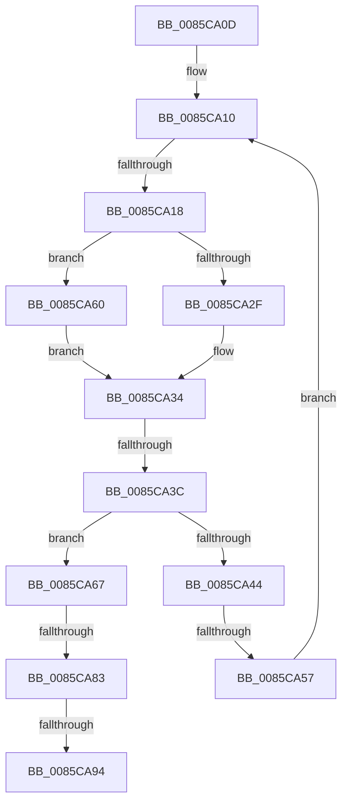

# sub_0085CA0D

- RVA: `0x0085CA0D`–`0x0085CA9E` (길이 `145` bytes)
- VA: `0x000000014085CA0D`
- 실행 섹션: `PAGE`
- PDB 이름 있음: `아니요`; PDB Function 태그: `아니요`
- unwind 정보 RVA: `0x0006AF00`
- 디코드: `41`개 명령, `145/145` bytes 표시
- 미해석 바이트: `0` (있으면 어셈블리에 `.byte`로 보존)

> 이 문서는 커널 이미지의 기계어와 PDB 기호를 분석해 생성했습니다. 4번과 5번은 함수 원형과 자료형을 바이너리 사용 방식에서 추정한 C 해석이며 원본 소스 복구 결과는 아닙니다.

## 1. Dependencies

- 직접 호출 지점: **4**; 고유 호출 대상: **3**
- 직접 호출자로 확인된 함수: **0**
- RIP 상대 이미지 참조: **0**

### Outgoing calls
- `0x0085CA2F` → [HvpGetCellFlat](HvpGetCellFlat_function_00854C60.md) (function, `0x00854C60`)
- `0x0085CA57` → [HvpReleaseCellPaged](HvpReleaseCellPaged_function_00855F40.md) (function, `0x00855F40`)
- `0x0085CA60` → [HvpGetCellPaged](HvpGetCellPaged_function_00854CB0.md) (function, `0x00854CB0`)
- `0x0085CA94` → [HvpReleaseCellPaged](HvpReleaseCellPaged_function_00855F40.md) (function, `0x00855F40`)

### Direct callers
- 이 함수 시작 RVA로 연결되는 직접 call은 확인되지 않았습니다. 간접 호출은 완전히 역산할 수 없습니다.

### Static image references
- 디코드된 RIP-relative 메모리 참조가 없습니다.

## 2. Other-region calls and transfers

- 다른 실행 섹션으로 향하는 call: **0**
- call이 아닌 외부 분기/꼬리 이동: **6**
  - `0x0085CA16` → [sub_0085C997 + 0x14](Unknown_function_0085C997.md) (`tail-transfer`)
  - `0x0085CA3A` → [sub_0085C997 + 0x34](Unknown_function_0085C997.md) (`tail-transfer`)
  - `0x0085CA55` → [sub_0085CABE](Unknown_function_0085CABE.md) (`tail-transfer`)
  - `0x0085CA81` → [sub_0085CAD4](Unknown_function_0085CAD4.md) (`tail-transfer`)
  - `0x0085CA92` → [sub_0085CAD4 + 0x11](Unknown_function_0085CAD4.md) (`tail-transfer`)
  - `0x0085CA99` → [sub_0085C997 + 0x34](Unknown_function_0085C997.md) (`tail-transfer`)

## 3. Assembly (complete function range)

```asm
0085CA0D  41 8B F4                        mov esi, r12d
0085CA10  0F B7 43 02                     movzx eax, word ptr [rbx + 2]
0085CA14  3B F0                           cmp esi, eax
0085CA16  73 93                           jae 0x14085c9ab
0085CA18  F6 87 8C 00 00 00 01            test byte ptr [rdi + 0x8c], 1
0085CA1F  4C 8D 44 24 58                  lea r8, [rsp + 0x58]
0085CA24  8B C6                           mov eax, esi
0085CA26  48 8B CF                        mov rcx, rdi
0085CA29  8B 54 83 04                     mov edx, dword ptr [rbx + rax*4 + 4]
0085CA2D  74 31                           je 0x14085ca60
0085CA2F  E8 2C 82 FF FF                  call 0x140854c60
0085CA34  48 8B C8                        mov rcx, rax
0085CA37  48 85 C0                        test rax, rax
0085CA3A  74 8F                           je 0x14085c9cb
0085CA3C  0F B7 40 02                     movzx eax, word ptr [rax + 2]
0085CA40  3B E8                           cmp ebp, eax
0085CA42  72 23                           jb 0x14085ca67
0085CA44  2B E8                           sub ebp, eax
0085CA46  48 8D 54 24 58                  lea rdx, [rsp + 0x58]
0085CA4B  F6 87 8C 00 00 00 01            test byte ptr [rdi + 0x8c], 1
0085CA52  48 8B CF                        mov rcx, rdi
0085CA55  75 67                           jne 0x14085cabe
0085CA57  E8 E4 94 FF FF                  call 0x140855f40
0085CA5C  FF C6                           inc esi
0085CA5E  EB B0                           jmp 0x14085ca10
0085CA60  E8 4B 82 FF FF                  call 0x140854cb0
0085CA65  EB CD                           jmp 0x14085ca34
0085CA67  0F B7 01                        movzx eax, word ptr [rcx]
0085CA6A  BA 6C 66 00 00                  mov edx, 0x666c
0085CA6F  66 2B C2                        sub ax, dx
0085CA72  BA FF FD 00 00                  mov edx, 0xfdff
0085CA77  66 85 C2                        test dx, ax
0085CA7A  8B C5                           mov eax, ebp
0085CA7C  48 8D 54 24 58                  lea rdx, [rsp + 0x58]
0085CA81  75 51                           jne 0x14085cad4
0085CA83  44 8B 74 C1 04                  mov r14d, dword ptr [rcx + rax*8 + 4]
0085CA88  F6 87 8C 00 00 00 01            test byte ptr [rdi + 0x8c], 1
0085CA8F  48 8B CF                        mov rcx, rdi
0085CA92  75 51                           jne 0x14085cae5
0085CA94  E8 A7 94 FF FF                  call 0x140855f40
0085CA99  E9 2D FF FF FF                  jmp 0x14085c9cb
```

## 4. C-style interpretation (structured pseudocode)

```c
__int64 __fastcall sub_0085CA0D(__int64 a1, __int64 a2, __int64 a3, __int64 a4, __int64 a5, __int64 a6, __int64 a7, __int64 a8, __int64 a9, __int64 a10, __int64 a11)
{
    __int64 result;
    __int64 v_rbp;
    __int64 v_rsi;

loc_0085CA10:
    if (((*(unsigned __int8 *)(v_rdi + 140)) & (1)) == 0) goto loc_0085CA60;
    result = HvpGetCellFlat(v_rdi, (unsigned int)(*(unsigned int *)(v_rbx + (unsigned int)((unsigned int)((unsigned int)((unsigned int)(v_r12)))) * 4 + 4)), a11, a4);
loc_0085CA34:
    if (((unsigned int)(v_rbp)) < ((unsigned int)(*(unsigned __int16 *)(result + 2)))) goto loc_0085CA67;
    v_rbp = (unsigned int)((v_rbp) - ((unsigned int)(*(unsigned __int16 *)(result + 2))));
    result = HvpReleaseCellPaged(v_rdi, a11, a11, a4);
    v_rsi = (unsigned int)(((unsigned int)((unsigned int)(v_r12))) + 1);
    goto loc_0085CA10;
loc_0085CA60:
    result = HvpGetCellPaged(v_rdi, a11, a11, a4);
    goto loc_0085CA34;
loc_0085CA67:
    result = (unsigned __int16)((*(unsigned __int16 *)(v_rdi)) - ((unsigned __int16)((unsigned int)(0x666CULL))));
    result = HvpReleaseCellPaged(v_rdi, a11, a11, a4);
}
```

## 5. (Beta) C Style

```c
int64_t sub_0085CA0D(int64_t Arg1, int64_t Arg2, int64_t Arg3, int64_t Arg4, uint64_t Arg5, uint64_t Arg6, uint64_t Arg7, uint64_t Arg8, uint64_t Arg9, uint64_t Arg10, int64_t Arg11)
{
    int64_t result;
    int64_t local_rbp;
    int64_t local_rsi;

loc_0085CA10:
    if (((*(uint8_t *)(local_rdi + 0x8C)) & (1)) == 0) goto loc_0085CA60;
    result = HvpGetCellFlat(local_rdi, (uint32_t)(*(uint32_t *)(local_rbx + (uint32_t)((uint32_t)((uint32_t)((uint32_t)(local_r12)))) * 4 + 0x4)), Arg11, Arg4);
loc_0085CA34:
    if (((uint32_t)(local_rbp)) < ((uint32_t)(*(uint16_t *)(result + 0x2)))) goto loc_0085CA67;
    local_rbp = (uint32_t)((local_rbp) - ((uint32_t)(*(uint16_t *)(result + 0x2))));
    result = HvpReleaseCellPaged(local_rdi, Arg11, Arg11, Arg4);
    local_rsi = (uint32_t)(((uint32_t)((uint32_t)(local_r12))) + 1);
    goto loc_0085CA10;
loc_0085CA60:
    result = HvpGetCellPaged(local_rdi, Arg11, Arg11, Arg4);
    goto loc_0085CA34;
loc_0085CA67:
    result = (uint16_t)((*(uint16_t *)(local_rdi)) - ((uint16_t)((uint32_t)(0x666CULL))));
    result = HvpReleaseCellPaged(local_rdi, Arg11, Arg11, Arg4);
}
```

## 6. Execution-region graph

[열기: 2D/3D 그래프와 함수 탐색 컨트롤 패널](../../../control-panel.html?section=page&rva=0x0085CA0D&view=graph)

- 2D 그래프는 위에서 아래로 흐르고, 3D 그래프는 빈 공간을 드래그해 회전합니다. Shift+드래그는 이동, 휠은 확대·축소, 함수 노드 선택은 대상 보고서 이동입니다.

### Static fallback


