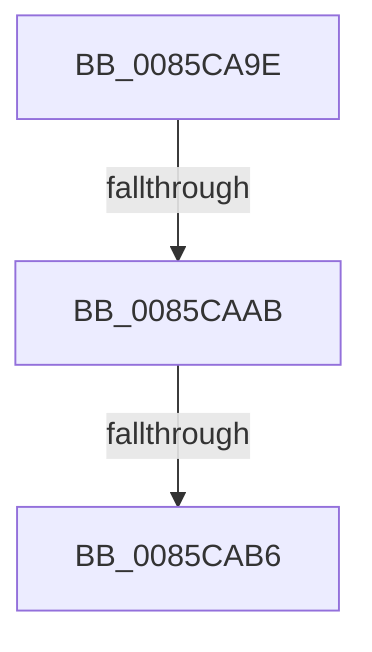

# sub_0085CA9E

- RVA: `0x0085CA9E`–`0x0085CABE` (길이 `32` bytes)
- VA: `0x000000014085CA9E`
- 실행 섹션: `PAGE`
- PDB 이름 있음: `아니요`; PDB Function 태그: `아니요`
- unwind 정보 RVA: `0x0006AF14`
- 디코드: `7`개 명령, `32/32` bytes 표시
- 미해석 바이트: `0` (있으면 어셈블리에 `.byte`로 보존)

> 이 문서는 커널 이미지의 기계어와 PDB 기호를 분석해 생성했습니다. 4번과 5번은 함수 원형과 자료형을 바이너리 사용 방식에서 추정한 C 해석이며 원본 소스 복구 결과는 아닙니다.

## 1. Dependencies

- 직접 호출 지점: **0**; 고유 호출 대상: **0**
- 직접 호출자로 확인된 함수: **0**
- RIP 상대 이미지 참조: **0**

### Outgoing calls
- 직접 디코드된 call 명령이 없습니다.

### Direct callers
- 이 함수 시작 RVA로 연결되는 직접 call은 확인되지 않았습니다. 간접 호출은 완전히 역산할 수 없습니다.

### Static image references
- 디코드된 RIP-relative 메모리 참조가 없습니다.

## 2. Other-region calls and transfers

- 다른 실행 섹션으로 향하는 call: **0**
- call이 아닌 외부 분기/꼬리 이동: **3**
  - `0x0085CAA5` → [sub_0085C9E8 + 0x5](Unknown_function_0085C9E8.md) (`tail-transfer`)
  - `0x0085CAB0` → [sub_0085C9E8 + 0x5](Unknown_function_0085C9E8.md) (`tail-transfer`)
  - `0x0085CAB9` → [CmpFindSubKeyByNumber + 0x3F](CmpFindSubKeyByNumber_function_0085C930.md) (`tail-transfer`)

## 3. Assembly (complete function range)

```asm
0085CA9E  83 B9 D8 00 00 00 01            cmp dword ptr [rcx + 0xd8], 1
0085CAA5  0F 86 42 FF FF FF               jbe 0x14085c9ed
0085CAAB  2B E8                           sub ebp, eax
0085CAAD  3B 6A 18                        cmp ebp, dword ptr [rdx + 0x18]
0085CAB0  0F 83 37 FF FF FF               jae 0x14085c9ed
0085CAB6  8B 52 20                        mov edx, dword ptr [rdx + 0x20]
0085CAB9  E9 B1 FE FF FF                  jmp 0x14085c96f
```

## 4. C-style interpretation (structured pseudocode)

```c
void __fastcall sub_0085CA9E(__int64 a1, __int64 a2)
{
    __int64 v_rbp;

    v_rbp = (unsigned int)((v_rbp) - ((unsigned int)(result)));
}
```

## 5. (Beta) C Style

```c
void sub_0085CA9E(void *Arg1, void *Arg2)
{
    uint8_t *arg1 = (uint8_t *)Arg1;
    uint8_t *arg2 = (uint8_t *)Arg2;

    int64_t local_rbp;

    local_rbp = (uint32_t)((local_rbp) - ((uint32_t)(result)));
}
```

### 관측된 메모리 오프셋

구조체 형식이 확인되지 않은 접근은 인자 기준의 오프셋으로만 기록했습니다.

| 기준 인자 | 오프셋 표현 | 폭 (bit) | 접근 |
|---|---:|---:|---|
| `Arg1` | `+ 0xD8` | `32` | `R` |
| `Arg2` | `+ 0x18` | `32` | `R` |
| `Arg2` | `+ 0x20` | `32` | `R` |

## 6. Execution-region graph

[열기: 2D/3D 그래프와 함수 탐색 컨트롤 패널](../../../control-panel.html?section=page&rva=0x0085CA9E&view=graph)

- 2D 그래프는 위에서 아래로 흐르고, 3D 그래프는 빈 공간을 드래그해 회전합니다. Shift+드래그는 이동, 휠은 확대·축소, 함수 노드 선택은 대상 보고서 이동입니다.

### Static fallback


