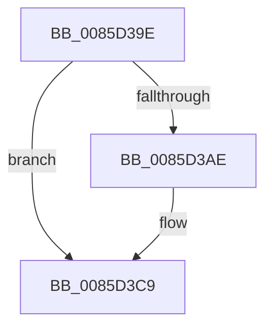

# sub_0085D39E

- RVA: `0x0085D39E`–`0x0085D3D3` (길이 `53` bytes)
- VA: `0x000000014085D39E`
- 실행 섹션: `PAGE`
- PDB 이름 있음: `아니요`; PDB Function 태그: `아니요`
- unwind 정보 RVA: `0x0006AFA0`
- 디코드: `13`개 명령, `53/53` bytes 표시
- 미해석 바이트: `0` (있으면 어셈블리에 `.byte`로 보존)

> 이 문서는 커널 이미지의 기계어와 PDB 기호를 분석해 생성했습니다. 4번과 5번은 함수 원형과 자료형을 바이너리 사용 방식에서 추정한 C 해석이며 원본 소스 복구 결과는 아닙니다.

## 1. Dependencies

- 직접 호출 지점: **1**; 고유 호출 대상: **1**
- 직접 호출자로 확인된 함수: **0**
- RIP 상대 이미지 참조: **0**

### Outgoing calls
- `0x0085D3C3` → [KeBugCheckEx](../../text/4F/KeBugCheckEx_function_004FD660.md) (function, `0x004FD660`)

### Direct callers
- 이 함수 시작 RVA로 연결되는 직접 call은 확인되지 않았습니다. 간접 호출은 완전히 역산할 수 없습니다.

### Static image references
- 디코드된 RIP-relative 메모리 참조가 없습니다.

## 2. Other-region calls and transfers

- 다른 실행 섹션으로 향하는 call: **1**
  - `0x0085D3C3` → [KeBugCheckEx](../../text/4F/KeBugCheckEx_function_004FD660.md) (`PAGE` → `.text`)
- call이 아닌 외부 분기/꼬리 이동: **1**
  - `0x0085D3CD` → [sub_0085D455 + 0x54](Unknown_function_0085D455.md) (`tail-transfer`)

## 3. Assembly (complete function range)

```asm
0085D39E  48 89 6C 24 48                  mov qword ptr [rsp + 0x48], rbp
0085D3A3  BD 01 00 00 00                  mov ebp, 1
0085D3A8  F0 48 FF 01                     lock inc qword ptr [rcx]
0085D3AC  75 1B                           jne 0x14085d3c9
0085D3AE  45 33 C9                        xor r9d, r9d
0085D3B1  48 C7 44 24 20 00 00 00 00      mov qword ptr [rsp + 0x20], 0
0085D3BA  4C 8B C3                        mov r8, rbx
0085D3BD  8D 55 23                        lea edx, [rbp + 0x23]
0085D3C0  8D 4D 50                        lea ecx, [rbp + 0x50]
0085D3C3  E8 98 02 CA FF                  call 0x1404fd660
0085D3C8  CC                              int3
0085D3C9  F6 41 40 02                     test byte ptr [rcx + 0x40], 2
0085D3CD  0F 84 D6 00 00 00               je 0x14085d4a9
```

## 4. C-style interpretation (structured pseudocode)

```c
__int64 __fastcall sub_0085D39E(__int64 a1, __int64 a2, __int64 a3, int a4)
{
    __int64 result;
    unsigned __int64 v_stack_p20;
    unsigned __int64 v_stack_p48;

    v_stack_p48 = v_rbp;
    if (!(condition_is_not_equal)) {
        a4 = 0;
        v_stack_p20 = 0;
        a3 = v_rbx;
        a2 = 1 + 35;
        a1 = 1 + 80;
        result = KeBugCheckEx(a1, a2, a3, a4);
    }
}
```

## 5. (Beta) C Style

```c
int64_t sub_0085D39E(void *Arg1, int64_t Arg2, int64_t Arg3, int32_t Arg4)
{
    uint8_t *arg1 = (uint8_t *)Arg1;

    int64_t result;
    uint64_t v_stack_p20;
    uint64_t v_stack_p48;

    v_stack_p48 = local_rbp;
    if (!(condition_is_not_equal)) {
        Arg4 = 0;
        v_stack_p20 = 0;
        Arg3 = local_rbx;
        Arg2 = 1 + 35;
        Arg1 = 1 + 80;
        result = KeBugCheckEx(Arg1, Arg2, Arg3, Arg4);
    }
}
```

### 관측된 메모리 오프셋

구조체 형식이 확인되지 않은 접근은 인자 기준의 오프셋으로만 기록했습니다.

| 기준 인자 | 오프셋 표현 | 폭 (bit) | 접근 |
|---|---:|---:|---|
| `Arg1` | `+ 0x0` | `64` | `R/W` |

## 6. Execution-region graph

[열기: 2D/3D 그래프와 함수 탐색 컨트롤 패널](../../../control-panel.html?section=page&rva=0x0085D39E&view=graph)

- 2D 그래프는 위에서 아래로 흐르고, 3D 그래프는 빈 공간을 드래그해 회전합니다. Shift+드래그는 이동, 휠은 확대·축소, 함수 노드 선택은 대상 보고서 이동입니다.

### Static fallback


