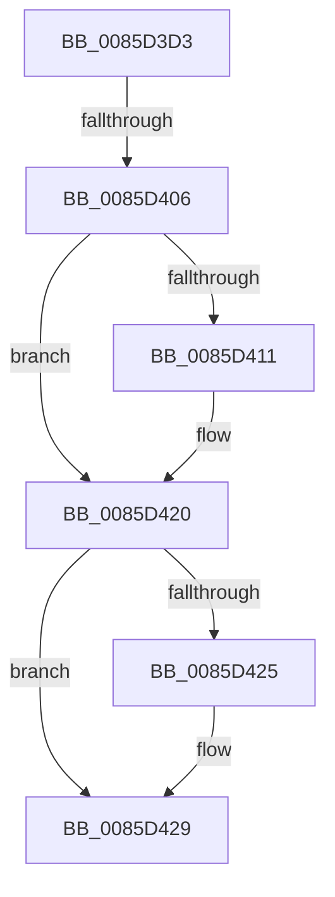

# sub_0085D3D3

- RVA: `0x0085D3D3`–`0x0085D455` (길이 `130` bytes)
- VA: `0x000000014085D3D3`
- 실행 섹션: `PAGE`
- PDB 이름 있음: `아니요`; PDB Function 태그: `아니요`
- unwind 정보 RVA: `0x0006AFB4`
- 디코드: `28`개 명령, `130/130` bytes 표시
- 미해석 바이트: `0` (있으면 어셈블리에 `.byte`로 보존)

> 이 문서는 커널 이미지의 기계어와 PDB 기호를 분석해 생성했습니다. 4번과 5번은 함수 원형과 자료형을 바이너리 사용 방식에서 추정한 C 해석이며 원본 소스 복구 결과는 아닙니다.

## 1. Dependencies

- 직접 호출 지점: **2**; 고유 호출 대상: **2**
- 직접 호출자로 확인된 함수: **0**
- RIP 상대 이미지 참조: **5**

### Outgoing calls
- `0x0085D3E9` → [KeAbPreAcquire](../../text/21/KeAbPreAcquire_function_00210230.md) (function, `0x00210230`)
- `0x0085D41B` → [ExpAcquireFastMutexContended](../../text/45/ExpAcquireFastMutexContended_function_00450288.md) (function, `0x00450288`)

### Direct callers
- 이 함수 시작 RVA로 연결되는 직접 call은 확인되지 않았습니다. 간접 호출은 완전히 역산할 수 없습니다.

### Static image references
- `0x0085D3D8` → RVA `0x00EF5880` (`.data`; read)
- `0x0085D3F9` → RVA `0x00FC6D20` (`ALMOSTRO`; read)
- `0x0085D406` → RVA `0x00EF5880` (`.data`; read/write)
- `0x0085D437` → RVA `0x00EF5888` (`.data`; write)
- `0x0085D447` → RVA `0x00EF58B0` (`.data`; write)

## 2. Other-region calls and transfers

- 다른 실행 섹션으로 향하는 call: **2**
  - `0x0085D3E9` → [KeAbPreAcquire](../../text/21/KeAbPreAcquire_function_00210230.md) (`PAGE` → `.text`)
  - `0x0085D41B` → [ExpAcquireFastMutexContended](../../text/45/ExpAcquireFastMutexContended_function_00450288.md) (`PAGE` → `.text`)
- call이 아닌 외부 분기/꼬리 이동: **2**
  - `0x0085D400` → [sub_0085D4B5](Unknown_function_0085D4B5.md) (`tail-transfer`)
  - `0x0085D453` → [sub_0085D455 + 0x48](Unknown_function_0085D455.md) (`tail-transfer`)

## 3. Assembly (complete function range)

```asm
0085D3D3  48 89 74 24 50                  mov qword ptr [rsp + 0x50], rsi
0085D3D8  48 8D 0D A1 84 69 00            lea rcx, [rip + 0x6984a1]
0085D3DF  45 33 C0                        xor r8d, r8d
0085D3E2  48 89 7C 24 58                  mov qword ptr [rsp + 0x58], rdi
0085D3E7  33 D2                           xor edx, edx
0085D3E9  E8 42 2E 9B FF                  call 0x140210230
0085D3EE  48 8B F8                        mov rdi, rax
0085D3F1  44 0F 20 C6                     mov rsi, cr8
0085D3F5  44 0F 22 C5                     mov cr8, rbp
0085D3F9  83 3D 20 99 76 00 00            cmp dword ptr [rip + 0x769920], 0
0085D400  0F 85 AF 00 00 00               jne 0x14085d4b5
0085D406  F0 0F BA 35 71 84 69 00 00      lock btr dword ptr [rip + 0x698471], 0
0085D40F  72 0F                           jb 0x14085d420
0085D411  48 8B D7                        mov rdx, rdi
0085D414  48 8D 0D 65 84 69 00            lea rcx, [rip + 0x698465]
0085D41B  E8 68 2E BF FF                  call 0x140450288
0085D420  48 85 FF                        test rdi, rdi
0085D423  74 04                           je 0x14085d429
0085D425  40 88 6F 0A                     mov byte ptr [rdi + 0xa], bpl
0085D429  65 48 8B 04 25 88 01 00 00      mov rax, qword ptr gs:[0x188]
0085D432  48 8B 7C 24 58                  mov rdi, qword ptr [rsp + 0x58]
0085D437  48 89 05 4A 84 69 00            mov qword ptr [rip + 0x69844a], rax
0085D43E  40 0F B6 C6                     movzx eax, sil
0085D442  48 8B 74 24 50                  mov rsi, qword ptr [rsp + 0x50]
0085D447  89 05 63 84 69 00               mov dword ptr [rip + 0x698463], eax
0085D44D  0F B6 43 40                     movzx eax, byte ptr [rbx + 0x40]
0085D451  A8 02                           test al, 2
0085D453  74 48                           je 0x14085d49d
```

## 4. C-style interpretation (structured pseudocode)

```c
__int64 __fastcall sub_0085D3D3(__int64 a1, int a2, int a3, __int64 a4, __int64 a5, __int64 a6, __int64 a7, __int64 a8, __int64 a9, __int64 a10, __int64 a11)
{
    __int64 result;
    unsigned __int64 v_stack_p50;
    unsigned __int64 v_stack_p58;

    v_stack_p50 = v_rsi;
    a3 = 0;
    v_stack_p58 = v_rdi;
    a2 = 0;
    result = KeAbPreAcquire(v_rip + 6915233, a2, a3, a4);
    if ((*(unsigned int *)(v_rip + 7772448)) >= 0) {
        a2 = result;
        a1 = v_rip + 6915173;
        result = ExpAcquireFastMutexContended(a1, a2, a3, a4);
    }
    if (result != 0) {
        *(unsigned __int8 *)(result + 10) = (unsigned __int8)(v_rbp);
    }
    *(unsigned __int64 *)(v_rip + 6915146) = *(unsigned __int64 *)(gs_base + (0 + 392));
    *(unsigned int *)(v_rip + 6915171) = (unsigned int)((unsigned __int8)(v_cr8));
}
```

## 5. (Beta) C Style

```c
int64_t sub_0085D3D3(int64_t Arg1, int32_t Arg2, int32_t Arg3, int64_t Arg4, uint64_t Arg5, uint64_t Arg6, uint64_t Arg7, uint64_t Arg8, uint64_t Arg9, int64_t Arg10, int64_t Arg11)
{
    int64_t result;
    uint64_t v_stack_p50;
    uint64_t v_stack_p58;

    v_stack_p50 = local_rsi;
    Arg3 = 0;
    v_stack_p58 = local_rdi;
    Arg2 = 0;
    result = KeAbPreAcquire(v_rip + 6915233, Arg2, Arg3, Arg4);
    if ((*(uint32_t *)(v_rip + 0x769920)) >= 0) {
        Arg2 = result;
        Arg1 = v_rip + 6915173;
        result = ExpAcquireFastMutexContended(Arg1, Arg2, Arg3, Arg4);
    }
    if (result != 0) {
        *(uint8_t *)(result + 0xA) = (uint8_t)(local_rbp);
    }
    *(uint64_t *)(v_rip + 0x69844A) = *(uint64_t *)(gs_base + (0 + 0x188));
    *(uint32_t *)(v_rip + 0x698463) = (uint32_t)((uint8_t)(v_cr8));
}
```

## 6. Execution-region graph

[열기: 2D/3D 그래프와 함수 탐색 컨트롤 패널](../../../control-panel.html?section=page&rva=0x0085D3D3&view=graph)

- 2D 그래프는 위에서 아래로 흐르고, 3D 그래프는 빈 공간을 드래그해 회전합니다. Shift+드래그는 이동, 휠은 확대·축소, 함수 노드 선택은 대상 보고서 이동입니다.

### Static fallback


