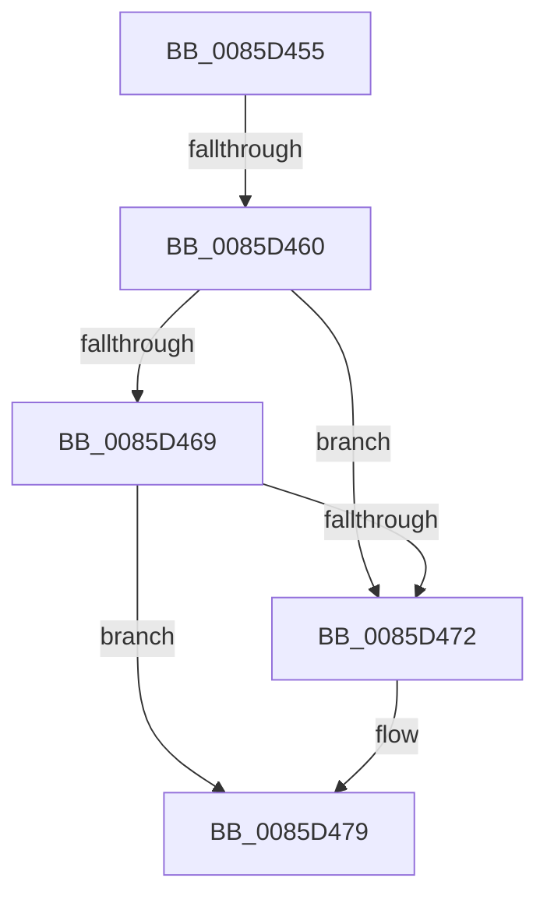

# sub_0085D455

- RVA: `0x0085D455`–`0x0085D4B4` (길이 `95` bytes)
- VA: `0x000000014085D455`
- 실행 섹션: `PAGE`
- PDB 이름 있음: `아니요`; PDB Function 태그: `아니요`
- unwind 정보 RVA: `0x0006AFCC`
- 디코드: `25`개 명령, `95/95` bytes 표시
- 미해석 바이트: `0` (있으면 어셈블리에 `.byte`로 보존)

> 이 문서는 커널 이미지의 기계어와 PDB 기호를 분석해 생성했습니다. 4번과 5번은 함수 원형과 자료형을 바이너리 사용 방식에서 추정한 C 해석이며 원본 소스 복구 결과는 아닙니다.

## 1. Dependencies

- 직접 호출 지점: **1**; 고유 호출 대상: **1**
- 직접 호출자로 확인된 함수: **0**
- RIP 상대 이미지 참조: **3**

### Outgoing calls
- `0x0085D4A4` → [ExReleaseFastMutex](../../text/25/ExReleaseFastMutex_function_002519C0.md) (function, `0x002519C0`)

### Direct callers
- 이 함수 시작 RVA로 연결되는 직접 call은 확인되지 않았습니다. 간접 호출은 완전히 역산할 수 없습니다.

### Static image references
- `0x0085D479` → RVA `0x00EEFC30` (`.data`; read/write)
- `0x0085D486` → RVA `0x00FDA438` (`PAGEDATA`; read/write)
- `0x0085D49D` → RVA `0x00EF5880` (`.data`; read)

## 2. Other-region calls and transfers

- 다른 실행 섹션으로 향하는 call: **1**
  - `0x0085D4A4` → [ExReleaseFastMutex](../../text/25/ExReleaseFastMutex_function_002519C0.md) (`PAGE` → `.text`)
- call이 아닌 외부 분기/꼬리 이동: **1**
  - `0x0085D45E` → [sub_0085D4C7](Unknown_function_0085D4C7.md) (`tail-transfer`)

## 3. Assembly (complete function range)

```asm
0085D455  48 8D 8B E0 00 00 00            lea rcx, [rbx + 0xe0]
0085D45C  A8 04                           test al, 4
0085D45E  75 67                           jne 0x14085d4c7
0085D460  48 8B 11                        mov rdx, qword ptr [rcx]
0085D463  48 39 4A 08                     cmp qword ptr [rdx + 8], rcx
0085D467  75 09                           jne 0x14085d472
0085D469  48 8B 41 08                     mov rax, qword ptr [rcx + 8]
0085D46D  48 39 08                        cmp qword ptr [rax], rcx
0085D470  74 07                           je 0x14085d479
0085D472  B9 03 00 00 00                  mov ecx, 3
0085D477  CD 29                           int 0x29
0085D479  FF 0D B1 27 69 00               dec dword ptr [rip + 0x6927b1]
0085D47F  48 89 10                        mov qword ptr [rax], rdx
0085D482  48 89 42 08                     mov qword ptr [rdx + 8], rax
0085D486  48 FF 0D AB CF 77 00            dec qword ptr [rip + 0x77cfab]
0085D48D  48 89 49 08                     mov qword ptr [rcx + 8], rcx
0085D491  48 89 09                        mov qword ptr [rcx], rcx
0085D494  F0 83 0C 24 00                  lock or dword ptr [rsp], 0
0085D499  80 63 40 FD                     and byte ptr [rbx + 0x40], 0xfd
0085D49D  48 8D 0D DC 83 69 00            lea rcx, [rip + 0x6983dc]
0085D4A4  E8 17 45 9F FF                  call 0x1402519c0
0085D4A9  48 8B 6C 24 48                  mov rbp, qword ptr [rsp + 0x48]
0085D4AE  48 83 C4 30                     add rsp, 0x30
0085D4B2  5B                              pop rbx
0085D4B3  C3                              ret
```

## 4. C-style interpretation (structured pseudocode)

```c
__int64 __fastcall sub_0085D455(__int64 a1, __int64 a2, __int64 a3, __int64 a4, __int64 a5, __int64 a6, __int64 a7, __int64 a8, __int64 a9)
{
    __int64 result;
    __int64 v_rsp;
    unsigned int v_stack_p0;

    if ((*(unsigned __int64 *)(*(unsigned __int64 *)(v_rbx + 224) + 8)) != (v_rbx + 224)) goto loc_0085D472;
    if ((*(unsigned __int64 *)(*(unsigned __int64 *)(v_rbx + 224 + 8))) != (v_rbx + 224)) {
        a1 = 3;
    }
    *(unsigned __int64 *)(*(unsigned __int64 *)(v_rbx + 224 + 8)) = *(unsigned __int64 *)(v_rbx + 224);
    *(unsigned __int64 *)(*(unsigned __int64 *)(v_rbx + 224) + 8) = *(unsigned __int64 *)(v_rbx + 224 + 8);
    *(unsigned __int64 *)(a1 + 8) = a1;
    *(unsigned __int64 *)(a1) = a1;
    result = ExReleaseFastMutex(v_rip + 6915036, *(unsigned __int64 *)(v_rbx + 224), a3, a4);
    v_rsp = (v_rsp) + (48);
    return result;
}
```

## 5. (Beta) C Style

```c
int64_t sub_0085D455(int64_t Arg1, int64_t Arg2, int64_t Arg3, int64_t Arg4, uint64_t Arg5, uint64_t Arg6, uint64_t Arg7, uint64_t Arg8, int64_t Arg9)
{
    int64_t result;
    int64_t local_rsp;
    uint32_t v_stack_p0;

    if ((*(uint64_t *)(*(uint64_t *)(local_rbx + 0xE0) + 0x8)) != (local_rbx + 224)) goto loc_0085D472;
    if ((*(uint64_t *)(*(uint64_t *)(local_rbx + 0xE0 + 0x8))) != (local_rbx + 224)) {
        Arg1 = 3;
    }
    *(uint64_t *)(*(uint64_t *)(local_rbx + 0xE0 + 0x8)) = *(uint64_t *)(local_rbx + 0xE0);
    *(uint64_t *)(*(uint64_t *)(local_rbx + 0xE0) + 0x8) = *(uint64_t *)(local_rbx + 0xE0 + 0x8);
    *(uint64_t *)(Arg1 + 0x8) = Arg1;
    *(uint64_t *)(Arg1) = Arg1;
    result = ExReleaseFastMutex(v_rip + 6915036, *(uint64_t *)(local_rbx + 0xE0), Arg3, Arg4);
    local_rsp = (local_rsp) + (48);
    return result;
}
```

## 6. Execution-region graph

[열기: 2D/3D 그래프와 함수 탐색 컨트롤 패널](../../../control-panel.html?section=page&rva=0x0085D455&view=graph)

- 2D 그래프는 위에서 아래로 흐르고, 3D 그래프는 빈 공간을 드래그해 회전합니다. Shift+드래그는 이동, 휠은 확대·축소, 함수 노드 선택은 대상 보고서 이동입니다.

### Static fallback


