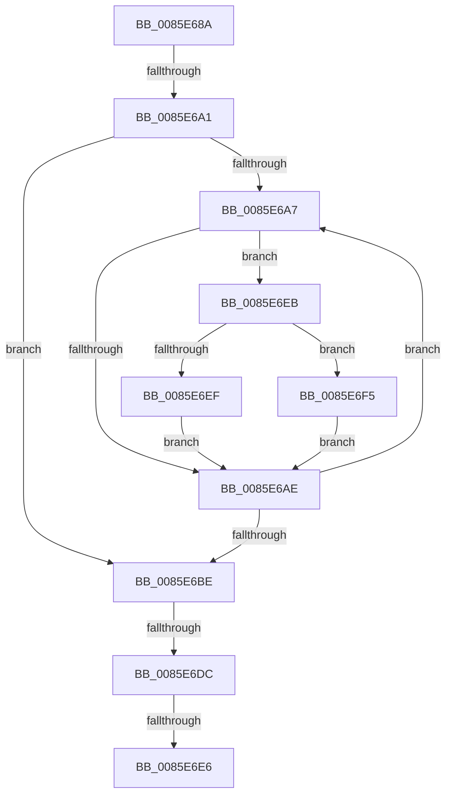

# sub_0085E68A

- RVA: `0x0085E68A`–`0x0085E6FF` (길이 `117` bytes)
- VA: `0x000000014085E68A`
- 실행 섹션: `PAGE`
- PDB 이름 있음: `아니요`; PDB Function 태그: `아니요`
- unwind 정보 RVA: `0x0006B0E0`
- 디코드: `34`개 명령, `117/117` bytes 표시
- 미해석 바이트: `0` (있으면 어셈블리에 `.byte`로 보존)

> 이 문서는 커널 이미지의 기계어와 PDB 기호를 분석해 생성했습니다. 4번과 5번은 함수 원형과 자료형을 바이너리 사용 방식에서 추정한 C 해석이며 원본 소스 복구 결과는 아닙니다.

## 1. Dependencies

- 직접 호출 지점: **2**; 고유 호출 대상: **2**
- 직접 호출자로 확인된 함수: **0**
- RIP 상대 이미지 참조: **0**

### Outgoing calls
- `0x0085E6DC` → [HvpReleaseCellPaged](HvpReleaseCellPaged_function_00855F40.md) (function, `0x00855F40`)
- `0x0085E6F8` → [RtlUpcaseUnicodeChar](RtlUpcaseUnicodeChar_function_0085F0F0.md) (function, `0x0085F0F0`)

### Direct callers
- 이 함수 시작 RVA로 연결되는 직접 call은 확인되지 않았습니다. 간접 호출은 완전히 역산할 수 없습니다.

### Static image references
- 디코드된 RIP-relative 메모리 참조가 없습니다.

## 2. Other-region calls and transfers

- 다른 실행 섹션으로 향하는 call: **0**
- call이 아닌 외부 분기/꼬리 이동: **4**
  - `0x0085E69B` → [sub_0085E9FA + 0xB](Unknown_function_0085E9FA.md) (`tail-transfer`)
  - `0x0085E6D6` → [sub_0085E997](Unknown_function_0085E997.md) (`tail-transfer`)
  - `0x0085E6E4` → [sub_0085E709](Unknown_function_0085E709.md) (`tail-transfer`)
  - `0x0085E6E9` → [sub_0085E709 + 0x37](Unknown_function_0085E709.md) (`tail-transfer`)

## 3. Assembly (complete function range)

```asm
0085E68A  48 89 9C 24 98 00 00 00         mov qword ptr [rsp + 0x98], rbx
0085E692  48 8D 58 4C                     lea rbx, [rax + 0x4c]
0085E696  48 89 6C 24 50                  mov qword ptr [rsp + 0x50], rbp
0085E69B  0F 84 64 03 00 00               je 0x14085ea05
0085E6A1  8B E9                           mov ebp, ecx
0085E6A3  85 C9                           test ecx, ecx
0085E6A5  74 17                           je 0x14085e6be
0085E6A7  0F B6 03                        movzx eax, byte ptr [rbx]
0085E6AA  3C 61                           cmp al, 0x61
0085E6AC  73 3D                           jae 0x14085e6eb
0085E6AE  6B F6 25                        imul esi, esi, 0x25
0085E6B1  48 FF C3                        inc rbx
0085E6B4  0F B7 C8                        movzx ecx, ax
0085E6B7  03 F1                           add esi, ecx
0085E6B9  83 C5 FF                        add ebp, -1
0085E6BC  75 E9                           jne 0x14085e6a7
0085E6BE  6B DF 25                        imul ebx, edi, 0x25
0085E6C1  03 DE                           add ebx, esi
0085E6C3  41 F6 86 8C 00 00 00 01         test byte ptr [r14 + 0x8c], 1
0085E6CB  48 8D 94 24 A0 00 00 00         lea rdx, [rsp + 0xa0]
0085E6D3  49 8B CE                        mov rcx, r14
0085E6D6  0F 85 BB 02 00 00               jne 0x14085e997
0085E6DC  E8 5F 78 FF FF                  call 0x140855f40
0085E6E1  4D 85 ED                        test r13, r13
0085E6E4  75 23                           jne 0x14085e709
0085E6E6  49 8B FF                        mov rdi, r15
0085E6E9  EB 55                           jmp 0x14085e740
0085E6EB  3C 7A                           cmp al, 0x7a
0085E6ED  77 06                           ja 0x14085e6f5
0085E6EF  66 83 E8 20                     sub ax, 0x20
0085E6F3  EB B9                           jmp 0x14085e6ae
0085E6F5  0F B7 C8                        movzx ecx, ax
0085E6F8  E8 F3 09 00 00                  call 0x14085f0f0
0085E6FD  EB AF                           jmp 0x14085e6ae
```

## 4. C-style interpretation (structured pseudocode)

```c
__int64 __fastcall sub_0085E68A(int a1, __int64 a2, __int64 a3, __int64 a4, __int64 a5, __int64 a6, __int64 a7, __int64 a8, __int64 a9, __int64 a10, __int64 a11, __int64 a12, __int64 a13, __int64 a14, __int64 a15, __int64 a16, __int64 a17, __int64 a18, __int64 a19, __int64 a20)
{
    __int64 result;
    __int64 v_rbp;
    __int64 v_rbx;
    __int64 v_rsi;
    unsigned __int64 v_stack_p50;
    unsigned __int64 v_stack_p98;

    v_stack_p98 = v_rbx;
    v_stack_p50 = v_rbp;
    if (a1 == 0) goto loc_0085E6BE;
loc_0085E6A7:
    if (((unsigned __int8)(*(unsigned __int8 *)(result + 76))) >= 97) goto loc_0085E6EB;
loc_0085E6AE:
    v_rsi = (unsigned int)((v_rsi) * ((unsigned int)(v_rsi)));
    v_rbx = (result + 76) + 1;
    v_rsi = (unsigned int)((v_rsi) + ((unsigned int)((unsigned __int16)(*(unsigned __int8 *)(result + 76)))));
    v_rbp = (unsigned int)(((unsigned int)(a1)) + (-1));
    if (condition_is_not_equal) goto loc_0085E6A7;
loc_0085E6BE:
    v_rbx = (unsigned int)((v_rbx) * ((unsigned int)(v_rdi)));
    v_rbx = (unsigned int)((v_rbx) + ((unsigned int)(v_rsi)));
    result = HvpReleaseCellPaged(v_r14, a20, a3, a4);
loc_0085E6EB:
    if (((unsigned __int8)(result)) > 122) goto loc_0085E6F5;
    result = (unsigned __int16)((result) - (32));
    goto loc_0085E6AE;
loc_0085E6F5:
    result = RtlUpcaseUnicodeChar((unsigned __int16)(result), a20, a3, a4);
    goto loc_0085E6AE;
}
```

## 5. (Beta) C Style

```c
int64_t sub_0085E68A(int32_t Arg1, int64_t Arg2, int64_t Arg3, int64_t Arg4, uint64_t Arg5, uint64_t Arg6, uint64_t Arg7, uint64_t Arg8, uint64_t Arg9, uint64_t Arg10, uint64_t Arg11, uint64_t Arg12, uint64_t Arg13, uint64_t Arg14, uint64_t Arg15, uint64_t Arg16, uint64_t Arg17, uint64_t Arg18, uint64_t Arg19, int64_t Arg20)
{
    int64_t result;
    int64_t local_rbp;
    int64_t local_rbx;
    int64_t local_rsi;
    uint64_t v_stack_p50;
    uint64_t v_stack_p98;

    v_stack_p98 = local_rbx;
    v_stack_p50 = local_rbp;
    if (Arg1 == 0) goto loc_0085E6BE;
loc_0085E6A7:
    if (((uint8_t)(*(uint8_t *)(result + 0x4C))) >= 97) goto loc_0085E6EB;
loc_0085E6AE:
    local_rsi = (uint32_t)((local_rsi) * ((uint32_t)(local_rsi)));
    local_rbx = (result + 76) + 1;
    local_rsi = (uint32_t)((local_rsi) + ((uint32_t)((uint16_t)(*(uint8_t *)(result + 0x4C)))));
    local_rbp = (uint32_t)(((uint32_t)(Arg1)) + (-1));
    if (condition_is_not_equal) goto loc_0085E6A7;
loc_0085E6BE:
    local_rbx = (uint32_t)((local_rbx) * ((uint32_t)(local_rdi)));
    local_rbx = (uint32_t)((local_rbx) + ((uint32_t)(local_rsi)));
    result = HvpReleaseCellPaged(local_r14, Arg20, Arg3, Arg4);
loc_0085E6EB:
    if (((uint8_t)(result)) > 122) goto loc_0085E6F5;
    result = (uint16_t)((result) - (32));
    goto loc_0085E6AE;
loc_0085E6F5:
    result = RtlUpcaseUnicodeChar((uint16_t)(result), Arg20, Arg3, Arg4);
    goto loc_0085E6AE;
}
```

## 6. Execution-region graph

[열기: 2D/3D 그래프와 함수 탐색 컨트롤 패널](../../../control-panel.html?section=page&rva=0x0085E68A&view=graph)

- 2D 그래프는 위에서 아래로 흐르고, 3D 그래프는 빈 공간을 드래그해 회전합니다. Shift+드래그는 이동, 휠은 확대·축소, 함수 노드 선택은 대상 보고서 이동입니다.

### Static fallback


