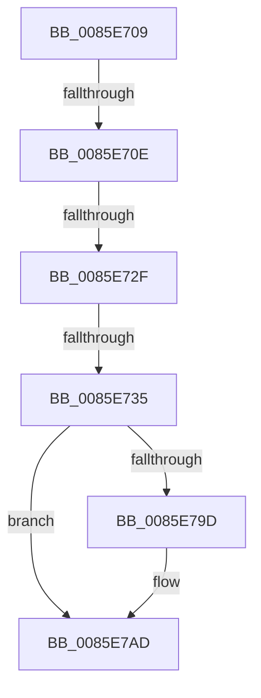

# sub_0085E709

- RVA: `0x0085E709`–`0x0085E7B7` (길이 `174` bytes)
- VA: `0x000000014085E709`
- 실행 섹션: `PAGE`
- PDB 이름 있음: `아니요`; PDB Function 태그: `아니요`
- unwind 정보 RVA: `0x0006B108`
- 디코드: `48`개 명령, `174/174` bytes 표시
- 미해석 바이트: `0` (있으면 어셈블리에 `.byte`로 보존)

> 이 문서는 커널 이미지의 기계어와 PDB 기호를 분석해 생성했습니다. 4번과 5번은 함수 원형과 자료형을 바이너리 사용 방식에서 추정한 C 해석이며 원본 소스 복구 결과는 아닙니다.

## 1. Dependencies

- 직접 호출 지점: **4**; 고유 호출 대상: **3**
- 직접 호출자로 확인된 함수: **0**
- RIP 상대 이미지 참조: **0**

### Outgoing calls
- `0x0085E73B` → [CmpUnlockKcb](../../pagecmrc/BC/CmpUnlockKcb_function_00BC92C0.md) (function, `0x00BC92C0`)
- `0x0085E743` → [CmpUnlockKcb](../../pagecmrc/BC/CmpUnlockKcb_function_00BC92C0.md) (function, `0x00BC92C0`)
- `0x0085E786` → [KeAbPreAcquire](../../text/21/KeAbPreAcquire_function_00210230.md) (function, `0x00210230`)
- `0x0085E7A8` → [ExfAcquirePushLockSharedEx](../../text/21/ExfAcquirePushLockSharedEx_function_0021044C.md) (function, `0x0021044C`)

### Direct callers
- 이 함수 시작 RVA로 연결되는 직접 call은 확인되지 않았습니다. 간접 호출은 완전히 역산할 수 없습니다.

### Static image references
- 디코드된 RIP-relative 메모리 참조가 없습니다.

## 2. Other-region calls and transfers

- 다른 실행 섹션으로 향하는 call: **4**
  - `0x0085E73B` → [CmpUnlockKcb](../../pagecmrc/BC/CmpUnlockKcb_function_00BC92C0.md) (`PAGE` → `PAGECMRC`)
  - `0x0085E743` → [CmpUnlockKcb](../../pagecmrc/BC/CmpUnlockKcb_function_00BC92C0.md) (`PAGE` → `PAGECMRC`)
  - `0x0085E786` → [KeAbPreAcquire](../../text/21/KeAbPreAcquire_function_00210230.md) (`PAGE` → `.text`)
  - `0x0085E7A8` → [ExfAcquirePushLockSharedEx](../../text/21/ExfAcquirePushLockSharedEx_function_0021044C.md) (`PAGE` → `.text`)
- call이 아닌 외부 분기/꼬리 이동: **4**
  - `0x0085E70C` → [sub_0085E68A + 0x5C](Unknown_function_0085E68A.md) (`tail-transfer`)
  - `0x0085E729` → [sub_0085E9FA](Unknown_function_0085E9FA.md) (`tail-transfer`)
  - `0x0085E72F` → [sub_0085EA4F](Unknown_function_0085EA4F.md) (`tail-transfer`)
  - `0x0085E7B5` → [sub_0085E7B7 + 0x4](Unknown_function_0085E7B7.md) (`tail-transfer`)

## 3. Assembly (complete function range)

```asm
0085E709  4D 3B FD                        cmp r15, r13
0085E70C  74 D8                           je 0x14085e6e6
0085E70E  41 8B 47 08                     mov eax, dword ptr [r15 + 8]
0085E712  41 8B 4D 08                     mov ecx, dword ptr [r13 + 8]
0085E716  C1 E8 15                        shr eax, 0x15
0085E719  C1 E9 15                        shr ecx, 0x15
0085E71C  25 FF 03 00 00                  and eax, 0x3ff
0085E721  81 E1 FF 03 00 00               and ecx, 0x3ff
0085E727  3B C1                           cmp eax, ecx
0085E729  0F 87 CB 02 00 00               ja 0x14085e9fa
0085E72F  0F 83 1A 03 00 00               jae 0x14085ea4f
0085E735  49 8B CD                        mov rcx, r13
0085E738  49 8B FF                        mov rdi, r15
0085E73B  E8 80 AB 36 00                  call 0x140bc92c0
0085E740  48 8B CF                        mov rcx, rdi
0085E743  E8 78 AB 36 00                  call 0x140bc92c0
0085E748  49 8B 7F 20                     mov rdi, qword ptr [r15 + 0x20]
0085E74C  8B C3                           mov eax, ebx
0085E74E  C1 E8 09                        shr eax, 9
0085E751  45 33 C0                        xor r8d, r8d
0085E754  33 C3                           xor eax, ebx
0085E756  69 C0 A3 8A 01 00               imul eax, eax, 0x18aa3
0085E75C  8B C8                           mov ecx, eax
0085E75E  8B D0                           mov edx, eax
0085E760  48 8B 87 70 06 00 00            mov rax, qword ptr [rdi + 0x670]
0085E767  48 C1 EA 09                     shr rdx, 9
0085E76B  48 33 D1                        xor rdx, rcx
0085E76E  8B 8F 78 06 00 00               mov ecx, dword ptr [rdi + 0x678]
0085E774  FF C9                           dec ecx
0085E776  48 23 D1                        and rdx, rcx
0085E779  48 8D 0C 52                     lea rcx, [rdx + rdx*2]
0085E77D  33 D2                           xor edx, edx
0085E77F  48 8D 2C C8                     lea rbp, [rax + rcx*8]
0085E783  48 8B CD                        mov rcx, rbp
0085E786  E8 A5 1A 9B FF                  call 0x140210230
0085E78B  48 8B F0                        mov rsi, rax
0085E78E  B9 11 00 00 00                  mov ecx, 0x11
0085E793  33 C0                           xor eax, eax
0085E795  F0 48 0F B1 4D 00               lock cmpxchg qword ptr [rbp], rcx
0085E79B  74 10                           je 0x14085e7ad
0085E79D  4C 8B CD                        mov r9, rbp
0085E7A0  4C 8B C6                        mov r8, rsi
0085E7A3  33 D2                           xor edx, edx
0085E7A5  48 8B CD                        mov rcx, rbp
0085E7A8  E8 9F 1C 9B FF                  call 0x14021044c
0085E7AD  48 8B 6C 24 50                  mov rbp, qword ptr [rsp + 0x50]
0085E7B2  48 85 F6                        test rsi, rsi
0085E7B5  74 04                           je 0x14085e7bb
```

## 4. C-style interpretation (structured pseudocode)

```c
__int64 __fastcall sub_0085E709(__int64 a1, __int64 a2, int a3, __int64 a4, __int64 a5, __int64 a6, __int64 a7, __int64 a8, __int64 a9, __int64 a10)
{
    __int64 result;

    result = (unsigned int)(((unsigned int)(*(unsigned int *)(v_r15 + 8))) >> (21));
    a1 = (unsigned int)(((unsigned int)(*(unsigned int *)(v_r13 + 8))) >> (21));
    result = (unsigned int)((result) & (0x3FFULL));
    a1 = (unsigned int)((a1) & (0x3FFULL));
    result = CmpUnlockKcb(v_r13, a2, a3, a4);
    result = CmpUnlockKcb(v_r15, a2, a3, a4);
    result = (unsigned int)(((unsigned int)((unsigned int)(v_rbx))) >> (9));
    a3 = 0;
    result = (unsigned int)((result) ^ ((unsigned int)(v_rbx)));
    result = (unsigned int)((result) * ((unsigned int)(result)));
    a2 = ((unsigned int)((unsigned int)(result))) >> (9);
    a2 = (a2) ^ ((unsigned int)((unsigned int)(result)));
    a1 = (unsigned int)(((unsigned int)(*(unsigned int *)(*(unsigned __int64 *)(v_r15 + 32) + 1656))) - 1);
    a2 = (a2) & (a1);
    a2 = 0;
    result = KeAbPreAcquire(*(unsigned __int64 *)(*(unsigned __int64 *)(v_r15 + 32) + 1648) + a2 + a2 * 2 * 8, a2, a3, a4);
    result = 0;
    if (!(condition_is_equal)) {
        a4 = *(unsigned __int64 *)(*(unsigned __int64 *)(v_r15 + 32) + 1648) + a2 + a2 * 2 * 8;
        a3 = 0;
        a2 = 0;
        a1 = *(unsigned __int64 *)(*(unsigned __int64 *)(v_r15 + 32) + 1648) + a2 + a2 * 2 * 8;
        result = ExfAcquirePushLockSharedEx(a1, a2, a3, a4);
    }
}
```

## 5. (Beta) C Style

```c
int64_t sub_0085E709(int64_t Arg1, int64_t Arg2, int32_t Arg3, int64_t Arg4, uint64_t Arg5, uint64_t Arg6, uint64_t Arg7, uint64_t Arg8, uint64_t Arg9, int64_t Arg10)
{
    int64_t result;

    result = (uint32_t)(((uint32_t)(*(uint32_t *)(local_r15 + 0x8))) >> (21));
    Arg1 = (uint32_t)(((uint32_t)(*(uint32_t *)(local_r13 + 0x8))) >> (21));
    result = (uint32_t)((result) & (0x3FFULL));
    Arg1 = (uint32_t)((Arg1) & (0x3FFULL));
    result = CmpUnlockKcb(local_r13, Arg2, Arg3, Arg4);
    result = CmpUnlockKcb(local_r15, Arg2, Arg3, Arg4);
    result = (uint32_t)(((uint32_t)((uint32_t)(local_rbx))) >> (9));
    Arg3 = 0;
    result = (uint32_t)((result) ^ ((uint32_t)(local_rbx)));
    result = (uint32_t)((result) * ((uint32_t)(result)));
    Arg2 = ((uint32_t)((uint32_t)(result))) >> (9);
    Arg2 = (Arg2) ^ ((uint32_t)((uint32_t)(result)));
    Arg1 = (uint32_t)(((uint32_t)(*(uint32_t *)(*(uint64_t *)(local_r15 + 0x20) + 0x678))) - 1);
    Arg2 = (Arg2) & (Arg1);
    Arg2 = 0;
    result = KeAbPreAcquire(*(uint64_t *)(*(uint64_t *)(local_r15 + 0x20) + 0x670) + Arg2 + Arg2 * 2 * 8, Arg2, Arg3, Arg4);
    result = 0;
    if (!(condition_is_equal)) {
        Arg4 = *(uint64_t *)(*(uint64_t *)(local_r15 + 0x20) + 0x670) + Arg2 + Arg2 * 2 * 8;
        Arg3 = 0;
        Arg2 = 0;
        Arg1 = *(uint64_t *)(*(uint64_t *)(local_r15 + 0x20) + 0x670) + Arg2 + Arg2 * 2 * 8;
        result = ExfAcquirePushLockSharedEx(Arg1, Arg2, Arg3, Arg4);
    }
}
```

## 6. Execution-region graph

[열기: 2D/3D 그래프와 함수 탐색 컨트롤 패널](../../../control-panel.html?section=page&rva=0x0085E709&view=graph)

- 2D 그래프는 위에서 아래로 흐르고, 3D 그래프는 빈 공간을 드래그해 회전합니다. Shift+드래그는 이동, 휠은 확대·축소, 함수 노드 선택은 대상 보고서 이동입니다.

### Static fallback


