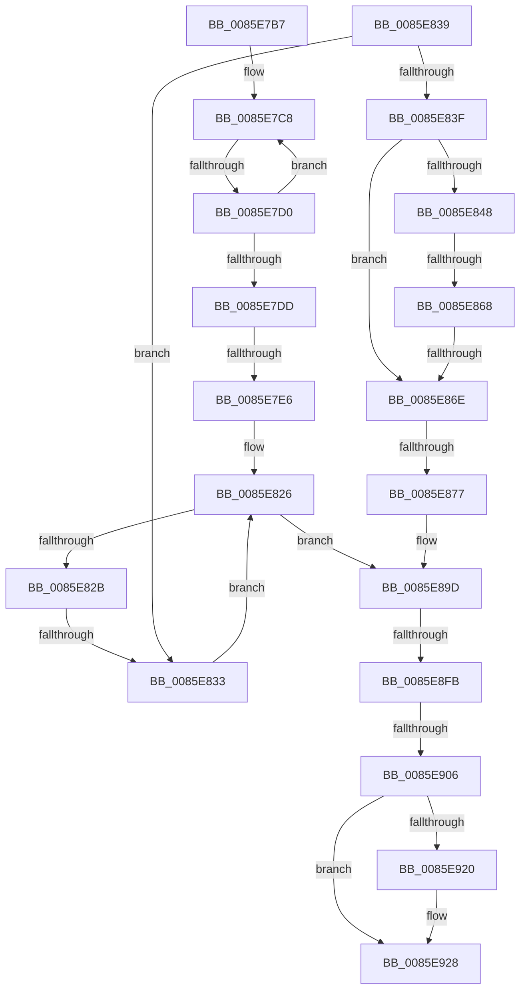

# sub_0085E7B7

- RVA: `0x0085E7B7`–`0x0085E941` (길이 `394` bytes)
- VA: `0x000000014085E7B7`
- 실행 섹션: `PAGE`
- PDB 이름 있음: `아니요`; PDB Function 태그: `아니요`
- unwind 정보 RVA: `0x0006B120`
- 디코드: `104`개 명령, `394/394` bytes 표시
- 미해석 바이트: `0` (있으면 어셈블리에 `.byte`로 보존)

> 이 문서는 커널 이미지의 기계어와 PDB 기호를 분석해 생성했습니다. 4번과 5번은 함수 원형과 자료형을 바이너리 사용 방식에서 추정한 C 해석이며 원본 소스 복구 결과는 아닙니다.

## 1. Dependencies

- 직접 호출 지점: **6**; 고유 호출 대상: **5**
- 직접 호출자로 확인된 함수: **0**
- RIP 상대 이미지 참조: **0**

### Outgoing calls
- `0x0085E7EC` → [CmpLockKcbShared](../../pagecmrc/BC/CmpLockKcbShared_function_00BC9A1C.md) (function, `0x00BC9A1C`)
- `0x0085E87D` → [CmpLockKcbShared](../../pagecmrc/BC/CmpLockKcbShared_function_00BC9A1C.md) (function, `0x00BC9A1C`)
- `0x0085E885` → [CmpReferenceKeyControlBlock](CmpReferenceKeyControlBlock_function_0085D370.md) (function, `0x0085D370`)
- `0x0085E898` → [CmpUnlockKcb](../../pagecmrc/BC/CmpUnlockKcb_function_00BC92C0.md) (function, `0x00BC92C0`)
- `0x0085E909` → [KeAbPostRelease](../../text/2E/KeAbPostRelease_function_002E1600.md) (function, `0x002E1600`)
- `0x0085E923` → [CmpDeleteHive](../86/CmpDeleteHive_function_0086450C.md) (function, `0x0086450C`)

### Direct callers
- 이 함수 시작 RVA로 연결되는 직접 call은 확인되지 않았습니다. 간접 호출은 완전히 역산할 수 없습니다.

### Static image references
- 디코드된 RIP-relative 메모리 참조가 없습니다.

## 2. Other-region calls and transfers

- 다른 실행 섹션으로 향하는 call: **4**
  - `0x0085E7EC` → [CmpLockKcbShared](../../pagecmrc/BC/CmpLockKcbShared_function_00BC9A1C.md) (`PAGE` → `PAGECMRC`)
  - `0x0085E87D` → [CmpLockKcbShared](../../pagecmrc/BC/CmpLockKcbShared_function_00BC9A1C.md) (`PAGE` → `PAGECMRC`)
  - `0x0085E898` → [CmpUnlockKcb](../../pagecmrc/BC/CmpUnlockKcb_function_00BC92C0.md) (`PAGE` → `PAGECMRC`)
  - `0x0085E909` → [KeAbPostRelease](../../text/2E/KeAbPostRelease_function_002E1600.md) (`PAGE` → `.text`)
- call이 아닌 외부 분기/꼬리 이동: **8**
  - `0x0085E7CA` → [sub_0085E9A1](Unknown_function_0085E9A1.md) (`tail-transfer`)
  - `0x0085E7E0` → [sub_0085E9A1 + 0x1D](Unknown_function_0085E9A1.md) (`tail-transfer`)
  - `0x0085E82D` → [sub_0085E942](Unknown_function_0085E942.md) (`tail-transfer`)
  - `0x0085E862` → [sub_0085E942 + 0x30](Unknown_function_0085E942.md) (`tail-transfer`)
  - `0x0085E868` → [sub_0085E942 + 0xF](Unknown_function_0085E942.md) (`tail-transfer`)
  - `0x0085E871` → [sub_0085EABD + 0x3D](Unknown_function_0085EABD.md) (`tail-transfer`)
  - `0x0085E8F5` → [sub_0085E942 + 0x48](Unknown_function_0085E942.md) (`tail-transfer`)
  - `0x0085E900` → [sub_0085E942 + 0x48](Unknown_function_0085E942.md) (`tail-transfer`)

## 3. Assembly (complete function range)

```asm
0085E7B7  C6 46 0A 01                     mov byte ptr [rsi + 0xa], 1
0085E7BB  0F 0D 8F 88 10 00 00            prefetchw byte ptr [rdi + 0x1088]
0085E7C2  8B 87 88 10 00 00               mov eax, dword ptr [rdi + 0x1088]
0085E7C8  85 C0                           test eax, eax
0085E7CA  0F 84 D1 01 00 00               je 0x14085e9a1
0085E7D0  8D 48 01                        lea ecx, [rax + 1]
0085E7D3  F0 0F B1 8F 88 10 00 00         lock cmpxchg dword ptr [rdi + 0x1088], ecx
0085E7DB  75 EB                           jne 0x14085e7c8
0085E7DD  4D 85 ED                        test r13, r13
0085E7E0  0F 85 D8 01 00 00               jne 0x14085e9be
0085E7E6  49 8B FF                        mov rdi, r15
0085E7E9  48 8B CF                        mov rcx, rdi
0085E7EC  E8 2B B2 36 00                  call 0x140bc9a1c
0085E7F1  8B C3                           mov eax, ebx
0085E7F3  C1 E8 09                        shr eax, 9
0085E7F6  33 C3                           xor eax, ebx
0085E7F8  69 C0 A3 8A 01 00               imul eax, eax, 0x18aa3
0085E7FE  8B C8                           mov ecx, eax
0085E800  8B D0                           mov edx, eax
0085E802  48 C1 EA 09                     shr rdx, 9
0085E806  48 33 D1                        xor rdx, rcx
0085E809  41 8B 8E 78 06 00 00            mov ecx, dword ptr [r14 + 0x678]
0085E810  FF C9                           dec ecx
0085E812  48 23 D1                        and rdx, rcx
0085E815  48 8B 8C 24 90 00 00 00         mov rcx, qword ptr [rsp + 0x90]
0085E81D  48 8D 04 52                     lea rax, [rdx + rdx*2]
0085E821  48 8B 4C C1 10                  mov rcx, qword ptr [rcx + rax*8 + 0x10]
0085E826  48 85 C9                        test rcx, rcx
0085E829  74 72                           je 0x14085e89d
0085E82B  3B 19                           cmp ebx, dword ptr [rcx]
0085E82D  0F 84 0F 01 00 00               je 0x14085e942
0085E833  48 8B 49 08                     mov rcx, qword ptr [rcx + 8]
0085E837  EB ED                           jmp 0x14085e826
0085E839  4C 3B 71 10                     cmp r14, qword ptr [rcx + 0x10]
0085E83D  75 F4                           jne 0x14085e833
0085E83F  48 8D 79 F0                     lea rdi, [rcx - 0x10]
0085E843  4C 3B FF                        cmp r15, rdi
0085E846  74 26                           je 0x14085e86e
0085E848  8B 47 08                        mov eax, dword ptr [rdi + 8]
0085E84B  41 8B 4F 08                     mov ecx, dword ptr [r15 + 8]
0085E84F  C1 E8 15                        shr eax, 0x15
0085E852  C1 E9 15                        shr ecx, 0x15
0085E855  25 FF 03 00 00                  and eax, 0x3ff
0085E85A  81 E1 FF 03 00 00               and ecx, 0x3ff
0085E860  3B C8                           cmp ecx, eax
0085E862  0F 87 0A 01 00 00               ja 0x14085e972
0085E868  0F 83 E3 00 00 00               jae 0x14085e951
0085E86E  4D 85 ED                        test r13, r13
0085E871  0F 85 83 02 00 00               jne 0x14085eafa
0085E877  4C 8B EF                        mov r13, rdi
0085E87A  49 8B CD                        mov rcx, r13
0085E87D  E8 9A B1 36 00                  call 0x140bc9a1c
0085E882  48 8B CF                        mov rcx, rdi
0085E885  E8 E6 EA FF FF                  call 0x14085d370
0085E88A  48 8B 84 24 B0 00 00 00         mov rax, qword ptr [rsp + 0xb0]
0085E892  48 8B CF                        mov rcx, rdi
0085E895  48 89 38                        mov qword ptr [rax], rdi
0085E898  E8 23 AA 36 00                  call 0x140bc92c0
0085E89D  49 8B 7F 20                     mov rdi, qword ptr [r15 + 0x20]
0085E8A1  8B C3                           mov eax, ebx
0085E8A3  C1 E8 09                        shr eax, 9
0085E8A6  33 C3                           xor eax, ebx
0085E8A8  69 C0 A3 8A 01 00               imul eax, eax, 0x18aa3
0085E8AE  8B C8                           mov ecx, eax
0085E8B0  8B D0                           mov edx, eax
0085E8B2  48 8B 87 70 06 00 00            mov rax, qword ptr [rdi + 0x670]
0085E8B9  48 C1 EA 09                     shr rdx, 9
0085E8BD  48 33 D1                        xor rdx, rcx
0085E8C0  8B 8F 78 06 00 00               mov ecx, dword ptr [rdi + 0x678]
0085E8C6  FF C9                           dec ecx
0085E8C8  48 23 D1                        and rdx, rcx
0085E8CB  45 33 C0                        xor r8d, r8d
0085E8CE  48 8D 0C 52                     lea rcx, [rdx + rdx*2]
0085E8D2  48 8D 1C C8                     lea rbx, [rax + rcx*8]
0085E8D6  4C 89 43 08                     mov qword ptr [rbx + 8], r8
0085E8DA  0F 0D 0B                        prefetchw byte ptr [rbx]
0085E8DD  48 8B 03                        mov rax, qword ptr [rbx]
0085E8E0  48 8B C8                        mov rcx, rax
0085E8E3  48 83 E1 F0                     and rcx, 0xfffffffffffffff0
0085E8E7  48 83 F9 10                     cmp rcx, 0x10
0085E8EB  48 8D 50 F0                     lea rdx, [rax - 0x10]
0085E8EF  49 0F 46 D0                     cmovbe rdx, r8
0085E8F3  A8 02                           test al, 2
0085E8F5  0F 85 8F 00 00 00               jne 0x14085e98a
0085E8FB  F0 48 0F B1 13                  lock cmpxchg qword ptr [rbx], rdx
0085E900  0F 85 84 00 00 00               jne 0x14085e98a
0085E906  48 8B CB                        mov rcx, rbx
0085E909  E8 F2 2C A8 FF                  call 0x1402e1600
0085E90E  B8 FF FF FF FF                  mov eax, 0xffffffff
0085E913  F0 0F C1 87 88 10 00 00         lock xadd dword ptr [rdi + 0x1088], eax
0085E91B  83 F8 01                        cmp eax, 1
0085E91E  75 08                           jne 0x14085e928
0085E920  48 8B CF                        mov rcx, rdi
0085E923  E8 E4 5B 00 00                  call 0x14086450c
0085E928  48 8B 9C 24 98 00 00 00         mov rbx, qword ptr [rsp + 0x98]
0085E930  33 C0                           xor eax, eax
0085E932  48 83 C4 58                     add rsp, 0x58
0085E936  41 5F                           pop r15
0085E938  41 5E                           pop r14
0085E93A  41 5D                           pop r13
0085E93C  41 5C                           pop r12
0085E93E  5F                              pop rdi
0085E93F  5E                              pop rsi
0085E940  C3                              ret
```

## 4. C-style interpretation (structured pseudocode)

```c
__int64 __fastcall sub_0085E7B7(__int64 a1, __int64 a2, int a3, __int64 a4, __int64 a5, __int64 a6, __int64 a7, __int64 a8, __int64 a9, __int64 a10, __int64 a11, __int64 a12, __int64 a13, __int64 a14, __int64 a15, __int64 a16, __int64 a17, __int64 a18, __int64 a19)
{
    __int64 result;
    __int64 v_rsp;
    unsigned __int64 v_stack_pB0;

    *(unsigned __int8 *)(v_rsi + 10) = 1;
loc_0085E7C8:
    if ((unsigned int)((unsigned int)(*(unsigned int *)(v_rdi + 4232))) != 0) goto loc_0085E7C8;
    result = CmpLockKcbShared(v_r15, a2, a3, a4);
    result = (unsigned int)(((unsigned int)((unsigned int)(v_rbx))) >> (9));
    result = (unsigned int)((result) ^ ((unsigned int)(v_rbx)));
    result = (unsigned int)((result) * ((unsigned int)(result)));
    a2 = ((unsigned int)((unsigned int)(result))) >> (9);
    a2 = (a2) ^ ((unsigned int)((unsigned int)(result)));
    a1 = (unsigned int)(((unsigned int)(*(unsigned int *)(v_r14 + 1656))) - 1);
    a2 = (a2) & (a1);
loc_0085E826:
    if (*(unsigned __int64 *)(a18 + a2 + a2 * 2 * 8 + 16) == 0) goto loc_0085E89D;
loc_0085E833:
    goto loc_0085E826;
loc_0085E89D:
    result = (unsigned int)(((unsigned int)((unsigned int)(v_rbx))) >> (9));
    result = (unsigned int)((result) ^ ((unsigned int)(v_rbx)));
    result = (unsigned int)((result) * ((unsigned int)(result)));
    a2 = ((unsigned int)((unsigned int)(result))) >> (9);
    a2 = (a2) ^ ((unsigned int)((unsigned int)(result)));
    a1 = (unsigned int)(((unsigned int)(*(unsigned int *)(*(unsigned __int64 *)(v_r15 + 32) + 1656))) - 1);
    a2 = (a2) & (a1);
    a3 = 0;
    *(unsigned __int64 *)(*(unsigned __int64 *)(*(unsigned __int64 *)(v_r15 + 32) + 1648) + a2 + a2 * 2 * 8 + 8) = 0;
    a1 = (*(unsigned __int64 *)(*(unsigned __int64 *)(*(unsigned __int64 *)(v_r15 + 32) + 1648) + a2 + a2 * 2 * 8)) & (-16);
    a2 = *(unsigned __int64 *)(*(unsigned __int64 *)(*(unsigned __int64 *)(v_r15 + 32) + 1648) + a2 + a2 * 2 * 8) - 16;
    if (a1 <= 16) { a2 = 0; }
    result = KeAbPostRelease(*(unsigned __int64 *)(*(unsigned __int64 *)(v_r15 + 32) + 1648) + a2 + a2 * 2 * 8, a2, a3, a4);
    result = (unsigned int)(0xFFFFFFFFULL);
    if (((unsigned int)((unsigned int)(0xFFFFFFFFULL))) == 1) {
        a1 = *(unsigned __int64 *)(v_r15 + 32);
        result = CmpDeleteHive(a1, a2, a3, a4);
    }
    result = 0;
    v_rsp = (v_rsp) + (88);
    return result;
}
```

## 5. (Beta) C Style

```c
int64_t sub_0085E7B7(int64_t Arg1, int64_t Arg2, int32_t Arg3, int64_t Arg4, uint64_t Arg5, uint64_t Arg6, uint64_t Arg7, uint64_t Arg8, uint64_t Arg9, uint64_t Arg10, uint64_t Arg11, uint64_t Arg12, uint64_t Arg13, uint64_t Arg14, uint64_t Arg15, uint64_t Arg16, uint64_t Arg17, void *Arg18, int64_t Arg19)
{
    uint8_t *arg18 = (uint8_t *)Arg18;

    int64_t result;
    int64_t local_rsp;
    uint64_t v_stack_pB0;

    *(uint8_t *)(local_rsi + 0xA) = 1;
loc_0085E7C8:
    if ((uint32_t)((uint32_t)(*(uint32_t *)(local_rdi + 0x1088))) != 0) goto loc_0085E7C8;
    result = CmpLockKcbShared(local_r15, Arg2, Arg3, Arg4);
    result = (uint32_t)(((uint32_t)((uint32_t)(local_rbx))) >> (9));
    result = (uint32_t)((result) ^ ((uint32_t)(local_rbx)));
    result = (uint32_t)((result) * ((uint32_t)(result)));
    Arg2 = ((uint32_t)((uint32_t)(result))) >> (9);
    Arg2 = (Arg2) ^ ((uint32_t)((uint32_t)(result)));
    Arg1 = (uint32_t)(((uint32_t)(*(uint32_t *)(local_r14 + 0x678))) - 1);
    Arg2 = (Arg2) & (Arg1);
loc_0085E826:
    if (*(uint64_t *)(arg18 + Arg2 + Arg2 * 2 * 8 + 0x10) == 0) goto loc_0085E89D;
loc_0085E833:
    goto loc_0085E826;
loc_0085E89D:
    result = (uint32_t)(((uint32_t)((uint32_t)(local_rbx))) >> (9));
    result = (uint32_t)((result) ^ ((uint32_t)(local_rbx)));
    result = (uint32_t)((result) * ((uint32_t)(result)));
    Arg2 = ((uint32_t)((uint32_t)(result))) >> (9);
    Arg2 = (Arg2) ^ ((uint32_t)((uint32_t)(result)));
    Arg1 = (uint32_t)(((uint32_t)(*(uint32_t *)(*(uint64_t *)(local_r15 + 0x20) + 0x678))) - 1);
    Arg2 = (Arg2) & (Arg1);
    Arg3 = 0;
    *(uint64_t *)(*(uint64_t *)(*(uint64_t *)(local_r15 + 0x20) + 0x670) + Arg2 + Arg2 * 2 * 8 + 0x8) = 0;
    Arg1 = (*(uint64_t *)(*(uint64_t *)(*(uint64_t *)(local_r15 + 0x20) + 0x670) + Arg2 + Arg2 * 2 * 8)) & (-16);
    Arg2 = *(uint64_t *)(*(uint64_t *)(*(uint64_t *)(local_r15 + 0x20) + 0x670) + Arg2 + Arg2 * 2 * 8) - 16;
    if (Arg1 <= 16) { Arg2 = 0; }
    result = KeAbPostRelease(*(uint64_t *)(*(uint64_t *)(local_r15 + 0x20) + 0x670) + Arg2 + Arg2 * 2 * 8, Arg2, Arg3, Arg4);
    result = (uint32_t)(0xFFFFFFFFULL);
    if (((uint32_t)((uint32_t)(0xFFFFFFFFULL))) == 1) {
        Arg1 = *(uint64_t *)(local_r15 + 0x20);
        result = CmpDeleteHive(Arg1, Arg2, Arg3, Arg4);
    }
    result = 0;
    local_rsp = (local_rsp) + (88);
    return result;
}
```

### 관측된 메모리 오프셋

구조체 형식이 확인되지 않은 접근은 인자 기준의 오프셋으로만 기록했습니다.

| 기준 인자 | 오프셋 표현 | 폭 (bit) | 접근 |
|---|---:|---:|---|
| `Arg18` | `+ 0x10 + rax*8` | `64` | `R` |

## 6. Execution-region graph

[열기: 2D/3D 그래프와 함수 탐색 컨트롤 패널](../../../control-panel.html?section=page&rva=0x0085E7B7&view=graph)

- 2D 그래프는 위에서 아래로 흐르고, 3D 그래프는 빈 공간을 드래그해 회전합니다. Shift+드래그는 이동, 휠은 확대·축소, 함수 노드 선택은 대상 보고서 이동입니다.

### Static fallback


