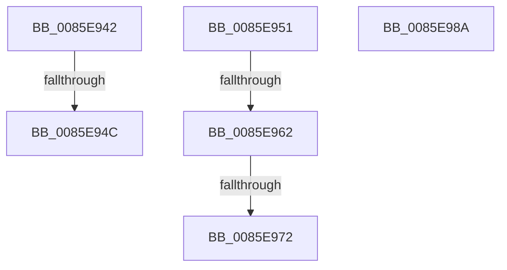

# sub_0085E942

- RVA: `0x0085E942`–`0x0085E997` (길이 `85` bytes)
- VA: `0x000000014085E942`
- 실행 섹션: `PAGE`
- PDB 이름 있음: `아니요`; PDB Function 태그: `아니요`
- unwind 정보 RVA: `0x0006B148`
- 디코드: `17`개 명령, `85/85` bytes 표시
- 미해석 바이트: `0` (있으면 어셈블리에 `.byte`로 보존)

> 이 문서는 커널 이미지의 기계어와 PDB 기호를 분석해 생성했습니다. 4번과 5번은 함수 원형과 자료형을 바이너리 사용 방식에서 추정한 C 해석이며 원본 소스 복구 결과는 아닙니다.

## 1. Dependencies

- 직접 호출 지점: **3**; 고유 호출 대상: **3**
- 직접 호출자로 확인된 함수: **0**
- RIP 상대 이미지 참조: **0**

### Outgoing calls
- `0x0085E975` → [CmpUnlockKcb](../../pagecmrc/BC/CmpUnlockKcb_function_00BC92C0.md) (function, `0x00BC92C0`)
- `0x0085E97D` → [CmpLockKcbShared](../../pagecmrc/BC/CmpLockKcbShared_function_00BC9A1C.md) (function, `0x00BC9A1C`)
- `0x0085E98D` → [ExfReleasePushLock](../../text/26/ExfReleasePushLock_function_002638D0.md) (function, `0x002638D0`)

### Direct callers
- 이 함수 시작 RVA로 연결되는 직접 call은 확인되지 않았습니다. 간접 호출은 완전히 역산할 수 없습니다.

### Static image references
- 디코드된 RIP-relative 메모리 참조가 없습니다.

## 2. Other-region calls and transfers

- 다른 실행 섹션으로 향하는 call: **3**
  - `0x0085E975` → [CmpUnlockKcb](../../pagecmrc/BC/CmpUnlockKcb_function_00BC92C0.md) (`PAGE` → `PAGECMRC`)
  - `0x0085E97D` → [CmpLockKcbShared](../../pagecmrc/BC/CmpLockKcbShared_function_00BC9A1C.md) (`PAGE` → `PAGECMRC`)
  - `0x0085E98D` → [ExfReleasePushLock](../../text/26/ExfReleasePushLock_function_002638D0.md) (`PAGE` → `.text`)
- call이 아닌 외부 분기/꼬리 이동: **6**
  - `0x0085E946` → [sub_0085E7B7 + 0x7C](Unknown_function_0085E7B7.md) (`tail-transfer`)
  - `0x0085E94C` → [sub_0085E7B7 + 0x82](Unknown_function_0085E7B7.md) (`tail-transfer`)
  - `0x0085E95C` → [sub_0085EABD + 0x1F](Unknown_function_0085EABD.md) (`tail-transfer`)
  - `0x0085E96C` → [sub_0085EABD + 0x1F](Unknown_function_0085EABD.md) (`tail-transfer`)
  - `0x0085E985` → [sub_0085E7B7 + 0xC3](Unknown_function_0085E7B7.md) (`tail-transfer`)
  - `0x0085E992` → [sub_0085E7B7 + 0x14F](Unknown_function_0085E7B7.md) (`tail-transfer`)

## 3. Assembly (complete function range)

```asm
0085E942  44 3B 61 18                     cmp r12d, dword ptr [rcx + 0x18]
0085E946  0F 85 E7 FE FF FF               jne 0x14085e833
0085E94C  E9 E8 FE FF FF                  jmp 0x14085e839
0085E951  41 0F B7 8F BA 00 00 00         movzx ecx, word ptr [r15 + 0xba]
0085E959  F6 C1 04                        test cl, 4
0085E95C  0F 84 7A 01 00 00               je 0x14085eadc
0085E962  F7 87 B8 00 00 00 00 00 02 00   test dword ptr [rdi + 0xb8], 0x20000
0085E96C  0F 84 6A 01 00 00               je 0x14085eadc
0085E972  49 8B CF                        mov rcx, r15
0085E975  E8 46 A9 36 00                  call 0x140bc92c0
0085E97A  48 8B CF                        mov rcx, rdi
0085E97D  E8 9A B0 36 00                  call 0x140bc9a1c
0085E982  4D 8B EF                        mov r13, r15
0085E985  E9 F0 FE FF FF                  jmp 0x14085e87a
0085E98A  48 8B CB                        mov rcx, rbx
0085E98D  E8 3E 4F A0 FF                  call 0x1402638d0
0085E992  E9 6F FF FF FF                  jmp 0x14085e906
```

## 4. C-style interpretation (structured pseudocode)

```c
__int64 __fastcall sub_0085E942(__int64 a1)
{
}
```

## 5. (Beta) C Style

```c
int64_t sub_0085E942(void *Arg1)
{
    uint8_t *arg1 = (uint8_t *)Arg1;

}
```

### 관측된 메모리 오프셋

구조체 형식이 확인되지 않은 접근은 인자 기준의 오프셋으로만 기록했습니다.

| 기준 인자 | 오프셋 표현 | 폭 (bit) | 접근 |
|---|---:|---:|---|
| `Arg1` | `+ 0x18` | `32` | `R` |

## 6. Execution-region graph

[열기: 2D/3D 그래프와 함수 탐색 컨트롤 패널](../../../control-panel.html?section=page&rva=0x0085E942&view=graph)

- 2D 그래프는 위에서 아래로 흐르고, 3D 그래프는 빈 공간을 드래그해 회전합니다. Shift+드래그는 이동, 휠은 확대·축소, 함수 노드 선택은 대상 보고서 이동입니다.

### Static fallback


