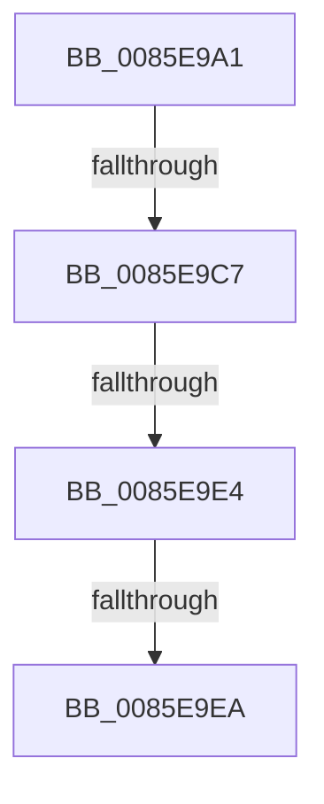

# sub_0085E9A1

- RVA: `0x0085E9A1`–`0x0085E9FA` (길이 `89` bytes)
- VA: `0x000000014085E9A1`
- 실행 섹션: `PAGE`
- PDB 이름 있음: `아니요`; PDB Function 태그: `아니요`
- unwind 정보 RVA: `0x0006B174`
- 디코드: `23`개 명령, `89/89` bytes 표시
- 미해석 바이트: `0` (있으면 어셈블리에 `.byte`로 보존)

> 이 문서는 커널 이미지의 기계어와 PDB 기호를 분석해 생성했습니다. 4번과 5번은 함수 원형과 자료형을 바이너리 사용 방식에서 추정한 C 해석이며 원본 소스 복구 결과는 아닙니다.

## 1. Dependencies

- 직접 호출 지점: **2**; 고유 호출 대상: **2**
- 직접 호출자로 확인된 함수: **0**
- RIP 상대 이미지 참조: **0**

### Outgoing calls
- `0x0085E9B8` → [KeBugCheckEx](../../text/4F/KeBugCheckEx_function_004FD660.md) (function, `0x004FD660`)
- `0x0085E9F0` → [CmpLockKcbShared](../../pagecmrc/BC/CmpLockKcbShared_function_00BC9A1C.md) (function, `0x00BC9A1C`)

### Direct callers
- 이 함수 시작 RVA로 연결되는 직접 call은 확인되지 않았습니다. 간접 호출은 완전히 역산할 수 없습니다.

### Static image references
- 디코드된 RIP-relative 메모리 참조가 없습니다.

## 2. Other-region calls and transfers

- 다른 실행 섹션으로 향하는 call: **2**
  - `0x0085E9B8` → [KeBugCheckEx](../../text/4F/KeBugCheckEx_function_004FD660.md) (`PAGE` → `.text`)
  - `0x0085E9F0` → [CmpLockKcbShared](../../pagecmrc/BC/CmpLockKcbShared_function_00BC9A1C.md) (`PAGE` → `PAGECMRC`)
- call이 아닌 외부 분기/꼬리 이동: **4**
  - `0x0085E9C1` → [sub_0085E7B7 + 0x2F](Unknown_function_0085E7B7.md) (`tail-transfer`)
  - `0x0085E9E2` → [sub_0085EA2A](Unknown_function_0085EA2A.md) (`tail-transfer`)
  - `0x0085E9E4` → [sub_0085EA74](Unknown_function_0085EA74.md) (`tail-transfer`)
  - `0x0085E9F5` → [sub_0085E7B7 + 0x32](Unknown_function_0085E7B7.md) (`tail-transfer`)

## 3. Assembly (complete function range)

```asm
0085E9A1  41 B9 09 00 00 00               mov r9d, 9
0085E9A7  8B C3                           mov eax, ebx
0085E9A9  4C 8B C7                        mov r8, rdi
0085E9AC  48 89 44 24 20                  mov qword ptr [rsp + 0x20], rax
0085E9B1  41 8D 51 0E                     lea edx, [r9 + 0xe]
0085E9B5  8D 4A 3A                        lea ecx, [rdx + 0x3a]
0085E9B8  E8 A3 EC C9 FF                  call 0x1404fd660
0085E9BD  CC                              int3
0085E9BE  4D 3B FD                        cmp r15, r13
0085E9C1  0F 84 1F FE FF FF               je 0x14085e7e6
0085E9C7  41 8B 47 08                     mov eax, dword ptr [r15 + 8]
0085E9CB  41 8B 4D 08                     mov ecx, dword ptr [r13 + 8]
0085E9CF  C1 E8 15                        shr eax, 0x15
0085E9D2  C1 E9 15                        shr ecx, 0x15
0085E9D5  25 FF 03 00 00                  and eax, 0x3ff
0085E9DA  81 E1 FF 03 00 00               and ecx, 0x3ff
0085E9E0  3B C1                           cmp eax, ecx
0085E9E2  77 46                           ja 0x14085ea2a
0085E9E4  0F 83 8A 00 00 00               jae 0x14085ea74
0085E9EA  49 8B FD                        mov rdi, r13
0085E9ED  49 8B CF                        mov rcx, r15
0085E9F0  E8 27 B0 36 00                  call 0x140bc9a1c
0085E9F5  E9 EF FD FF FF                  jmp 0x14085e7e9
```

## 4. C-style interpretation (structured pseudocode)

```c
__int64 __fastcall sub_0085E9A1(void)
{
    __int64 result;
    unsigned __int64 v_stack_p20;

    v_stack_p20 = (unsigned int)((unsigned int)(v_rbx));
    result = KeBugCheckEx(9 + 14 + 58, 9 + 14, v_rdi, 9);
    result = (unsigned int)(((unsigned int)(*(unsigned int *)(v_r15 + 8))) >> (21));
    a1 = (unsigned int)(((unsigned int)(*(unsigned int *)(v_r13 + 8))) >> (21));
    result = (unsigned int)((result) & (0x3FFULL));
    a1 = (unsigned int)((a1) & (0x3FFULL));
    result = CmpLockKcbShared(v_r15, 9 + 14, v_rdi, 9);
}
```

## 5. (Beta) C Style

```c
void sub_0085E9A1(void)
{
    int64_t result;
    uint64_t v_stack_p20;

    v_stack_p20 = (uint32_t)((uint32_t)(local_rbx));
    result = KeBugCheckEx(9 + 14 + 58, 9 + 14, local_rdi, 9);
    result = (uint32_t)(((uint32_t)(*(uint32_t *)(local_r15 + 0x8))) >> (21));
    a1 = (uint32_t)(((uint32_t)(*(uint32_t *)(local_r13 + 0x8))) >> (21));
    result = (uint32_t)((result) & (0x3FFULL));
    a1 = (uint32_t)((a1) & (0x3FFULL));
    result = CmpLockKcbShared(local_r15, 9 + 14, local_rdi, 9);
}
```

## 6. Execution-region graph

[열기: 2D/3D 그래프와 함수 탐색 컨트롤 패널](../../../control-panel.html?section=page&rva=0x0085E9A1&view=graph)

- 2D 그래프는 위에서 아래로 흐르고, 3D 그래프는 빈 공간을 드래그해 회전합니다. Shift+드래그는 이동, 휠은 확대·축소, 함수 노드 선택은 대상 보고서 이동입니다.

### Static fallback


