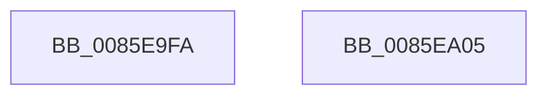

# sub_0085E9FA

- RVA: `0x0085E9FA`–`0x0085EA2A` (길이 `48` bytes)
- VA: `0x000000014085E9FA`
- 실행 섹션: `PAGE`
- PDB 이름 있음: `아니요`; PDB Function 태그: `아니요`
- unwind 정보 RVA: `0x0006B188`
- 디코드: `12`개 명령, `48/48` bytes 표시
- 미해석 바이트: `0` (있으면 어셈블리에 `.byte`로 보존)

> 이 문서는 커널 이미지의 기계어와 PDB 기호를 분석해 생성했습니다. 4번과 5번은 함수 원형과 자료형을 바이너리 사용 방식에서 추정한 C 해석이며 원본 소스 복구 결과는 아닙니다.

## 1. Dependencies

- 직접 호출 지점: **1**; 고유 호출 대상: **1**
- 직접 호출자로 확인된 함수: **0**
- RIP 상대 이미지 참조: **0**

### Outgoing calls
- `0x0085EA19` → [CmpHashUnicodeComponent](../84/CmpHashUnicodeComponent_function_0084AC24.md) (function, `0x0084AC24`)

### Direct callers
- 이 함수 시작 RVA로 연결되는 직접 call은 확인되지 않았습니다. 간접 호출은 완전히 역산할 수 없습니다.

### Static image references
- 디코드된 RIP-relative 메모리 참조가 없습니다.

## 2. Other-region calls and transfers

- 다른 실행 섹션으로 향하는 call: **0**
- call이 아닌 외부 분기/꼬리 이동: **2**
  - `0x0085EA00` → [sub_0085E709 + 0x32](Unknown_function_0085E709.md) (`tail-transfer`)
  - `0x0085EA25` → [sub_0085E68A + 0x39](Unknown_function_0085E68A.md) (`tail-transfer`)

## 3. Assembly (complete function range)

```asm
0085E9FA  49 8B FD                        mov rdi, r13
0085E9FD  49 8B CF                        mov rcx, r15
0085EA00  E9 36 FD FF FF                  jmp 0x14085e73b
0085EA05  66 89 4C 24 38                  mov word ptr [rsp + 0x38], cx
0085EA0A  66 89 4C 24 3A                  mov word ptr [rsp + 0x3a], cx
0085EA0F  48 8D 4C 24 38                  lea rcx, [rsp + 0x38]
0085EA14  48 89 5C 24 40                  mov qword ptr [rsp + 0x40], rbx
0085EA19  E8 06 C2 FE FF                  call 0x14084ac24
0085EA1E  8B D8                           mov ebx, eax
0085EA20  6B C7 25                        imul eax, edi, 0x25
0085EA23  03 D8                           add ebx, eax
0085EA25  E9 99 FC FF FF                  jmp 0x14085e6c3
```

## 4. C-style interpretation (structured pseudocode)

```c
__int64 __fastcall sub_0085E9FA(void)
{
    unsigned __int16 v_stack_p38;
    unsigned __int16 v_stack_p3A;
    unsigned __int64 v_stack_p40;
}
```

## 5. (Beta) C Style

```c
void sub_0085E9FA(void)
{
    uint16_t v_stack_p38;
    uint16_t v_stack_p3A;
    uint64_t v_stack_p40;
}
```

## 6. Execution-region graph

[열기: 2D/3D 그래프와 함수 탐색 컨트롤 패널](../../../control-panel.html?section=page&rva=0x0085E9FA&view=graph)

- 2D 그래프는 위에서 아래로 흐르고, 3D 그래프는 빈 공간을 드래그해 회전합니다. Shift+드래그는 이동, 휠은 확대·축소, 함수 노드 선택은 대상 보고서 이동입니다.

### Static fallback


