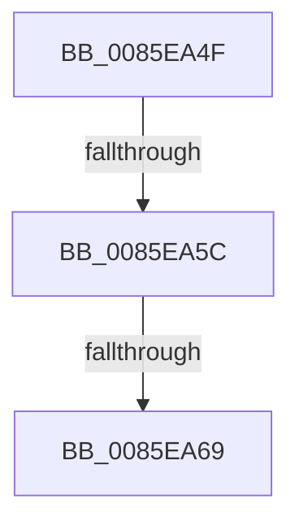

# sub_0085EA4F

- RVA: `0x0085EA4F`–`0x0085EA74` (길이 `37` bytes)
- VA: `0x000000014085EA4F`
- 실행 섹션: `PAGE`
- PDB 이름 있음: `아니요`; PDB Function 태그: `아니요`
- unwind 정보 RVA: `0x0006B1C8`
- 디코드: `8`개 명령, `37/37` bytes 표시
- 미해석 바이트: `0` (있으면 어셈블리에 `.byte`로 보존)

> 이 문서는 커널 이미지의 기계어와 PDB 기호를 분석해 생성했습니다. 4번과 5번은 함수 원형과 자료형을 바이너리 사용 방식에서 추정한 C 해석이며 원본 소스 복구 결과는 아닙니다.

## 1. Dependencies

- 직접 호출 지점: **0**; 고유 호출 대상: **0**
- 직접 호출자로 확인된 함수: **0**
- RIP 상대 이미지 참조: **0**

### Outgoing calls
- 직접 디코드된 call 명령이 없습니다.

### Direct callers
- 이 함수 시작 RVA로 연결되는 직접 call은 확인되지 않았습니다. 간접 호출은 완전히 역산할 수 없습니다.

### Static image references
- 디코드된 RIP-relative 메모리 참조가 없습니다.

## 2. Other-region calls and transfers

- 다른 실행 섹션으로 향하는 call: **0**
- call이 아닌 외부 분기/꼬리 이동: **3**
  - `0x0085EA5A` → [sub_0085EA9E](Unknown_function_0085EA9E.md) (`tail-transfer`)
  - `0x0085EA67` → [sub_0085EA9E](Unknown_function_0085EA9E.md) (`tail-transfer`)
  - `0x0085EA6F` → [sub_0085E709 + 0x32](Unknown_function_0085E709.md) (`tail-transfer`)

## 3. Assembly (complete function range)

```asm
0085EA4F  41 0F B7 8F BA 00 00 00         movzx ecx, word ptr [r15 + 0xba]
0085EA57  F6 C1 04                        test cl, 4
0085EA5A  74 42                           je 0x14085ea9e
0085EA5C  41 F7 85 B8 00 00 00 00 00 02 00  test dword ptr [r13 + 0xb8], 0x20000
0085EA67  74 35                           je 0x14085ea9e
0085EA69  49 8B FD                        mov rdi, r13
0085EA6C  49 8B CF                        mov rcx, r15
0085EA6F  E9 C7 FC FF FF                  jmp 0x14085e73b
```

## 4. C-style interpretation (structured pseudocode)

```c
void __fastcall sub_0085EA4F(void)
{
}
```

## 5. (Beta) C Style

```c
void sub_0085EA4F(void)
{
}
```

## 6. Execution-region graph

[열기: 2D/3D 그래프와 함수 탐색 컨트롤 패널](../../../control-panel.html?section=page&rva=0x0085EA4F&view=graph)

- 2D 그래프는 위에서 아래로 흐르고, 3D 그래프는 빈 공간을 드래그해 회전합니다. Shift+드래그는 이동, 휠은 확대·축소, 함수 노드 선택은 대상 보고서 이동입니다.

### Static fallback


