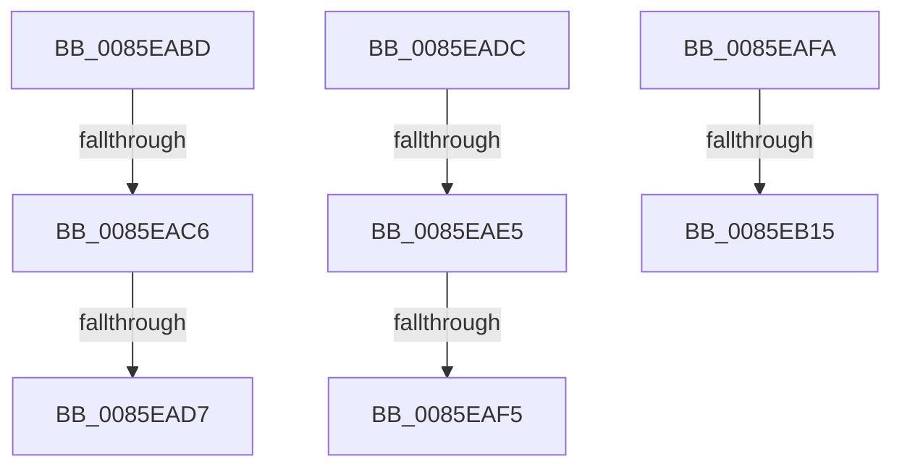

# sub_0085EABD

- RVA: `0x0085EABD`–`0x0085EB2A` (길이 `109` bytes)
- VA: `0x000000014085EABD`
- 실행 섹션: `PAGE`
- PDB 이름 있음: `아니요`; PDB Function 태그: `아니요`
- unwind 정보 RVA: `0x0006B20C`
- 디코드: `21`개 명령, `109/109` bytes 표시
- 미해석 바이트: `0` (있으면 어셈블리에 `.byte`로 보존)

> 이 문서는 커널 이미지의 기계어와 PDB 기호를 분석해 생성했습니다. 4번과 5번은 함수 원형과 자료형을 바이너리 사용 방식에서 추정한 C 해석이며 원본 소스 복구 결과는 아닙니다.

## 1. Dependencies

- 직접 호출 지점: **3**; 고유 호출 대상: **3**
- 직접 호출자로 확인된 함수: **0**
- RIP 상대 이미지 참조: **0**

### Outgoing calls
- `0x0085EB08` → [CmpIsKcbLockAllowed](../A1/CmpIsKcbLockAllowed_function_00A1DDC0.md) (function, `0x00A1DDC0`)
- `0x0085EB18` → [CmpUnlockKcb](../../pagecmrc/BC/CmpUnlockKcb_function_00BC92C0.md) (function, `0x00BC92C0`)
- `0x0085EB20` → [CmpLockKcbShared](../../pagecmrc/BC/CmpLockKcbShared_function_00BC9A1C.md) (function, `0x00BC9A1C`)

### Direct callers
- 이 함수 시작 RVA로 연결되는 직접 call은 확인되지 않았습니다. 간접 호출은 완전히 역산할 수 없습니다.

### Static image references
- 디코드된 RIP-relative 메모리 참조가 없습니다.

## 2. Other-region calls and transfers

- 다른 실행 섹션으로 향하는 call: **2**
  - `0x0085EB18` → [CmpUnlockKcb](../../pagecmrc/BC/CmpUnlockKcb_function_00BC92C0.md) (`PAGE` → `PAGECMRC`)
  - `0x0085EB20` → [CmpLockKcbShared](../../pagecmrc/BC/CmpLockKcbShared_function_00BC9A1C.md) (`PAGE` → `PAGECMRC`)
- call이 아닌 외부 분기/꼬리 이동: **8**
  - `0x0085EAC0` → [sub_00B16F11](../B1/Unknown_function_00B16F11.md) (`tail-transfer`)
  - `0x0085EAD1` → [sub_0085E9A1 + 0x49](Unknown_function_0085E9A1.md) (`tail-transfer`)
  - `0x0085EAD7` → [sub_00B16F11](../B1/Unknown_function_00B16F11.md) (`tail-transfer`)
  - `0x0085EADF` → [sub_00B16F11 + 0x31](../B1/Unknown_function_00B16F11.md) (`tail-transfer`)
  - `0x0085EAEF` → [sub_0085E7B7 + 0xB7](Unknown_function_0085E7B7.md) (`tail-transfer`)
  - `0x0085EAF5` → [sub_00B16F11 + 0x31](../B1/Unknown_function_00B16F11.md) (`tail-transfer`)
  - `0x0085EB0F` → [sub_0085E7B7 + 0xC0](Unknown_function_0085E7B7.md) (`tail-transfer`)
  - `0x0085EB25` → [sub_0085E7B7 + 0xC3](Unknown_function_0085E7B7.md) (`tail-transfer`)

## 3. Assembly (complete function range)

```asm
0085EABD  F6 C1 02                        test cl, 2
0085EAC0  0F 84 4B 84 2B 00               je 0x140b16f11
0085EAC6  41 F7 85 B8 00 00 00 00 00 04 00  test dword ptr [r13 + 0xb8], 0x40000
0085EAD1  0F 85 13 FF FF FF               jne 0x14085e9ea
0085EAD7  E9 35 84 2B 00                  jmp 0x140b16f11
0085EADC  F6 C1 02                        test cl, 2
0085EADF  0F 84 5D 84 2B 00               je 0x140b16f42
0085EAE5  F7 87 B8 00 00 00 00 00 04 00   test dword ptr [rdi + 0xb8], 0x40000
0085EAEF  0F 85 79 FD FF FF               jne 0x14085e86e
0085EAF5  E9 48 84 2B 00                  jmp 0x140b16f42
0085EAFA  4C 8D 84 24 90 00 00 00         lea r8, [rsp + 0x90]
0085EB02  48 8B D7                        mov rdx, rdi
0085EB05  49 8B CD                        mov rcx, r13
0085EB08  E8 B3 F2 1B 00                  call 0x140a1ddc0
0085EB0D  84 C0                           test al, al
0085EB0F  0F 85 62 FD FF FF               jne 0x14085e877
0085EB15  49 8B CD                        mov rcx, r13
0085EB18  E8 A3 A7 36 00                  call 0x140bc92c0
0085EB1D  48 8B CF                        mov rcx, rdi
0085EB20  E8 F7 AE 36 00                  call 0x140bc9a1c
0085EB25  E9 50 FD FF FF                  jmp 0x14085e87a
```

## 4. C-style interpretation (structured pseudocode)

```c
__int64 __fastcall sub_0085EABD(unsigned __int8 a1)
{
    unsigned __int64 v_stack_p90;
}
```

## 5. (Beta) C Style

```c
int64_t sub_0085EABD(uint8_t Arg1)
{
    uint64_t v_stack_p90;
}
```

## 6. Execution-region graph

[열기: 2D/3D 그래프와 함수 탐색 컨트롤 패널](../../../control-panel.html?section=page&rva=0x0085EABD&view=graph)

- 2D 그래프는 위에서 아래로 흐르고, 3D 그래프는 빈 공간을 드래그해 회전합니다. Shift+드래그는 이동, 휠은 확대·축소, 함수 노드 선택은 대상 보고서 이동입니다.

### Static fallback


