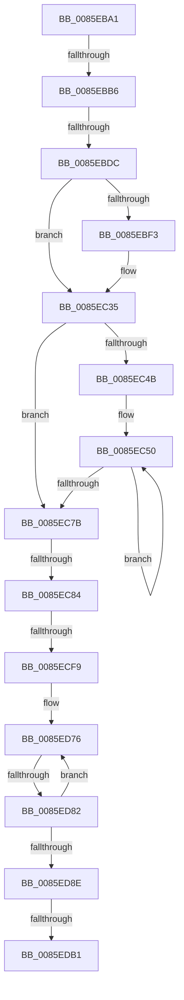

# sub_0085EBA1

- RVA: `0x0085EBA1`–`0x0085EDE5` (길이 `580` bytes)
- VA: `0x000000014085EBA1`
- 실행 섹션: `PAGE`
- PDB 이름 있음: `아니요`; PDB Function 태그: `아니요`
- unwind 정보 RVA: `0x0006B270`
- 디코드: `142`개 명령, `580/580` bytes 표시
- 미해석 바이트: `0` (있으면 어셈블리에 `.byte`로 보존)

> 이 문서는 커널 이미지의 기계어와 PDB 기호를 분석해 생성했습니다. 4번과 5번은 함수 원형과 자료형을 바이너리 사용 방식에서 추정한 C 해석이며 원본 소스 복구 결과는 아닙니다.

## 1. Dependencies

- 직접 호출 지점: **6**; 고유 호출 대상: **5**
- 직접 호출자로 확인된 함수: **0**
- RIP 상대 이미지 참조: **0**

### Outgoing calls
- `0x0085EBC6` → [ExAllocatePool2](../../poolcode/B8/ExAllocatePool2_function_00B820F0.md) (function, `0x00B820F0`)
- `0x0085EC14` → [ExAllocatePool2](../../poolcode/B8/ExAllocatePool2_function_00B820F0.md) (function, `0x00B820F0`)
- `0x0085EC53` → [RtlUpcaseUnicodeChar](RtlUpcaseUnicodeChar_function_0085F0F0.md) (function, `0x0085F0F0`)
- `0x0085EC8C` → [FsRtlAcquirePushLockExclusive](../../text/4A/FsRtlAcquirePushLockExclusive_function_004A05F4.md) (function, `0x004A05F4`)
- `0x0085EDB4` → [KeAbPostRelease](../../text/2E/KeAbPostRelease_function_002E1600.md) (function, `0x002E1600`)
- `0x0085EDC2` → [KeLeaveCriticalRegionThread](../../text/25/KeLeaveCriticalRegionThread_function_0025EFF0.md) (function, `0x0025EFF0`)

### Direct callers
- 이 함수 시작 RVA로 연결되는 직접 call은 확인되지 않았습니다. 간접 호출은 완전히 역산할 수 없습니다.

### Static image references
- 디코드된 RIP-relative 메모리 참조가 없습니다.

## 2. Other-region calls and transfers

- 다른 실행 섹션으로 향하는 call: **5**
  - `0x0085EBC6` → [ExAllocatePool2](../../poolcode/B8/ExAllocatePool2_function_00B820F0.md) (`PAGE` → `POOLCODE`)
  - `0x0085EC14` → [ExAllocatePool2](../../poolcode/B8/ExAllocatePool2_function_00B820F0.md) (`PAGE` → `POOLCODE`)
  - `0x0085EC8C` → [FsRtlAcquirePushLockExclusive](../../text/4A/FsRtlAcquirePushLockExclusive_function_004A05F4.md) (`PAGE` → `.text`)
  - `0x0085EDB4` → [KeAbPostRelease](../../text/2E/KeAbPostRelease_function_002E1600.md) (`PAGE` → `.text`)
  - `0x0085EDC2` → [KeLeaveCriticalRegionThread](../../text/25/KeLeaveCriticalRegionThread_function_0025EFF0.md) (`PAGE` → `.text`)
- call이 아닌 외부 분기/꼬리 이동: **7**
  - `0x0085EBB0` → [sub_0085EE4E](Unknown_function_0085EE4E.md) (`tail-transfer`)
  - `0x0085EBD6` → [sub_0085F094](Unknown_function_0085F094.md) (`tail-transfer`)
  - `0x0085EC7E` → [sub_0085F094 + 0xB](Unknown_function_0085F094.md) (`tail-transfer`)
  - `0x0085ECF3` → [sub_0085F094 + 0x16](Unknown_function_0085F094.md) (`tail-transfer`)
  - `0x0085ED7C` → [sub_0085EF90](Unknown_function_0085EF90.md) (`tail-transfer`)
  - `0x0085EDAB` → [sub_0085EE4E + 0x11B](Unknown_function_0085EE4E.md) (`tail-transfer`)
  - `0x0085EDE3` → [sub_0085EE44](Unknown_function_0085EE44.md) (`tail-transfer`)

## 3. Assembly (complete function range)

```asm
0085EBA1  48 89 AC 24 C0 00 00 00         mov qword ptr [rsp + 0xc0], rbp
0085EBA9  4C 89 6C 24 78                  mov qword ptr [rsp + 0x78], r13
0085EBAE  85 DB                           test ebx, ebx
0085EBB0  0F 84 98 02 00 00               je 0x14085ee4e
0085EBB6  BA 18 00 00 00                  mov edx, 0x18
0085EBBB  B9 00 01 00 00                  mov ecx, 0x100
0085EBC0  41 B8 50 66 46 4B               mov r8d, 0x4b466650
0085EBC6  E8 25 35 32 00                  call 0x140b820f0
0085EBCB  48 89 44 24 40                  mov qword ptr [rsp + 0x40], rax
0085EBD0  4C 8B E8                        mov r13, rax
0085EBD3  48 85 C0                        test rax, rax
0085EBD6  0F 84 B8 04 00 00               je 0x14085f094
0085EBDC  49 8D 44 24 04                  lea rax, [r12 + 4]
0085EBE1  48 89 44 24 58                  mov qword ptr [rsp + 0x58], rax
0085EBE6  8B 00                           mov eax, dword ptr [rax]
0085EBE8  C1 E8 05                        shr eax, 5
0085EBEB  03 C0                           add eax, eax
0085EBED  41 39 04 24                     cmp dword ptr [r12], eax
0085EBF1  72 42                           jb 0x14085ec35
0085EBF3  44 8B E0                        mov r12d, eax
0085EBF6  B9 00 01 00 00                  mov ecx, 0x100
0085EBFB  B8 40 00 00 00                  mov eax, 0x40
0085EC00  45 85 E4                        test r12d, r12d
0085EC03  41 B8 50 66 46 48               mov r8d, 0x48466650
0085EC09  44 0F 44 E0                     cmove r12d, eax
0085EC0D  41 8B D4                        mov edx, r12d
0085EC10  48 C1 E2 03                     shl rdx, 3
0085EC14  E8 D7 34 32 00                  call 0x140b820f0
0085EC19  48 85 C0                        test rax, rax
0085EC1C  48 89 44 24 38                  mov qword ptr [rsp + 0x38], rax
0085EC21  45 0F 44 E7                     cmove r12d, r15d
0085EC25  44 89 A4 24 C8 00 00 00         mov dword ptr [rsp + 0xc8], r12d
0085EC2D  4C 8B A4 24 B0 00 00 00         mov r12, qword ptr [rsp + 0xb0]
0085EC35  48 8B 5E 18                     mov rbx, qword ptr [rsi + 0x18]
0085EC39  0F B7 46 22                     movzx eax, word ptr [rsi + 0x22]
0085EC3D  BE 2F CB 04 00                  mov esi, 0x4cb2f
0085EC42  48 8D 2C 43                     lea rbp, [rbx + rax*2]
0085EC46  48 3B DD                        cmp rbx, rbp
0085EC49  73 30                           jae 0x14085ec7b
0085EC4B  0F 1F 44 00 00                  nop dword ptr [rax + rax]
0085EC50  0F B7 0B                        movzx ecx, word ptr [rbx]
0085EC53  E8 98 04 00 00                  call 0x14085f0f0
0085EC58  48 6B CE 25                     imul rcx, rsi, 0x25
0085EC5C  0F B7 D0                        movzx edx, ax
0085EC5F  48 83 C3 02                     add rbx, 2
0085EC63  0F B6 C2                        movzx eax, dl
0085EC66  8B F2                           mov esi, edx
0085EC68  48 03 C8                        add rcx, rax
0085EC6B  48 C1 EE 08                     shr rsi, 8
0085EC6F  48 6B C1 25                     imul rax, rcx, 0x25
0085EC73  48 03 F0                        add rsi, rax
0085EC76  48 3B DD                        cmp rbx, rbp
0085EC79  72 D5                           jb 0x14085ec50
0085EC7B  48 85 F6                        test rsi, rsi
0085EC7E  0F 84 1B 04 00 00               je 0x14085f09f
0085EC84  49 8D 6C 24 30                  lea rbp, [r12 + 0x30]
0085EC89  48 8B CD                        mov rcx, rbp
0085EC8C  E8 63 19 C4 FF                  call 0x1404a05f4
0085EC91  45 8B 5C 24 04                  mov r11d, dword ptr [r12 + 4]
0085EC96  48 C7 C3 FF FF FF FF            mov rbx, 0xffffffffffffffff
0085EC9D  41 8B CB                        mov ecx, r11d
0085ECA0  4C 89 6C 24 48                  mov qword ptr [rsp + 0x48], r13
0085ECA5  83 E1 1F                        and ecx, 0x1f
0085ECA8  41 C1 EB 05                     shr r11d, 5
0085ECAC  4C 8B D3                        mov r10, rbx
0085ECAF  49 D3 E2                        shl r10, cl
0085ECB2  4D 8B CA                        mov r9, r10
0085ECB5  4C 23 4C 24 20                  and r9, qword ptr [rsp + 0x20]
0085ECBA  4D 8B F1                        mov r14, r9
0085ECBD  4D 8B C1                        mov r8, r9
0085ECC0  4D 8B F9                        mov r15, r9
0085ECC3  49 C1 EE 38                     shr r14, 0x38
0085ECC7  4D 8B E1                        mov r12, r9
0085ECCA  49 C1 E8 30                     shr r8, 0x30
0085ECCE  4D 8B E9                        mov r13, r9
0085ECD1  49 C1 EF 28                     shr r15, 0x28
0085ECD5  49 8B C1                        mov rax, r9
0085ECD8  49 C1 EC 20                     shr r12, 0x20
0085ECDC  48 C1 E8 10                     shr rax, 0x10
0085ECE0  49 8B D1                        mov rdx, r9
0085ECE3  49 C1 ED 18                     shr r13, 0x18
0085ECE7  48 C1 EA 08                     shr rdx, 8
0085ECEB  48 89 44 24 50                  mov qword ptr [rsp + 0x50], rax
0085ECF0  45 85 DB                        test r11d, r11d
0085ECF3  0F 84 B1 03 00 00               je 0x14085f0aa
0085ECF9  41 0F B6 C1                     movzx eax, r9b
0085ECFD  48 05 CB 5D B1 00               add rax, 0xb15dcb
0085ED03  4C 89 4C 24 60                  mov qword ptr [rsp + 0x60], r9
0085ED08  48 6B C8 25                     imul rcx, rax, 0x25
0085ED0C  0F B6 C2                        movzx eax, dl
0085ED0F  48 03 C8                        add rcx, rax
0085ED12  0F B6 44 24 50                  movzx eax, byte ptr [rsp + 0x50]
0085ED17  48 6B D1 25                     imul rdx, rcx, 0x25
0085ED1B  48 03 D0                        add rdx, rax
0085ED1E  41 0F B6 C5                     movzx eax, r13b
0085ED22  48 6B CA 25                     imul rcx, rdx, 0x25
0085ED26  48 03 C8                        add rcx, rax
0085ED29  41 0F B6 C4                     movzx eax, r12b
0085ED2D  48 6B D1 25                     imul rdx, rcx, 0x25
0085ED31  48 03 D0                        add rdx, rax
0085ED34  41 0F B6 C7                     movzx eax, r15b
0085ED38  48 6B CA 25                     imul rcx, rdx, 0x25
0085ED3C  48 03 C8                        add rcx, rax
0085ED3F  41 0F B6 C0                     movzx eax, r8b
0085ED43  44 8B 84 24 C8 00 00 00         mov r8d, dword ptr [rsp + 0xc8]
0085ED4B  48 6B D1 25                     imul rdx, rcx, 0x25
0085ED4F  41 8D 4B FF                     lea ecx, [r11 - 1]
0085ED53  48 03 D0                        add rdx, rax
0085ED56  48 6B C2 25                     imul rax, rdx, 0x25
0085ED5A  49 03 C6                        add rax, r14
0085ED5D  4C 8B B4 24 B0 00 00 00         mov r14, qword ptr [rsp + 0xb0]
0085ED65  8B C0                           mov eax, eax
0085ED67  48 23 C8                        and rcx, rax
0085ED6A  49 8B 46 08                     mov rax, qword ptr [r14 + 8]
0085ED6E  4D 8D 7E 04                     lea r15, [r14 + 4]
0085ED72  48 8D 14 C8                     lea rdx, [rax + rcx*8]
0085ED76  48 8B 12                        mov rdx, qword ptr [rdx]
0085ED79  F6 C2 01                        test dl, 1
0085ED7C  0F 85 0E 02 00 00               jne 0x14085ef90
0085ED82  48 8B 42 08                     mov rax, qword ptr [rdx + 8]
0085ED86  49 23 C2                        and rax, r10
0085ED89  4C 3B C8                        cmp r9, rax
0085ED8C  75 E8                           jne 0x14085ed76
0085ED8E  4C 8B 6C 24 48                  mov r13, qword ptr [rsp + 0x48]
0085ED93  45 33 FF                        xor r15d, r15d
0085ED96  48 89 72 10                     mov qword ptr [rdx + 0x10], rsi
0085ED9A  4C 8B 74 24 30                  mov r14, qword ptr [rsp + 0x30]
0085ED9F  F0 48 0F C1 5D 00               lock xadd qword ptr [rbp], rbx
0085EDA5  80 E3 06                        and bl, 6
0085EDA8  80 FB 02                        cmp bl, 2
0085EDAB  0F 84 B8 01 00 00               je 0x14085ef69
0085EDB1  48 8B CD                        mov rcx, rbp
0085EDB4  E8 47 28 A8 FF                  call 0x1402e1600
0085EDB9  65 48 8B 0C 25 88 01 00 00      mov rcx, qword ptr gs:[0x188]
0085EDC2  E8 29 02 A0 FF                  call 0x14025eff0
0085EDC7  41 0F 0D 0E                     prefetchw byte ptr [r14]
0085EDCB  49 8B 06                        mov rax, qword ptr [r14]
0085EDCE  48 8B AC 24 C0 00 00 00         mov rbp, qword ptr [rsp + 0xc0]
0085EDD6  48 83 E0 FE                     and rax, 0xfffffffffffffffe
0085EDDA  48 8D 50 FE                     lea rdx, [rax - 2]
0085EDDE  F0 49 0F B1 16                  lock cmpxchg qword ptr [r14], rdx
0085EDE3  75 5F                           jne 0x14085ee44
```

## 4. C-style interpretation (structured pseudocode)

```c
__int64 __fastcall sub_0085EBA1(__int64 a1, __int64 a2, __int64 a3, __int64 a4, __int64 a5, __int64 a6, __int64 a7, __int64 a8, __int64 a9, unsigned __int8 a10, __int64 a11, __int64 a12, __int64 a13, __int64 a14, __int64 a15, __int64 a16, __int64 a17, __int64 a18, __int64 a19, __int64 a20, __int64 a21, __int64 a22, __int64 a23, __int64 a24, unsigned int a25)
{
    __int64 result;
    __int64 v_r10;
    __int64 v_r11;
    __int64 v_r12;
    __int64 v_r13;
    __int64 v_r14;
    __int64 v_r15;
    __int64 v_rbx;
    __int64 v_rsi;
    unsigned __int64 v_stack_p20;
    unsigned __int64 v_stack_p38;
    unsigned __int64 v_stack_p40;
    unsigned __int64 v_stack_p48;
    unsigned __int64 v_stack_p50;
    unsigned __int64 v_stack_p58;
    unsigned __int64 v_stack_p60;
    unsigned __int64 v_stack_p78;
    unsigned __int64 v_stack_pC0;
    unsigned int v_stack_pC8;

    v_stack_pC0 = v_rbp;
    v_stack_p78 = v_r13;
    result = ExAllocatePool2(256, 24, (unsigned int)(0x4B466650ULL), a4);
    v_stack_p40 = result;
    v_stack_p58 = v_r12 + 4;
    result = (unsigned int)(((unsigned int)(*(unsigned int *)(v_r12 + 4))) >> (5));
    result = (unsigned int)((result) + ((unsigned int)(result)));
    if ((*(unsigned int *)(v_r12)) >= ((unsigned int)(result))) {
        v_r12 = (unsigned int)(result);
        a1 = 256;
        result = 64;
        a3 = 0x48466650ULL;
        if ((unsigned int)(v_r12) == 0) { v_r12 = (unsigned int)(result); }
        a2 = (unsigned int)(v_r12);
        a2 = (a2) << (3);
        result = ExAllocatePool2(a1, a2, a3, a4);
        v_stack_p38 = result;
        if (result == 0) { v_r12 = (unsigned int)(v_r15); }
        v_stack_pC8 = (unsigned int)(v_r12);
        v_r12 = a22;
    }
    if ((*(unsigned __int64 *)(v_rsi + 24)) >= (*(unsigned __int64 *)(v_rsi + 24) + *(unsigned __int16 *)(v_rsi + 34) * 2)) goto loc_0085EC7B;
loc_0085EC50:
    result = RtlUpcaseUnicodeChar(*(unsigned __int16 *)(*(unsigned __int64 *)(v_rsi + 24)), a2, a3, a4);
    a1 = (*(unsigned __int16 *)(*(unsigned __int64 *)(v_rsi + 24))) * ((unsigned int)(0x4CB2FULL));
    v_rbx = (*(unsigned __int64 *)(v_rsi + 24)) + (2);
    a1 = (a1) + ((unsigned __int8)((unsigned __int16)(result)));
    v_rsi = ((unsigned int)((unsigned int)((unsigned __int16)(result)))) >> (8);
    result = ((unsigned __int8)((unsigned __int16)(result))) * (a1);
    v_rsi = (v_rsi) + (result);
    if (v_rbx < (*(unsigned __int64 *)(v_rsi + 24) + *(unsigned __int16 *)(v_rsi + 34) * 2)) goto loc_0085EC50;
loc_0085EC7B:
    result = FsRtlAcquirePushLockExclusive(v_r12 + 48, (unsigned __int16)(result), a3, a4);
    v_stack_p48 = result;
    a1 = (unsigned int)(((unsigned int)((unsigned int)((unsigned int)(*(unsigned int *)(v_r12 + 4))))) & (31));
    v_r11 = (unsigned int)(((unsigned int)(*(unsigned int *)(v_r12 + 4))) >> (5));
    v_r10 = (-1) << ((unsigned __int8)(a1));
    a4 = (v_r10) & (v_stack_p20);
    v_r14 = (a4) >> (56);
    a3 = (a4) >> (48);
    v_r15 = (a4) >> (40);
    v_r12 = (a4) >> (32);
    result = (a4) >> (16);
    v_r13 = (a4) >> (24);
    a2 = (a4) >> (8);
    v_stack_p50 = result;
    result = ((unsigned __int8)(a4)) + (0xB15DCBULL);
    v_stack_p60 = a4;
    a1 = (a1) * (result);
    a1 = (a1) + ((unsigned __int8)(a2));
    a2 = (a2) * (a1);
    a2 = (a2) + (a10);
    a1 = (a1) * (a2);
    a1 = (a1) + ((unsigned __int8)(v_r13));
    a2 = (a2) * (a1);
    a2 = (a2) + ((unsigned __int8)(v_r12));
    a1 = (a1) * (a2);
    a1 = (a1) + ((unsigned __int8)(v_r15));
    a2 = (a2) * (a1);
    a2 = (a2) + ((unsigned __int8)(a3));
    result = ((unsigned __int8)(a3)) * (a2);
    result = (result) + (v_r14);
    a1 = (v_r11 - 1) & ((unsigned int)((unsigned int)(result)));
loc_0085ED76:
    result = (*(unsigned __int64 *)(*(unsigned __int64 *)(*(unsigned __int64 *)(a22 + 8) + a1 * 8) + 8)) & (v_r10);
    if (a4 != result) goto loc_0085ED76;
    v_r15 = 0;
    *(unsigned __int64 *)(*(unsigned __int64 *)(*(unsigned __int64 *)(a22 + 8) + a1 * 8) + 16) = v_rsi;
    v_rbx = (unsigned __int8)((-1) & (6));
    result = KeAbPostRelease(v_r12 + 48, *(unsigned __int64 *)(*(unsigned __int64 *)(a22 + 8) + a1 * 8), (unsigned int)(a25), a4);
    result = KeLeaveCriticalRegionThread(*(unsigned __int64 *)(gs_base + (0 + 392)), *(unsigned __int64 *)(*(unsigned __int64 *)(a22 + 8) + a1 * 8), (unsigned int)(a25), a4);
    result = (*(unsigned __int64 *)(a6)) & (-2);
}
```

## 5. (Beta) C Style

```c
int64_t sub_0085EBA1(int64_t Arg1, int64_t Arg2, int64_t Arg3, int64_t Arg4, uint64_t Arg5, void *Arg6, uint64_t Arg7, uint64_t Arg8, int64_t Arg9, uint8_t Arg10, uint64_t Arg11, uint64_t Arg12, uint64_t Arg13, uint64_t Arg14, uint64_t Arg15, uint64_t Arg16, uint64_t Arg17, uint64_t Arg18, uint64_t Arg19, uint64_t Arg20, uint64_t Arg21, void *Arg22, uint64_t Arg23, int64_t Arg24, uint32_t Arg25)
{
    uint8_t *arg6 = (uint8_t *)Arg6;
    uint8_t *arg22 = (uint8_t *)Arg22;

    int64_t result;
    int64_t local_r10;
    int64_t local_r11;
    int64_t local_r12;
    int64_t local_r13;
    int64_t local_r14;
    int64_t local_r15;
    int64_t local_rbx;
    int64_t local_rsi;
    uint64_t v_stack_p20;
    uint64_t v_stack_p38;
    uint64_t v_stack_p40;
    uint64_t v_stack_p48;
    uint64_t v_stack_p50;
    uint64_t v_stack_p58;
    uint64_t v_stack_p60;
    uint64_t v_stack_p78;
    uint64_t v_stack_pC0;
    uint32_t v_stack_pC8;

    v_stack_pC0 = local_rbp;
    v_stack_p78 = local_r13;
    result = ExAllocatePool2(256, 24, (uint32_t)(0x4B466650ULL), Arg4);
    v_stack_p40 = result;
    v_stack_p58 = local_r12 + 4;
    result = (uint32_t)(((uint32_t)(*(uint32_t *)(local_r12 + 0x4))) >> (5));
    result = (uint32_t)((result) + ((uint32_t)(result)));
    if ((*(uint32_t *)(local_r12)) >= ((uint32_t)(result))) {
        local_r12 = (uint32_t)(result);
        Arg1 = 256;
        result = 64;
        Arg3 = 0x48466650ULL;
        if ((uint32_t)(local_r12) == 0) { local_r12 = (uint32_t)(result); }
        Arg2 = (uint32_t)(local_r12);
        Arg2 = (Arg2) << (3);
        result = ExAllocatePool2(Arg1, Arg2, Arg3, Arg4);
        v_stack_p38 = result;
        if (result == 0) { local_r12 = (uint32_t)(local_r15); }
        v_stack_pC8 = (uint32_t)(local_r12);
        local_r12 = Arg22;
    }
    if ((*(uint64_t *)(local_rsi + 0x18)) >= (*(uint64_t *)(local_rsi + 0x18) + *(uint16_t *)(local_rsi + 0x22) * 2)) goto loc_0085EC7B;
loc_0085EC50:
    result = RtlUpcaseUnicodeChar(*(uint16_t *)(*(uint64_t *)(local_rsi + 0x18)), Arg2, Arg3, Arg4);
    Arg1 = (*(uint16_t *)(*(uint64_t *)(local_rsi + 0x18))) * ((uint32_t)(0x4CB2FULL));
    local_rbx = (*(uint64_t *)(local_rsi + 0x18)) + (2);
    Arg1 = (Arg1) + ((uint8_t)((uint16_t)(result)));
    local_rsi = ((uint32_t)((uint32_t)((uint16_t)(result)))) >> (8);
    result = ((uint8_t)((uint16_t)(result))) * (Arg1);
    local_rsi = (local_rsi) + (result);
    if (local_rbx < (*(uint64_t *)(local_rsi + 0x18) + *(uint16_t *)(local_rsi + 0x22) * 2)) goto loc_0085EC50;
loc_0085EC7B:
    result = FsRtlAcquirePushLockExclusive(local_r12 + 48, (uint16_t)(result), Arg3, Arg4);
    v_stack_p48 = result;
    Arg1 = (uint32_t)(((uint32_t)((uint32_t)((uint32_t)(*(uint32_t *)(local_r12 + 0x4))))) & (31));
    local_r11 = (uint32_t)(((uint32_t)(*(uint32_t *)(local_r12 + 0x4))) >> (5));
    local_r10 = (-1) << ((uint8_t)(Arg1));
    Arg4 = (local_r10) & (v_stack_p20);
    local_r14 = (Arg4) >> (56);
    Arg3 = (Arg4) >> (48);
    local_r15 = (Arg4) >> (40);
    local_r12 = (Arg4) >> (32);
    result = (Arg4) >> (16);
    local_r13 = (Arg4) >> (24);
    Arg2 = (Arg4) >> (8);
    v_stack_p50 = result;
    result = ((uint8_t)(Arg4)) + (0xB15DCBULL);
    v_stack_p60 = Arg4;
    Arg1 = (Arg1) * (result);
    Arg1 = (Arg1) + ((uint8_t)(Arg2));
    Arg2 = (Arg2) * (Arg1);
    Arg2 = (Arg2) + (Arg10);
    Arg1 = (Arg1) * (Arg2);
    Arg1 = (Arg1) + ((uint8_t)(local_r13));
    Arg2 = (Arg2) * (Arg1);
    Arg2 = (Arg2) + ((uint8_t)(local_r12));
    Arg1 = (Arg1) * (Arg2);
    Arg1 = (Arg1) + ((uint8_t)(local_r15));
    Arg2 = (Arg2) * (Arg1);
    Arg2 = (Arg2) + ((uint8_t)(Arg3));
    result = ((uint8_t)(Arg3)) * (Arg2);
    result = (result) + (local_r14);
    Arg1 = (local_r11 - 1) & ((uint32_t)((uint32_t)(result)));
loc_0085ED76:
    result = (*(uint64_t *)(*(uint64_t *)(*(uint64_t *)(arg22 + 0x8) + Arg1 * 8) + 0x8)) & (local_r10);
    if (Arg4 != result) goto loc_0085ED76;
    local_r15 = 0;
    *(uint64_t *)(*(uint64_t *)(*(uint64_t *)(arg22 + 0x8) + Arg1 * 8) + 0x10) = local_rsi;
    local_rbx = (uint8_t)((-1) & (6));
    result = KeAbPostRelease(local_r12 + 48, *(uint64_t *)(*(uint64_t *)(arg22 + 0x8) + Arg1 * 8), (uint32_t)(Arg25), Arg4);
    result = KeLeaveCriticalRegionThread(*(uint64_t *)(gs_base + (0 + 0x188)), *(uint64_t *)(*(uint64_t *)(arg22 + 0x8) + Arg1 * 8), (uint32_t)(Arg25), Arg4);
    result = (*(uint64_t *)(arg6)) & (-2);
}
```

### 관측된 메모리 오프셋

구조체 형식이 확인되지 않은 접근은 인자 기준의 오프셋으로만 기록했습니다.

| 기준 인자 | 오프셋 표현 | 폭 (bit) | 접근 |
|---|---:|---:|---|
| `Arg6` | `+ 0x0` | `8` | `R` |
| `Arg6` | `+ 0x0` | `64` | `R` |
| `Arg22` | `+ 0x4` | `64` | `R` |
| `Arg22` | `+ 0x8` | `64` | `R` |

## 6. Execution-region graph

[열기: 2D/3D 그래프와 함수 탐색 컨트롤 패널](../../../control-panel.html?section=page&rva=0x0085EBA1&view=graph)

- 2D 그래프는 위에서 아래로 흐르고, 3D 그래프는 빈 공간을 드래그해 회전합니다. Shift+드래그는 이동, 휠은 확대·축소, 함수 노드 선택은 대상 보고서 이동입니다.

### Static fallback


