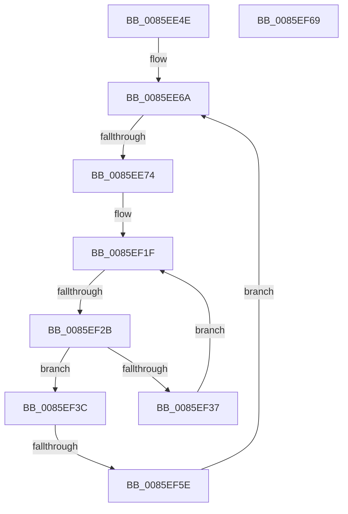

# sub_0085EE4E

- RVA: `0x0085EE4E`–`0x0085EF76` (길이 `296` bytes)
- VA: `0x000000014085EE4E`
- 실행 섹션: `PAGE`
- PDB 이름 있음: `아니요`; PDB Function 태그: `아니요`
- unwind 정보 RVA: `0x0006B2EC`
- 디코드: `79`개 명령, `296/296` bytes 표시
- 미해석 바이트: `0` (있으면 어셈블리에 `.byte`로 보존)

> 이 문서는 커널 이미지의 기계어와 PDB 기호를 분석해 생성했습니다. 4번과 5번은 함수 원형과 자료형을 바이너리 사용 방식에서 추정한 C 해석이며 원본 소스 복구 결과는 아닙니다.

## 1. Dependencies

- 직접 호출 지점: **2**; 고유 호출 대상: **2**
- 직접 호출자로 확인된 함수: **0**
- RIP 상대 이미지 참조: **0**

### Outgoing calls
- `0x0085EE56` → [FsRtlAcquirePushLockExclusive](../../text/4A/FsRtlAcquirePushLockExclusive_function_004A05F4.md) (function, `0x004A05F4`)
- `0x0085EF6C` → [ExfTryToWakePushLock](../../text/26/ExfTryToWakePushLock_function_00265DD0.md) (function, `0x00265DD0`)

### Direct callers
- 이 함수 시작 RVA로 연결되는 직접 call은 확인되지 않았습니다. 간접 호출은 완전히 역산할 수 없습니다.

### Static image references
- 디코드된 RIP-relative 메모리 참조가 없습니다.

## 2. Other-region calls and transfers

- 다른 실행 섹션으로 향하는 call: **2**
  - `0x0085EE56` → [FsRtlAcquirePushLockExclusive](../../text/4A/FsRtlAcquirePushLockExclusive_function_004A05F4.md) (`PAGE` → `.text`)
  - `0x0085EF6C` → [ExfTryToWakePushLock](../../text/26/ExfTryToWakePushLock_function_00265DD0.md) (`PAGE` → `.text`)
- call이 아닌 외부 분기/꼬리 이동: **4**
  - `0x0085EE6E` → [sub_0085EBA1 + 0x1F9](Unknown_function_0085EBA1.md) (`tail-transfer`)
  - `0x0085EF25` → [sub_0085EBA1 + 0x1F9](Unknown_function_0085EBA1.md) (`tail-transfer`)
  - `0x0085EF58` → [sub_0085F094 + 0x35](Unknown_function_0085F094.md) (`tail-transfer`)
  - `0x0085EF71` → [sub_0085EBA1 + 0x210](Unknown_function_0085EBA1.md) (`tail-transfer`)

## 3. Assembly (complete function range)

```asm
0085EE4E  49 8D 6C 24 30                  lea rbp, [r12 + 0x30]
0085EE53  48 8B CD                        mov rcx, rbp
0085EE56  E8 99 17 C4 FF                  call 0x1404a05f4
0085EE5B  4C 8B 74 24 20                  mov r14, qword ptr [rsp + 0x20]
0085EE60  4D 8B EF                        mov r13, r15
0085EE63  48 C7 C3 FF FF FF FF            mov rbx, 0xffffffffffffffff
0085EE6A  45 39 3C 24                     cmp dword ptr [r12], r15d
0085EE6E  0F 84 26 FF FF FF               je 0x14085ed9a
0085EE74  45 8B 4C 24 04                  mov r9d, dword ptr [r12 + 4]
0085EE79  4C 8B DB                        mov r11, rbx
0085EE7C  41 8B C9                        mov ecx, r9d
0085EE7F  41 C1 E9 05                     shr r9d, 5
0085EE83  83 E1 1F                        and ecx, 0x1f
0085EE86  49 D3 E3                        shl r11, cl
0085EE89  4D 8B D3                        mov r10, r11
0085EE8C  4D 23 D6                        and r10, r14
0085EE8F  49 8B C2                        mov rax, r10
0085EE92  48 C1 E8 08                     shr rax, 8
0085EE96  0F B6 C8                        movzx ecx, al
0085EE99  41 0F B6 C2                     movzx eax, r10b
0085EE9D  48 05 CB 5D B1 00               add rax, 0xb15dcb
0085EEA3  48 6B C0 25                     imul rax, rax, 0x25
0085EEA7  48 03 C8                        add rcx, rax
0085EEAA  49 8B C2                        mov rax, r10
0085EEAD  48 C1 E8 10                     shr rax, 0x10
0085EEB1  0F B6 C0                        movzx eax, al
0085EEB4  48 6B D1 25                     imul rdx, rcx, 0x25
0085EEB8  48 03 D0                        add rdx, rax
0085EEBB  49 8B C2                        mov rax, r10
0085EEBE  48 C1 E8 18                     shr rax, 0x18
0085EEC2  0F B6 C0                        movzx eax, al
0085EEC5  48 6B CA 25                     imul rcx, rdx, 0x25
0085EEC9  48 03 C8                        add rcx, rax
0085EECC  49 8B C2                        mov rax, r10
0085EECF  48 C1 E8 20                     shr rax, 0x20
0085EED3  0F B6 C0                        movzx eax, al
0085EED6  48 6B D1 25                     imul rdx, rcx, 0x25
0085EEDA  48 03 D0                        add rdx, rax
0085EEDD  49 8B C2                        mov rax, r10
0085EEE0  48 C1 E8 28                     shr rax, 0x28
0085EEE4  0F B6 C0                        movzx eax, al
0085EEE7  48 6B CA 25                     imul rcx, rdx, 0x25
0085EEEB  48 03 C8                        add rcx, rax
0085EEEE  49 8B C2                        mov rax, r10
0085EEF1  48 C1 E8 30                     shr rax, 0x30
0085EEF5  0F B6 C0                        movzx eax, al
0085EEF8  48 6B D1 25                     imul rdx, rcx, 0x25
0085EEFC  41 8D 49 FF                     lea ecx, [r9 - 1]
0085EF00  48 03 D0                        add rdx, rax
0085EF03  49 8B C2                        mov rax, r10
0085EF06  48 C1 E8 38                     shr rax, 0x38
0085EF0A  4C 6B C2 25                     imul r8, rdx, 0x25
0085EF0E  49 03 C0                        add rax, r8
0085EF11  8B C0                           mov eax, eax
0085EF13  48 23 C8                        and rcx, rax
0085EF16  49 8B 44 24 08                  mov rax, qword ptr [r12 + 8]
0085EF1B  48 8D 14 C8                     lea rdx, [rax + rcx*8]
0085EF1F  48 8B 0A                        mov rcx, qword ptr [rdx]
0085EF22  F6 C1 01                        test cl, 1
0085EF25  0F 85 6F FE FF FF               jne 0x14085ed9a
0085EF2B  48 8B 41 08                     mov rax, qword ptr [rcx + 8]
0085EF2F  49 23 C3                        and rax, r11
0085EF32  49 3B C2                        cmp rax, r10
0085EF35  74 05                           je 0x14085ef3c
0085EF37  48 8B D1                        mov rdx, rcx
0085EF3A  EB E3                           jmp 0x14085ef1f
0085EF3C  48 8B 01                        mov rax, qword ptr [rcx]
0085EF3F  48 89 02                        mov qword ptr [rdx], rax
0085EF42  48 B8 02 00 00 00 00 00 00 80   movabs rax, 0x8000000000000002
0085EF4C  41 FF 0C 24                     dec dword ptr [r12]
0085EF50  48 09 01                        or qword ptr [rcx], rax
0085EF53  49 39 4C 24 10                  cmp qword ptr [r12 + 0x10], rcx
0085EF58  0F 84 6B 01 00 00               je 0x14085f0c9
0085EF5E  48 89 39                        mov qword ptr [rcx], rdi
0085EF61  48 8B F9                        mov rdi, rcx
0085EF64  E9 01 FF FF FF                  jmp 0x14085ee6a
0085EF69  48 8B CD                        mov rcx, rbp
0085EF6C  E8 5F 6E A0 FF                  call 0x140265dd0
0085EF71  E9 3B FE FF FF                  jmp 0x14085edb1
```

## 4. C-style interpretation (structured pseudocode)

```c
__int64 __fastcall sub_0085EE4E(void)
{
    __int64 result;
    __int64 v_r10;
    __int64 v_r11;
    unsigned __int64 v_stack_p20;

    result = FsRtlAcquirePushLockExclusive(v_r12 + 48, a2, a3, a4);
loc_0085EE6A:
    a4 = (unsigned int)(((unsigned int)(*(unsigned int *)(v_r12 + 4))) >> (5));
    a1 = (unsigned int)(((unsigned int)((unsigned int)((unsigned int)(*(unsigned int *)(v_r12 + 4))))) & (31));
    v_r11 = (-1) << ((unsigned __int8)(a1));
    v_r10 = (v_r11) & (v_stack_p20);
    result = (v_r10) >> (8);
    result = ((unsigned __int8)(v_r10)) + (0xB15DCBULL);
    result = (result) * (result);
    a1 = ((unsigned __int8)(result)) + (result);
    result = (v_r10) >> (16);
    a2 = (a2) * (a1);
    a2 = (a2) + ((unsigned __int8)(result));
    result = (v_r10) >> (24);
    a1 = (a1) * (a2);
    a1 = (a1) + ((unsigned __int8)(result));
    result = (v_r10) >> (32);
    a2 = (a2) * (a1);
    a2 = (a2) + ((unsigned __int8)(result));
    result = (v_r10) >> (40);
    a1 = (a1) * (a2);
    a1 = (a1) + ((unsigned __int8)(result));
    result = (v_r10) >> (48);
    a2 = (a2) * (a1);
    a2 = (a2) + ((unsigned __int8)(result));
    result = (v_r10) >> (56);
    a3 = (a3) * (a2);
    result = (result) + (a3);
    a1 = (a4 - 1) & ((unsigned int)((unsigned int)(result)));
loc_0085EF1F:
    result = (*(unsigned __int64 *)(*(unsigned __int64 *)(*(unsigned __int64 *)(v_r12 + 8) + a1 * 8) + 8)) & (v_r11);
    if (result == v_r10) goto loc_0085EF3C;
    goto loc_0085EF1F;
loc_0085EF3C:
    *(unsigned __int64 *)(*(unsigned __int64 *)(*(unsigned __int64 *)(v_r12 + 8) + a1 * 8)) = *(unsigned __int64 *)(*(unsigned __int64 *)(*(unsigned __int64 *)(v_r12 + 8) + a1 * 8));
    *(unsigned __int64 *)(*(unsigned __int64 *)(*(unsigned __int64 *)(v_r12 + 8) + a1 * 8)) = v_rdi;
    goto loc_0085EE6A;
}
```

## 5. (Beta) C Style

```c
void sub_0085EE4E(void)
{
    int64_t result;
    int64_t local_r10;
    int64_t local_r11;
    uint64_t v_stack_p20;

    result = FsRtlAcquirePushLockExclusive(local_r12 + 48, a2, a3, a4);
loc_0085EE6A:
    a4 = (uint32_t)(((uint32_t)(*(uint32_t *)(local_r12 + 0x4))) >> (5));
    a1 = (uint32_t)(((uint32_t)((uint32_t)((uint32_t)(*(uint32_t *)(local_r12 + 0x4))))) & (31));
    local_r11 = (-1) << ((uint8_t)(a1));
    local_r10 = (local_r11) & (v_stack_p20);
    result = (local_r10) >> (8);
    result = ((uint8_t)(local_r10)) + (0xB15DCBULL);
    result = (result) * (result);
    a1 = ((uint8_t)(result)) + (result);
    result = (local_r10) >> (16);
    a2 = (a2) * (a1);
    a2 = (a2) + ((uint8_t)(result));
    result = (local_r10) >> (24);
    a1 = (a1) * (a2);
    a1 = (a1) + ((uint8_t)(result));
    result = (local_r10) >> (32);
    a2 = (a2) * (a1);
    a2 = (a2) + ((uint8_t)(result));
    result = (local_r10) >> (40);
    a1 = (a1) * (a2);
    a1 = (a1) + ((uint8_t)(result));
    result = (local_r10) >> (48);
    a2 = (a2) * (a1);
    a2 = (a2) + ((uint8_t)(result));
    result = (local_r10) >> (56);
    a3 = (a3) * (a2);
    result = (result) + (a3);
    a1 = (a4 - 1) & ((uint32_t)((uint32_t)(result)));
loc_0085EF1F:
    result = (*(uint64_t *)(*(uint64_t *)(*(uint64_t *)(local_r12 + 0x8) + a1 * 8) + 0x8)) & (local_r11);
    if (result == local_r10) goto loc_0085EF3C;
    goto loc_0085EF1F;
loc_0085EF3C:
    *(uint64_t *)(*(uint64_t *)(*(uint64_t *)(local_r12 + 0x8) + a1 * 8)) = *(uint64_t *)(*(uint64_t *)(*(uint64_t *)(local_r12 + 0x8) + a1 * 8));
    *(uint64_t *)(*(uint64_t *)(*(uint64_t *)(local_r12 + 0x8) + a1 * 8)) = local_rdi;
    goto loc_0085EE6A;
}
```

## 6. Execution-region graph

[열기: 2D/3D 그래프와 함수 탐색 컨트롤 패널](../../../control-panel.html?section=page&rva=0x0085EE4E&view=graph)

- 2D 그래프는 위에서 아래로 흐르고, 3D 그래프는 빈 공간을 드래그해 회전합니다. Shift+드래그는 이동, 휠은 확대·축소, 함수 노드 선택은 대상 보고서 이동입니다.

### Static fallback


