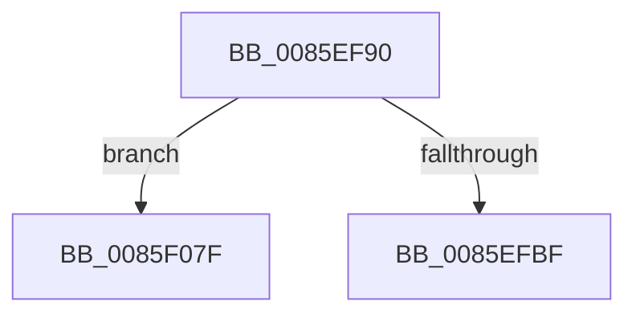

# sub_0085EF90

- RVA: `0x0085EF90`–`0x0085F08A` (길이 `250` bytes)
- VA: `0x000000014085EF90`
- 실행 섹션: `PAGE`
- PDB 이름 있음: `아니요`; PDB Function 태그: `아니요`
- unwind 정보 RVA: `0x0006B31C`
- 디코드: `68`개 명령, `250/250` bytes 표시
- 미해석 바이트: `0` (있으면 어셈블리에 `.byte`로 보존)

> 이 문서는 커널 이미지의 기계어와 PDB 기호를 분석해 생성했습니다. 4번과 5번은 함수 원형과 자료형을 바이너리 사용 방식에서 추정한 C 해석이며 원본 소스 복구 결과는 아닙니다.

## 1. Dependencies

- 직접 호출 지점: **1**; 고유 호출 대상: **1**
- 직접 호출자로 확인된 함수: **0**
- RIP 상대 이미지 참조: **0**

### Outgoing calls
- `0x0085EFB2` → [PfpRpRehashIfNeeded](../A4/PfpRpRehashIfNeeded_function_00A46EA4.md) (function, `0x00A46EA4`)

### Direct callers
- 이 함수 시작 RVA로 연결되는 직접 call은 확인되지 않았습니다. 간접 호출은 완전히 역산할 수 없습니다.

### Static image references
- 디코드된 RIP-relative 메모리 참조가 없습니다.

## 2. Other-region calls and transfers

- 다른 실행 섹션으로 향하는 call: **0**
- call이 아닌 외부 분기/꼬리 이동: **2**
  - `0x0085F07A` → [sub_0085EBA1 + 0x1F9](Unknown_function_0085EBA1.md) (`tail-transfer`)
  - `0x0085F085` → [sub_0085EBA1 + 0x1F9](Unknown_function_0085EBA1.md) (`tail-transfer`)

## 3. Assembly (complete function range)

```asm
0085EF90  4C 8B 6C 24 48                  mov r13, qword ptr [rsp + 0x48]
0085EF95  48 8B 44 24 20                  mov rax, qword ptr [rsp + 0x20]
0085EF9A  48 8D 54 24 38                  lea rdx, [rsp + 0x38]
0085EF9F  0F 57 C0                        xorps xmm0, xmm0
0085EFA2  49 8B CE                        mov rcx, r14
0085EFA5  41 0F 11 45 00                  movups xmmword ptr [r13], xmm0
0085EFAA  49 89 45 08                     mov qword ptr [r13 + 8], rax
0085EFAE  49 89 75 10                     mov qword ptr [r13 + 0x10], rsi
0085EFB2  E8 ED 7E 1E 00                  call 0x140a46ea4
0085EFB7  85 C0                           test eax, eax
0085EFB9  0F 84 C0 00 00 00               je 0x14085f07f
0085EFBF  41 8B 0F                        mov ecx, dword ptr [r15]
0085EFC2  4C 8B CB                        mov r9, rbx
0085EFC5  44 8B D1                        mov r10d, ecx
0085EFC8  83 E1 1F                        and ecx, 0x1f
0085EFCB  49 D3 E1                        shl r9, cl
0085EFCE  4D 23 4D 08                     and r9, qword ptr [r13 + 8]
0085EFD2  41 0F B6 C1                     movzx eax, r9b
0085EFD6  48 05 CB 5D B1 00               add rax, 0xb15dcb
0085EFDC  41 C1 EA 05                     shr r10d, 5
0085EFE0  48 6B C8 25                     imul rcx, rax, 0x25
0085EFE4  49 8B C1                        mov rax, r9
0085EFE7  4C 89 4C 24 20                  mov qword ptr [rsp + 0x20], r9
0085EFEC  48 C1 E8 08                     shr rax, 8
0085EFF0  0F B6 C0                        movzx eax, al
0085EFF3  48 03 C8                        add rcx, rax
0085EFF6  49 8B C1                        mov rax, r9
0085EFF9  48 C1 E8 10                     shr rax, 0x10
0085EFFD  0F B6 C0                        movzx eax, al
0085F000  48 6B D1 25                     imul rdx, rcx, 0x25
0085F004  48 03 D0                        add rdx, rax
0085F007  49 8B C1                        mov rax, r9
0085F00A  48 C1 E8 18                     shr rax, 0x18
0085F00E  0F B6 C0                        movzx eax, al
0085F011  48 6B CA 25                     imul rcx, rdx, 0x25
0085F015  48 03 C8                        add rcx, rax
0085F018  49 8B C1                        mov rax, r9
0085F01B  48 C1 E8 20                     shr rax, 0x20
0085F01F  0F B6 C0                        movzx eax, al
0085F022  48 6B D1 25                     imul rdx, rcx, 0x25
0085F026  48 03 D0                        add rdx, rax
0085F029  49 8B C1                        mov rax, r9
0085F02C  48 C1 E8 28                     shr rax, 0x28
0085F030  0F B6 C0                        movzx eax, al
0085F033  48 6B CA 25                     imul rcx, rdx, 0x25
0085F037  48 03 C8                        add rcx, rax
0085F03A  49 8B C1                        mov rax, r9
0085F03D  48 C1 E8 30                     shr rax, 0x30
0085F041  0F B6 C0                        movzx eax, al
0085F044  48 6B D1 25                     imul rdx, rcx, 0x25
0085F048  49 C1 E9 38                     shr r9, 0x38
0085F04C  41 8D 4A FF                     lea ecx, [r10 - 1]
0085F050  48 03 D0                        add rdx, rax
0085F053  48 6B C2 25                     imul rax, rdx, 0x25
0085F057  49 03 C1                        add rax, r9
0085F05A  8B C0                           mov eax, eax
0085F05C  48 23 C8                        and rcx, rax
0085F05F  49 8B 46 08                     mov rax, qword ptr [r14 + 8]
0085F063  48 8D 0C C8                     lea rcx, [rax + rcx*8]
0085F067  48 8B 01                        mov rax, qword ptr [rcx]
0085F06A  49 89 45 00                     mov qword ptr [r13], rax
0085F06E  4C 89 29                        mov qword ptr [rcx], r13
0085F071  41 FF 06                        inc dword ptr [r14]
0085F074  45 33 FF                        xor r15d, r15d
0085F077  45 8B EF                        mov r13d, r15d
0085F07A  E9 1B FD FF FF                  jmp 0x14085ed9a
0085F07F  41 BF 9A 00 00 C0               mov r15d, 0xc000009a
0085F085  E9 10 FD FF FF                  jmp 0x14085ed9a
```

## 4. C-style interpretation (structured pseudocode)

```c
__int64 __fastcall sub_0085EF90(__int64 a1, __int64 a2, __int64 a3, __int64 a4, __int64 a5, __int64 a6, __int64 a7, __int64 a8, __int64 a9)
{
    __int64 result;
    __int64 v_r10;
    __int64 v_r15;
    unsigned __int64 v_stack_p20;

    *(unsigned __int64 *)(a9) = v_xmm0;
    *(unsigned __int64 *)(a9 + 8) = v_stack_p20;
    *(unsigned __int64 *)(a9 + 16) = v_rsi;
    result = PfpRpRehashIfNeeded(v_r14, a7, a3, a4);
    if ((unsigned int)(result) == 0) goto loc_0085F07F;
    a1 = (unsigned int)(((unsigned int)(*(unsigned int *)(v_r15))) & (31));
    a4 = (v_rbx) << ((unsigned __int8)(a1));
    a4 = (a4) & (*(unsigned __int64 *)(a9 + 8));
    result = ((unsigned __int8)(a4)) + (0xB15DCBULL);
    v_r10 = (unsigned int)(((unsigned int)((unsigned int)((unsigned int)(*(unsigned int *)(v_r15))))) >> (5));
    a1 = (a1) * (result);
    v_stack_p20 = a4;
    result = (a4) >> (8);
    a1 = (a1) + ((unsigned __int8)(result));
    result = (a4) >> (16);
    a2 = (a7) * (a1);
    a2 = (a2) + ((unsigned __int8)(result));
    result = (a4) >> (24);
    a1 = (a1) * (a2);
    a1 = (a1) + ((unsigned __int8)(result));
    result = (a4) >> (32);
    a2 = (a2) * (a1);
    a2 = (a2) + ((unsigned __int8)(result));
    result = (a4) >> (40);
    a1 = (a1) * (a2);
    a1 = (a1) + ((unsigned __int8)(result));
    result = (a4) >> (48);
    a2 = (a2) * (a1);
    a4 = (a4) >> (56);
    a2 = (a2) + ((unsigned __int8)(result));
    result = ((unsigned __int8)(result)) * (a2);
    result = (result) + (a4);
    a1 = (v_r10 - 1) & ((unsigned int)((unsigned int)(result)));
    *(unsigned __int64 *)(a9) = *(unsigned __int64 *)(*(unsigned __int64 *)(v_r14 + 8) + a1 * 8);
    *(unsigned __int64 *)(*(unsigned __int64 *)(v_r14 + 8) + a1 * 8) = a9;
    v_r15 = 0;
loc_0085F07F:
}
```

## 5. (Beta) C Style

```c
int64_t sub_0085EF90(int64_t Arg1, int64_t Arg2, int64_t Arg3, int64_t Arg4, uint64_t Arg5, uint64_t Arg6, int64_t Arg7, uint64_t Arg8, void *Arg9)
{
    uint8_t *arg9 = (uint8_t *)Arg9;

    int64_t result;
    int64_t local_r10;
    int64_t local_r15;
    uint64_t v_stack_p20;

    *(uint64_t *)(arg9) = v_xmm0;
    *(uint64_t *)(arg9 + 0x8) = v_stack_p20;
    *(uint64_t *)(arg9 + 0x10) = local_rsi;
    result = PfpRpRehashIfNeeded(local_r14, Arg7, Arg3, Arg4);
    if ((uint32_t)(result) == 0) goto loc_0085F07F;
    Arg1 = (uint32_t)(((uint32_t)(*(uint32_t *)(local_r15))) & (31));
    Arg4 = (local_rbx) << ((uint8_t)(Arg1));
    Arg4 = (Arg4) & (*(uint64_t *)(arg9 + 0x8));
    result = ((uint8_t)(Arg4)) + (0xB15DCBULL);
    local_r10 = (uint32_t)(((uint32_t)((uint32_t)((uint32_t)(*(uint32_t *)(local_r15))))) >> (5));
    Arg1 = (Arg1) * (result);
    v_stack_p20 = Arg4;
    result = (Arg4) >> (8);
    Arg1 = (Arg1) + ((uint8_t)(result));
    result = (Arg4) >> (16);
    Arg2 = (Arg7) * (Arg1);
    Arg2 = (Arg2) + ((uint8_t)(result));
    result = (Arg4) >> (24);
    Arg1 = (Arg1) * (Arg2);
    Arg1 = (Arg1) + ((uint8_t)(result));
    result = (Arg4) >> (32);
    Arg2 = (Arg2) * (Arg1);
    Arg2 = (Arg2) + ((uint8_t)(result));
    result = (Arg4) >> (40);
    Arg1 = (Arg1) * (Arg2);
    Arg1 = (Arg1) + ((uint8_t)(result));
    result = (Arg4) >> (48);
    Arg2 = (Arg2) * (Arg1);
    Arg4 = (Arg4) >> (56);
    Arg2 = (Arg2) + ((uint8_t)(result));
    result = ((uint8_t)(result)) * (Arg2);
    result = (result) + (Arg4);
    Arg1 = (local_r10 - 1) & ((uint32_t)((uint32_t)(result)));
    *(uint64_t *)(arg9) = *(uint64_t *)(*(uint64_t *)(local_r14 + 0x8) + Arg1 * 8);
    *(void **)(*(uint64_t *)(local_r14 + 0x8) + Arg1 * 8) = Arg9;
    local_r15 = 0;
loc_0085F07F:
}
```

### 관측된 메모리 오프셋

구조체 형식이 확인되지 않은 접근은 인자 기준의 오프셋으로만 기록했습니다.

| 기준 인자 | 오프셋 표현 | 폭 (bit) | 접근 |
|---|---:|---:|---|
| `Arg9` | `+ 0x0` | `64` | `W` |
| `Arg9` | `+ 0x0` | `128` | `R` |
| `Arg9` | `+ 0x8` | `64` | `R` |
| `Arg9` | `+ 0x8` | `64` | `W` |
| `Arg9` | `+ 0x10` | `64` | `W` |

## 6. Execution-region graph

[열기: 2D/3D 그래프와 함수 탐색 컨트롤 패널](../../../control-panel.html?section=page&rva=0x0085EF90&view=graph)

- 2D 그래프는 위에서 아래로 흐르고, 3D 그래프는 빈 공간을 드래그해 회전합니다. Shift+드래그는 이동, 휠은 확대·축소, 함수 노드 선택은 대상 보고서 이동입니다.

### Static fallback


