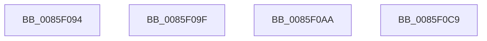

# sub_0085F094

- RVA: `0x0085F094`–`0x0085F0D8` (길이 `68` bytes)
- VA: `0x000000014085F094`
- 실행 섹션: `PAGE`
- PDB 이름 있음: `아니요`; PDB Function 태그: `아니요`
- unwind 정보 RVA: `0x0006B348`
- 디코드: `12`개 명령, `68/68` bytes 표시
- 미해석 바이트: `0` (있으면 어셈블리에 `.byte`로 보존)

> 이 문서는 커널 이미지의 기계어와 PDB 기호를 분석해 생성했습니다. 4번과 5번은 함수 원형과 자료형을 바이너리 사용 방식에서 추정한 C 해석이며 원본 소스 복구 결과는 아닙니다.

## 1. Dependencies

- 직접 호출 지점: **0**; 고유 호출 대상: **0**
- 직접 호출자로 확인된 함수: **0**
- RIP 상대 이미지 참조: **0**

### Outgoing calls
- 직접 디코드된 call 명령이 없습니다.

### Direct callers
- 이 함수 시작 RVA로 연결되는 직접 call은 확인되지 않았습니다. 간접 호출은 완전히 역산할 수 없습니다.

### Static image references
- 디코드된 RIP-relative 메모리 참조가 없습니다.

## 2. Other-region calls and transfers

- 다른 실행 섹션으로 향하는 call: **0**
- call이 아닌 외부 분기/꼬리 이동: **4**
  - `0x0085F09A` → [sub_0085EBA1 + 0x226](Unknown_function_0085EBA1.md) (`tail-transfer`)
  - `0x0085F0A5` → [sub_0085EBA1 + 0x226](Unknown_function_0085EBA1.md) (`tail-transfer`)
  - `0x0085F0C4` → [sub_0085EF90 + 0x5](Unknown_function_0085EF90.md) (`tail-transfer`)
  - `0x0085F0D3` → [sub_0085EE4E + 0x110](Unknown_function_0085EE4E.md) (`tail-transfer`)

## 3. Assembly (complete function range)

```asm
0085F094  41 BF 9A 00 00 C0               mov r15d, 0xc000009a
0085F09A  E9 28 FD FF FF                  jmp 0x14085edc7
0085F09F  41 BF 4D 00 00 C0               mov r15d, 0xc000004d
0085F0A5  E9 1D FD FF FF                  jmp 0x14085edc7
0085F0AA  4C 8B 6C 24 40                  mov r13, qword ptr [rsp + 0x40]
0085F0AF  44 8B 84 24 C8 00 00 00         mov r8d, dword ptr [rsp + 0xc8]
0085F0B7  4C 8B B4 24 B0 00 00 00         mov r14, qword ptr [rsp + 0xb0]
0085F0BF  4C 8B 7C 24 58                  mov r15, qword ptr [rsp + 0x58]
0085F0C4  E9 CC FE FF FF                  jmp 0x14085ef95
0085F0C9  49 8D 44 24 18                  lea rax, [r12 + 0x18]
0085F0CE  49 89 44 24 10                  mov qword ptr [r12 + 0x10], rax
0085F0D3  E9 86 FE FF FF                  jmp 0x14085ef5e
```

## 4. C-style interpretation (structured pseudocode)

```c
__int64 __fastcall sub_0085F094(void)
{
    unsigned __int64 v_stack_p40;
    unsigned __int64 v_stack_p58;
    unsigned __int64 v_stack_pB0;
    unsigned int v_stack_pC8;
}
```

## 5. (Beta) C Style

```c
void sub_0085F094(void)
{
    uint64_t v_stack_p40;
    uint64_t v_stack_p58;
    uint64_t v_stack_pB0;
    uint32_t v_stack_pC8;
}
```

## 6. Execution-region graph

[열기: 2D/3D 그래프와 함수 탐색 컨트롤 패널](../../../control-panel.html?section=page&rva=0x0085F094&view=graph)

- 2D 그래프는 위에서 아래로 흐르고, 3D 그래프는 빈 공간을 드래그해 회전합니다. Shift+드래그는 이동, 휠은 확대·축소, 함수 노드 선택은 대상 보고서 이동입니다.

### Static fallback


