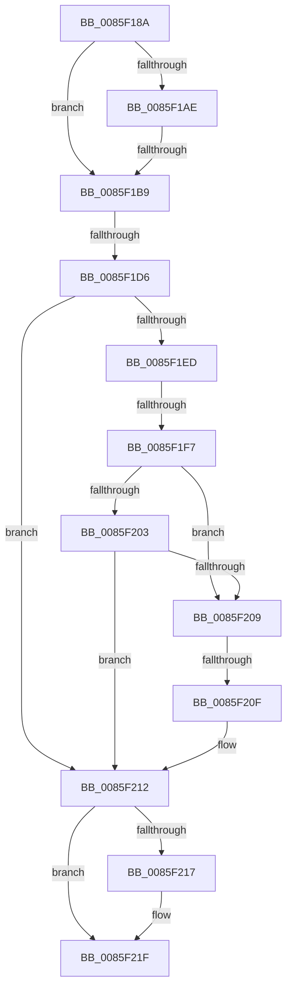

# sub_0085F18A

- RVA: `0x0085F18A`–`0x0085F229` (길이 `159` bytes)
- VA: `0x000000014085F18A`
- 실행 섹션: `PAGE`
- PDB 이름 있음: `아니요`; PDB Function 태그: `아니요`
- unwind 정보 RVA: `0x0006B38C`
- 디코드: `42`개 명령, `159/159` bytes 표시
- 미해석 바이트: `0` (있으면 어셈블리에 `.byte`로 보존)

> 이 문서는 커널 이미지의 기계어와 PDB 기호를 분석해 생성했습니다. 4번과 5번은 함수 원형과 자료형을 바이너리 사용 방식에서 추정한 C 해석이며 원본 소스 복구 결과는 아닙니다.

## 1. Dependencies

- 직접 호출 지점: **1**; 고유 호출 대상: **1**
- 직접 호출자로 확인된 함수: **0**
- RIP 상대 이미지 참조: **0**

### Outgoing calls
- `0x0085F21A` → [CmSiFreeMemory](../../text/47/CmSiFreeMemory_function_00475D80.md) (function, `0x00475D80`)

### Direct callers
- 이 함수 시작 RVA로 연결되는 직접 call은 확인되지 않았습니다. 간접 호출은 완전히 역산할 수 없습니다.

### Static image references
- 디코드된 RIP-relative 메모리 참조가 없습니다.

## 2. Other-region calls and transfers

- 다른 실행 섹션으로 향하는 call: **1**
  - `0x0085F21A` → [CmSiFreeMemory](../../text/47/CmSiFreeMemory_function_00475D80.md) (`PAGE` → `.text`)
- call이 아닌 외부 분기/꼬리 이동: **5**
  - `0x0085F1B3` → [sub_0085F25C + 0x4D](Unknown_function_0085F25C.md) (`tail-transfer`)
  - `0x0085F1D0` → [sub_0085F25C + 0x7](Unknown_function_0085F25C.md) (`tail-transfer`)
  - `0x0085F1F5` → [sub_0085F25C](Unknown_function_0085F25C.md) (`tail-transfer`)
  - `0x0085F20D` → [sub_0085F24A](Unknown_function_0085F24A.md) (`tail-transfer`)
  - `0x0085F227` → [sub_0085F24F](Unknown_function_0085F24F.md) (`tail-transfer`)

## 3. Assembly (complete function range)

```asm
0085F18A  48 89 7C 24 50                  mov qword ptr [rsp + 0x50], rdi
0085F18F  0F BF 79 42                     movsx edi, word ptr [rcx + 0x42]
0085F193  33 D2                           xor edx, edx
0085F195  B8 FF FF FF FF                  mov eax, 0xffffffff
0085F19A  0F 11 44 24 20                  movups xmmword ptr [rsp + 0x20], xmm0
0085F19F  66 89 44 24 22                  mov word ptr [rsp + 0x22], ax
0085F1A4  0F 11 44 24 30                  movups xmmword ptr [rsp + 0x30], xmm0
0085F1A9  83 FF 02                        cmp edi, 2
0085F1AC  7C 0B                           jl 0x14085f1b9
0085F1AE  8B C7                           mov eax, edi
0085F1B0  83 E8 01                        sub eax, 1
0085F1B3  0F 85 F0 00 00 00               jne 0x14085f2a9
0085F1B9  48 0F BF 43 42                  movsx rax, word ptr [rbx + 0x42]
0085F1BE  66 89 7C 24 20                  mov word ptr [rsp + 0x20], di
0085F1C3  48 89 54 24 38                  mov qword ptr [rsp + 0x38], rdx
0085F1C8  66 89 44 24 22                  mov word ptr [rsp + 0x22], ax
0085F1CD  66 85 C0                        test ax, ax
0085F1D0  0F 85 8D 00 00 00               jne 0x14085f263
0085F1D6  48 89 5C C4 28                  mov qword ptr [rsp + rax*8 + 0x28], rbx
0085F1DB  48 8B 54 24 38                  mov rdx, qword ptr [rsp + 0x38]
0085F1E0  0F B7 44 24 22                  movzx eax, word ptr [rsp + 0x22]
0085F1E5  40 B7 01                        mov dil, 1
0085F1E8  66 85 C0                        test ax, ax
0085F1EB  78 25                           js 0x14085f212
0085F1ED  48 0F BF C8                     movsx rcx, ax
0085F1F1  66 83 F8 02                     cmp ax, 2
0085F1F5  7D 65                           jge 0x14085f25c
0085F1F7  48 8B 4C CC 28                  mov rcx, qword ptr [rsp + rcx*8 + 0x28]
0085F1FC  66 83 79 42 00                  cmp word ptr [rcx + 0x42], 0
0085F201  74 06                           je 0x14085f209
0085F203  40 38 79 41                     cmp byte ptr [rcx + 0x41], dil
0085F207  74 09                           je 0x14085f212
0085F209  83 79 28 FF                     cmp dword ptr [rcx + 0x28], -1
0085F20D  74 3B                           je 0x14085f24a
0085F20F  40 32 FF                        xor dil, dil
0085F212  48 85 D2                        test rdx, rdx
0085F215  74 08                           je 0x14085f21f
0085F217  48 8B CA                        mov rcx, rdx
0085F21A  E8 61 6B C1 FF                  call 0x140475d80
0085F21F  40 84 FF                        test dil, dil
0085F222  48 8B 7C 24 50                  mov rdi, qword ptr [rsp + 0x50]
0085F227  75 26                           jne 0x14085f24f
```

## 4. C-style interpretation (structured pseudocode)

```c
__int64 __fastcall sub_0085F18A(__int64 a1, int a2, __int64 a3, __int64 a4, __int64 a5, __int64 a6, __int64 a7, __int64 a8, __int64 a9, __int64 a10)
{
    __int64 result;
    __int64 v_rdi;
    unsigned __int64 v_stack_p20;
    unsigned __int16 v_stack_p22;
    unsigned __int64 v_stack_p38;
    unsigned __int64 v_stack_p50;

    v_stack_p50 = v_rdi;
    a2 = 0;
    v_stack_p20 = v_xmm0;
    v_stack_p22 = (unsigned __int16)((unsigned int)(0xFFFFFFFFULL));
    a6 = v_xmm0;
    if (((unsigned int)((__int16)(*(unsigned __int16 *)(a1 + 66)))) < 2) goto loc_0085F1B9;
    result = (unsigned int)(((unsigned int)((unsigned int)((__int16)(*(unsigned __int16 *)(a1 + 66))))) - (1));
loc_0085F1B9:
    v_stack_p20 = (unsigned __int16)((__int16)(*(unsigned __int16 *)(a1 + 66)));
    v_stack_p38 = 0;
    v_stack_p22 = (unsigned __int16)((__int16)(*(unsigned __int16 *)(v_rbx + 66)));
    *(unsigned __int64 *)(v_rsp + (__int16)(*(unsigned __int16 *)(v_rbx + 66)) * 8 + 40) = v_rbx;
    if (sign_flag) goto loc_0085F212;
    if ((*(unsigned __int16 *)(*(unsigned __int64 *)(v_rsp + (__int16)((unsigned __int16)(v_stack_p22)) * 8 + 40) + 66)) == 0) goto loc_0085F209;
    if ((*(unsigned __int8 *)(*(unsigned __int64 *)(v_rsp + (__int16)((unsigned __int16)(v_stack_p22)) * 8 + 40) + 65)) == 1) goto loc_0085F212;
loc_0085F209:
    v_rdi = 0;
loc_0085F212:
    result = v_stack_p22;
    if (a7 != 0) {
        a1 = a7;
        result = CmSiFreeMemory(a1, a7, a3, a4);
    }
}
```

## 5. (Beta) C Style

```c
int64_t sub_0085F18A(void *Arg1, int32_t Arg2, int64_t Arg3, int64_t Arg4, void *Arg5, int64_t Arg6, int64_t Arg7, uint64_t Arg8, uint64_t Arg9, int64_t Arg10)
{
    uint8_t *arg1 = (uint8_t *)Arg1;
    uint8_t *arg5 = (uint8_t *)Arg5;

    int64_t result;
    int64_t local_rdi;
    uint64_t v_stack_p20;
    uint16_t v_stack_p22;
    uint64_t v_stack_p38;
    uint64_t v_stack_p50;

    v_stack_p50 = local_rdi;
    Arg2 = 0;
    v_stack_p20 = v_xmm0;
    v_stack_p22 = (uint16_t)((uint32_t)(0xFFFFFFFFULL));
    Arg6 = v_xmm0;
    if (((uint32_t)((int16_t)(*(uint16_t *)(arg1 + 0x42)))) < 2) goto loc_0085F1B9;
    result = (uint32_t)(((uint32_t)((uint32_t)((int16_t)(*(uint16_t *)(arg1 + 0x42))))) - (1));
loc_0085F1B9:
    v_stack_p20 = (uint16_t)((int16_t)(*(uint16_t *)(arg1 + 0x42)));
    v_stack_p38 = 0;
    v_stack_p22 = (uint16_t)((int16_t)(*(uint16_t *)(local_rbx + 0x42)));
    *(uint64_t *)(local_rsp + (int16_t)(*(uint16_t *)(local_rbx + 0x42)) * 8 + 0x28) = local_rbx;
    if (sign_flag) goto loc_0085F212;
    if ((*(uint16_t *)(*(uint64_t *)(local_rsp + (int16_t)((uint16_t)(v_stack_p22)) * 8 + 0x28) + 0x42)) == 0) goto loc_0085F209;
    if ((*(uint8_t *)(*(uint64_t *)(local_rsp + (int16_t)((uint16_t)(v_stack_p22)) * 8 + 0x28) + 0x41)) == 1) goto loc_0085F212;
loc_0085F209:
    local_rdi = 0;
loc_0085F212:
    result = v_stack_p22;
    if (Arg7 != 0) {
        Arg1 = Arg7;
        result = CmSiFreeMemory(Arg1, Arg7, Arg3, Arg4);
    }
}
```

### 관측된 메모리 오프셋

구조체 형식이 확인되지 않은 접근은 인자 기준의 오프셋으로만 기록했습니다.

| 기준 인자 | 오프셋 표현 | 폭 (bit) | 접근 |
|---|---:|---:|---|
| `Arg1` | `+ 0x42` | `16` | `R` |
| `Arg5` | `+ 0x28` | `32` | `R` |
| `Arg5` | `+ 0x41` | `8` | `R` |
| `Arg5` | `+ 0x42` | `16` | `R` |

## 6. Execution-region graph

[열기: 2D/3D 그래프와 함수 탐색 컨트롤 패널](../../../control-panel.html?section=page&rva=0x0085F18A&view=graph)

- 2D 그래프는 위에서 아래로 흐르고, 3D 그래프는 빈 공간을 드래그해 회전합니다. Shift+드래그는 이동, 휠은 확대·축소, 함수 노드 선택은 대상 보고서 이동입니다.

### Static fallback


