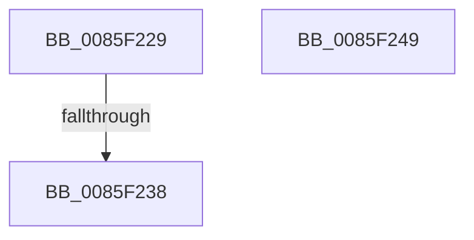

# sub_0085F229

- RVA: `0x0085F229`–`0x0085F24A` (길이 `33` bytes)
- VA: `0x000000014085F229`
- 실행 섹션: `PAGE`
- PDB 이름 있음: `아니요`; PDB Function 태그: `아니요`
- unwind 정보 RVA: `0x0006B3A0`
- 디코드: `11`개 명령, `33/33` bytes 표시
- 미해석 바이트: `0` (있으면 어셈블리에 `.byte`로 보존)

> 이 문서는 커널 이미지의 기계어와 PDB 기호를 분석해 생성했습니다. 4번과 5번은 함수 원형과 자료형을 바이너리 사용 방식에서 추정한 C 해석이며 원본 소스 복구 결과는 아닙니다.

## 1. Dependencies

- 직접 호출 지점: **0**; 고유 호출 대상: **0**
- 직접 호출자로 확인된 함수: **0**
- RIP 상대 이미지 참조: **0**

### Outgoing calls
- 직접 디코드된 call 명령이 없습니다.

### Direct callers
- 이 함수 시작 RVA로 연결되는 직접 call은 확인되지 않았습니다. 간접 호출은 완전히 역산할 수 없습니다.

### Static image references
- 디코드된 RIP-relative 메모리 참조가 없습니다.

## 2. Other-region calls and transfers

- 다른 실행 섹션으로 향하는 call: **0**
- call이 아닌 외부 분기/꼬리 이동: **1**
  - `0x0085F236` → [sub_0085F24F](Unknown_function_0085F24F.md) (`tail-transfer`)

## 3. Assembly (complete function range)

```asm
0085F229  48 8B 43 20                     mov rax, qword ptr [rbx + 0x20]
0085F22D  8B 88 10 10 00 00               mov ecx, dword ptr [rax + 0x1010]
0085F233  F6 C1 10                        test cl, 0x10
0085F236  75 17                           jne 0x14085f24f
0085F238  8B 83 B8 00 00 00               mov eax, dword ptr [rbx + 0xb8]
0085F23E  C1 E8 19                        shr eax, 0x19
0085F241  24 01                           and al, 1
0085F243  48 83 C4 40                     add rsp, 0x40
0085F247  5B                              pop rbx
0085F248  C3                              ret
0085F249  CC                              int3
```

## 4. C-style interpretation (structured pseudocode)

```c
__int64 __fastcall sub_0085F229(void)
{
    __int64 result;
    __int64 v_rsp;

    result = (unsigned int)(((unsigned int)(*(unsigned int *)(v_rbx + 184))) >> (25));
    result = (unsigned __int8)((result) & (1));
    v_rsp = (v_rsp) + (64);
    return result;
}
```

## 5. (Beta) C Style

```c
void sub_0085F229(void)
{
    int64_t result;
    int64_t local_rsp;

    result = (uint32_t)(((uint32_t)(*(uint32_t *)(local_rbx + 0xB8))) >> (25));
    result = (uint8_t)((result) & (1));
    local_rsp = (local_rsp) + (64);
    return result;
}
```

## 6. Execution-region graph

[열기: 2D/3D 그래프와 함수 탐색 컨트롤 패널](../../../control-panel.html?section=page&rva=0x0085F229&view=graph)

- 2D 그래프는 위에서 아래로 흐르고, 3D 그래프는 빈 공간을 드래그해 회전합니다. Shift+드래그는 이동, 휠은 확대·축소, 함수 노드 선택은 대상 보고서 이동입니다.

### Static fallback


