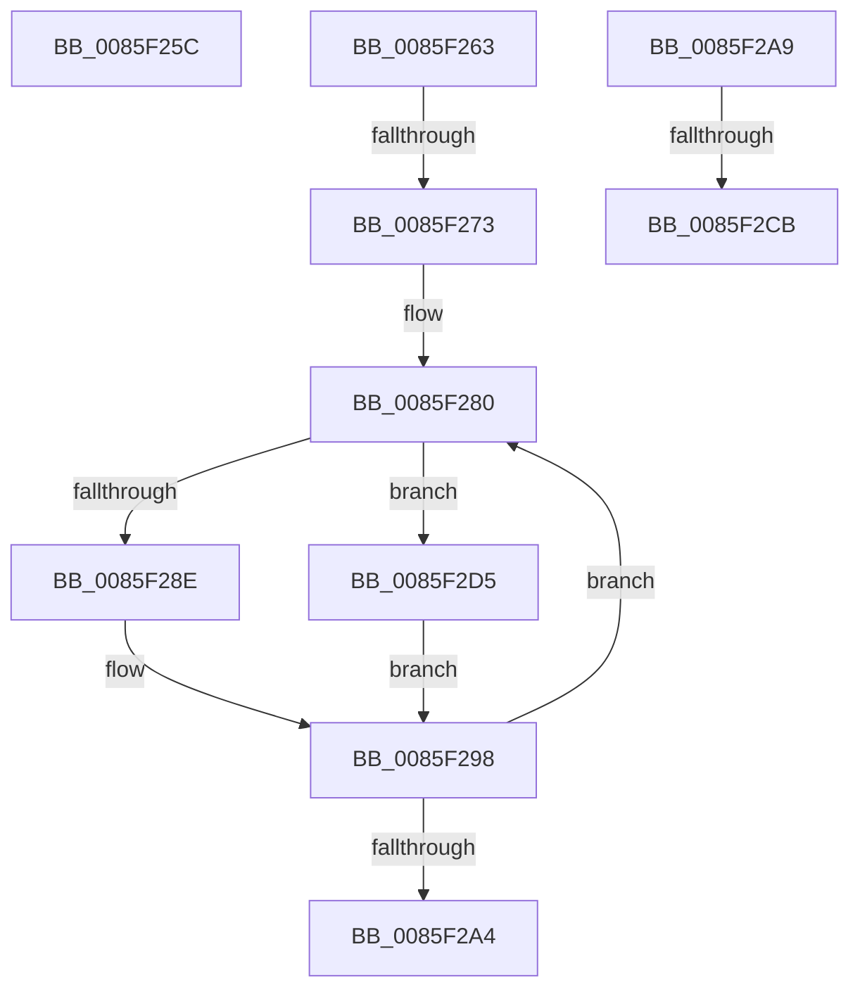

# sub_0085F25C

- RVA: `0x0085F25C`–`0x0085F2DC` (길이 `128` bytes)
- VA: `0x000000014085F25C`
- 실행 섹션: `PAGE`
- PDB 이름 있음: `아니요`; PDB Function 태그: `아니요`
- unwind 정보 RVA: `0x0006B3DC`
- 디코드: `30`개 명령, `128/128` bytes 표시
- 미해석 바이트: `0` (있으면 어셈블리에 `.byte`로 보존)

> 이 문서는 커널 이미지의 기계어와 PDB 기호를 분석해 생성했습니다. 4번과 5번은 함수 원형과 자료형을 바이너리 사용 방식에서 추정한 C 해석이며 원본 소스 복구 결과는 아닙니다.

## 1. Dependencies

- 직접 호출 지점: **1**; 고유 호출 대상: **1**
- 직접 호출자로 확인된 함수: **0**
- RIP 상대 이미지 참조: **0**

### Outgoing calls
- `0x0085F2BA` → [CmpAllocatePool](../../text/3C/CmpAllocatePool_function_003CD504.md) (function, `0x003CD504`)

### Direct callers
- 이 함수 시작 RVA로 연결되는 직접 call은 확인되지 않았습니다. 간접 호출은 완전히 역산할 수 없습니다.

### Static image references
- 디코드된 RIP-relative 메모리 참조가 없습니다.

## 2. Other-region calls and transfers

- 다른 실행 섹션으로 향하는 call: **1**
  - `0x0085F2BA` → [CmpAllocatePool](../../text/3C/CmpAllocatePool_function_003CD504.md) (`PAGE` → `.text`)
- call이 아닌 외부 분기/꼬리 이동: **5**
  - `0x0085F261` → [sub_0085F18A + 0x72](Unknown_function_0085F18A.md) (`tail-transfer`)
  - `0x0085F26D` → [sub_0085F18A + 0x56](Unknown_function_0085F18A.md) (`tail-transfer`)
  - `0x0085F2A4` → [sub_0085F18A + 0x56](Unknown_function_0085F18A.md) (`tail-transfer`)
  - `0x0085F2C5` → [sub_0085F18A + 0x2F](Unknown_function_0085F18A.md) (`tail-transfer`)
  - `0x0085F2D0` → [sub_0085F18A + 0x56](Unknown_function_0085F18A.md) (`tail-transfer`)

## 3. Assembly (complete function range)

```asm
0085F25C  48 8B 4C CA F0                  mov rcx, qword ptr [rdx + rcx*8 - 0x10]
0085F261  EB 99                           jmp 0x14085f1fc
0085F263  48 8B 8B C0 00 00 00            mov rcx, qword ptr [rbx + 0xc0]
0085F26A  48 85 C9                        test rcx, rcx
0085F26D  0F 84 6D FF FF FF               je 0x14085f1e0
0085F273  0F 1F 40 00                     nop dword ptr [rax]
0085F277  66 0F 1F 84 00 00 00 00 00      nop word ptr [rax + rax]
0085F280  4C 8B 41 10                     mov r8, qword ptr [rcx + 0x10]
0085F284  4C 0F BF C8                     movsx r9, ax
0085F288  66 83 F8 02                     cmp ax, 2
0085F28C  7D 47                           jge 0x14085f2d5
0085F28E  4E 89 44 CC 28                  mov qword ptr [rsp + r9*8 + 0x28], r8
0085F293  48 8B 54 24 38                  mov rdx, qword ptr [rsp + 0x38]
0085F298  48 8B 49 18                     mov rcx, qword ptr [rcx + 0x18]
0085F29C  66 FF C8                        dec ax
0085F29F  48 85 C9                        test rcx, rcx
0085F2A2  75 DC                           jne 0x14085f280
0085F2A4  E9 37 FF FF FF                  jmp 0x14085f1e0
0085F2A9  8B D0                           mov edx, eax
0085F2AB  B9 00 01 00 00                  mov ecx, 0x100
0085F2B0  48 C1 E2 03                     shl rdx, 3
0085F2B4  41 B8 43 4D 36 35               mov r8d, 0x35364d43
0085F2BA  E8 45 E2 B6 FF                  call 0x1403cd504
0085F2BF  48 8B D0                        mov rdx, rax
0085F2C2  48 85 C0                        test rax, rax
0085F2C5  0F 85 EE FE FF FF               jne 0x14085f1b9
0085F2CB  48 8B 54 24 38                  mov rdx, qword ptr [rsp + 0x38]
0085F2D0  E9 0B FF FF FF                  jmp 0x14085f1e0
0085F2D5  4E 89 44 CA F0                  mov qword ptr [rdx + r9*8 - 0x10], r8
0085F2DA  EB BC                           jmp 0x14085f298
```

## 4. C-style interpretation (structured pseudocode)

```c
__int64 __fastcall sub_0085F25C(__int64 a1, __int64 a2)
{
    unsigned __int64 v_stack_p38;
}
```

## 5. (Beta) C Style

```c
int64_t sub_0085F25C(int64_t Arg1, void *Arg2)
{
    uint8_t *arg2 = (uint8_t *)Arg2;

    uint64_t v_stack_p38;
}
```

### 관측된 메모리 오프셋

구조체 형식이 확인되지 않은 접근은 인자 기준의 오프셋으로만 기록했습니다.

| 기준 인자 | 오프셋 표현 | 폭 (bit) | 접근 |
|---|---:|---:|---|
| `Arg2` | `- 0x10 + rcx*8` | `64` | `R` |

## 6. Execution-region graph

[열기: 2D/3D 그래프와 함수 탐색 컨트롤 패널](../../../control-panel.html?section=page&rva=0x0085F25C&view=graph)

- 2D 그래프는 위에서 아래로 흐르고, 3D 그래프는 빈 공간을 드래그해 회전합니다. Shift+드래그는 이동, 휠은 확대·축소, 함수 노드 선택은 대상 보고서 이동입니다.

### Static fallback


