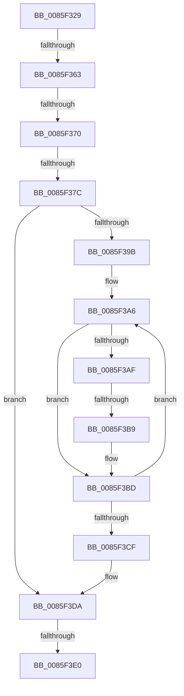

# sub_0085F329

- RVA: `0x0085F329`–`0x0085F413` (길이 `234` bytes)
- VA: `0x000000014085F329`
- 실행 섹션: `PAGE`
- PDB 이름 있음: `아니요`; PDB Function 태그: `아니요`
- unwind 정보 RVA: `0x0006B400`
- 디코드: `57`개 명령, `234/234` bytes 표시
- 미해석 바이트: `0` (있으면 어셈블리에 `.byte`로 보존)

> 이 문서는 커널 이미지의 기계어와 PDB 기호를 분석해 생성했습니다. 4번과 5번은 함수 원형과 자료형을 바이너리 사용 방식에서 추정한 C 해석이며 원본 소스 복구 결과는 아닙니다.

## 1. Dependencies

- 직접 호출 지점: **0**; 고유 호출 대상: **0**
- 직접 호출자로 확인된 함수: **0**
- RIP 상대 이미지 참조: **0**

### Outgoing calls
- 직접 디코드된 call 명령이 없습니다.

### Direct callers
- 이 함수 시작 RVA로 연결되는 직접 call은 확인되지 않았습니다. 간접 호출은 완전히 역산할 수 없습니다.

### Static image references
- 디코드된 RIP-relative 메모리 참조가 없습니다.

## 2. Other-region calls and transfers

- 다른 실행 섹션으로 향하는 call: **0**
- call이 아닌 외부 분기/꼬리 이동: **5**
  - `0x0085F35D` → [sub_0085F45E + 0x31](Unknown_function_0085F45E.md) (`tail-transfer`)
  - `0x0085F36A` → [sub_0085F45E](Unknown_function_0085F45E.md) (`tail-transfer`)
  - `0x0085F376` → [sub_0085F421](Unknown_function_0085F421.md) (`tail-transfer`)
  - `0x0085F3B3` → [sub_0085F45E + 0x24](Unknown_function_0085F45E.md) (`tail-transfer`)
  - `0x0085F3DE` → [sub_0085F421 + 0x1A](Unknown_function_0085F421.md) (`tail-transfer`)

## 3. Assembly (complete function range)

```asm
0085F329  48 89 58 20                     mov qword ptr [rax + 0x20], rbx
0085F32D  45 33 C9                        xor r9d, r9d
0085F330  48 89 68 E8                     mov qword ptr [rax - 0x18], rbp
0085F334  41 0F B7 D9                     movzx ebx, r9w
0085F338  48 89 78 E0                     mov qword ptr [rax - 0x20], rdi
0085F33C  4C 89 60 D8                     mov qword ptr [rax - 0x28], r12
0085F340  44 0F B7 60 9A                  movzx r12d, word ptr [rax - 0x66]
0085F345  4C 89 78 C8                     mov qword ptr [rax - 0x38], r15
0085F349  4C 8B 78 A0                     mov r15, qword ptr [rax - 0x60]
0085F34D  4C 89 68 D0                     mov qword ptr [rax - 0x30], r13
0085F351  B8 FE FF 00 00                  mov eax, 0xfffe
0085F356  0F BF FB                        movsx edi, bx
0085F359  66 45 85 F6                     test r14w, r14w
0085F35D  0F 85 2C 01 00 00               jne 0x14085f48f
0085F363  66 FF C3                        inc bx
0085F366  66 83 FB 08                     cmp bx, 8
0085F36A  0F 8F EE 00 00 00               jg 0x14085f45e
0085F370  44 8B F7                        mov r14d, edi
0085F373  83 FF 08                        cmp edi, 8
0085F376  0F 83 A5 00 00 00               jae 0x14085f421
0085F37C  48 8D 47 02                     lea rax, [rdi + 2]
0085F380  48 03 C0                        add rax, rax
0085F383  41 0F 11 34 C0                  movups xmmword ptr [r8 + rax*8], xmm6
0085F388  66 0F 7E F0                     movd eax, xmm6
0085F38C  41 8B F9                        mov edi, r9d
0085F38F  66 0F 7F 74 24 30               movdqa xmmword ptr [rsp + 0x30], xmm6
0085F395  66 83 F8 02                     cmp ax, 2
0085F399  72 3F                           jb 0x14085f3da
0085F39B  48 8B 74 24 38                  mov rsi, qword ptr [rsp + 0x38]
0085F3A0  0F B7 E8                        movzx ebp, ax
0085F3A3  48 D1 ED                        shr rbp, 1
0085F3A6  0F B7 06                        movzx eax, word ptr [rsi]
0085F3A9  66 83 F8 61                     cmp ax, 0x61
0085F3AD  72 0E                           jb 0x14085f3bd
0085F3AF  66 83 F8 7A                     cmp ax, 0x7a
0085F3B3  0F 87 C9 00 00 00               ja 0x14085f482
0085F3B9  66 83 E8 20                     sub ax, 0x20
0085F3BD  6B FF 25                        imul edi, edi, 0x25
0085F3C0  48 83 C6 02                     add rsi, 2
0085F3C4  0F B7 C0                        movzx eax, ax
0085F3C7  03 F8                           add edi, eax
0085F3C9  48 83 ED 01                     sub rbp, 1
0085F3CD  75 D7                           jne 0x14085f3a6
0085F3CF  4C 8B 84 24 A0 00 00 00         mov r8, qword ptr [rsp + 0xa0]
0085F3D7  45 33 C9                        xor r9d, r9d
0085F3DA  41 83 FE 08                     cmp r14d, 8
0085F3DE  73 5B                           jae 0x14085f43b
0085F3E0  43 89 3C B0                     mov dword ptr [r8 + r14*4], edi
0085F3E4  48 8B 84 24 98 00 00 00         mov rax, qword ptr [rsp + 0x98]
0085F3EC  66 89 18                        mov word ptr [rax], bx
0085F3EF  41 8B C1                        mov eax, r9d
0085F3F2  4C 8B 6C 24 58                  mov r13, qword ptr [rsp + 0x58]
0085F3F7  4C 8B 64 24 60                  mov r12, qword ptr [rsp + 0x60]
0085F3FC  48 8B 7C 24 68                  mov rdi, qword ptr [rsp + 0x68]
0085F401  48 8B 6C 24 70                  mov rbp, qword ptr [rsp + 0x70]
0085F406  48 8B 9C 24 A8 00 00 00         mov rbx, qword ptr [rsp + 0xa8]
0085F40E  4C 8B 7C 24 50                  mov r15, qword ptr [rsp + 0x50]
```

## 4. C-style interpretation (structured pseudocode)

```c
__int64 __fastcall sub_0085F329(__int64 a1, __int64 a2, __int64 a3, int a4, __int64 a5, __int64 a6, __int64 a7, __int64 a8, __int64 a9, __int64 a10, __int64 a11, __int64 a12, __int64 a13, __int64 a14, __int64 a15, __int64 a16, __int64 a17, __int64 a18, __int64 a19, __int64 a20, __int64 a21)
{
    __int64 result;
    __int64 v_rbp;
    __int64 v_rbx;
    __int64 v_rdi;
    __int64 v_rsi;
    unsigned __int64 v_stack_p30;

    *(unsigned __int64 *)(result + 32) = v_rbx;
    a4 = 0;
    *(unsigned __int64 *)(result - 24) = v_rbp;
    *(unsigned __int64 *)(result - 32) = v_rdi;
    *(unsigned __int64 *)(result - 40) = v_r12;
    *(unsigned __int64 *)(result - 56) = v_r15;
    *(unsigned __int64 *)(result - 48) = v_r13;
    v_rbx = (unsigned __int16)((0) + 1);
    result = ((__int16)(0) + 2) + ((__int16)(0) + 2);
    *(unsigned __int64 *)(a3 + result * 8) = v_xmm6;
    v_stack_p30 = v_xmm6;
    if (((unsigned __int16)(result)) < 2) goto loc_0085F3DA;
    v_rbp = ((unsigned __int16)(result)) >> (1);
loc_0085F3A6:
    if (((unsigned __int16)(*(unsigned __int16 *)(a7))) < 97) goto loc_0085F3BD;
    result = (unsigned __int16)((*(unsigned __int16 *)(a7)) - (32));
loc_0085F3BD:
    v_rdi = (unsigned int)((0) * (0));
    v_rsi = (a7) + (2);
    v_rdi = (unsigned int)((v_rdi) + ((unsigned int)((unsigned __int16)(result))));
    v_rbp = (v_rbp) - (1);
    if (condition_is_not_equal) goto loc_0085F3A6;
    a4 = 0;
loc_0085F3DA:
    *(unsigned int *)(a20 + (unsigned int)((unsigned int)((__int16)(0))) * 4) = (unsigned int)(v_rdi);
    *(unsigned __int16 *)(a19) = (unsigned __int16)(v_rbx);
    return 0;
}
```

## 5. (Beta) C Style

```c
int64_t sub_0085F329(int64_t Arg1, int64_t Arg2, void *Arg3, int32_t Arg4, uint64_t Arg5, uint64_t Arg6, void *Arg7, uint64_t Arg8, uint64_t Arg9, int64_t Arg10, int64_t Arg11, int64_t Arg12, int64_t Arg13, int64_t Arg14, uint64_t Arg15, uint64_t Arg16, uint64_t Arg17, uint64_t Arg18, void *Arg19, int64_t Arg20, int64_t Arg21)
{
    uint8_t *arg3 = (uint8_t *)Arg3;
    uint8_t *arg7 = (uint8_t *)Arg7;
    uint8_t *arg19 = (uint8_t *)Arg19;

    int64_t result;
    int64_t local_rbp;
    int64_t local_rbx;
    int64_t local_rdi;
    int64_t local_rsi;
    uint64_t v_stack_p30;

    *(uint64_t *)(result + 0x20) = local_rbx;
    Arg4 = 0;
    *(uint64_t *)(result - 0x18) = local_rbp;
    *(uint64_t *)(result - 0x20) = local_rdi;
    *(uint64_t *)(result - 0x28) = local_r12;
    *(uint64_t *)(result - 0x38) = local_r15;
    *(uint64_t *)(result - 0x30) = local_r13;
    local_rbx = (uint16_t)((0) + 1);
    result = ((int16_t)(0) + 2) + ((int16_t)(0) + 2);
    *(uint64_t *)(arg3 + result * 8) = v_xmm6;
    v_stack_p30 = v_xmm6;
    if (((uint16_t)(result)) < 2) goto loc_0085F3DA;
    local_rbp = ((uint16_t)(result)) >> (1);
loc_0085F3A6:
    if (((uint16_t)(*(uint16_t *)(arg7))) < 97) goto loc_0085F3BD;
    result = (uint16_t)((*(uint16_t *)(arg7)) - (32));
loc_0085F3BD:
    local_rdi = (uint32_t)((0) * (0));
    local_rsi = (Arg7) + (2);
    local_rdi = (uint32_t)((local_rdi) + ((uint32_t)((uint16_t)(result))));
    local_rbp = (local_rbp) - (1);
    if (condition_is_not_equal) goto loc_0085F3A6;
    Arg4 = 0;
loc_0085F3DA:
    *(uint32_t *)(Arg20 + (uint32_t)((uint32_t)((int16_t)(0))) * 4) = (uint32_t)(local_rdi);
    *(uint16_t *)(arg19) = (uint16_t)(local_rbx);
    return 0;
}
```

### 관측된 메모리 오프셋

구조체 형식이 확인되지 않은 접근은 인자 기준의 오프셋으로만 기록했습니다.

| 기준 인자 | 오프셋 표현 | 폭 (bit) | 접근 |
|---|---:|---:|---|
| `Arg3` | `+ 0x0 + rax*8` | `128` | `R` |
| `Arg7` | `+ 0x0` | `16` | `R` |
| `Arg19` | `+ 0x0` | `16` | `W` |

## 6. Execution-region graph

[열기: 2D/3D 그래프와 함수 탐색 컨트롤 패널](../../../control-panel.html?section=page&rva=0x0085F329&view=graph)

- 2D 그래프는 위에서 아래로 흐르고, 3D 그래프는 빈 공간을 드래그해 회전합니다. Shift+드래그는 이동, 휠은 확대·축소, 함수 노드 선택은 대상 보고서 이동입니다.

### Static fallback


