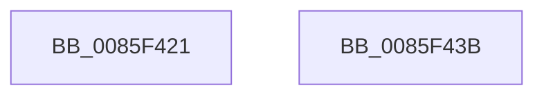

# sub_0085F421

- RVA: `0x0085F421`–`0x0085F44B` (길이 `42` bytes)
- VA: `0x000000014085F421`
- 실행 섹션: `PAGE`
- PDB 이름 있음: `아니요`; PDB Function 태그: `아니요`
- unwind 정보 RVA: `0x0006B43C`
- 디코드: `10`개 명령, `42/42` bytes 표시
- 미해석 바이트: `0` (있으면 어셈블리에 `.byte`로 보존)

> 이 문서는 커널 이미지의 기계어와 PDB 기호를 분석해 생성했습니다. 4번과 5번은 함수 원형과 자료형을 바이너리 사용 방식에서 추정한 C 해석이며 원본 소스 복구 결과는 아닙니다.

## 1. Dependencies

- 직접 호출 지점: **0**; 고유 호출 대상: **0**
- 직접 호출자로 확인된 함수: **0**
- RIP 상대 이미지 참조: **0**

### Outgoing calls
- 직접 디코드된 call 명령이 없습니다.

### Direct callers
- 이 함수 시작 RVA로 연결되는 직접 call은 확인되지 않았습니다. 간접 호출은 완전히 역산할 수 없습니다.

### Static image references
- 디코드된 RIP-relative 메모리 참조가 없습니다.

## 2. Other-region calls and transfers

- 다른 실행 섹션으로 향하는 call: **0**
- call이 아닌 외부 분기/꼬리 이동: **2**
  - `0x0085F436` → [sub_0085F329 + 0x5F](Unknown_function_0085F329.md) (`tail-transfer`)
  - `0x0085F449` → [sub_0085F329 + 0xBB](Unknown_function_0085F329.md) (`tail-transfer`)

## 3. Assembly (complete function range)

```asm
0085F421  49 8B 80 A0 00 00 00            mov rax, qword ptr [r8 + 0xa0]
0085F428  8D 4F F8                        lea ecx, [rdi - 8]
0085F42B  48 83 C1 06                     add rcx, 6
0085F42F  48 03 C9                        add rcx, rcx
0085F432  0F 11 34 C8                     movups xmmword ptr [rax + rcx*8], xmm6
0085F436  E9 4D FF FF FF                  jmp 0x14085f388
0085F43B  49 8B 88 A0 00 00 00            mov rcx, qword ptr [r8 + 0xa0]
0085F442  41 8D 56 F8                     lea edx, [r14 - 8]
0085F446  89 3C 91                        mov dword ptr [rcx + rdx*4], edi
0085F449  EB 99                           jmp 0x14085f3e4
```

## 4. C-style interpretation (structured pseudocode)

```c
__int64 __fastcall sub_0085F421(__int64 a1, __int64 a2, __int64 a3)
{
    a1 = (v_rdi - 8) + (6);
    a1 = (a1) + (a1);
    *(unsigned __int64 *)(*(unsigned __int64 *)(a3 + 160) + a1 * 8) = v_xmm6;
}
```

## 5. (Beta) C Style

```c
int64_t sub_0085F421(int64_t Arg1, int64_t Arg2, void *Arg3)
{
    uint8_t *arg3 = (uint8_t *)Arg3;

    Arg1 = (local_rdi - 8) + (6);
    Arg1 = (Arg1) + (Arg1);
    *(uint64_t *)(*(uint64_t *)(arg3 + 0xA0) + Arg1 * 8) = v_xmm6;
}
```

### 관측된 메모리 오프셋

구조체 형식이 확인되지 않은 접근은 인자 기준의 오프셋으로만 기록했습니다.

| 기준 인자 | 오프셋 표현 | 폭 (bit) | 접근 |
|---|---:|---:|---|
| `Arg3` | `+ 0xA0` | `64` | `R` |

## 6. Execution-region graph

[열기: 2D/3D 그래프와 함수 탐색 컨트롤 패널](../../../control-panel.html?section=page&rva=0x0085F421&view=graph)

- 2D 그래프는 위에서 아래로 흐르고, 3D 그래프는 빈 공간을 드래그해 회전합니다. Shift+드래그는 이동, 휠은 확대·축소, 함수 노드 선택은 대상 보고서 이동입니다.

### Static fallback


