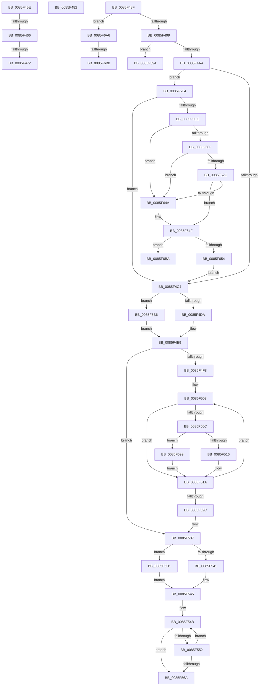

# sub_0085F45E

- RVA: `0x0085F45E`–`0x0085F6C4` (길이 `614` bytes)
- VA: `0x000000014085F45E`
- 실행 섹션: `PAGE`
- PDB 이름 있음: `아니요`; PDB Function 태그: `아니요`
- unwind 정보 RVA: `0x0006B478`
- 디코드: `142`개 명령, `614/614` bytes 표시
- 미해석 바이트: `0` (있으면 어셈블리에 `.byte`로 보존)

> 이 문서는 커널 이미지의 기계어와 PDB 기호를 분석해 생성했습니다. 4번과 5번은 함수 원형과 자료형을 바이너리 사용 방식에서 추정한 C 해석이며 원본 소스 복구 결과는 아닙니다.

## 1. Dependencies

- 직접 호출 지점: **7**; 고유 호출 대상: **5**
- 직접 호출자로 확인된 함수: **0**
- RIP 상대 이미지 참조: **0**

### Outgoing calls
- `0x0085F469` → [CmpExpandPathInfo](CmpExpandPathInfo_function_0085D4DC.md) (function, `0x0085D4DC`)
- `0x0085F485` → [RtlUpcaseUnicodeChar](RtlUpcaseUnicodeChar_function_0085F0F0.md) (function, `0x0085F0F0`)
- `0x0085F602` → [ExpInterlockedPopEntrySList](../../text/6B/ExpInterlockedPopEntrySList_function_006BA570.md) (function, `0x006BA570`)
- `0x0085F61F` → [ExpInterlockedPopEntrySList](../../text/6B/ExpInterlockedPopEntrySList_function_006BA570.md) (function, `0x006BA570`)
- `0x0085F63D` → [guard_dispatch_icall](../../text/6B/guard_dispatch_icall_function_006BAAD0.md) (function, `0x006BAAD0`)
- `0x0085F65F` → [memset](../../text/6C/memset_function_006C6C40.md) (function, `0x006C6C40`)
- `0x0085F69C` → [RtlUpcaseUnicodeChar](RtlUpcaseUnicodeChar_function_0085F0F0.md) (function, `0x0085F0F0`)

### Direct callers
- 이 함수 시작 RVA로 연결되는 직접 call은 확인되지 않았습니다. 간접 호출은 완전히 역산할 수 없습니다.

### Static image references
- 디코드된 RIP-relative 메모리 참조가 없습니다.

## 2. Other-region calls and transfers

- 다른 실행 섹션으로 향하는 call: **4**
  - `0x0085F602` → [ExpInterlockedPopEntrySList](../../text/6B/ExpInterlockedPopEntrySList_function_006BA570.md) (`PAGE` → `.text`)
  - `0x0085F61F` → [ExpInterlockedPopEntrySList](../../text/6B/ExpInterlockedPopEntrySList_function_006BA570.md) (`PAGE` → `.text`)
  - `0x0085F63D` → [guard_dispatch_icall](../../text/6B/guard_dispatch_icall_function_006BAAD0.md) (`PAGE` → `.text`)
  - `0x0085F65F` → [memset](../../text/6C/memset_function_006C6C40.md) (`PAGE` → `.text`)
- call이 아닌 외부 분기/꼬리 이동: **9**
  - `0x0085F460` → [sub_0085F329 + 0x47](Unknown_function_0085F329.md) (`tail-transfer`)
  - `0x0085F470` → [sub_0085F329 + 0xC9](Unknown_function_0085F329.md) (`tail-transfer`)
  - `0x0085F47D` → [sub_0085F329 + 0x47](Unknown_function_0085F329.md) (`tail-transfer`)
  - `0x0085F48A` → [sub_0085F329 + 0x94](Unknown_function_0085F329.md) (`tail-transfer`)
  - `0x0085F58F` → [sub_0085F329 + 0x28](Unknown_function_0085F329.md) (`tail-transfer`)
  - `0x0085F5B1` → [sub_0085F329 + 0x2D](Unknown_function_0085F329.md) (`tail-transfer`)
  - `0x0085F6AA` → [sub_0085F329 + 0x3A](Unknown_function_0085F329.md) (`tail-transfer`)
  - `0x0085F6B5` → [sub_0085F329 + 0xC9](Unknown_function_0085F329.md) (`tail-transfer`)
  - `0x0085F6BF` → [sub_0085F329 + 0xC9](Unknown_function_0085F329.md) (`tail-transfer`)

## 3. Assembly (complete function range)

```asm
0085F45E  84 C9                           test cl, cl
0085F460  0F 85 0A FF FF FF               jne 0x14085f370
0085F466  49 8B C8                        mov rcx, r8
0085F469  E8 6E E0 FF FF                  call 0x14085d4dc
0085F46E  85 C0                           test eax, eax
0085F470  78 80                           js 0x14085f3f2
0085F472  4C 8B 84 24 A0 00 00 00         mov r8, qword ptr [rsp + 0xa0]
0085F47A  45 33 C9                        xor r9d, r9d
0085F47D  E9 EE FE FF FF                  jmp 0x14085f370
0085F482  0F B7 C8                        movzx ecx, ax
0085F485  E8 66 FC FF FF                  call 0x14085f0f0
0085F48A  E9 2E FF FF FF                  jmp 0x14085f3bd
0085F48F  66 83 FB 20                     cmp bx, 0x20
0085F493  0F 8D 0D 02 00 00               jge 0x14085f6a6
0085F499  66 41 83 3F 5C                  cmp word ptr [r15], 0x5c
0085F49E  0F 85 F0 00 00 00               jne 0x14085f594
0085F4A4  0F B7 54 24 30                  movzx edx, word ptr [rsp + 0x30]
0085F4A9  66 FF C3                        inc bx
0085F4AC  66 41 2B D6                     sub dx, r14w
0085F4B0  66 89 54 24 30                  mov word ptr [rsp + 0x30], dx
0085F4B5  66 89 54 24 32                  mov word ptr [rsp + 0x32], dx
0085F4BA  66 83 FB 08                     cmp bx, 8
0085F4BE  0F 8F 20 01 00 00               jg 0x14085f5e4
0085F4C4  0F 28 44 24 30                  movaps xmm0, xmmword ptr [rsp + 0x30]
0085F4C9  44 0F BF EB                     movsx r13d, bx
0085F4CD  41 FF CD                        dec r13d
0085F4D0  41 83 FD 08                     cmp r13d, 8
0085F4D4  0F 83 DC 00 00 00               jae 0x14085f5b6
0085F4DA  41 8B C5                        mov eax, r13d
0085F4DD  48 83 C0 02                     add rax, 2
0085F4E1  48 03 C0                        add rax, rax
0085F4E4  41 0F 11 04 C0                  movups xmmword ptr [r8 + rax*8], xmm0
0085F4E9  66 0F 7F 44 24 30               movdqa xmmword ptr [rsp + 0x30], xmm0
0085F4EF  41 8B F9                        mov edi, r9d
0085F4F2  66 83 FA 02                     cmp dx, 2
0085F4F6  72 3F                           jb 0x14085f537
0085F4F8  48 8B 74 24 38                  mov rsi, qword ptr [rsp + 0x38]
0085F4FD  0F B7 EA                        movzx ebp, dx
0085F500  48 D1 ED                        shr rbp, 1
0085F503  0F B7 06                        movzx eax, word ptr [rsi]
0085F506  66 83 F8 61                     cmp ax, 0x61
0085F50A  72 0E                           jb 0x14085f51a
0085F50C  66 83 F8 7A                     cmp ax, 0x7a
0085F510  0F 87 83 01 00 00               ja 0x14085f699
0085F516  66 83 E8 20                     sub ax, 0x20
0085F51A  6B FF 25                        imul edi, edi, 0x25
0085F51D  48 83 C6 02                     add rsi, 2
0085F521  0F B7 C8                        movzx ecx, ax
0085F524  03 F9                           add edi, ecx
0085F526  48 83 ED 01                     sub rbp, 1
0085F52A  75 D7                           jne 0x14085f503
0085F52C  4C 8B 84 24 A0 00 00 00         mov r8, qword ptr [rsp + 0xa0]
0085F534  45 33 C9                        xor r9d, r9d
0085F537  41 83 FD 08                     cmp r13d, 8
0085F53B  0F 83 90 00 00 00               jae 0x14085f5d1
0085F541  43 89 3C A8                     mov dword ptr [r8 + r13*4], edi
0085F545  41 B8 FE FF 00 00               mov r8d, 0xfffe
0085F54B  66 41 83 3F 5C                  cmp word ptr [r15], 0x5c
0085F550  75 18                           jne 0x14085f56a
0085F552  66 45 03 F0                     add r14w, r8w
0085F556  49 83 C7 02                     add r15, 2
0085F55A  66 45 03 E0                     add r12w, r8w
0085F55E  66 44 89 74 24 20               mov word ptr [rsp + 0x20], r14w
0085F564  66 45 85 F6                     test r14w, r14w
0085F568  75 E1                           jne 0x14085f54b
0085F56A  4C 8B 84 24 A0 00 00 00         mov r8, qword ptr [rsp + 0xa0]
0085F572  0F B6 8C 24 90 00 00 00         movzx ecx, byte ptr [rsp + 0x90]
0085F57A  4C 89 7C 24 28                  mov qword ptr [rsp + 0x28], r15
0085F57F  66 44 89 64 24 22               mov word ptr [rsp + 0x22], r12w
0085F585  0F 28 74 24 20                  movaps xmm6, xmmword ptr [rsp + 0x20]
0085F58A  0F 29 74 24 30                  movaps xmmword ptr [rsp + 0x30], xmm6
0085F58F  E9 BD FD FF FF                  jmp 0x14085f351
0085F594  49 83 C7 02                     add r15, 2
0085F598  66 44 03 F0                     add r14w, ax
0085F59C  66 44 03 E0                     add r12w, ax
0085F5A0  4C 89 7C 24 28                  mov qword ptr [rsp + 0x28], r15
0085F5A5  66 44 89 64 24 22               mov word ptr [rsp + 0x22], r12w
0085F5AB  66 44 89 74 24 20               mov word ptr [rsp + 0x20], r14w
0085F5B1  E9 A0 FD FF FF                  jmp 0x14085f356
0085F5B6  49 8B 80 A0 00 00 00            mov rax, qword ptr [r8 + 0xa0]
0085F5BD  41 8D 4D F8                     lea ecx, [r13 - 8]
0085F5C1  48 83 C1 06                     add rcx, 6
0085F5C5  48 03 C9                        add rcx, rcx
0085F5C8  0F 11 04 C8                     movups xmmword ptr [rax + rcx*8], xmm0
0085F5CC  E9 18 FF FF FF                  jmp 0x14085f4e9
0085F5D1  49 8B 80 A0 00 00 00            mov rax, qword ptr [r8 + 0xa0]
0085F5D8  41 8D 4D F8                     lea ecx, [r13 - 8]
0085F5DC  89 3C 88                        mov dword ptr [rax + rcx*4], edi
0085F5DF  E9 61 FF FF FF                  jmp 0x14085f545
0085F5E4  84 C9                           test cl, cl
0085F5E6  0F 85 D8 FE FF FF               jne 0x14085f4c4
0085F5EC  65 48 8B 2C 25 20 00 00 00      mov rbp, qword ptr gs:[0x20]
0085F5F5  48 8B B5 80 08 00 00            mov rsi, qword ptr [rbp + 0x880]
0085F5FC  48 8B CE                        mov rcx, rsi
0085F5FF  FF 46 14                        inc dword ptr [rsi + 0x14]
0085F602  E8 69 AF E5 FF                  call 0x1406ba570
0085F607  48 8B F8                        mov rdi, rax
0085F60A  48 85 C0                        test rax, rax
0085F60D  75 3B                           jne 0x14085f64a
0085F60F  FF 46 18                        inc dword ptr [rsi + 0x18]
0085F612  48 8B B5 88 08 00 00            mov rsi, qword ptr [rbp + 0x888]
0085F619  48 8B CE                        mov rcx, rsi
0085F61C  FF 46 14                        inc dword ptr [rsi + 0x14]
0085F61F  E8 4C AF E5 FF                  call 0x1406ba570
0085F624  48 8B F8                        mov rdi, rax
0085F627  48 85 C0                        test rax, rax
0085F62A  75 1E                           jne 0x14085f64a
0085F62C  8B 56 2C                        mov edx, dword ptr [rsi + 0x2c]
0085F62F  48 8B 46 30                     mov rax, qword ptr [rsi + 0x30]
0085F633  44 8B 46 28                     mov r8d, dword ptr [rsi + 0x28]
0085F637  8B 4E 24                        mov ecx, dword ptr [rsi + 0x24]
0085F63A  FF 46 18                        inc dword ptr [rsi + 0x18]
0085F63D  E8 8E B4 E5 FF                  call 0x1406baad0
0085F642  48 8B F8                        mov rdi, rax
0085F645  48 85 C0                        test rax, rax
0085F648  74 05                           je 0x14085f64f
0085F64A  8B 45 24                        mov eax, dword ptr [rbp + 0x24]
0085F64D  89 07                           mov dword ptr [rdi], eax
0085F64F  48 85 FF                        test rdi, rdi
0085F652  74 66                           je 0x14085f6ba
0085F654  33 D2                           xor edx, edx
0085F656  41 B8 E0 01 00 00               mov r8d, 0x1e0
0085F65C  48 8B CF                        mov rcx, rdi
0085F65F  E8 DC 75 E6 FF                  call 0x1406c6c40
0085F664  4C 8B 84 24 A0 00 00 00         mov r8, qword ptr [rsp + 0xa0]
0085F66C  45 33 C9                        xor r9d, r9d
0085F66F  0F B7 54 24 30                  movzx edx, word ptr [rsp + 0x30]
0085F674  4C 8B 7C 24 28                  mov r15, qword ptr [rsp + 0x28]
0085F679  44 0F B7 64 24 22               movzx r12d, word ptr [rsp + 0x22]
0085F67F  44 0F B7 74 24 20               movzx r14d, word ptr [rsp + 0x20]
0085F685  49 89 B8 A0 00 00 00            mov qword ptr [r8 + 0xa0], rdi
0085F68C  C6 84 24 90 00 00 00 01         mov byte ptr [rsp + 0x90], 1
0085F694  E9 2B FE FF FF                  jmp 0x14085f4c4
0085F699  0F B7 C8                        movzx ecx, ax
0085F69C  E8 4F FA FF FF                  call 0x14085f0f0
0085F6A1  E9 74 FE FF FF                  jmp 0x14085f51a
0085F6A6  66 45 85 F6                     test r14w, r14w
0085F6AA  0F 84 B3 FC FF FF               je 0x14085f363
0085F6B0  B8 0D 00 00 C0                  mov eax, 0xc000000d
0085F6B5  E9 38 FD FF FF                  jmp 0x14085f3f2
0085F6BA  B8 9A 00 00 C0                  mov eax, 0xc000009a
0085F6BF  E9 2E FD FF FF                  jmp 0x14085f3f2
```

## 4. C-style interpretation (structured pseudocode)

```c
__int64 __fastcall sub_0085F45E(unsigned __int8 a1, __int64 a2, __int64 a3, int a4, __int64 a5, __int64 a6, __int64 a7, __int64 a8, __int64 a9, __int64 a10, __int64 a11, __int64 a12, __int64 a13, __int64 a14, __int64 a15, __int64 a16, __int64 a17, __int64 a18, __int64 a19, __int64 a20)
{
    __int64 result;
    unsigned __int16 v_stack_p20;
    unsigned __int16 v_stack_p22;
    unsigned __int64 v_stack_p28;
    unsigned __int16 v_stack_p30;
    unsigned __int16 v_stack_p32;
    unsigned __int64 v_stack_p38;
    unsigned __int8 v_stack_p90;
    unsigned __int64 v_stack_pA0;

    result = CmpExpandPathInfo(a3, a2, a3, a4);
    a4 = 0;
}
```

## 5. (Beta) C Style

```c
int64_t sub_0085F45E(uint8_t Arg1, int64_t Arg2, int64_t Arg3, int32_t Arg4, uint64_t Arg5, uint64_t Arg6, uint64_t Arg7, uint64_t Arg8, uint64_t Arg9, uint64_t Arg10, uint64_t Arg11, uint64_t Arg12, uint64_t Arg13, uint64_t Arg14, uint64_t Arg15, uint64_t Arg16, uint64_t Arg17, uint64_t Arg18, uint64_t Arg19, int64_t Arg20)
{
    int64_t result;
    uint16_t v_stack_p20;
    uint16_t v_stack_p22;
    uint64_t v_stack_p28;
    uint16_t v_stack_p30;
    uint16_t v_stack_p32;
    uint64_t v_stack_p38;
    uint8_t v_stack_p90;
    uint64_t v_stack_pA0;

    result = CmpExpandPathInfo(Arg3, Arg2, Arg3, Arg4);
    Arg4 = 0;
}
```

## 6. Execution-region graph

[열기: 2D/3D 그래프와 함수 탐색 컨트롤 패널](../../../control-panel.html?section=page&rva=0x0085F45E&view=graph)

- 2D 그래프는 위에서 아래로 흐르고, 3D 그래프는 빈 공간을 드래그해 회전합니다. Shift+드래그는 이동, 휠은 확대·축소, 함수 노드 선택은 대상 보고서 이동입니다.

### Static fallback


