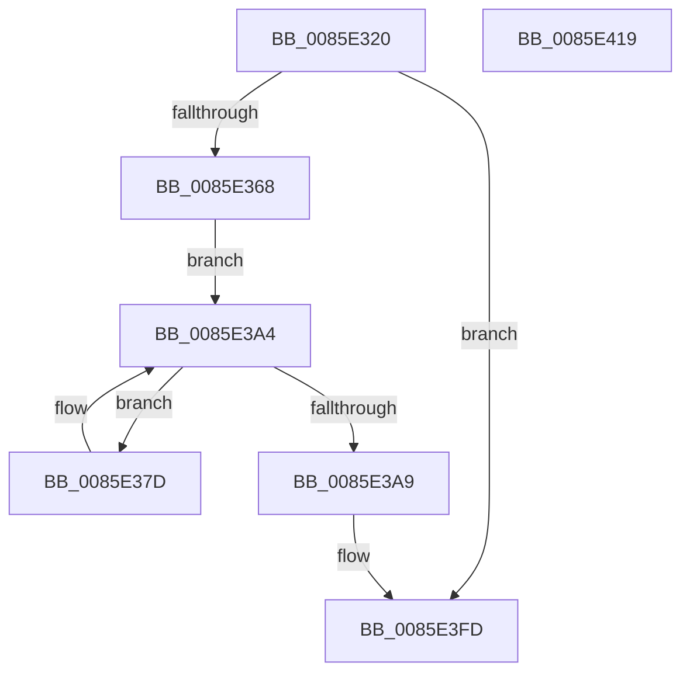

# VrpAllocateDiffHiveEntry

- RVA: `0x0085E320`–`0x0085E41A` (길이 `250` bytes)
- VA: `0x000000014085E320`
- 실행 섹션: `PAGE`
- PDB 이름 있음: `예`; PDB Function 태그: `아니요`
- unwind 정보 RVA: `0x0006B074`
- 디코드: `67`개 명령, `250/250` bytes 표시
- 미해석 바이트: `0` (있으면 어셈블리에 `.byte`로 보존)

> 이 문서는 커널 이미지의 기계어와 PDB 기호를 분석해 생성했습니다. 4번과 5번은 함수 원형과 자료형을 바이너리 사용 방식에서 추정한 C 해석이며 원본 소스 복구 결과는 아닙니다.

## 1. Dependencies

- 직접 호출 지점: **5**; 고유 호출 대상: **4**
- 직접 호출자로 확인된 함수: **1**
- RIP 상대 이미지 참조: **0**

### Outgoing calls
- `0x0085E357` → [ExAllocatePool2](../../poolcode/B8/ExAllocatePool2_function_00B820F0.md) (function, `0x00B820F0`)
- `0x0085E380` → [RtlUpcaseUnicodeChar](RtlUpcaseUnicodeChar_function_0085F0F0.md) (function, `0x0085F0F0`)
- `0x0085E3BE` → [KeInitializeWaitChain](../../text/43/KeInitializeWaitChain_function_00438EB0.md) (function, `0x00438EB0`)
- `0x0085E3D5` → [memcpy](../../text/6C/memcpy_function_006C6840.md) (function, `0x006C6840`)
- `0x0085E3F8` → [memcpy](../../text/6C/memcpy_function_006C6840.md) (function, `0x006C6840`)

### Direct callers
- [VrpFindOrCreateDiffHiveEntryForMountPoint](../93/VrpFindOrCreateDiffHiveEntryForMountPoint_function_00936290.md) at `0x009362CF`

### Static image references
- 디코드된 RIP-relative 메모리 참조가 없습니다.

## 2. Other-region calls and transfers

- 다른 실행 섹션으로 향하는 call: **4**
  - `0x0085E357` → [ExAllocatePool2](../../poolcode/B8/ExAllocatePool2_function_00B820F0.md) (`PAGE` → `POOLCODE`)
  - `0x0085E3BE` → [KeInitializeWaitChain](../../text/43/KeInitializeWaitChain_function_00438EB0.md) (`PAGE` → `.text`)
  - `0x0085E3D5` → [memcpy](../../text/6C/memcpy_function_006C6840.md) (`PAGE` → `.text`)
  - `0x0085E3F8` → [memcpy](../../text/6C/memcpy_function_006C6840.md) (`PAGE` → `.text`)
- 별도 외부 분기/꼬리 이동을 확인하지 못했습니다.

## 3. Assembly (complete function range)

```asm
0085E320  48 89 5C 24 10                  mov qword ptr [rsp + 0x10], rbx
0085E325  48 89 6C 24 18                  mov qword ptr [rsp + 0x18], rbp
0085E32A  48 89 74 24 20                  mov qword ptr [rsp + 0x20], rsi
0085E32F  57                              push rdi
0085E330  41 56                           push r14
0085E332  41 57                           push r15
0085E334  48 83 EC 20                     sub rsp, 0x20
0085E338  44 0F B7 01                     movzx r8d, word ptr [rcx]
0085E33C  4C 8B FA                        mov r15, rdx
0085E33F  0F B7 12                        movzx edx, word ptr [rdx]
0085E342  48 8B F1                        mov rsi, rcx
0085E345  48 83 C2 44                     add rdx, 0x44
0085E349  B9 00 01 00 00                  mov ecx, 0x100
0085E34E  49 03 D0                        add rdx, r8
0085E351  41 B8 56 52 65 67               mov r8d, 0x67655256
0085E357  E8 94 3D 32 00                  call 0x140b820f0
0085E35C  48 8B D8                        mov rbx, rax
0085E35F  48 85 C0                        test rax, rax
0085E362  0F 84 95 00 00 00               je 0x14085e3fd
0085E368  0F B7 0E                        movzx ecx, word ptr [rsi]
0085E36B  BD 2F CB 04 00                  mov ebp, 0x4cb2f
0085E370  48 8B 7E 08                     mov rdi, qword ptr [rsi + 8]
0085E374  48 D1 E9                        shr rcx, 1
0085E377  4C 8D 34 4F                     lea r14, [rdi + rcx*2]
0085E37B  EB 27                           jmp 0x14085e3a4
0085E37D  0F B7 0F                        movzx ecx, word ptr [rdi]
0085E380  E8 6B 0D 00 00                  call 0x14085f0f0
0085E385  48 6B CD 25                     imul rcx, rbp, 0x25
0085E389  66 89 44 24 40                  mov word ptr [rsp + 0x40], ax
0085E38E  48 83 C7 02                     add rdi, 2
0085E392  0F B6 C0                        movzx eax, al
0085E395  48 03 C8                        add rcx, rax
0085E398  0F B6 44 24 41                  movzx eax, byte ptr [rsp + 0x41]
0085E39D  48 6B E9 25                     imul rbp, rcx, 0x25
0085E3A1  48 03 E8                        add rbp, rax
0085E3A4  49 3B FE                        cmp rdi, r14
0085E3A7  72 D4                           jb 0x14085e37d
0085E3A9  48 83 63 18 00                  and qword ptr [rbx + 0x18], 0
0085E3AE  48 8D 4B 30                     lea rcx, [rbx + 0x30]
0085E3B2  48 89 6B 08                     mov qword ptr [rbx + 8], rbp
0085E3B6  48 C7 43 10 01 00 00 00         mov qword ptr [rbx + 0x10], 1
0085E3BE  E8 ED AA BD FF                  call 0x140438eb0
0085E3C3  0F B7 06                        movzx eax, word ptr [rsi]
0085E3C6  48 8D 4B 44                     lea rcx, [rbx + 0x44]
0085E3CA  66 89 43 40                     mov word ptr [rbx + 0x40], ax
0085E3CE  44 8B C0                        mov r8d, eax
0085E3D1  48 8B 56 08                     mov rdx, qword ptr [rsi + 8]
0085E3D5  E8 66 84 E6 FF                  call 0x1406c6840
0085E3DA  41 0F B7 07                     movzx eax, word ptr [r15]
0085E3DE  66 89 43 42                     mov word ptr [rbx + 0x42], ax
0085E3E2  44 8B C0                        mov r8d, eax
0085E3E5  0F B7 43 40                     movzx eax, word ptr [rbx + 0x40]
0085E3E9  49 8B 57 08                     mov rdx, qword ptr [r15 + 8]
0085E3ED  48 D1 E8                        shr rax, 1
0085E3F0  48 83 C0 22                     add rax, 0x22
0085E3F4  48 8D 0C 43                     lea rcx, [rbx + rax*2]
0085E3F8  E8 43 84 E6 FF                  call 0x1406c6840
0085E3FD  48 8B 6C 24 50                  mov rbp, qword ptr [rsp + 0x50]
0085E402  48 8B C3                        mov rax, rbx
0085E405  48 8B 5C 24 48                  mov rbx, qword ptr [rsp + 0x48]
0085E40A  48 8B 74 24 58                  mov rsi, qword ptr [rsp + 0x58]
0085E40F  48 83 C4 20                     add rsp, 0x20
0085E413  41 5F                           pop r15
0085E415  41 5E                           pop r14
0085E417  5F                              pop rdi
0085E418  C3                              ret
0085E419  CC                              int3
```

## 4. C-style interpretation (structured pseudocode)

```c
__int64 __fastcall VrpAllocateDiffHiveEntry(__int64 a1, __int64 a2)
{
    __int64 result;
    __int64 v_rbp;
    __int64 v_rdi;
    __int64 v_rsp;
    unsigned __int64 v_stack_p10;
    unsigned __int64 v_stack_p18;
    unsigned __int64 v_stack_p20;
    unsigned __int16 v_stack_p8;
    unsigned __int8 v_stack_p9;

    v_stack_p10 = v_rbx;
    v_stack_p18 = v_rbp;
    v_stack_p20 = v_rsi;
    v_rsp = (v_rsp) - (32);
    a2 = (*(unsigned __int16 *)(a2)) + (68);
    a2 = (a2) + (*(unsigned __int16 *)(a1));
    result = ExAllocatePool2(256, a2, (unsigned int)(0x67655256ULL), a4);
    if (result == 0) goto loc_0085E3FD;
    a1 = (*(unsigned __int16 *)(a1)) >> (1);
    goto loc_0085E3A4;
loc_0085E37D:
    result = RtlUpcaseUnicodeChar(*(unsigned __int16 *)(*(unsigned __int64 *)(a1 + 8)), a2, (unsigned int)(0x67655256ULL), a4);
    a1 = (*(unsigned __int16 *)(*(unsigned __int64 *)(a1 + 8))) * ((unsigned int)(0x4CB2FULL));
    v_stack_p8 = (unsigned __int16)(result);
    v_rdi = (*(unsigned __int64 *)(a1 + 8)) + (2);
    a1 = (a1) + ((unsigned __int8)(result));
    v_rbp = ((unsigned int)(0x4CB2FULL)) * (a1);
    v_rbp = (v_rbp) + (v_stack_p9);
loc_0085E3A4:
    if (v_rdi < (*(unsigned __int64 *)(a1 + 8) + a1 * 2)) goto loc_0085E37D;
    *(unsigned __int64 *)(result + 8) = v_rbp;
    *(unsigned __int64 *)(result + 16) = 1;
    result = KeInitializeWaitChain(result + 48, a2, (unsigned int)(0x67655256ULL), a4);
    *(unsigned __int16 *)(result + 64) = (unsigned __int16)(*(unsigned __int16 *)(a1));
    result = memcpy(result + 68, *(unsigned __int64 *)(a1 + 8), (unsigned int)((unsigned int)(*(unsigned __int16 *)(a1))), a4);
    *(unsigned __int16 *)(result + 66) = (unsigned __int16)(*(unsigned __int16 *)(a2));
    result = (*(unsigned __int16 *)(result + 64)) >> (1);
    result = (result) + (34);
    result = memcpy(result + result * 2, *(unsigned __int64 *)(a2 + 8), (unsigned int)((unsigned int)(*(unsigned __int16 *)(a2))), a4);
loc_0085E3FD:
    v_rsp = (v_rsp) + (32);
    return result;
}
```

## 5. (Beta) C Style

```c
int64_t VrpAllocateDiffHiveEntry(void *Arg1, void *Arg2)
{
    uint8_t *arg1 = (uint8_t *)Arg1;
    uint8_t *arg2 = (uint8_t *)Arg2;

    int64_t result;
    int64_t local_rbp;
    int64_t local_rdi;
    int64_t local_rsp;
    uint64_t v_stack_p10;
    uint64_t v_stack_p18;
    uint64_t v_stack_p20;
    uint16_t v_stack_p8;
    uint8_t v_stack_p9;

    v_stack_p10 = local_rbx;
    v_stack_p18 = local_rbp;
    v_stack_p20 = local_rsi;
    local_rsp = (local_rsp) - (32);
    Arg2 = (*(uint16_t *)(arg2)) + (68);
    Arg2 = (Arg2) + (*(uint16_t *)(arg1));
    result = ExAllocatePool2(256, Arg2, (uint32_t)(0x67655256ULL), a4);
    if (result == 0) goto loc_0085E3FD;
    Arg1 = (*(uint16_t *)(arg1)) >> (1);
    goto loc_0085E3A4;
loc_0085E37D:
    result = RtlUpcaseUnicodeChar(*(uint16_t *)(*(uint64_t *)(arg1 + 0x8)), Arg2, (uint32_t)(0x67655256ULL), a4);
    Arg1 = (*(uint16_t *)(*(uint64_t *)(arg1 + 0x8))) * ((uint32_t)(0x4CB2FULL));
    v_stack_p8 = (uint16_t)(result);
    local_rdi = (*(uint64_t *)(arg1 + 0x8)) + (2);
    Arg1 = (Arg1) + ((uint8_t)(result));
    local_rbp = ((uint32_t)(0x4CB2FULL)) * (Arg1);
    local_rbp = (local_rbp) + (v_stack_p9);
loc_0085E3A4:
    if (local_rdi < (*(uint64_t *)(arg1 + 0x8) + Arg1 * 2)) goto loc_0085E37D;
    *(uint64_t *)(result + 0x8) = local_rbp;
    *(uint64_t *)(result + 0x10) = 1;
    result = KeInitializeWaitChain(result + 48, Arg2, (uint32_t)(0x67655256ULL), a4);
    *(uint16_t *)(result + 0x40) = (uint16_t)(*(uint16_t *)(arg1));
    result = memcpy(result + 68, *(uint64_t *)(arg1 + 0x8), (uint32_t)((uint32_t)(*(uint16_t *)(arg1))), a4);
    *(uint16_t *)(result + 0x42) = (uint16_t)(*(uint16_t *)(arg2));
    result = (*(uint16_t *)(result + 0x40)) >> (1);
    result = (result) + (34);
    result = memcpy(result + result * 2, *(uint64_t *)(arg2 + 0x8), (uint32_t)((uint32_t)(*(uint16_t *)(arg2))), a4);
loc_0085E3FD:
    local_rsp = (local_rsp) + (32);
    return result;
}
```

### 관측된 메모리 오프셋

구조체 형식이 확인되지 않은 접근은 인자 기준의 오프셋으로만 기록했습니다.

| 기준 인자 | 오프셋 표현 | 폭 (bit) | 접근 |
|---|---:|---:|---|
| `Arg1` | `+ 0x0` | `16` | `R` |
| `Arg1` | `+ 0x8` | `64` | `R` |
| `Arg2` | `+ 0x0` | `16` | `R` |
| `Arg2` | `+ 0x8` | `64` | `R` |

## 6. Execution-region graph

[열기: 2D/3D 그래프와 함수 탐색 컨트롤 패널](../../../control-panel.html?section=page&rva=0x0085E320&view=graph)

- 2D 그래프는 위에서 아래로 흐르고, 3D 그래프는 빈 공간을 드래그해 회전합니다. Shift+드래그는 이동, 휠은 확대·축소, 함수 노드 선택은 대상 보고서 이동입니다.

### Static fallback


