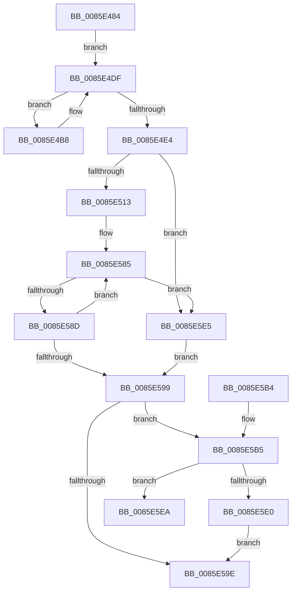

# VrpFindDiffHiveEntryForMountPointWithLock

- RVA: `0x0085E484`–`0x0085E604` (길이 `384` bytes)
- VA: `0x000000014085E484`
- 실행 섹션: `PAGE`
- PDB 이름 있음: `예`; PDB Function 태그: `예`
- unwind 정보 RVA: `0x0006B0A4`
- 디코드: `108`개 명령, `384/384` bytes 표시
- 미해석 바이트: `0` (있으면 어셈블리에 `.byte`로 보존)

> 이 문서는 커널 이미지의 기계어와 PDB 기호를 분석해 생성했습니다. 4번과 5번은 함수 원형과 자료형을 바이너리 사용 방식에서 추정한 C 해석이며 원본 소스 복구 결과는 아닙니다.

## 1. Dependencies

- 직접 호출 지점: **2**; 고유 호출 대상: **2**
- 직접 호출자로 확인된 함수: **2**
- RIP 상대 이미지 참조: **2**

### Outgoing calls
- `0x0085E4BB` → [RtlUpcaseUnicodeChar](RtlUpcaseUnicodeChar_function_0085F0F0.md) (function, `0x0085F0F0`)
- `0x0085E5D7` → [RtlEqualUnicodeString](../93/RtlEqualUnicodeString_function_00932A20.md) (function, `0x00932A20`)

### Direct callers
- [VrpFindOrCreateDiffHiveEntryForMountPoint](../93/VrpFindOrCreateDiffHiveEntryForMountPoint_function_00936290.md) at `0x009362B7`
- [VrpFindOrCreateDiffHiveEntryForMountPoint](../93/VrpFindOrCreateDiffHiveEntryForMountPoint_function_00936290.md) at `0x009362EB`
- [VrpFindDiffHiveEntryForMountPoint](../93/VrpFindDiffHiveEntryForMountPoint_function_00936DF0.md) at `0x00936E01`

### Static image references
- `0x0085E4E4` → RVA `0x00EF02A4` (`.data`; read)
- `0x0085E57A` → RVA `0x00EF02A8` (`.data`; read)

## 2. Other-region calls and transfers

- 다른 실행 섹션으로 향하는 call: **0**
- call이 아닌 외부 분기/꼬리 이동: **1**
  - `0x0085E5FF` → [sub_00B16EC2](../B1/Unknown_function_00B16EC2.md) (`tail-transfer`)

## 3. Assembly (complete function range)

```asm
0085E484  48 89 5C 24 10                  mov qword ptr [rsp + 0x10], rbx
0085E489  48 89 6C 24 18                  mov qword ptr [rsp + 0x18], rbp
0085E48E  56                              push rsi
0085E48F  57                              push rdi
0085E490  41 56                           push r14
0085E492  48 83 EC 30                     sub rsp, 0x30
0085E496  0F B7 01                        movzx eax, word ptr [rcx]
0085E499  33 FF                           xor edi, edi
0085E49B  48 8B 59 08                     mov rbx, qword ptr [rcx + 8]
0085E49F  0F 57 C0                        xorps xmm0, xmm0
0085E4A2  48 D1 E8                        shr rax, 1
0085E4A5  4C 8B F1                        mov r14, rcx
0085E4A8  0F 11 44 24 20                  movups xmmword ptr [rsp + 0x20], xmm0
0085E4AD  BE 2F CB 04 00                  mov esi, 0x4cb2f
0085E4B2  48 8D 2C 43                     lea rbp, [rbx + rax*2]
0085E4B6  EB 27                           jmp 0x14085e4df
0085E4B8  0F B7 0B                        movzx ecx, word ptr [rbx]
0085E4BB  E8 30 0C 00 00                  call 0x14085f0f0
0085E4C0  48 6B CE 25                     imul rcx, rsi, 0x25
0085E4C4  66 89 44 24 50                  mov word ptr [rsp + 0x50], ax
0085E4C9  48 83 C3 02                     add rbx, 2
0085E4CD  0F B6 C0                        movzx eax, al
0085E4D0  48 03 C8                        add rcx, rax
0085E4D3  0F B6 44 24 51                  movzx eax, byte ptr [rsp + 0x51]
0085E4D8  48 6B F1 25                     imul rsi, rcx, 0x25
0085E4DC  48 03 F0                        add rsi, rax
0085E4DF  48 3B DD                        cmp rbx, rbp
0085E4E2  72 D4                           jb 0x14085e4b8
0085E4E4  44 8B 0D B9 1D 69 00            mov r9d, dword ptr [rip + 0x691db9]
0085E4EB  48 83 CD FF                     or rbp, 0xffffffffffffffff
0085E4EF  41 8B C9                        mov ecx, r9d
0085E4F2  4C 8B DD                        mov r11, rbp
0085E4F5  83 E1 1F                        and ecx, 0x1f
0085E4F8  41 C1 E9 05                     shr r9d, 5
0085E4FC  49 D3 E3                        shl r11, cl
0085E4FF  4D 8B D3                        mov r10, r11
0085E502  4C 23 D6                        and r10, rsi
0085E505  4C 89 54 24 50                  mov qword ptr [rsp + 0x50], r10
0085E50A  45 85 C9                        test r9d, r9d
0085E50D  0F 84 D2 00 00 00               je 0x14085e5e5
0085E513  41 0F B6 C2                     movzx eax, r10b
0085E517  48 05 CB 5D B1 00               add rax, 0xb15dcb
0085E51D  48 6B C8 25                     imul rcx, rax, 0x25
0085E521  0F B6 44 24 51                  movzx eax, byte ptr [rsp + 0x51]
0085E526  48 03 C8                        add rcx, rax
0085E529  0F B6 44 24 52                  movzx eax, byte ptr [rsp + 0x52]
0085E52E  48 6B D1 25                     imul rdx, rcx, 0x25
0085E532  48 03 D0                        add rdx, rax
0085E535  0F B6 44 24 53                  movzx eax, byte ptr [rsp + 0x53]
0085E53A  48 6B CA 25                     imul rcx, rdx, 0x25
0085E53E  48 03 C8                        add rcx, rax
0085E541  0F B6 44 24 54                  movzx eax, byte ptr [rsp + 0x54]
0085E546  48 6B D1 25                     imul rdx, rcx, 0x25
0085E54A  48 03 D0                        add rdx, rax
0085E54D  0F B6 44 24 55                  movzx eax, byte ptr [rsp + 0x55]
0085E552  48 6B CA 25                     imul rcx, rdx, 0x25
0085E556  48 03 C8                        add rcx, rax
0085E559  0F B6 44 24 56                  movzx eax, byte ptr [rsp + 0x56]
0085E55E  48 6B D1 25                     imul rdx, rcx, 0x25
0085E562  41 8D 49 FF                     lea ecx, [r9 - 1]
0085E566  48 03 D0                        add rdx, rax
0085E569  0F B6 44 24 57                  movzx eax, byte ptr [rsp + 0x57]
0085E56E  4C 6B C2 25                     imul r8, rdx, 0x25
0085E572  49 03 C0                        add rax, r8
0085E575  8B C0                           mov eax, eax
0085E577  48 23 C8                        and rcx, rax
0085E57A  48 8B 05 27 1D 69 00            mov rax, qword ptr [rip + 0x691d27]
0085E581  48 8D 1C C8                     lea rbx, [rax + rcx*8]
0085E585  48 8B 1B                        mov rbx, qword ptr [rbx]
0085E588  F6 C3 01                        test bl, 1
0085E58B  75 58                           jne 0x14085e5e5
0085E58D  48 8B 43 08                     mov rax, qword ptr [rbx + 8]
0085E591  49 23 C3                        and rax, r11
0085E594  4C 3B D0                        cmp r10, rax
0085E597  75 EC                           jne 0x14085e585
0085E599  48 85 DB                        test rbx, rbx
0085E59C  75 17                           jne 0x14085e5b5
0085E59E  48 8B 5C 24 58                  mov rbx, qword ptr [rsp + 0x58]
0085E5A3  48 8B C7                        mov rax, rdi
0085E5A6  48 8B 6C 24 60                  mov rbp, qword ptr [rsp + 0x60]
0085E5AB  48 83 C4 30                     add rsp, 0x30
0085E5AF  41 5E                           pop r14
0085E5B1  5F                              pop rdi
0085E5B2  5E                              pop rsi
0085E5B3  C3                              ret
0085E5B4  CC                              int3
0085E5B5  48 8D 43 44                     lea rax, [rbx + 0x44]
0085E5B9  41 B0 01                        mov r8b, 1
0085E5BC  48 89 44 24 28                  mov qword ptr [rsp + 0x28], rax
0085E5C1  48 8D 54 24 20                  lea rdx, [rsp + 0x20]
0085E5C6  0F B7 43 40                     movzx eax, word ptr [rbx + 0x40]
0085E5CA  49 8B CE                        mov rcx, r14
0085E5CD  66 89 44 24 20                  mov word ptr [rsp + 0x20], ax
0085E5D2  66 89 44 24 22                  mov word ptr [rsp + 0x22], ax
0085E5D7  E8 44 44 0D 00                  call 0x140932a20
0085E5DC  84 C0                           test al, al
0085E5DE  74 0A                           je 0x14085e5ea
0085E5E0  48 8B FB                        mov rdi, rbx
0085E5E3  EB B9                           jmp 0x14085e59e
0085E5E5  48 8B DF                        mov rbx, rdi
0085E5E8  EB AF                           jmp 0x14085e599
0085E5EA  8B 0D B4 1C 69 00               mov ecx, dword ptr [rip + 0x691cb4]
0085E5F0  48 8B D5                        mov rdx, rbp
0085E5F3  83 E1 1F                        and ecx, 0x1f
0085E5F6  48 D3 E2                        shl rdx, cl
0085E5F9  48 8B CA                        mov rcx, rdx
0085E5FC  48 23 CE                        and rcx, rsi
0085E5FF  E9 BE 88 2B 00                  jmp 0x140b16ec2
```

## 4. C-style interpretation (structured pseudocode)

```c
__int64 __fastcall VrpFindDiffHiveEntryForMountPointWithLock(__int64 a1)
{
    __int64 result;
    __int64 v_r10;
    __int64 v_r11;
    __int64 v_rbp;
    __int64 v_rbx;
    __int64 v_rdi;
    __int64 v_rsi;
    __int64 v_rsp;
    unsigned __int64 v_stack_m28;
    unsigned __int64 v_stack_p10;
    unsigned __int64 v_stack_p18;
    unsigned __int64 v_stack_p20;
    unsigned __int16 v_stack_p22;
    unsigned __int64 v_stack_p28;
    unsigned __int16 v_stack_p8;
    unsigned __int8 v_stack_p9;
    unsigned __int8 v_stack_pA;
    unsigned __int8 v_stack_pB;
    unsigned __int8 v_stack_pC;
    unsigned __int8 v_stack_pD;
    unsigned __int8 v_stack_pE;
    unsigned __int8 v_stack_pF;

    v_stack_p10 = v_rbx;
    v_stack_p18 = v_rbp;
    v_rsp = (v_rsp) - (48);
    v_rdi = 0;
    result = (*(unsigned __int16 *)(a1)) >> (1);
    v_stack_m28 = v_xmm0;
    goto loc_0085E4DF;
loc_0085E4B8:
    result = RtlUpcaseUnicodeChar(*(unsigned __int16 *)(*(unsigned __int64 *)(a1 + 8)), a2, a3, a4);
    a1 = (*(unsigned __int16 *)(*(unsigned __int64 *)(a1 + 8))) * ((unsigned int)(0x4CB2FULL));
    v_stack_p8 = (unsigned __int16)(result);
    v_rbx = (*(unsigned __int64 *)(a1 + 8)) + (2);
    a1 = (a1) + ((unsigned __int8)(result));
    v_rsi = ((unsigned int)(0x4CB2FULL)) * (a1);
    v_rsi = (v_rsi) + (v_stack_p9);
loc_0085E4DF:
    if (v_rbx < (*(unsigned __int64 *)(a1 + 8) + result * 2)) goto loc_0085E4B8;
    v_rbp = (*(unsigned __int64 *)(a1 + 8) + result * 2) | (-1);
    a1 = (unsigned int)(((unsigned int)((unsigned int)((unsigned int)(*(unsigned int *)(v_rip + 6888889))))) & (31));
    a4 = (unsigned int)(((unsigned int)(*(unsigned int *)(v_rip + 6888889))) >> (5));
    v_r11 = (v_rbp) << ((unsigned __int8)(a1));
    v_r10 = (v_r11) & (v_rsi);
    v_stack_p8 = v_r10;
    if ((unsigned int)(a4) == 0) goto loc_0085E5E5;
    result = ((unsigned __int8)(v_r10)) + (0xB15DCBULL);
    a1 = (a1) * (result);
    a1 = (a1) + (v_stack_p9);
    a2 = (a2) * (a1);
    a2 = (a2) + (v_stack_pA);
    a1 = (a1) * (a2);
    a1 = (a1) + (v_stack_pB);
    a2 = (a2) * (a1);
    a2 = (a2) + (v_stack_pC);
    a1 = (a1) * (a2);
    a1 = (a1) + (v_stack_pD);
    a2 = (a2) * (a1);
    a2 = (a2) + (v_stack_pE);
    a3 = (a3) * (a2);
    result = (v_stack_pF) + (a3);
    a1 = (a4 - 1) & ((unsigned int)((unsigned int)(result)));
loc_0085E585:
    if ((((unsigned __int8)(*(unsigned __int64 *)(*(unsigned __int64 *)(v_rip + 6888743) + a1 * 8))) & (1)) != 0) goto loc_0085E5E5;
    result = (*(unsigned __int64 *)(*(unsigned __int64 *)(*(unsigned __int64 *)(v_rip + 6888743) + a1 * 8) + 8)) & (v_r11);
    if (v_r10 != result) goto loc_0085E585;
loc_0085E599:
    if (*(unsigned __int64 *)(*(unsigned __int64 *)(v_rip + 6888743) + a1 * 8) != 0) goto loc_0085E5B5;
loc_0085E59E:
    v_rsp = (v_rsp) + (48);
    return 0;
loc_0085E5B5:
    v_stack_p28 = v_stack_p10 + 68;
    v_stack_p20 = (unsigned __int16)(*(unsigned __int16 *)(v_stack_p10 + 64));
    v_stack_p22 = (unsigned __int16)(*(unsigned __int16 *)(v_stack_p10 + 64));
    result = RtlEqualUnicodeString(a1, v_stack_p20, 1, a4);
    if ((unsigned __int8)(result) == 0) goto loc_0085E5EA;
    goto loc_0085E59E;
loc_0085E5E5:
    goto loc_0085E599;
loc_0085E5EA:
    a1 = (unsigned int)(((unsigned int)(*(unsigned int *)(v_rip + 6888628))) & (31));
    a2 = (v_stack_p18) << ((unsigned __int8)(a1));
    a1 = (a2) & (v_rsi);
}
```

## 5. (Beta) C Style

```c
int64_t VrpFindDiffHiveEntryForMountPointWithLock(void *Arg1)
{
    uint8_t *arg1 = (uint8_t *)Arg1;

    int64_t result;
    int64_t local_r10;
    int64_t local_r11;
    int64_t local_rbp;
    int64_t local_rbx;
    int64_t local_rdi;
    int64_t local_rsi;
    int64_t local_rsp;
    uint64_t v_stack_m28;
    uint64_t v_stack_p10;
    uint64_t v_stack_p18;
    uint64_t v_stack_p20;
    uint16_t v_stack_p22;
    uint64_t v_stack_p28;
    uint16_t v_stack_p8;
    uint8_t v_stack_p9;
    uint8_t v_stack_pA;
    uint8_t v_stack_pB;
    uint8_t v_stack_pC;
    uint8_t v_stack_pD;
    uint8_t v_stack_pE;
    uint8_t v_stack_pF;

    v_stack_p10 = local_rbx;
    v_stack_p18 = local_rbp;
    local_rsp = (local_rsp) - (48);
    local_rdi = 0;
    result = (*(uint16_t *)(arg1)) >> (1);
    v_stack_m28 = v_xmm0;
    goto loc_0085E4DF;
loc_0085E4B8:
    result = RtlUpcaseUnicodeChar(*(uint16_t *)(*(uint64_t *)(arg1 + 0x8)), a2, a3, a4);
    Arg1 = (*(uint16_t *)(*(uint64_t *)(arg1 + 0x8))) * ((uint32_t)(0x4CB2FULL));
    v_stack_p8 = (uint16_t)(result);
    local_rbx = (*(uint64_t *)(arg1 + 0x8)) + (2);
    Arg1 = (Arg1) + ((uint8_t)(result));
    local_rsi = ((uint32_t)(0x4CB2FULL)) * (Arg1);
    local_rsi = (local_rsi) + (v_stack_p9);
loc_0085E4DF:
    if (local_rbx < (*(uint64_t *)(arg1 + 0x8) + result * 2)) goto loc_0085E4B8;
    local_rbp = (*(uint64_t *)(arg1 + 0x8) + result * 2) | (-1);
    Arg1 = (uint32_t)(((uint32_t)((uint32_t)((uint32_t)(*(uint32_t *)(v_rip + 0x691DB9))))) & (31));
    a4 = (uint32_t)(((uint32_t)(*(uint32_t *)(v_rip + 0x691DB9))) >> (5));
    local_r11 = (local_rbp) << ((uint8_t)(Arg1));
    local_r10 = (local_r11) & (local_rsi);
    v_stack_p8 = local_r10;
    if ((uint32_t)(a4) == 0) goto loc_0085E5E5;
    result = ((uint8_t)(local_r10)) + (0xB15DCBULL);
    Arg1 = (Arg1) * (result);
    Arg1 = (Arg1) + (v_stack_p9);
    a2 = (a2) * (Arg1);
    a2 = (a2) + (v_stack_pA);
    Arg1 = (Arg1) * (a2);
    Arg1 = (Arg1) + (v_stack_pB);
    a2 = (a2) * (Arg1);
    a2 = (a2) + (v_stack_pC);
    Arg1 = (Arg1) * (a2);
    Arg1 = (Arg1) + (v_stack_pD);
    a2 = (a2) * (Arg1);
    a2 = (a2) + (v_stack_pE);
    a3 = (a3) * (a2);
    result = (v_stack_pF) + (a3);
    Arg1 = (a4 - 1) & ((uint32_t)((uint32_t)(result)));
loc_0085E585:
    if ((((uint8_t)(*(uint64_t *)(*(uint64_t *)(v_rip + 0x691D27) + arg1 * 8))) & (1)) != 0) goto loc_0085E5E5;
    result = (*(uint64_t *)(*(uint64_t *)(*(uint64_t *)(v_rip + 0x691D27) + arg1 * 8) + 0x8)) & (local_r11);
    if (local_r10 != result) goto loc_0085E585;
loc_0085E599:
    if (*(uint64_t *)(*(uint64_t *)(v_rip + 0x691D27) + arg1 * 8) != 0) goto loc_0085E5B5;
loc_0085E59E:
    local_rsp = (local_rsp) + (48);
    return 0;
loc_0085E5B5:
    v_stack_p28 = v_stack_p10 + 68;
    v_stack_p20 = (uint16_t)(*(uint16_t *)(v_stack_p10 + 0x40));
    v_stack_p22 = (uint16_t)(*(uint16_t *)(v_stack_p10 + 0x40));
    result = RtlEqualUnicodeString(Arg1, v_stack_p20, 1, a4);
    if ((uint8_t)(result) == 0) goto loc_0085E5EA;
    goto loc_0085E59E;
loc_0085E5E5:
    goto loc_0085E599;
loc_0085E5EA:
    Arg1 = (uint32_t)(((uint32_t)(*(uint32_t *)(v_rip + 0x691CB4))) & (31));
    a2 = (v_stack_p18) << ((uint8_t)(Arg1));
    Arg1 = (a2) & (local_rsi);
}
```

### 관측된 메모리 오프셋

구조체 형식이 확인되지 않은 접근은 인자 기준의 오프셋으로만 기록했습니다.

| 기준 인자 | 오프셋 표현 | 폭 (bit) | 접근 |
|---|---:|---:|---|
| `Arg1` | `+ 0x0` | `16` | `R` |
| `Arg1` | `+ 0x8` | `64` | `R` |

## 6. Execution-region graph

[열기: 2D/3D 그래프와 함수 탐색 컨트롤 패널](../../../control-panel.html?section=page&rva=0x0085E484&view=graph)

- 2D 그래프는 위에서 아래로 흐르고, 3D 그래프는 빈 공간을 드래그해 회전합니다. Shift+드래그는 이동, 휠은 확대·축소, 함수 노드 선택은 대상 보고서 이동입니다.

### Static fallback


