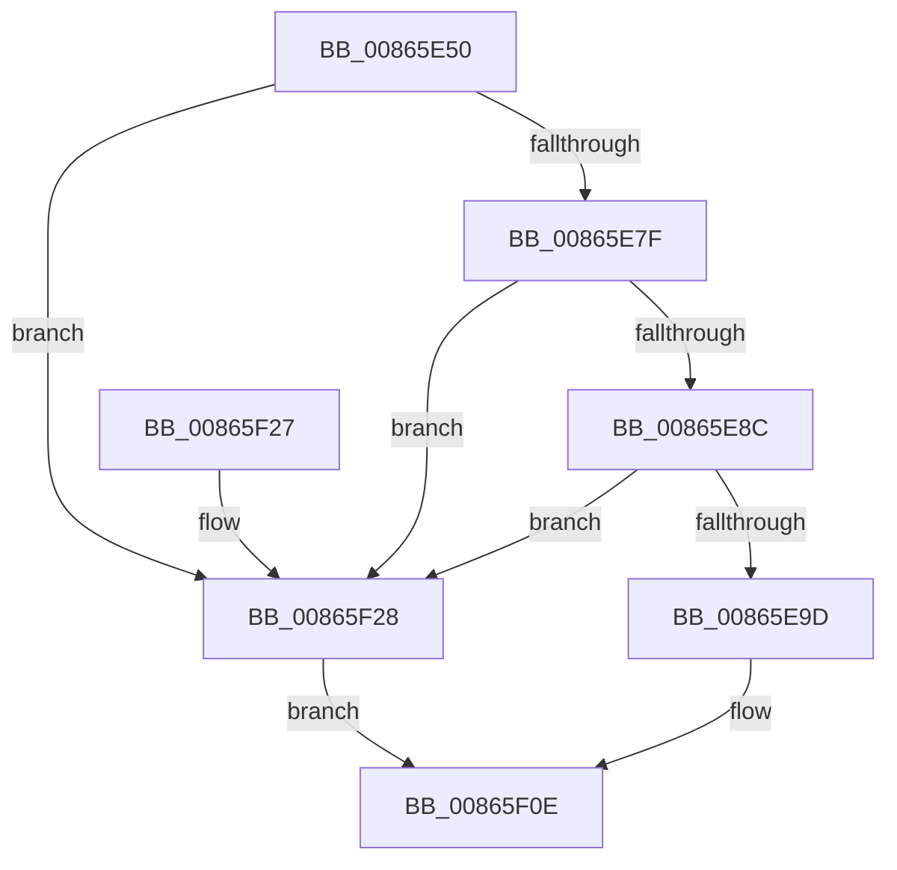

# CmPostCallbackNotificationEx

- RVA: `0x00865E50`–`0x00865F2C` (길이 `220` bytes)
- VA: `0x0000000140865E50`
- 실행 섹션: `PAGE`
- PDB 이름 있음: `예`; PDB Function 태그: `아니요`
- unwind 정보 RVA: `0x0006BBBC`
- 디코드: `52`개 명령, `220/220` bytes 표시
- 미해석 바이트: `0` (있으면 어셈블리에 `.byte`로 보존)

> 이 문서는 커널 이미지의 기계어와 PDB 기호를 분석해 생성했습니다. 4번과 5번은 함수 원형과 자료형을 바이너리 사용 방식에서 추정한 C 해석이며 원본 소스 복구 결과는 아닙니다.

## 1. Dependencies

- 직접 호출 지점: **2**; 고유 호출 대상: **2**
- 직접 호출자로 확인된 함수: **5**
- RIP 상대 이미지 참조: **1**

### Outgoing calls
- `0x00865E7F` → [CmpIsRegistryLockAcquired](../../text/45/CmpIsRegistryLockAcquired_function_00456A7C.md) (function, `0x00456A7C`)
- `0x00865F05` → [CmpCallCallBacksEx](CmpCallCallBacksEx_function_00865F40.md) (function, `0x00865F40`)

### Direct callers
- [NtRenameKey](../7E/NtRenameKey_function_007E04B0.md) at `0x007E08E2`
- [NtReplaceKey](../7E/NtReplaceKey_function_007E0970.md) at `0x007E0B60`
- [NtRestoreKey](../7E/NtRestoreKey_function_007E0CC0.md) at `0x007E0EC0`
- [NtSaveMergedKeys](../7E/NtSaveMergedKeys_function_007E1070.md) at `0x007E12FF`
- [sub_00B44216](../B4/Unknown_function_00B44216.md) at `0x00B44312`

### Static image references
- `0x00865E67` → RVA `0x00EEFB88` (`.data`; read)

## 2. Other-region calls and transfers

- 다른 실행 섹션으로 향하는 call: **1**
  - `0x00865E7F` → [CmpIsRegistryLockAcquired](../../text/45/CmpIsRegistryLockAcquired_function_00456A7C.md) (`PAGE` → `.text`)
- 별도 외부 분기/꼬리 이동을 확인하지 못했습니다.

## 3. Assembly (complete function range)

```asm
00865E50  48 89 5C 24 08                  mov qword ptr [rsp + 8], rbx
00865E55  48 89 6C 24 10                  mov qword ptr [rsp + 0x10], rbp
00865E5A  48 89 74 24 18                  mov qword ptr [rsp + 0x18], rsi
00865E5F  57                              push rdi
00865E60  48 81 EC 90 00 00 00            sub rsp, 0x90
00865E67  83 3D 1A 9D 68 00 00            cmp dword ptr [rip + 0x689d1a], 0
00865E6E  49 8B E9                        mov rbp, r9
00865E71  41 8B D8                        mov ebx, r8d
00865E74  48 8B FA                        mov rdi, rdx
00865E77  8B F1                           mov esi, ecx
00865E79  0F 84 A9 00 00 00               je 0x140865f28
00865E7F  E8 F8 0B BF FF                  call 0x140456a7c
00865E84  85 C0                           test eax, eax
00865E86  0F 85 9C 00 00 00               jne 0x140865f28
00865E8C  48 8B 84 24 C8 00 00 00         mov rax, qword ptr [rsp + 0xc8]
00865E94  48 39 00                        cmp qword ptr [rax], rax
00865E97  0F 84 8B 00 00 00               je 0x140865f28
00865E9D  33 D2                           xor edx, edx
00865E9F  48 89 44 24 30                  mov qword ptr [rsp + 0x30], rax
00865EA4  48 8D 4C 24 50                  lea rcx, [rsp + 0x50]
00865EA9  89 54 24 5C                     mov dword ptr [rsp + 0x5c], edx
00865EAD  48 89 4C 24 40                  mov qword ptr [rsp + 0x40], rcx
00865EB2  4C 8D 44 24 40                  lea r8, [rsp + 0x40]
00865EB7  48 8B 8C 24 C0 00 00 00         mov rcx, qword ptr [rsp + 0xc0]
00865EBF  0F 57 C0                        xorps xmm0, xmm0
00865EC2  48 85 C9                        test rcx, rcx
00865EC5  48 89 54 24 7C                  mov qword ptr [rsp + 0x7c], rdx
00865ECA  89 94 24 84 00 00 00            mov dword ptr [rsp + 0x84], edx
00865ED1  4C 0F 44 C2                     cmove r8, rdx
00865ED5  48 89 4C 24 48                  mov qword ptr [rsp + 0x48], rcx
00865EDA  45 33 C9                        xor r9d, r9d
00865EDD  48 89 7C 24 28                  mov qword ptr [rsp + 0x28], rdi
00865EE2  48 8D 54 24 50                  lea rdx, [rsp + 0x50]
00865EE7  48 89 7C 24 50                  mov qword ptr [rsp + 0x50], rdi
00865EEC  8B CE                           mov ecx, esi
00865EEE  89 5C 24 58                     mov dword ptr [rsp + 0x58], ebx
00865EF2  F3 0F 7F 44 24 6C               movdqu xmmword ptr [rsp + 0x6c], xmm0
00865EF8  89 5C 24 68                     mov dword ptr [rsp + 0x68], ebx
00865EFC  48 89 6C 24 60                  mov qword ptr [rsp + 0x60], rbp
00865F01  89 74 24 20                     mov dword ptr [rsp + 0x20], esi
00865F05  E8 36 00 00 00                  call 0x140865f40
00865F0A  8B 44 24 68                     mov eax, dword ptr [rsp + 0x68]
00865F0E  4C 8D 9C 24 90 00 00 00         lea r11, [rsp + 0x90]
00865F16  49 8B 5B 10                     mov rbx, qword ptr [r11 + 0x10]
00865F1A  49 8B 6B 18                     mov rbp, qword ptr [r11 + 0x18]
00865F1E  49 8B 73 20                     mov rsi, qword ptr [r11 + 0x20]
00865F22  49 8B E3                        mov rsp, r11
00865F25  5F                              pop rdi
00865F26  C3                              ret
00865F27  CC                              int3
00865F28  8B C3                           mov eax, ebx
00865F2A  EB E2                           jmp 0x140865f0e
```

## 4. C-style interpretation (structured pseudocode)

```c
__int64 __fastcall CmPostCallbackNotificationEx(int a1, __int64 a2, int a3, __int64 a4, __int64 a5, __int64 a6)
{
    __int64 result;
    __int64 v_rsp;
    unsigned int v_stack_m14;
    unsigned __int64 v_stack_m1C;
    unsigned __int64 v_stack_m2C;
    unsigned int v_stack_m30;
    unsigned __int64 v_stack_m38;
    unsigned int v_stack_m3C;
    unsigned int v_stack_m40;
    unsigned __int64 v_stack_m48;
    unsigned __int64 v_stack_m50;
    unsigned __int64 v_stack_m58;
    unsigned __int64 v_stack_m68;
    unsigned __int64 v_stack_m70;
    unsigned int v_stack_m78;
    unsigned __int64 v_stack_m8;
    unsigned __int64 v_stack_p10;
    unsigned __int64 v_stack_p18;
    unsigned __int64 v_stack_p8;

    v_stack_p8 = v_rbx;
    v_stack_p10 = v_rbp;
    v_stack_p18 = v_rsi;
    v_rsp = (v_rsp) - (144);
    if ((*(unsigned int *)(v_rip + 6855962)) == 0) goto loc_00865F28;
    result = CmpIsRegistryLockAcquired(a1, a2, a3, a4);
    if ((unsigned int)(result) != 0) goto loc_00865F28;
    if ((*(unsigned __int64 *)(a6)) == a6) goto loc_00865F28;
    a2 = 0;
    v_stack_m68 = a6;
    v_stack_m3C = 0;
    v_stack_m58 = v_stack_m48;
    v_stack_m1C = 0;
    v_stack_m14 = 0;
    a3 = v_stack_m58;
    if (a5 == 0) { a3 = 0; }
    v_stack_m50 = a5;
    a4 = 0;
    v_stack_m70 = 0;
    v_stack_m48 = 0;
    v_stack_m40 = (unsigned int)((unsigned int)(a3));
    v_stack_m2C = v_xmm0;
    v_stack_m30 = (unsigned int)((unsigned int)(a3));
    v_stack_m38 = 0;
    v_stack_m78 = (unsigned int)((unsigned int)(a1));
    result = CmpCallCallBacksEx((unsigned int)((unsigned int)((unsigned int)(a1))), v_stack_m48, a3, a4);
loc_00865F0E:
    return (unsigned int)(v_stack_m30);
loc_00865F28:
    goto loc_00865F0E;
}
```

## 5. (Beta) C Style

```c
int64_t CmPostCallbackNotificationEx(int32_t Arg1, int64_t Arg2, int32_t Arg3, int64_t Arg4, int64_t Arg5, void *Arg6)
{
    uint8_t *arg6 = (uint8_t *)Arg6;

    int64_t result;
    int64_t local_rsp;
    uint32_t v_stack_m14;
    uint64_t v_stack_m1C;
    uint64_t v_stack_m2C;
    uint32_t v_stack_m30;
    uint64_t v_stack_m38;
    uint32_t v_stack_m3C;
    uint32_t v_stack_m40;
    uint64_t v_stack_m48;
    uint64_t v_stack_m50;
    uint64_t v_stack_m58;
    uint64_t v_stack_m68;
    uint64_t v_stack_m70;
    uint32_t v_stack_m78;
    uint64_t v_stack_m8;
    uint64_t v_stack_p10;
    uint64_t v_stack_p18;
    uint64_t v_stack_p8;

    v_stack_p8 = local_rbx;
    v_stack_p10 = local_rbp;
    v_stack_p18 = local_rsi;
    local_rsp = (local_rsp) - (144);
    if ((*(uint32_t *)(v_rip + 0x689D1A)) == 0) goto loc_00865F28;
    result = CmpIsRegistryLockAcquired(Arg1, Arg2, Arg3, Arg4);
    if ((uint32_t)(result) != 0) goto loc_00865F28;
    if ((*(uint64_t *)(arg6)) == Arg6) goto loc_00865F28;
    Arg2 = 0;
    v_stack_m68 = Arg6;
    v_stack_m3C = 0;
    v_stack_m58 = v_stack_m48;
    v_stack_m1C = 0;
    v_stack_m14 = 0;
    Arg3 = v_stack_m58;
    if (Arg5 == 0) { Arg3 = 0; }
    v_stack_m50 = Arg5;
    Arg4 = 0;
    v_stack_m70 = 0;
    v_stack_m48 = 0;
    v_stack_m40 = (uint32_t)((uint32_t)(Arg3));
    v_stack_m2C = v_xmm0;
    v_stack_m30 = (uint32_t)((uint32_t)(Arg3));
    v_stack_m38 = 0;
    v_stack_m78 = (uint32_t)((uint32_t)(Arg1));
    result = CmpCallCallBacksEx((uint32_t)((uint32_t)((uint32_t)(Arg1))), v_stack_m48, Arg3, Arg4);
loc_00865F0E:
    return (uint32_t)(v_stack_m30);
loc_00865F28:
    goto loc_00865F0E;
}
```

### 관측된 메모리 오프셋

구조체 형식이 확인되지 않은 접근은 인자 기준의 오프셋으로만 기록했습니다.

| 기준 인자 | 오프셋 표현 | 폭 (bit) | 접근 |
|---|---:|---:|---|
| `Arg6` | `+ 0x0` | `64` | `R` |

## 6. Execution-region graph

[열기: 2D/3D 그래프와 함수 탐색 컨트롤 패널](../../../control-panel.html?section=page&rva=0x00865E50&view=graph)

- 2D 그래프는 위에서 아래로 흐르고, 3D 그래프는 빈 공간을 드래그해 회전합니다. Shift+드래그는 이동, 휠은 확대·축소, 함수 노드 선택은 대상 보고서 이동입니다.

### Static fallback


