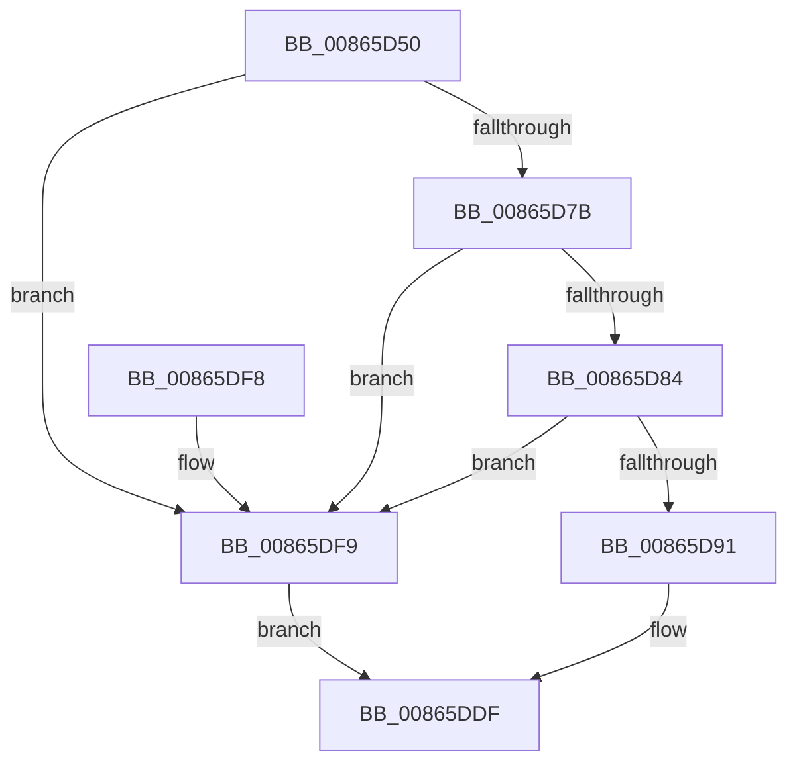

# CmPostCallbackNotification

- RVA: `0x00865D50`–`0x00865DFD` (길이 `173` bytes)
- VA: `0x0000000140865D50`
- 실행 섹션: `PAGE`
- PDB 이름 있음: `예`; PDB Function 태그: `아니요`
- unwind 정보 RVA: `0x0006BBA4`
- 디코드: `46`개 명령, `173/173` bytes 표시
- 미해석 바이트: `0` (있으면 어셈블리에 `.byte`로 보존)

> 이 문서는 커널 이미지의 기계어와 PDB 기호를 분석해 생성했습니다. 4번과 5번은 함수 원형과 자료형을 바이너리 사용 방식에서 추정한 C 해석이며 원본 소스 복구 결과는 아닙니다.

## 1. Dependencies

- 직접 호출 지점: **2**; 고유 호출 대상: **2**
- 직접 호출자로 확인된 함수: **1**
- RIP 상대 이미지 참조: **1**

### Outgoing calls
- `0x00865D7B` → [CmpIsRegistryLockAcquired](../../text/45/CmpIsRegistryLockAcquired_function_00456A7C.md) (function, `0x00456A7C`)
- `0x00865DD6` → [CmpCallCallBacksEx](CmpCallCallBacksEx_function_00865F40.md) (function, `0x00865F40`)

### Direct callers
- [CmpDoQueryKeyName](../../text/45/CmpDoQueryKeyName_function_00456664.md) at `0x0045696B`

### Static image references
- `0x00865D67` → RVA `0x00EEFB88` (`.data`; read)

## 2. Other-region calls and transfers

- 다른 실행 섹션으로 향하는 call: **1**
  - `0x00865D7B` → [CmpIsRegistryLockAcquired](../../text/45/CmpIsRegistryLockAcquired_function_00456A7C.md) (`PAGE` → `.text`)
- 별도 외부 분기/꼬리 이동을 확인하지 못했습니다.

## 3. Assembly (complete function range)

```asm
00865D50  48 89 5C 24 08                  mov qword ptr [rsp + 8], rbx
00865D55  48 89 6C 24 10                  mov qword ptr [rsp + 0x10], rbp
00865D5A  48 89 74 24 18                  mov qword ptr [rsp + 0x18], rsi
00865D5F  57                              push rdi
00865D60  48 81 EC 80 00 00 00            sub rsp, 0x80
00865D67  83 3D 1A 9E 68 00 00            cmp dword ptr [rip + 0x689e1a], 0
00865D6E  49 8B E9                        mov rbp, r9
00865D71  41 8B D8                        mov ebx, r8d
00865D74  48 8B FA                        mov rdi, rdx
00865D77  8B F1                           mov esi, ecx
00865D79  74 7E                           je 0x140865df9
00865D7B  E8 FC 0C BF FF                  call 0x140456a7c
00865D80  85 C0                           test eax, eax
00865D82  75 75                           jne 0x140865df9
00865D84  48 8B 84 24 B0 00 00 00         mov rax, qword ptr [rsp + 0xb0]
00865D8C  48 39 00                        cmp qword ptr [rax], rax
00865D8F  74 68                           je 0x140865df9
00865D91  33 C9                           xor ecx, ecx
00865D93  48 89 44 24 30                  mov qword ptr [rsp + 0x30], rax
00865D98  89 4C 24 4C                     mov dword ptr [rsp + 0x4c], ecx
00865D9C  48 8D 54 24 40                  lea rdx, [rsp + 0x40]
00865DA1  48 89 4C 24 6C                  mov qword ptr [rsp + 0x6c], rcx
00865DA6  0F 57 C0                        xorps xmm0, xmm0
00865DA9  89 4C 24 74                     mov dword ptr [rsp + 0x74], ecx
00865DAD  45 33 C9                        xor r9d, r9d
00865DB0  8B CE                           mov ecx, esi
00865DB2  48 89 7C 24 28                  mov qword ptr [rsp + 0x28], rdi
00865DB7  45 33 C0                        xor r8d, r8d
00865DBA  48 89 7C 24 40                  mov qword ptr [rsp + 0x40], rdi
00865DBF  F3 0F 7F 44 24 5C               movdqu xmmword ptr [rsp + 0x5c], xmm0
00865DC5  89 5C 24 48                     mov dword ptr [rsp + 0x48], ebx
00865DC9  89 5C 24 58                     mov dword ptr [rsp + 0x58], ebx
00865DCD  48 89 6C 24 50                  mov qword ptr [rsp + 0x50], rbp
00865DD2  89 74 24 20                     mov dword ptr [rsp + 0x20], esi
00865DD6  E8 65 01 00 00                  call 0x140865f40
00865DDB  8B 44 24 58                     mov eax, dword ptr [rsp + 0x58]
00865DDF  4C 8D 9C 24 80 00 00 00         lea r11, [rsp + 0x80]
00865DE7  49 8B 5B 10                     mov rbx, qword ptr [r11 + 0x10]
00865DEB  49 8B 6B 18                     mov rbp, qword ptr [r11 + 0x18]
00865DEF  49 8B 73 20                     mov rsi, qword ptr [r11 + 0x20]
00865DF3  49 8B E3                        mov rsp, r11
00865DF6  5F                              pop rdi
00865DF7  C3                              ret
00865DF8  CC                              int3
00865DF9  8B C3                           mov eax, ebx
00865DFB  EB E2                           jmp 0x140865ddf
```

## 4. C-style interpretation (structured pseudocode)

```c
__int64 __fastcall CmPostCallbackNotification(int a1, __int64 a2, int a3, __int64 a4, __int64 a5)
{
    __int64 result;
    __int64 v_rsp;
    unsigned int v_stack_m14;
    unsigned __int64 v_stack_m1C;
    unsigned __int64 v_stack_m2C;
    unsigned int v_stack_m30;
    unsigned __int64 v_stack_m38;
    unsigned int v_stack_m3C;
    unsigned int v_stack_m40;
    unsigned __int64 v_stack_m48;
    unsigned __int64 v_stack_m58;
    unsigned __int64 v_stack_m60;
    unsigned int v_stack_m68;
    unsigned __int64 v_stack_m8;
    unsigned __int64 v_stack_p10;
    unsigned __int64 v_stack_p18;
    unsigned __int64 v_stack_p8;

    v_stack_p8 = v_rbx;
    v_stack_p10 = v_rbp;
    v_stack_p18 = v_rsi;
    v_rsp = (v_rsp) - (128);
    if ((*(unsigned int *)(v_rip + 6856218)) == 0) goto loc_00865DF9;
    result = CmpIsRegistryLockAcquired(a1, a2, a3, a4);
    if ((unsigned int)(result) != 0) goto loc_00865DF9;
    if ((*(unsigned __int64 *)(a5)) == a5) goto loc_00865DF9;
    a1 = 0;
    v_stack_m58 = a5;
    v_stack_m3C = 0;
    v_stack_m1C = 0;
    v_stack_m14 = 0;
    a4 = 0;
    v_stack_m60 = a2;
    a3 = 0;
    v_stack_m48 = a2;
    v_stack_m2C = v_xmm0;
    v_stack_m40 = (unsigned int)((unsigned int)(a3));
    v_stack_m30 = (unsigned int)((unsigned int)(a3));
    v_stack_m38 = 0;
    v_stack_m68 = (unsigned int)((unsigned int)(a1));
    result = CmpCallCallBacksEx((unsigned int)((unsigned int)((unsigned int)(a1))), v_stack_m48, a3, a4);
loc_00865DDF:
    return (unsigned int)(v_stack_m30);
loc_00865DF9:
    goto loc_00865DDF;
}
```

## 5. (Beta) C Style

```c
int64_t CmPostCallbackNotification(int32_t Arg1, int64_t Arg2, int32_t Arg3, int64_t Arg4, void *Arg5)
{
    uint8_t *arg5 = (uint8_t *)Arg5;

    int64_t result;
    int64_t local_rsp;
    uint32_t v_stack_m14;
    uint64_t v_stack_m1C;
    uint64_t v_stack_m2C;
    uint32_t v_stack_m30;
    uint64_t v_stack_m38;
    uint32_t v_stack_m3C;
    uint32_t v_stack_m40;
    uint64_t v_stack_m48;
    uint64_t v_stack_m58;
    uint64_t v_stack_m60;
    uint32_t v_stack_m68;
    uint64_t v_stack_m8;
    uint64_t v_stack_p10;
    uint64_t v_stack_p18;
    uint64_t v_stack_p8;

    v_stack_p8 = local_rbx;
    v_stack_p10 = local_rbp;
    v_stack_p18 = local_rsi;
    local_rsp = (local_rsp) - (128);
    if ((*(uint32_t *)(v_rip + 0x689E1A)) == 0) goto loc_00865DF9;
    result = CmpIsRegistryLockAcquired(Arg1, Arg2, Arg3, Arg4);
    if ((uint32_t)(result) != 0) goto loc_00865DF9;
    if ((*(uint64_t *)(arg5)) == Arg5) goto loc_00865DF9;
    Arg1 = 0;
    v_stack_m58 = Arg5;
    v_stack_m3C = 0;
    v_stack_m1C = 0;
    v_stack_m14 = 0;
    Arg4 = 0;
    v_stack_m60 = Arg2;
    Arg3 = 0;
    v_stack_m48 = Arg2;
    v_stack_m2C = v_xmm0;
    v_stack_m40 = (uint32_t)((uint32_t)(Arg3));
    v_stack_m30 = (uint32_t)((uint32_t)(Arg3));
    v_stack_m38 = 0;
    v_stack_m68 = (uint32_t)((uint32_t)(Arg1));
    result = CmpCallCallBacksEx((uint32_t)((uint32_t)((uint32_t)(Arg1))), v_stack_m48, Arg3, Arg4);
loc_00865DDF:
    return (uint32_t)(v_stack_m30);
loc_00865DF9:
    goto loc_00865DDF;
}
```

### 관측된 메모리 오프셋

구조체 형식이 확인되지 않은 접근은 인자 기준의 오프셋으로만 기록했습니다.

| 기준 인자 | 오프셋 표현 | 폭 (bit) | 접근 |
|---|---:|---:|---|
| `Arg5` | `+ 0x0` | `64` | `R` |

## 6. Execution-region graph

[열기: 2D/3D 그래프와 함수 탐색 컨트롤 패널](../../../control-panel.html?section=page&rva=0x00865D50&view=graph)

- 2D 그래프는 위에서 아래로 흐르고, 3D 그래프는 빈 공간을 드래그해 회전합니다. Shift+드래그는 이동, 휠은 확대·축소, 함수 노드 선택은 대상 보고서 이동입니다.

### Static fallback


