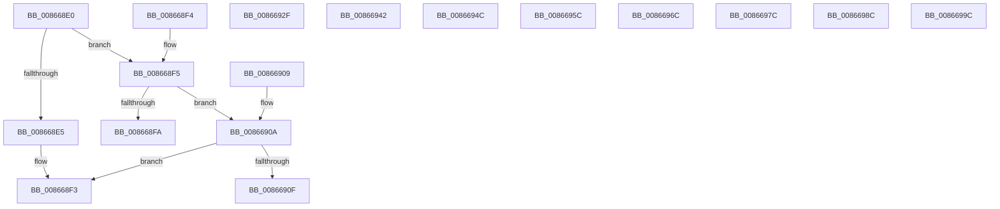

# CmpCallbackFetchCallContext

- RVA: `0x008668E0`–`0x008669FB` (길이 `283` bytes)
- VA: `0x00000001408668E0`
- 실행 섹션: `PAGE`
- PDB 이름 있음: `예`; PDB Function 태그: `아니요`
- unwind 정보 RVA: `0x000DB714`
- 디코드: `96`개 명령, `283/283` bytes 표시
- 미해석 바이트: `4` (있으면 어셈블리에 `.byte`로 보존)

> 이 문서는 커널 이미지의 기계어와 PDB 기호를 분석해 생성했습니다. 4번과 5번은 함수 원형과 자료형을 바이너리 사용 방식에서 추정한 C 해석이며 원본 소스 복구 결과는 아닙니다.

## 1. Dependencies

- 직접 호출 지점: **0**; 고유 호출 대상: **0**
- 직접 호출자로 확인된 함수: **1**
- RIP 상대 이미지 참조: **4**

### Outgoing calls
- 직접 디코드된 call 명령이 없습니다.

### Direct callers
- [CmpCallCallBacksEx](CmpCallCallBacksEx_function_00865F40.md) at `0x008665F6`

### Static image references
- `0x00866912` → RVA `0x00000000` (`image boundary/outside`; read)
- `0x008669D6` → RVA `0x058B6EE1` (`image boundary/outside`; read/write)
- `0x008669E6` → RVA `0x05886EF3` (`image boundary/outside`; read/write)
- `0x008669EC` → RVA `0x088F6EFA` (`image boundary/outside`; read)

## 2. Other-region calls and transfers

- 다른 실행 섹션으로 향하는 call: **0**
- 별도 외부 분기/꼬리 이동을 확인하지 못했습니다.

## 3. Assembly (complete function range)

```asm
008668E0  83 F9 1C                        cmp ecx, 0x1c
008668E3  75 10                           jne 0x1408668f5
008668E5  48 8B 42 50                     mov rax, qword ptr [rdx + 0x50]
008668E9  49 89 40 20                     mov qword ptr [r8 + 0x20], rax
008668ED  33 C0                           xor eax, eax
008668EF  48 89 42 50                     mov qword ptr [rdx + 0x50], rax
008668F3  C3                              ret
008668F4  CC                              int3
008668F5  83 F9 1E                        cmp ecx, 0x1e
008668F8  75 10                           jne 0x14086690a
008668FA  48 8B 42 08                     mov rax, qword ptr [rdx + 8]
008668FE  49 89 40 20                     mov qword ptr [r8 + 0x20], rax
00866902  33 C0                           xor eax, eax
00866904  48 89 42 08                     mov qword ptr [rdx + 8], rax
00866908  C3                              ret
00866909  CC                              int3
0086690A  83 F9 32                        cmp ecx, 0x32
0086690D  77 E4                           ja 0x1408668f3
0086690F  48 63 C1                        movsxd rax, ecx
00866912  4C 8D 0D E7 96 79 FF            lea r9, [rip - 0x866919]
00866919  41 0F B6 84 01 C8 69 86 00      movzx eax, byte ptr [r9 + rax + 0x8669c8]
00866922  41 8B 8C 81 A0 69 86 00         mov ecx, dword ptr [r9 + rax*4 + 0x8669a0]
0086692A  49 03 C9                        add rcx, r9
0086692D  FF E1                           jmp rcx
0086692F  CC                              int3
00866930  CC                              int3
00866931  CC                              int3
00866932  CC                              int3
00866933  48 8B 42 40                     mov rax, qword ptr [rdx + 0x40]
00866937  49 89 40 20                     mov qword ptr [r8 + 0x20], rax
0086693B  33 C0                           xor eax, eax
0086693D  48 89 42 40                     mov qword ptr [rdx + 0x40], rax
00866941  C3                              ret
00866942  CC                              int3
00866943  49 8B 40 20                     mov rax, qword ptr [r8 + 0x20]
00866947  48 89 42 20                     mov qword ptr [rdx + 0x20], rax
0086694B  C3                              ret
0086694C  CC                              int3
0086694D  48 8B 42 10                     mov rax, qword ptr [rdx + 0x10]
00866951  49 89 40 20                     mov qword ptr [r8 + 0x20], rax
00866955  33 C0                           xor eax, eax
00866957  48 89 42 10                     mov qword ptr [rdx + 0x10], rax
0086695B  C3                              ret
0086695C  CC                              int3
0086695D  48 8B 42 28                     mov rax, qword ptr [rdx + 0x28]
00866961  49 89 40 20                     mov qword ptr [r8 + 0x20], rax
00866965  33 C0                           xor eax, eax
00866967  48 89 42 28                     mov qword ptr [rdx + 0x28], rax
0086696B  C3                              ret
0086696C  CC                              int3
0086696D  48 8B 42 20                     mov rax, qword ptr [rdx + 0x20]
00866971  49 89 40 20                     mov qword ptr [r8 + 0x20], rax
00866975  33 C0                           xor eax, eax
00866977  48 89 42 20                     mov qword ptr [rdx + 0x20], rax
0086697B  C3                              ret
0086697C  CC                              int3
0086697D  48 8B 42 30                     mov rax, qword ptr [rdx + 0x30]
00866981  49 89 40 20                     mov qword ptr [r8 + 0x20], rax
00866985  33 C0                           xor eax, eax
00866987  48 89 42 30                     mov qword ptr [rdx + 0x30], rax
0086698B  C3                              ret
0086698C  CC                              int3
0086698D  48 8B 42 18                     mov rax, qword ptr [rdx + 0x18]
00866991  49 89 40 20                     mov qword ptr [r8 + 0x20], rax
00866995  33 C0                           xor eax, eax
00866997  48 89 42 18                     mov qword ptr [rdx + 0x18], rax
0086699B  C3                              ret
0086699C  CC                              int3
0086699D  0F 1F 00                        nop dword ptr [rax]
008669A0  FA                              cli
008669A1  68 86 00 5D 69                  push 0x695d0086
008669A6  86 00                           xchg byte ptr [rax], al
008669A8  4D 69 86 00 6D 69 86 00 7D 69 86  imul r8, qword ptr [r14 - 0x79969300], -0x79968300
008669B3  00 43 69                        add byte ptr [rbx + 0x69], al
008669B6  86 00                           xchg byte ptr [rax], al
008669B8  E5 68                           in eax, 0x68
008669BA  86 00                           xchg byte ptr [rax], al
008669BC  33 69 86                        xor ebp, dword ptr [rcx - 0x7a]
008669BF  00 8D 69 86 00 F3               add byte ptr [rbp - 0xcff7997], cl
008669C5  68 86 00 00 01                  push 0x1000086
008669CA  02 03                           add al, byte ptr [rbx]
008669CC  02 01                           add al, byte ptr [rcx]
008669CE  01 01                           add dword ptr [rcx], eax
008669D0  04 04                           add al, 4
008669D2  09 09                           or dword ptr [rcx], ecx
008669D4  09 09                           or dword ptr [rcx], ecx
008669D6  00 05 05 05 05 05               add byte ptr [rip + 0x5050505], al
008669DC  05 05 05 05 05                  add eax, 0x5050505
008669E1  05 06 05 09 05                  add eax, 0x5090506
008669E6  09 05 07 05 02 05               or dword ptr [rip + 0x5020507], eax
008669EC  03 05 08 05 09 08               add eax, dword ptr [rip + 0x8090508]
008669F2  05 08 05 08 05                  add eax, 0x5080508
008669F7  03                              .byte 0x03
008669F8  05                              .byte 0x05
008669F9  03                              .byte 0x03
008669FA  05                              .byte 0x05
```

## 4. C-style interpretation (structured pseudocode)

```c
__int64 __fastcall CmpCallbackFetchCallContext(int a1, __int64 a2, __int64 a3)
{
    __int64 result;

    if (a1 != 28) goto loc_008668F5;
    *(unsigned __int64 *)(a3 + 32) = *(unsigned __int64 *)(a2 + 80);
    result = 0;
    *(unsigned __int64 *)(a2 + 80) = 0;
loc_008668F3:
    return result;
loc_008668F5:
    if (a1 != 30) goto loc_0086690A;
    *(unsigned __int64 *)(a3 + 32) = *(unsigned __int64 *)(a2 + 8);
    result = 0;
    *(unsigned __int64 *)(a2 + 8) = 0;
    return result;
loc_0086690A:
    if (a1 > 50) goto loc_008668F3;
    a1 = ((unsigned int)(*(unsigned int *)(v_rip - 8808729 + *(unsigned __int8 *)(v_rip - 8808729 + (int)(a1) * 1 + 8808904) * 4 + 8808864))) + (v_rip - 8808729);
}
```

## 5. (Beta) C Style

```c
int64_t CmpCallbackFetchCallContext(int32_t Arg1, void *Arg2, void *Arg3)
{
    uint8_t *arg2 = (uint8_t *)Arg2;
    uint8_t *arg3 = (uint8_t *)Arg3;

    int64_t result;

    if (Arg1 != 28) goto loc_008668F5;
    *(uint64_t *)(arg3 + 0x20) = *(uint64_t *)(arg2 + 0x50);
    result = 0;
    *(uint64_t *)(arg2 + 0x50) = 0;
loc_008668F3:
    return result;
loc_008668F5:
    if (Arg1 != 30) goto loc_0086690A;
    *(uint64_t *)(arg3 + 0x20) = *(uint64_t *)(arg2 + 0x8);
    result = 0;
    *(uint64_t *)(arg2 + 0x8) = 0;
    return result;
loc_0086690A:
    if (Arg1 > 50) goto loc_008668F3;
    Arg1 = ((uint32_t)(*(uint32_t *)(v_rip - 0x866919 + *(uint8_t *)(v_rip - 0x866919 + (int32_t)(Arg1) * 1 + 0x8669C8) * 4 + 0x8669A0))) + (v_rip - 8808729);
}
```

### 관측된 메모리 오프셋

구조체 형식이 확인되지 않은 접근은 인자 기준의 오프셋으로만 기록했습니다.

| 기준 인자 | 오프셋 표현 | 폭 (bit) | 접근 |
|---|---:|---:|---|
| `Arg2` | `+ 0x8` | `64` | `R` |
| `Arg2` | `+ 0x8` | `64` | `W` |
| `Arg2` | `+ 0x50` | `64` | `R` |
| `Arg2` | `+ 0x50` | `64` | `W` |
| `Arg3` | `+ 0x20` | `64` | `W` |

## 6. Execution-region graph

[열기: 2D/3D 그래프와 함수 탐색 컨트롤 패널](../../../control-panel.html?section=page&rva=0x008668E0&view=graph)

- 2D 그래프는 위에서 아래로 흐르고, 3D 그래프는 빈 공간을 드래그해 회전합니다. Shift+드래그는 이동, 휠은 확대·축소, 함수 노드 선택은 대상 보고서 이동입니다.

### Static fallback


