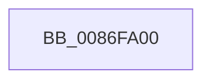

# CmpCheckKeyBodyAccess

- RVA: `0x0086FA00`–`0x0086FA1C` (길이 `28` bytes)
- VA: `0x000000014086FA00`
- 실행 섹션: `PAGE`
- PDB 이름 있음: `예`; PDB Function 태그: `아니요`
- unwind 정보 RVA: `0x0006C1CC`
- 디코드: `8`개 명령, `28/28` bytes 표시
- 미해석 바이트: `0` (있으면 어셈블리에 `.byte`로 보존)

> 이 문서는 커널 이미지의 기계어와 PDB 기호를 분석해 생성했습니다. 4번과 5번은 함수 원형과 자료형을 바이너리 사용 방식에서 추정한 C 해석이며 원본 소스 복구 결과는 아닙니다.

## 1. Dependencies

- 직접 호출 지점: **0**; 고유 호출 대상: **0**
- 직접 호출자로 확인된 함수: **2**
- RIP 상대 이미지 참조: **0**

### Outgoing calls
- 직접 디코드된 call 명령이 없습니다.

### Direct callers
- [CmpDoAccessCheckOnKCB](../7E/CmpDoAccessCheckOnKCB_function_007EB348.md) at `0x007EB46C`
- [CmpCheckOpenAccessOnKeyBody](../87/CmpCheckOpenAccessOnKeyBody_function_00870000.md) at `0x00870A32`

### Static image references
- 디코드된 RIP-relative 메모리 참조가 없습니다.

## 2. Other-region calls and transfers

- 다른 실행 섹션으로 향하는 call: **0**
- 별도 외부 분기/꼬리 이동을 확인하지 못했습니다.

## 3. Assembly (complete function range)

```asm
0086FA00  48 8B C4                        mov rax, rsp
0086FA03  44 88 48 20                     mov byte ptr [rax + 0x20], r9b
0086FA07  48 89 50 10                     mov qword ptr [rax + 0x10], rdx
0086FA0B  48 89 48 08                     mov qword ptr [rax + 8], rcx
0086FA0F  55                              push rbp
0086FA10  56                              push rsi
0086FA11  48 8D 68 A9                     lea rbp, [rax - 0x57]
0086FA15  48 81 EC B8 00 00 00            sub rsp, 0xb8
```

## 4. C-style interpretation (structured pseudocode)

```c
__int64 __fastcall CmpCheckKeyBodyAccess(__int64 a1, __int64 a2, __int64 a3, unsigned __int8 a4)
{
    __int64 v_rsp;

    *(unsigned __int8 *)(v_rsp + 32) = a4;
    *(unsigned __int64 *)(v_rsp + 16) = a2;
    *(unsigned __int64 *)(v_rsp + 8) = a1;
    v_rsp = (v_rsp) - (184);
    return v_rsp;
}
```

## 5. (Beta) C Style

```c
int64_t CmpCheckKeyBodyAccess(int64_t Arg1, int64_t Arg2, int64_t Arg3, uint8_t Arg4)
{
    int64_t local_rsp;

    *(uint8_t *)(local_rsp + 0x20) = Arg4;
    *(uint64_t *)(local_rsp + 0x10) = Arg2;
    *(uint64_t *)(local_rsp + 0x8) = Arg1;
    local_rsp = (local_rsp) - (184);
    return local_rsp;
}
```

## 6. Execution-region graph

[열기: 2D/3D 그래프와 함수 탐색 컨트롤 패널](../../../control-panel.html?section=page&rva=0x0086FA00&view=graph)

- 2D 그래프는 위에서 아래로 흐르고, 3D 그래프는 빈 공간을 드래그해 회전합니다. Shift+드래그는 이동, 휠은 확대·축소, 함수 노드 선택은 대상 보고서 이동입니다.

### Static fallback


