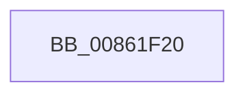

# CmpCleanUpKcbCacheWithLock

- RVA: `0x00861F20`–`0x00861F51` (길이 `49` bytes)
- VA: `0x0000000140861F20`
- 실행 섹션: `PAGE`
- PDB 이름 있음: `예`; PDB Function 태그: `아니요`
- unwind 정보 RVA: `0x0006B4E8`
- 디코드: `13`개 명령, `49/49` bytes 표시
- 미해석 바이트: `0` (있으면 어셈블리에 `.byte`로 보존)

> 이 문서는 커널 이미지의 기계어와 PDB 기호를 분석해 생성했습니다. 4번과 5번은 함수 원형과 자료형을 바이너리 사용 방식에서 추정한 C 해석이며 원본 소스 복구 결과는 아닙니다.

## 1. Dependencies

- 직접 호출 지점: **0**; 고유 호출 대상: **0**
- 직접 호출자로 확인된 함수: **8**
- RIP 상대 이미지 참조: **1**

### Outgoing calls
- 직접 디코드된 call 명령이 없습니다.

### Direct callers
- [CmpPerformCompleteKcbCacheLookup](../84/CmpPerformCompleteKcbCacheLookup_function_0084FD20.md) at `0x00850669`
- [CmpPerformCompleteKcbCacheLookup](../84/CmpPerformCompleteKcbCacheLookup_function_0084FD20.md) at `0x00850B6E`
- [CmpPerformCompleteKcbCacheLookup](../84/CmpPerformCompleteKcbCacheLookup_function_0084FD20.md) at `0x00850FF9`
- [CmpPerformCompleteKcbCacheLookup](../84/CmpPerformCompleteKcbCacheLookup_function_0084FD20.md) at `0x008511C7`
- [sub_00851B91](../85/Unknown_function_00851B91.md) at `0x00851CC3`
- [CmpDoParseKey](../85/CmpDoParseKey_function_0085F750.md) at `0x0086056A`
- [CmpCommitDiscardReplacePost](CmpCommitDiscardReplacePost_function_008624D4.md) at `0x00862639`
- [sub_008631CA](Unknown_function_008631CA.md) at `0x008631D1`
- [CmpCleanUpKCBCacheTable](../9B/CmpCleanUpKCBCacheTable_function_009B0478.md) at `0x009B0534`
- [CmpDelayCloseWorker](../9D/CmpDelayCloseWorker_function_009DB8E0.md) at `0x009DBB3C`
- [CmpSearchKeyControlBlockTreeEx](../A6/CmpSearchKeyControlBlockTreeEx_function_00A65548.md) at `0x00A6560A`

### Static image references
- `0x00861F2E` → RVA `0x00E0A740` (`.data`; read)

## 2. Other-region calls and transfers

- 다른 실행 섹션으로 향하는 call: **0**
- call이 아닌 외부 분기/꼬리 이동: **1**
  - `0x00861F4B` → [sub_008621A3](Unknown_function_008621A3.md) (`tail-transfer`)

## 3. Assembly (complete function range)

```asm
00861F20  4C 8B DC                        mov r11, rsp
00861F23  53                              push rbx
00861F24  56                              push rsi
00861F25  41 56                           push r14
00861F27  48 81 EC B0 00 00 00            sub rsp, 0xb0
00861F2E  48 8B 05 0B 88 5A 00            mov rax, qword ptr [rip + 0x5a880b]
00861F35  48 33 C4                        xor rax, rsp
00861F38  48 89 84 24 90 00 00 00         mov qword ptr [rsp + 0x90], rax
00861F40  33 F6                           xor esi, esi
00861F42  4C 8B F2                        mov r14, rdx
00861F45  48 8B D9                        mov rbx, rcx
00861F48  48 39 31                        cmp qword ptr [rcx], rsi
00861F4B  0F 85 52 02 00 00               jne 0x1408621a3
```

## 4. C-style interpretation (structured pseudocode)

```c
__int64 __fastcall CmpCleanUpKcbCacheWithLock(__int64 a1, __int64 a2)
{
    __int64 result;
    __int64 v_rsi;
    __int64 v_rsp;
    unsigned __int64 v_stack_m38;

    v_rsp = (v_rsp) - (176);
    result = (*(unsigned __int64 *)(v_rip + 5933067)) ^ (v_rsp);
    v_stack_m38 = result;
    v_rsi = 0;
}
```

## 5. (Beta) C Style

```c
int64_t CmpCleanUpKcbCacheWithLock(void *Arg1, int64_t Arg2)
{
    uint8_t *arg1 = (uint8_t *)Arg1;

    int64_t result;
    int64_t local_rsi;
    int64_t local_rsp;
    uint64_t v_stack_m38;

    local_rsp = (local_rsp) - (176);
    result = (*(uint64_t *)(v_rip + 0x5A880B)) ^ (local_rsp);
    v_stack_m38 = result;
    local_rsi = 0;
}
```

### 관측된 메모리 오프셋

구조체 형식이 확인되지 않은 접근은 인자 기준의 오프셋으로만 기록했습니다.

| 기준 인자 | 오프셋 표현 | 폭 (bit) | 접근 |
|---|---:|---:|---|
| `Arg1` | `+ 0x0` | `64` | `R` |

## 6. Execution-region graph

[열기: 2D/3D 그래프와 함수 탐색 컨트롤 패널](../../../control-panel.html?section=page&rva=0x00861F20&view=graph)

- 2D 그래프는 위에서 아래로 흐르고, 3D 그래프는 빈 공간을 드래그해 회전합니다. Shift+드래그는 이동, 휠은 확대·축소, 함수 노드 선택은 대상 보고서 이동입니다.

### Static fallback


