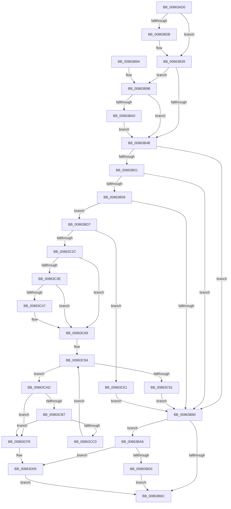

# CmpCloseKeyObject

- RVA: `0x00863AD0`–`0x00863D0F` (길이 `575` bytes)
- VA: `0x0000000140863AD0`
- 실행 섹션: `PAGE`
- PDB 이름 있음: `예`; PDB Function 태그: `아니요`
- unwind 정보 RVA: `0x0006B870`
- 디코드: `141`개 명령, `575/575` bytes 표시
- 미해석 바이트: `0` (있으면 어셈블리에 `.byte`로 보존)

> 이 문서는 커널 이미지의 기계어와 PDB 기호를 분석해 생성했습니다. 4번과 5번은 함수 원형과 자료형을 바이너리 사용 방식에서 추정한 C 해석이며 원본 소스 복구 결과는 아닙니다.

## 1. Dependencies

- 직접 호출 지점: **21**; 고유 호출 대상: **18**
- 직접 호출자로 확인된 함수: **3**
- RIP 상대 이미지 참조: **3**

### Outgoing calls
- `0x00863B34` → [EtwGetKernelTraceTimestamp](../../text/39/EtwGetKernelTraceTimestamp_function_0039FC50.md) (function, `0x0039FC50`)
- `0x00863B3D` → [CmpInitializeThreadInfo](../../text/3F/CmpInitializeThreadInfo_function_003FBE70.md) (function, `0x003FBE70`)
- `0x00863B70` → [CmCleanupThreadInfo](../../text/41/CmCleanupThreadInfo_function_0041FD50.md) (function, `0x0041FD50`)
- `0x00863B7C` → [_security_check_cookie](../../text/6A/_security_check_cookie_function_006AC640.md) (function, `0x006AC640`)
- `0x00863BD0` → [EtwpTraceRegistry](EtwpTraceRegistry_function_00862980.md) (function, `0x00862980`)
- `0x00863C08` → [CmpLockRegistry](../../pagecmrc/BC/CmpLockRegistry_function_00BC9B34.md) (function, `0x00BC9B34`)
- `0x00863C11` → [CmpLockKcbShared](../../pagecmrc/BC/CmpLockKcbShared_function_00BC9A1C.md) (function, `0x00BC9A1C`)
- `0x00863C1B` → [CmpIsKeyDeletedForKeyBody](../../pagecmrc/BC/CmpIsKeyDeletedForKeyBody_function_00BC9480.md) (function, `0x00BC9480`)
- `0x00863C30` → [CmLockHive](../85/CmLockHive_function_008512B4.md) (function, `0x008512B4`)
- `0x00863C64` → [CmpPostNotify](CmpPostNotify_function_008645D8.md) (function, `0x008645D8`)
- `0x00863C71` → [CmUnlockHive](../85/CmUnlockHive_function_00851D6C.md) (function, `0x00851D6C`)
- `0x00863C7A` → [CmpUnlockKcb](../../pagecmrc/BC/CmpUnlockKcb_function_00BC92C0.md) (function, `0x00BC92C0`)
- `0x00863C7F` → [CmpUnlockRegistry](../../pagecmrc/BC/CmpUnlockRegistry_function_00BC9A84.md) (function, `0x00BC9A84`)
- `0x00863C95` → [CmpSignalDeferredPosts](../84/CmpSignalDeferredPosts_function_008484B0.md) (function, `0x008484B0`)
- `0x00863CA3` → [KeLeaveCriticalRegionThread](../../text/25/KeLeaveCriticalRegionThread_function_0025EFF0.md) (function, `0x0025EFF0`)
- `0x00863CD0` → [ObDereferenceObjectDeferDelete](../../text/3F/ObDereferenceObjectDeferDelete_function_003FCE40.md) (function, `0x003FCE40`)
- `0x00863CDA` → [ExFreePoolWithTag](../../poolcode/B8/ExFreePoolWithTag_function_00B82870.md) (function, `0x00B82870`)
- `0x00863CE1` → [CmpUnlockKcb](../../pagecmrc/BC/CmpUnlockKcb_function_00BC92C0.md) (function, `0x00BC92C0`)
- `0x00863CE6` → [CmpUnlockRegistry](../../pagecmrc/BC/CmpUnlockRegistry_function_00BC9A84.md) (function, `0x00BC9A84`)
- `0x00863CF4` → [KeLeaveCriticalRegionThread](../../text/25/KeLeaveCriticalRegionThread_function_0025EFF0.md) (function, `0x0025EFF0`)
- `0x00863D05` → [guard_dispatch_icall](../../text/6B/guard_dispatch_icall_function_006BAAD0.md) (function, `0x006BAAD0`)

### Direct callers
- [ObpDecrementHandleCount](ObpDecrementHandleCount_function_008632E0.md) at `0x008633D8`
- [ObCloseHandleTableEntry](ObCloseHandleTableEntry_function_00869E20.md) at `0x0086A150`
- [ObpCreateHandle](ObpCreateHandle_function_0086B950.md) at `0x0086D58B`

### Static image references
- `0x00863AEC` → RVA `0x00E0A740` (`.data`; read)
- `0x00863B05` → RVA `0x00FD8008` (`PAGEDATA`; read)
- `0x00863BA6` → RVA `0x00862980` (`EtwpTraceRegistry`; read)

## 2. Other-region calls and transfers

- 다른 실행 섹션으로 향하는 call: **16**
  - `0x00863B34` → [EtwGetKernelTraceTimestamp](../../text/39/EtwGetKernelTraceTimestamp_function_0039FC50.md) (`PAGE` → `.text`)
  - `0x00863B3D` → [CmpInitializeThreadInfo](../../text/3F/CmpInitializeThreadInfo_function_003FBE70.md) (`PAGE` → `.text`)
  - `0x00863B70` → [CmCleanupThreadInfo](../../text/41/CmCleanupThreadInfo_function_0041FD50.md) (`PAGE` → `.text`)
  - `0x00863B7C` → [_security_check_cookie](../../text/6A/_security_check_cookie_function_006AC640.md) (`PAGE` → `.text`)
  - `0x00863C08` → [CmpLockRegistry](../../pagecmrc/BC/CmpLockRegistry_function_00BC9B34.md) (`PAGE` → `PAGECMRC`)
  - `0x00863C11` → [CmpLockKcbShared](../../pagecmrc/BC/CmpLockKcbShared_function_00BC9A1C.md) (`PAGE` → `PAGECMRC`)
  - `0x00863C1B` → [CmpIsKeyDeletedForKeyBody](../../pagecmrc/BC/CmpIsKeyDeletedForKeyBody_function_00BC9480.md) (`PAGE` → `PAGECMRC`)
  - `0x00863C7A` → [CmpUnlockKcb](../../pagecmrc/BC/CmpUnlockKcb_function_00BC92C0.md) (`PAGE` → `PAGECMRC`)
  - `0x00863C7F` → [CmpUnlockRegistry](../../pagecmrc/BC/CmpUnlockRegistry_function_00BC9A84.md) (`PAGE` → `PAGECMRC`)
  - `0x00863CA3` → [KeLeaveCriticalRegionThread](../../text/25/KeLeaveCriticalRegionThread_function_0025EFF0.md) (`PAGE` → `.text`)
  - `0x00863CD0` → [ObDereferenceObjectDeferDelete](../../text/3F/ObDereferenceObjectDeferDelete_function_003FCE40.md) (`PAGE` → `.text`)
  - `0x00863CDA` → [ExFreePoolWithTag](../../poolcode/B8/ExFreePoolWithTag_function_00B82870.md) (`PAGE` → `POOLCODE`)
  - `0x00863CE1` → [CmpUnlockKcb](../../pagecmrc/BC/CmpUnlockKcb_function_00BC92C0.md) (`PAGE` → `PAGECMRC`)
  - `0x00863CE6` → [CmpUnlockRegistry](../../pagecmrc/BC/CmpUnlockRegistry_function_00BC9A84.md) (`PAGE` → `PAGECMRC`)
  - `0x00863CF4` → [KeLeaveCriticalRegionThread](../../text/25/KeLeaveCriticalRegionThread_function_0025EFF0.md) (`PAGE` → `.text`)
  - `0x00863D05` → [guard_dispatch_icall](../../text/6B/guard_dispatch_icall_function_006BAAD0.md) (`PAGE` → `.text`)
- 별도 외부 분기/꼬리 이동을 확인하지 못했습니다.

## 3. Assembly (complete function range)

```asm
00863AD0  48 89 5C 24 08                  mov qword ptr [rsp + 8], rbx
00863AD5  48 89 74 24 18                  mov qword ptr [rsp + 0x18], rsi
00863ADA  48 89 7C 24 20                  mov qword ptr [rsp + 0x20], rdi
00863ADF  55                              push rbp
00863AE0  48 8D 6C 24 A9                  lea rbp, [rsp - 0x57]
00863AE5  48 81 EC A0 00 00 00            sub rsp, 0xa0
00863AEC  48 8B 05 4D 6C 5A 00            mov rax, qword ptr [rip + 0x5a6c4d]
00863AF3  48 33 C4                        xor rax, rsp
00863AF6  48 89 45 4F                     mov qword ptr [rbp + 0x4f], rax
00863AFA  0F 57 C0                        xorps xmm0, xmm0
00863AFD  33 C0                           xor eax, eax
00863AFF  33 F6                           xor esi, esi
00863B01  48 89 45 27                     mov qword ptr [rbp + 0x27], rax
00863B05  48 39 05 FC 44 77 00            cmp qword ptr [rip + 0x7744fc], rax
00863B0C  0F 57 C9                        xorps xmm1, xmm1
00863B0F  49 8B D9                        mov rbx, r9
00863B12  48 8B FA                        mov rdi, rdx
00863B15  0F 11 45 17                     movups xmmword ptr [rbp + 0x17], xmm0
00863B19  0F 11 45 07                     movups xmmword ptr [rbp + 7], xmm0
00863B1D  0F 11 4D F7                     movups xmmword ptr [rbp - 9], xmm1
00863B21  0F 11 45 2F                     movups xmmword ptr [rbp + 0x2f], xmm0
00863B25  0F 11 45 3F                     movups xmmword ptr [rbp + 0x3f], xmm0
00863B29  74 0E                           je 0x140863b39
00863B2B  BA 00 00 02 00                  mov edx, 0x20000
00863B30  48 8D 4D 2F                     lea rcx, [rbp + 0x2f]
00863B34  E8 17 C1 B3 FF                  call 0x14039fc50
00863B39  48 8D 4D 17                     lea rcx, [rbp + 0x17]
00863B3D  E8 2E 83 B9 FF                  call 0x1403fbe70
00863B42  48 39 35 BF 44 77 00            cmp qword ptr [rip + 0x7744bf], rsi
00863B49  75 50                           jne 0x140863b9b
00863B4B  48 83 FB 01                     cmp rbx, 1
00863B4F  77 0F                           ja 0x140863b60
00863B51  81 3F 32 30 79 6B               cmp dword ptr [rdi], 0x6b793032
00863B57  75 07                           jne 0x140863b60
00863B59  48 83 7F 10 00                  cmp qword ptr [rdi + 0x10], 0
00863B5E  75 77                           jne 0x140863bd7
00863B60  48 8B 05 A1 44 77 00            mov rax, qword ptr [rip + 0x7744a1]
00863B67  48 85 C0                        test rax, rax
00863B6A  75 3A                           jne 0x140863ba6
00863B6C  48 8D 4D 17                     lea rcx, [rbp + 0x17]
00863B70  E8 DB C1 BB FF                  call 0x14041fd50
00863B75  48 8B 4D 4F                     mov rcx, qword ptr [rbp + 0x4f]
00863B79  48 33 CC                        xor rcx, rsp
00863B7C  E8 BF 8A E4 FF                  call 0x1406ac640
00863B81  4C 8D 9C 24 A0 00 00 00         lea r11, [rsp + 0xa0]
00863B89  49 8B 5B 10                     mov rbx, qword ptr [r11 + 0x10]
00863B8D  49 8B 73 20                     mov rsi, qword ptr [r11 + 0x20]
00863B91  49 8B 7B 28                     mov rdi, qword ptr [r11 + 0x28]
00863B95  49 8B E3                        mov rsp, r11
00863B98  5D                              pop rbp
00863B99  C3                              ret
00863B9A  CC                              int3
00863B9B  48 85 FF                        test rdi, rdi
00863B9E  74 AB                           je 0x140863b4b
00863BA0  48 8B 77 08                     mov rsi, qword ptr [rdi + 8]
00863BA4  EB A5                           jmp 0x140863b4b
00863BA6  48 8D 0D D3 ED FF FF            lea rcx, [rip - 0x122d]
00863BAD  48 C7 44 24 28 00 00 00 00      mov qword ptr [rsp + 0x28], 0
00863BB6  45 33 C9                        xor r9d, r9d
00863BB9  48 89 74 24 20                  mov qword ptr [rsp + 0x20], rsi
00863BBE  45 33 C0                        xor r8d, r8d
00863BC1  48 8D 55 2F                     lea rdx, [rbp + 0x2f]
00863BC5  48 3B C1                        cmp rax, rcx
00863BC8  B1 1B                           mov cl, 0x1b
00863BCA  0F 85 35 01 00 00               jne 0x140863d05
00863BD0  E8 AB ED FF FF                  call 0x140862980
00863BD5  EB 95                           jmp 0x140863b6c
00863BD7  48 8D 45 07                     lea rax, [rbp + 7]
00863BDB  48 89 45 0F                     mov qword ptr [rbp + 0xf], rax
00863BDF  48 8D 45 07                     lea rax, [rbp + 7]
00863BE3  48 89 45 07                     mov qword ptr [rbp + 7], rax
00863BE7  48 8D 45 F7                     lea rax, [rbp - 9]
00863BEB  48 89 45 FF                     mov qword ptr [rbp - 1], rax
00863BEF  48 8D 45 F7                     lea rax, [rbp - 9]
00863BF3  48 89 45 F7                     mov qword ptr [rbp - 9], rax
00863BF7  65 48 8B 04 25 88 01 00 00      mov rax, qword ptr gs:[0x188]
00863C00  66 FF 88 E4 01 00 00            dec word ptr [rax + 0x1e4]
00863C07  90                              nop
00863C08  E8 27 5F 36 00                  call 0x140bc9b34
00863C0D  48 8B 4F 08                     mov rcx, qword ptr [rdi + 8]
00863C11  E8 06 5E 36 00                  call 0x140bc9a1c
00863C16  33 D2                           xor edx, edx
00863C18  48 8B CF                        mov rcx, rdi
00863C1B  E8 60 58 36 00                  call 0x140bc9480
00863C20  48 8B 4F 08                     mov rcx, qword ptr [rdi + 8]
00863C24  84 C0                           test al, al
00863C26  0F 85 B5 00 00 00               jne 0x140863ce1
00863C2C  48 8B 49 20                     mov rcx, qword ptr [rcx + 0x20]
00863C30  E8 7F D6 FE FF                  call 0x1408512b4
00863C35  48 8B 4F 10                     mov rcx, qword ptr [rdi + 0x10]
00863C39  48 85 C9                        test rcx, rcx
00863C3C  74 2B                           je 0x140863c69
00863C3E  48 8D 41 10                     lea rax, [rcx + 0x10]
00863C42  48 39 00                        cmp qword ptr [rax], rax
00863C45  74 22                           je 0x140863c69
00863C47  48 8D 45 07                     lea rax, [rbp + 7]
00863C4B  41 B9 0B 01 00 00               mov r9d, 0x10b
00863C51  48 89 44 24 30                  mov qword ptr [rsp + 0x30], rax
00863C56  48 8D 45 F7                     lea rax, [rbp - 9]
00863C5A  48 89 44 24 28                  mov qword ptr [rsp + 0x28], rax
00863C5F  C6 44 24 20 00                  mov byte ptr [rsp + 0x20], 0
00863C64  E8 6F 09 00 00                  call 0x1408645d8
00863C69  48 8B 4F 08                     mov rcx, qword ptr [rdi + 8]
00863C6D  48 8B 49 20                     mov rcx, qword ptr [rcx + 0x20]
00863C71  E8 F6 E0 FE FF                  call 0x140851d6c
00863C76  48 8B 4F 08                     mov rcx, qword ptr [rdi + 8]
00863C7A  E8 41 56 36 00                  call 0x140bc92c0
00863C7F  E8 00 5E 36 00                  call 0x140bc9a84
00863C84  48 8B 5D F7                     mov rbx, qword ptr [rbp - 9]
00863C88  48 8D 45 F7                     lea rax, [rbp - 9]
00863C8C  48 3B D8                        cmp rbx, rax
00863C8F  75 1C                           jne 0x140863cad
00863C91  48 8D 4D 07                     lea rcx, [rbp + 7]
00863C95  E8 16 48 FE FF                  call 0x1408484b0
00863C9A  65 48 8B 0C 25 88 01 00 00      mov rcx, qword ptr gs:[0x188]
00863CA3  E8 48 B3 9F FF                  call 0x14025eff0
00863CA8  E9 B3 FE FF FF                  jmp 0x140863b60
00863CAD  48 8D 45 F7                     lea rax, [rbp - 9]
00863CB1  48 39 43 08                     cmp qword ptr [rbx + 8], rax
00863CB5  75 47                           jne 0x140863cfe
00863CB7  48 8B 03                        mov rax, qword ptr [rbx]
00863CBA  48 39 58 08                     cmp qword ptr [rax + 8], rbx
00863CBE  75 3E                           jne 0x140863cfe
00863CC0  48 89 45 F7                     mov qword ptr [rbp - 9], rax
00863CC4  48 8D 4D F7                     lea rcx, [rbp - 9]
00863CC8  48 89 48 08                     mov qword ptr [rax + 8], rcx
00863CCC  48 8B 4B 10                     mov rcx, qword ptr [rbx + 0x10]
00863CD0  E8 6B 91 B9 FF                  call 0x1403fce40
00863CD5  33 D2                           xor edx, edx
00863CD7  48 8B CB                        mov rcx, rbx
00863CDA  E8 91 EB 31 00                  call 0x140b82870
00863CDF  EB A3                           jmp 0x140863c84
00863CE1  E8 DA 55 36 00                  call 0x140bc92c0
00863CE6  E8 99 5D 36 00                  call 0x140bc9a84
00863CEB  65 48 8B 0C 25 88 01 00 00      mov rcx, qword ptr gs:[0x188]
00863CF4  E8 F7 B2 9F FF                  call 0x14025eff0
00863CF9  E9 62 FE FF FF                  jmp 0x140863b60
00863CFE  B9 03 00 00 00                  mov ecx, 3
00863D03  CD 29                           int 0x29
00863D05  E8 C6 6D E5 FF                  call 0x1406baad0
00863D0A  E9 5D FE FF FF                  jmp 0x140863b6c
```

## 4. C-style interpretation (structured pseudocode)

```c
__int64 __fastcall CmpCloseKeyObject(__int64 a1, __int64 a2, int a3, __int64 a4)
{
    __int64 result;
    __int64 v_rsi;
    __int64 v_rsp;
    unsigned __int64 v_stack_m10;
    unsigned __int64 v_stack_m20;
    unsigned __int64 v_stack_m30;
    unsigned __int64 v_stack_m38;
    unsigned __int64 v_stack_m48;
    unsigned __int64 v_stack_m50;
    unsigned __int64 v_stack_m58;
    unsigned __int64 v_stack_m5F;
    unsigned __int64 v_stack_m60;
    unsigned __int64 v_stack_m68;
    unsigned __int64 v_stack_m70;
    unsigned __int64 v_stack_m78;
    unsigned __int64 v_stack_m8;
    unsigned __int64 v_stack_m80;
    unsigned __int64 v_stack_p18;
    unsigned __int64 v_stack_p20;
    unsigned __int64 v_stack_p8;

    v_stack_p8 = v_rbx;
    v_stack_p18 = v_rsi;
    v_stack_p20 = v_rdi;
    v_rsp = (v_rsp) - (160);
    result = (*(unsigned __int64 *)(v_rip + 5925965)) ^ (v_rsp);
    v_stack_m10 = result;
    result = 0;
    v_rsi = 0;
    v_stack_m38 = 0;
    v_stack_m48 = v_xmm0;
    v_stack_m58 = v_xmm0;
    v_stack_m68 = v_xmm1;
    v_stack_m30 = v_xmm0;
    v_stack_m20 = v_xmm0;
    if ((*(unsigned __int64 *)(v_rip + 7816444)) != 0) {
        a2 = 0x20000ULL;
        a1 = v_stack_m30;
        result = EtwGetKernelTraceTimestamp(a1, a2, a3, a4);
    }
    result = CmpInitializeThreadInfo(v_stack_m48, a2, a3, a4);
    if ((*(unsigned __int64 *)(v_rip + 7816383)) != 0) goto loc_00863B9B;
loc_00863B4B:
    if (a4 > 1) goto loc_00863B60;
    if ((*(unsigned int *)(a2)) != 0x6B793032ULL) goto loc_00863B60;
    if ((*(unsigned __int64 *)(a2 + 16)) != 0) goto loc_00863BD7;
loc_00863B60:
    if (*(unsigned __int64 *)(v_rip + 7816353) != 0) goto loc_00863BA6;
loc_00863B6C:
    result = CmCleanupThreadInfo(v_stack_m48, a2, a3, a4);
    a1 = (v_stack_m10) ^ (v_rsp);
    result = _security_check_cookie(a1, a2, a3, a4);
    return result;
loc_00863B9B:
    if (*(unsigned __int64 *)(v_stack_m8 + 40) == 0) goto loc_00863B4B;
    goto loc_00863B4B;
loc_00863BA6:
    v_stack_m78 = 0;
    a4 = 0;
    v_stack_m80 = *(unsigned __int64 *)(*(unsigned __int64 *)(v_stack_m8 + 40) + 8);
    a3 = 0;
    if (result != (v_rip - 4653)) goto loc_00863D05;
    result = EtwpTraceRegistry(27, v_stack_m30, a3, a4);
    goto loc_00863B6C;
loc_00863BD7:
    v_stack_m50 = v_stack_m58;
    v_stack_m58 = v_stack_m58;
    v_stack_m60 = v_stack_m68;
    v_stack_m68 = v_stack_m68;
    result = CmpLockRegistry(27, v_stack_m30, a3, a4);
    result = CmpLockKcbShared(*(unsigned __int64 *)(*(unsigned __int64 *)(v_stack_m8 + 40) + 8), v_stack_m30, a3, a4);
    a2 = 0;
    result = CmpIsKeyDeletedForKeyBody(*(unsigned __int64 *)(v_stack_m8 + 40), a2, a3, a4);
    if ((unsigned __int8)(result) != 0) goto loc_00863CE1;
    result = CmLockHive(*(unsigned __int64 *)(*(unsigned __int64 *)(*(unsigned __int64 *)(v_stack_m8 + 40) + 8) + 32), a2, a3, a4);
    if (*(unsigned __int64 *)(*(unsigned __int64 *)(v_stack_m8 + 40) + 16) == 0) goto loc_00863C69;
    result = *(unsigned __int64 *)(*(unsigned __int64 *)(v_stack_m8 + 40) + 16) + 16;
    if ((*(unsigned __int64 *)(*(unsigned __int64 *)(*(unsigned __int64 *)(v_stack_m8 + 40) + 16) + 16)) != (*(unsigned __int64 *)(*(unsigned __int64 *)(v_stack_m8 + 40) + 16) + 16)) {
        result = v_stack_m58;
        a4 = 267;
        v_stack_m70 = result;
        result = v_stack_m68;
        v_stack_m78 = result;
        v_stack_m80 = 0;
        result = CmpPostNotify(*(unsigned __int64 *)(*(unsigned __int64 *)(v_stack_m8 + 40) + 16), a2, a3, a4);
    }
    result = CmUnlockHive(*(unsigned __int64 *)(*(unsigned __int64 *)(*(unsigned __int64 *)(v_stack_m8 + 40) + 8) + 32), a2, a3, a4);
    result = CmpUnlockKcb(*(unsigned __int64 *)(*(unsigned __int64 *)(v_stack_m8 + 40) + 8), a2, a3, a4);
    result = CmpUnlockRegistry(*(unsigned __int64 *)(*(unsigned __int64 *)(v_stack_m8 + 40) + 8), a2, a3, a4);
loc_00863C84:
    if (v_stack_m68 != v_stack_m68) goto loc_00863CAD;
    result = CmpSignalDeferredPosts(v_stack_m58, a2, a3, a4);
    result = KeLeaveCriticalRegionThread(*(unsigned __int64 *)(gs_base + (0 + 392)), a2, a3, a4);
    goto loc_00863B60;
loc_00863CAD:
    if ((*(unsigned __int64 *)(v_stack_m68 + 8)) != v_stack_m68) goto loc_00863CFE;
    if ((*(unsigned __int64 *)(*(unsigned __int64 *)(v_stack_m68) + 8)) != v_stack_m68) goto loc_00863CFE;
    v_stack_m68 = *(unsigned __int64 *)(v_stack_m68);
    *(unsigned __int64 *)(*(unsigned __int64 *)(v_stack_m68) + 8) = v_stack_m68;
    result = ObDereferenceObjectDeferDelete(*(unsigned __int64 *)(v_stack_m68 + 16), a2, a3, a4);
    a2 = 0;
    result = ExFreePoolWithTag(v_stack_m68, a2, a3, a4);
    goto loc_00863C84;
loc_00863CE1:
    result = CmpUnlockKcb(v_stack_m68, a2, a3, a4);
    result = CmpUnlockRegistry(v_stack_m68, a2, a3, a4);
    result = KeLeaveCriticalRegionThread(*(unsigned __int64 *)(gs_base + (0 + 392)), a2, a3, a4);
    goto loc_00863B60;
loc_00863CFE:
loc_00863D05:
    result = guard_dispatch_icall(3, a2, a3, a4);
    goto loc_00863B6C;
}
```

## 5. (Beta) C Style

```c
int64_t CmpCloseKeyObject(int64_t Arg1, int64_t Arg2, int32_t Arg3, int64_t Arg4)
{
    int64_t result;
    int64_t local_rsi;
    int64_t local_rsp;
    uint64_t v_stack_m10;
    uint64_t v_stack_m20;
    uint64_t v_stack_m30;
    uint64_t v_stack_m38;
    uint64_t v_stack_m48;
    uint64_t v_stack_m50;
    uint64_t v_stack_m58;
    uint64_t v_stack_m5F;
    uint64_t v_stack_m60;
    uint64_t v_stack_m68;
    uint64_t v_stack_m70;
    uint64_t v_stack_m78;
    uint64_t v_stack_m8;
    uint64_t v_stack_m80;
    uint64_t v_stack_p18;
    uint64_t v_stack_p20;
    uint64_t v_stack_p8;

    v_stack_p8 = local_rbx;
    v_stack_p18 = local_rsi;
    v_stack_p20 = local_rdi;
    local_rsp = (local_rsp) - (160);
    result = (*(uint64_t *)(v_rip + 0x5A6C4D)) ^ (local_rsp);
    v_stack_m10 = result;
    result = 0;
    local_rsi = 0;
    v_stack_m38 = 0;
    v_stack_m48 = v_xmm0;
    v_stack_m58 = v_xmm0;
    v_stack_m68 = v_xmm1;
    v_stack_m30 = v_xmm0;
    v_stack_m20 = v_xmm0;
    if ((*(uint64_t *)(v_rip + 0x7744FC)) != 0) {
        Arg2 = 0x20000ULL;
        Arg1 = v_stack_m30;
        result = EtwGetKernelTraceTimestamp(Arg1, Arg2, Arg3, Arg4);
    }
    result = CmpInitializeThreadInfo(v_stack_m48, Arg2, Arg3, Arg4);
    if ((*(uint64_t *)(v_rip + 0x7744BF)) != 0) goto loc_00863B9B;
loc_00863B4B:
    if (Arg4 > 1) goto loc_00863B60;
    if ((*(uint32_t *)(Arg2)) != 0x6B793032ULL) goto loc_00863B60;
    if ((*(uint64_t *)(Arg2 + 0x10)) != 0) goto loc_00863BD7;
loc_00863B60:
    if (*(uint64_t *)(v_rip + 0x7744A1) != 0) goto loc_00863BA6;
loc_00863B6C:
    result = CmCleanupThreadInfo(v_stack_m48, Arg2, Arg3, Arg4);
    Arg1 = (v_stack_m10) ^ (local_rsp);
    result = _security_check_cookie(Arg1, Arg2, Arg3, Arg4);
    return result;
loc_00863B9B:
    if (*(uint64_t *)(v_stack_m8 + 0x28) == 0) goto loc_00863B4B;
    goto loc_00863B4B;
loc_00863BA6:
    v_stack_m78 = 0;
    Arg4 = 0;
    v_stack_m80 = *(uint64_t *)(*(uint64_t *)(v_stack_m8 + 0x28) + 0x8);
    Arg3 = 0;
    if (result != (v_rip - 4653)) goto loc_00863D05;
    result = EtwpTraceRegistry(27, v_stack_m30, Arg3, Arg4);
    goto loc_00863B6C;
loc_00863BD7:
    v_stack_m50 = v_stack_m58;
    v_stack_m58 = v_stack_m58;
    v_stack_m60 = v_stack_m68;
    v_stack_m68 = v_stack_m68;
    result = CmpLockRegistry(27, v_stack_m30, Arg3, Arg4);
    result = CmpLockKcbShared(*(uint64_t *)(*(uint64_t *)(v_stack_m8 + 0x28) + 0x8), v_stack_m30, Arg3, Arg4);
    Arg2 = 0;
    result = CmpIsKeyDeletedForKeyBody(*(uint64_t *)(v_stack_m8 + 0x28), Arg2, Arg3, Arg4);
    if ((uint8_t)(result) != 0) goto loc_00863CE1;
    result = CmLockHive(*(uint64_t *)(*(uint64_t *)(*(uint64_t *)(v_stack_m8 + 0x28) + 0x8) + 0x20), Arg2, Arg3, Arg4);
    if (*(uint64_t *)(*(uint64_t *)(v_stack_m8 + 0x28) + 0x10) == 0) goto loc_00863C69;
    result = *(uint64_t *)(*(uint64_t *)(v_stack_m8 + 0x28) + 0x10) + 16;
    if ((*(uint64_t *)(*(uint64_t *)(*(uint64_t *)(v_stack_m8 + 0x28) + 0x10) + 0x10)) != (*(uint64_t *)(*(uint64_t *)(v_stack_m8 + 0x28) + 0x10) + 16)) {
        result = v_stack_m58;
        Arg4 = 267;
        v_stack_m70 = result;
        result = v_stack_m68;
        v_stack_m78 = result;
        v_stack_m80 = 0;
        result = CmpPostNotify(*(uint64_t *)(*(uint64_t *)(v_stack_m8 + 0x28) + 0x10), Arg2, Arg3, Arg4);
    }
    result = CmUnlockHive(*(uint64_t *)(*(uint64_t *)(*(uint64_t *)(v_stack_m8 + 0x28) + 0x8) + 0x20), Arg2, Arg3, Arg4);
    result = CmpUnlockKcb(*(uint64_t *)(*(uint64_t *)(v_stack_m8 + 0x28) + 0x8), Arg2, Arg3, Arg4);
    result = CmpUnlockRegistry(*(uint64_t *)(*(uint64_t *)(v_stack_m8 + 0x28) + 0x8), Arg2, Arg3, Arg4);
loc_00863C84:
    if (v_stack_m68 != v_stack_m68) goto loc_00863CAD;
    result = CmpSignalDeferredPosts(v_stack_m58, Arg2, Arg3, Arg4);
    result = KeLeaveCriticalRegionThread(*(uint64_t *)(gs_base + (0 + 0x188)), Arg2, Arg3, Arg4);
    goto loc_00863B60;
loc_00863CAD:
    if ((*(uint64_t *)(v_stack_m68 + 0x8)) != v_stack_m68) goto loc_00863CFE;
    if ((*(uint64_t *)(*(uint64_t *)(v_stack_m68) + 0x8)) != v_stack_m68) goto loc_00863CFE;
    v_stack_m68 = *(uint64_t *)(v_stack_m68);
    *(uint64_t *)(*(uint64_t *)(v_stack_m68) + 0x8) = v_stack_m68;
    result = ObDereferenceObjectDeferDelete(*(uint64_t *)(v_stack_m68 + 0x10), Arg2, Arg3, Arg4);
    Arg2 = 0;
    result = ExFreePoolWithTag(v_stack_m68, Arg2, Arg3, Arg4);
    goto loc_00863C84;
loc_00863CE1:
    result = CmpUnlockKcb(v_stack_m68, Arg2, Arg3, Arg4);
    result = CmpUnlockRegistry(v_stack_m68, Arg2, Arg3, Arg4);
    result = KeLeaveCriticalRegionThread(*(uint64_t *)(gs_base + (0 + 0x188)), Arg2, Arg3, Arg4);
    goto loc_00863B60;
loc_00863CFE:
loc_00863D05:
    result = guard_dispatch_icall(3, Arg2, Arg3, Arg4);
    goto loc_00863B6C;
}
```

## 6. Execution-region graph

[열기: 2D/3D 그래프와 함수 탐색 컨트롤 패널](../../../control-panel.html?section=page&rva=0x00863AD0&view=graph)

- 2D 그래프는 위에서 아래로 흐르고, 3D 그래프는 빈 공간을 드래그해 회전합니다. Shift+드래그는 이동, 휠은 확대·축소, 함수 노드 선택은 대상 보고서 이동입니다.

### Static fallback


