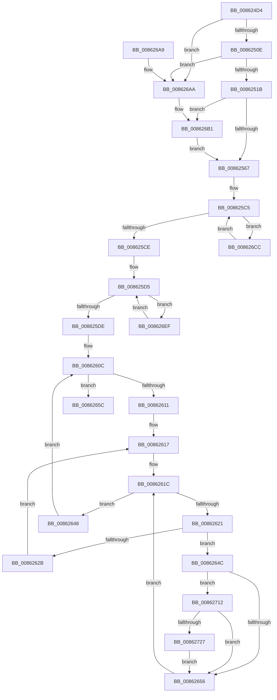

# CmpCommitDiscardReplacePost

- RVA: `0x008624D4`–`0x0086273C` (길이 `616` bytes)
- VA: `0x00000001408624D4`
- 실행 섹션: `PAGE`
- PDB 이름 있음: `예`; PDB Function 태그: `아니요`
- unwind 정보 RVA: `0x0006B614`
- 디코드: `160`개 명령, `616/616` bytes 표시
- 미해석 바이트: `0` (있으면 어셈블리에 `.byte`로 보존)

> 이 문서는 커널 이미지의 기계어와 PDB 기호를 분석해 생성했습니다. 4번과 5번은 함수 원형과 자료형을 바이너리 사용 방식에서 추정한 C 해석이며 원본 소스 복구 결과는 아닙니다.

## 1. Dependencies

- 직접 호출 지점: **17**; 고유 호출 대상: **12**
- 직접 호출자로 확인된 함수: **1**
- RIP 상대 이미지 참조: **1**

### Outgoing calls
- `0x0086256A` → [CmpDiscardKcb](../9B/CmpDiscardKcb_function_009B2F34.md) (function, `0x009B2F34`)
- `0x00862607` → [CmpAttachToRegistryProcess](../../pagecmrc/BC/CmpAttachToRegistryProcess_function_00BC98E0.md) (function, `0x00BC98E0`)
- `0x0086262E` → [CmpRemoveFromDelayedClose](CmpRemoveFromDelayedClose_function_00862350.md) (function, `0x00862350`)
- `0x00862639` → [CmpCleanUpKcbCacheWithLock](CmpCleanUpKcbCacheWithLock_function_00861F20.md) (function, `0x00861F20`)
- `0x00862641` → [CmpDecommisssionKcb](CmpDecommisssionKcb_function_00862750.md) (function, `0x00862750`)
- `0x00862661` → [CmpDetachFromRegistryProcess](../../pagecmrc/BC/CmpDetachFromRegistryProcess_function_00BC9920.md) (function, `0x00BC9920`)
- `0x0086266F` → [CmpDereferenceKeyControlBlockWithLock](CmpDereferenceKeyControlBlockWithLock_function_00862B60.md) (function, `0x00862B60`)
- `0x0086267D` → [CmpDereferenceKeyControlBlockWithLock](CmpDereferenceKeyControlBlockWithLock_function_00862B60.md) (function, `0x00862B60`)
- `0x0086268C` → [_security_check_cookie](../../text/6A/_security_check_cookie_function_006AC640.md) (function, `0x006AC640`)
- `0x008626B7` → [CmpMarkKeyUnbacked](../9B/CmpMarkKeyUnbacked_function_009B3C4C.md) (function, `0x009B3C4C`)
- `0x008626C2` → [CmpRebuildKcbCache](../87/CmpRebuildKcbCache_function_00874DF8.md) (function, `0x00874DF8`)
- `0x008626CF` → [CmpReferenceKeyControlBlockUnsafe](../87/CmpReferenceKeyControlBlockUnsafe_function_00874DA0.md) (function, `0x00874DA0`)
- `0x008626D7` → [CmpDereferenceKeyControlBlockUnsafe](../99/CmpDereferenceKeyControlBlockUnsafe_function_0099F960.md) (function, `0x0099F960`)
- `0x008626F2` → [CmpReferenceKeyControlBlockUnsafe](../87/CmpReferenceKeyControlBlockUnsafe_function_00874DA0.md) (function, `0x00874DA0`)
- `0x008626FA` → [CmpDereferenceKeyControlBlockUnsafe](../99/CmpDereferenceKeyControlBlockUnsafe_function_0099F960.md) (function, `0x0099F960`)
- `0x0086272A` → [CmpReferenceKeyControlBlockUnsafe](../87/CmpReferenceKeyControlBlockUnsafe_function_00874DA0.md) (function, `0x00874DA0`)
- `0x00862732` → [CmpDereferenceKeyControlBlockUnsafe](../99/CmpDereferenceKeyControlBlockUnsafe_function_0099F960.md) (function, `0x0099F960`)

### Direct callers
- [CmpCommitDiscardAndReplaceKcbAndUnbackedHigherLayers](../A5/CmpCommitDiscardAndReplaceKcbAndUnbackedHigherLayers_function_00A55070.md) at `0x00A55139`
- [CmpCommitDiscardAndReplaceKcbAndUnbackedHigherLayers](../A5/CmpCommitDiscardAndReplaceKcbAndUnbackedHigherLayers_function_00A55070.md) at `0x00A55180`

### Static image references
- `0x008624E8` → RVA `0x00E0A740` (`.data`; read)

## 2. Other-region calls and transfers

- 다른 실행 섹션으로 향하는 call: **3**
  - `0x00862607` → [CmpAttachToRegistryProcess](../../pagecmrc/BC/CmpAttachToRegistryProcess_function_00BC98E0.md) (`PAGE` → `PAGECMRC`)
  - `0x00862661` → [CmpDetachFromRegistryProcess](../../pagecmrc/BC/CmpDetachFromRegistryProcess_function_00BC9920.md) (`PAGE` → `PAGECMRC`)
  - `0x0086268C` → [_security_check_cookie](../../text/6A/_security_check_cookie_function_006AC640.md) (`PAGE` → `.text`)
- 별도 외부 분기/꼬리 이동을 확인하지 못했습니다.

## 3. Assembly (complete function range)

```asm
008624D4  48 89 5C 24 20                  mov qword ptr [rsp + 0x20], rbx
008624D9  55                              push rbp
008624DA  56                              push rsi
008624DB  57                              push rdi
008624DC  41 54                           push r12
008624DE  41 55                           push r13
008624E0  41 56                           push r14
008624E2  41 57                           push r15
008624E4  48 83 EC 60                     sub rsp, 0x60
008624E8  48 8B 05 51 82 5A 00            mov rax, qword ptr [rip + 0x5a8251]
008624EF  48 33 C4                        xor rax, rsp
008624F2  48 89 44 24 50                  mov qword ptr [rsp + 0x50], rax
008624F7  49 83 C0 10                     add r8, 0x10
008624FB  4C 8B F2                        mov r14, rdx
008624FE  48 8B F9                        mov rdi, rcx
00862501  49 8B 00                        mov rax, qword ptr [r8]
00862504  4C 39 40 08                     cmp qword ptr [rax + 8], r8
00862508  0F 85 9C 01 00 00               jne 0x1408626aa
0086250E  48 8B 08                        mov rcx, qword ptr [rax]
00862511  48 39 41 08                     cmp qword ptr [rcx + 8], rax
00862515  0F 85 8F 01 00 00               jne 0x1408626aa
0086251B  49 89 08                        mov qword ptr [r8], rcx
0086251E  48 8D 58 88                     lea rbx, [rax - 0x78]
00862522  4C 89 41 08                     mov qword ptr [rcx + 8], r8
00862526  33 ED                           xor ebp, ebp
00862528  48 89 40 08                     mov qword ptr [rax + 8], rax
0086252C  48 89 00                        mov qword ptr [rax], rax
0086252F  0F B7 47 42                     movzx eax, word ptr [rdi + 0x42]
00862533  66 89 43 42                     mov word ptr [rbx + 0x42], ax
00862537  48 8B 87 C0 00 00 00            mov rax, qword ptr [rdi + 0xc0]
0086253E  48 89 83 C0 00 00 00            mov qword ptr [rbx + 0xc0], rax
00862545  48 89 AF C0 00 00 00            mov qword ptr [rdi + 0xc0], rbp
0086254C  66 89 6F 42                     mov word ptr [rdi + 0x42], bp
00862550  48 8B 83 C0 00 00 00            mov rax, qword ptr [rbx + 0xc0]
00862557  48 89 58 10                     mov qword ptr [rax + 0x10], rbx
0086255B  8B 47 28                        mov eax, dword ptr [rdi + 0x28]
0086255E  83 F8 FF                        cmp eax, -1
00862561  0F 85 4A 01 00 00               jne 0x1408626b1
00862567  48 8B CF                        mov rcx, rdi
0086256A  E8 C5 09 15 00                  call 0x1409b2f34
0086256F  4C 8B 43 20                     mov r8, qword ptr [rbx + 0x20]
00862573  4C 8D 4B 10                     lea r9, [rbx + 0x10]
00862577  41 8B 01                        mov eax, dword ptr [r9]
0086257A  8B C8                           mov ecx, eax
0086257C  C1 E9 09                        shr ecx, 9
0086257F  33 C8                           xor ecx, eax
00862581  69 C1 A3 8A 01 00               imul eax, ecx, 0x18aa3
00862587  8B C8                           mov ecx, eax
00862589  8B D0                           mov edx, eax
0086258B  41 8B 80 78 06 00 00            mov eax, dword ptr [r8 + 0x678]
00862592  48 C1 EA 09                     shr rdx, 9
00862596  FF C8                           dec eax
00862598  48 33 D1                        xor rdx, rcx
0086259B  49 8B 88 70 06 00 00            mov rcx, qword ptr [r8 + 0x670]
008625A2  48 23 D0                        and rdx, rax
008625A5  48 8D 14 52                     lea rdx, [rdx + rdx*2]
008625A9  48 8B 44 D1 10                  mov rax, qword ptr [rcx + rdx*8 + 0x10]
008625AE  48 89 43 18                     mov qword ptr [rbx + 0x18], rax
008625B2  4C 89 4C D1 10                  mov qword ptr [rcx + rdx*8 + 0x10], r9
008625B7  48 8B 8B C0 00 00 00            mov rcx, qword ptr [rbx + 0xc0]
008625BE  48 8D 41 20                     lea rax, [rcx + 0x20]
008625C2  48 8B 30                        mov rsi, qword ptr [rax]
008625C5  48 3B F0                        cmp rsi, rax
008625C8  0F 85 FE 00 00 00               jne 0x1408626cc
008625CE  48 8D 41 30                     lea rax, [rcx + 0x30]
008625D2  48 8B 30                        mov rsi, qword ptr [rax]
008625D5  48 3B F0                        cmp rsi, rax
008625D8  0F 85 11 01 00 00               jne 0x1408626ef
008625DE  48 8B 43 20                     mov rax, qword ptr [rbx + 0x20]
008625E2  48 8D 4C 24 20                  lea rcx, [rsp + 0x20]
008625E7  0F 57 C0                        xorps xmm0, xmm0
008625EA  0F 11 44 24 20                  movups xmmword ptr [rsp + 0x20], xmm0
008625EF  44 8B A8 78 06 00 00            mov r13d, dword ptr [rax + 0x678]
008625F6  4C 8B A0 70 06 00 00            mov r12, qword ptr [rax + 0x670]
008625FD  0F 11 44 24 30                  movups xmmword ptr [rsp + 0x30], xmm0
00862602  0F 11 44 24 40                  movups xmmword ptr [rsp + 0x40], xmm0
00862607  E8 D4 72 36 00                  call 0x140bc98e0
0086260C  41 3B ED                        cmp ebp, r13d
0086260F  73 4B                           jae 0x14086265c
00862611  8B C5                           mov eax, ebp
00862613  4C 8D 3C 40                     lea r15, [rax + rax*2]
00862617  4B 8B 74 FC 10                  mov rsi, qword ptr [r12 + r15*8 + 0x10]
0086261C  48 85 F6                        test rsi, rsi
0086261F  74 27                           je 0x140862648
00862621  48 83 C6 F0                     add rsi, -0x10
00862625  48 83 3E 00                     cmp qword ptr [rsi], 0
00862629  75 21                           jne 0x14086264c
0086262B  48 8B CE                        mov rcx, rsi
0086262E  E8 1D FD FF FF                  call 0x140862350
00862633  49 8B D6                        mov rdx, r14
00862636  48 8B CE                        mov rcx, rsi
00862639  E8 E2 F8 FF FF                  call 0x140861f20
0086263E  48 8B CE                        mov rcx, rsi
00862641  E8 0A 01 00 00                  call 0x140862750
00862646  EB CF                           jmp 0x140862617
00862648  FF C5                           inc ebp
0086264A  EB C0                           jmp 0x14086260c
0086264C  48 39 7E 48                     cmp qword ptr [rsi + 0x48], rdi
00862650  0F 84 BC 00 00 00               je 0x140862712
00862656  48 8B 76 18                     mov rsi, qword ptr [rsi + 0x18]
0086265A  EB C0                           jmp 0x14086261c
0086265C  48 8D 4C 24 20                  lea rcx, [rsp + 0x20]
00862661  E8 BA 72 36 00                  call 0x140bc9920
00862666  45 33 C0                        xor r8d, r8d
00862669  49 8B D6                        mov rdx, r14
0086266C  48 8B CF                        mov rcx, rdi
0086266F  E8 EC 04 00 00                  call 0x140862b60
00862674  45 33 C0                        xor r8d, r8d
00862677  49 8B D6                        mov rdx, r14
0086267A  48 8B CB                        mov rcx, rbx
0086267D  E8 DE 04 00 00                  call 0x140862b60
00862682  33 C0                           xor eax, eax
00862684  48 8B 4C 24 50                  mov rcx, qword ptr [rsp + 0x50]
00862689  48 33 CC                        xor rcx, rsp
0086268C  E8 AF 9F E4 FF                  call 0x1406ac640
00862691  48 8B 9C 24 B8 00 00 00         mov rbx, qword ptr [rsp + 0xb8]
00862699  48 83 C4 60                     add rsp, 0x60
0086269D  41 5F                           pop r15
0086269F  41 5E                           pop r14
008626A1  41 5D                           pop r13
008626A3  41 5C                           pop r12
008626A5  5F                              pop rdi
008626A6  5E                              pop rsi
008626A7  5D                              pop rbp
008626A8  C3                              ret
008626A9  CC                              int3
008626AA  B9 03 00 00 00                  mov ecx, 3
008626AF  CD 29                           int 0x29
008626B1  48 8B CF                        mov rcx, rdi
008626B4  89 43 28                        mov dword ptr [rbx + 0x28], eax
008626B7  E8 90 15 15 00                  call 0x1409b3c4c
008626BC  49 8B D6                        mov rdx, r14
008626BF  48 8B CB                        mov rcx, rbx
008626C2  E8 31 27 01 00                  call 0x140874df8
008626C7  E9 9B FE FF FF                  jmp 0x140862567
008626CC  48 8B CB                        mov rcx, rbx
008626CF  E8 CC 26 01 00                  call 0x140874da0
008626D4  48 8B CF                        mov rcx, rdi
008626D7  E8 84 D2 13 00                  call 0x14099f960
008626DC  48 8B 8B C0 00 00 00            mov rcx, qword ptr [rbx + 0xc0]
008626E3  48 8B 36                        mov rsi, qword ptr [rsi]
008626E6  48 8D 41 20                     lea rax, [rcx + 0x20]
008626EA  E9 D6 FE FF FF                  jmp 0x1408625c5
008626EF  48 8B CB                        mov rcx, rbx
008626F2  E8 A9 26 01 00                  call 0x140874da0
008626F7  48 8B CF                        mov rcx, rdi
008626FA  E8 61 D2 13 00                  call 0x14099f960
008626FF  48 8B 83 C0 00 00 00            mov rax, qword ptr [rbx + 0xc0]
00862706  48 8B 36                        mov rsi, qword ptr [rsi]
00862709  48 83 C0 30                     add rax, 0x30
0086270D  E9 C3 FE FF FF                  jmp 0x1408625d5
00862712  48 FF 86 30 01 00 00            inc qword ptr [rsi + 0x130]
00862719  48 89 5E 48                     mov qword ptr [rsi + 0x48], rbx
0086271D  48 83 3F 00                     cmp qword ptr [rdi], 0
00862721  0F 84 2F FF FF FF               je 0x140862656
00862727  48 8B CB                        mov rcx, rbx
0086272A  E8 71 26 01 00                  call 0x140874da0
0086272F  48 8B CF                        mov rcx, rdi
00862732  E8 29 D2 13 00                  call 0x14099f960
00862737  E9 1A FF FF FF                  jmp 0x140862656
```

## 4. C-style interpretation (structured pseudocode)

```c
__int64 __fastcall CmpCommitDiscardReplacePost(__int64 a1, __int64 a2, __int64 a3)
{
    __int64 result;
    __int64 v_rbp;
    __int64 v_rsi;
    __int64 v_rsp;
    unsigned __int64 v_stack_m48;
    unsigned __int64 v_stack_m58;
    unsigned __int64 v_stack_m68;
    unsigned __int64 v_stack_m78;
    unsigned __int64 v_stack_p20;

    v_stack_p20 = v_rbx;
    v_rsp = (v_rsp) - (96);
    result = (*(unsigned __int64 *)(v_rip + 5931601)) ^ (v_rsp);
    v_stack_m48 = result;
    a3 = (a3) + (16);
    if ((*(unsigned __int64 *)(*(unsigned __int64 *)(a3) + 8)) != a3) goto loc_008626AA;
    if ((*(unsigned __int64 *)(*(unsigned __int64 *)(*(unsigned __int64 *)(a3)) + 8)) != (*(unsigned __int64 *)(a3))) goto loc_008626AA;
    *(unsigned __int64 *)(a3) = *(unsigned __int64 *)(*(unsigned __int64 *)(a3));
    *(unsigned __int64 *)(*(unsigned __int64 *)(*(unsigned __int64 *)(a3)) + 8) = a3;
    v_rbp = 0;
    *(unsigned __int64 *)(*(unsigned __int64 *)(a3) + 8) = *(unsigned __int64 *)(a3);
    *(unsigned __int64 *)(*(unsigned __int64 *)(a3)) = *(unsigned __int64 *)(a3);
    *(unsigned __int16 *)(*(unsigned __int64 *)(a3) - 120 + 66) = (unsigned __int16)(*(unsigned __int16 *)(a1 + 66));
    *(unsigned __int64 *)(*(unsigned __int64 *)(a3) - 120 + 192) = *(unsigned __int64 *)(a1 + 192);
    *(unsigned __int64 *)(a1 + 192) = 0;
    *(unsigned __int16 *)(a1 + 66) = 0;
    *(unsigned __int64 *)(*(unsigned __int64 *)(*(unsigned __int64 *)(a3) - 120 + 192) + 16) = *(unsigned __int64 *)(a3) - 120;
    if (((unsigned int)((unsigned int)(*(unsigned int *)(a1 + 40)))) != -1) goto loc_008626B1;
loc_00862567:
    result = CmpDiscardKcb(a1, a2, a3, a4);
    a1 = (unsigned int)(((unsigned int)((unsigned int)((unsigned int)(*(unsigned int *)(*(unsigned __int64 *)(a3) - 120 + 16))))) >> (9));
    a1 = (unsigned int)((a1) ^ ((unsigned int)((unsigned int)(*(unsigned int *)(*(unsigned __int64 *)(a3) - 120 + 16)))));
    result = (unsigned int)(((unsigned int)(*(unsigned int *)(*(unsigned __int64 *)(a3) - 120 + 16))) * ((unsigned int)(a1)));
    a2 = ((unsigned int)((unsigned int)(result))) >> (9);
    result = (unsigned int)(((unsigned int)(*(unsigned int *)(*(unsigned __int64 *)(*(unsigned __int64 *)(a3) - 120 + 32) + 1656))) - 1);
    a2 = (a2) ^ ((unsigned int)((unsigned int)(result)));
    a2 = (a2) & (result);
    *(unsigned __int64 *)(*(unsigned __int64 *)(a3) - 120 + 24) = *(unsigned __int64 *)(*(unsigned __int64 *)(*(unsigned __int64 *)(*(unsigned __int64 *)(a3) - 120 + 32) + 1648) + a2 + a2 * 2 * 8 + 16);
    *(unsigned __int64 *)(*(unsigned __int64 *)(*(unsigned __int64 *)(*(unsigned __int64 *)(a3) - 120 + 32) + 1648) + a2 + a2 * 2 * 8 + 16) = *(unsigned __int64 *)(a3) - 120 + 16;
loc_008625C5:
    if ((*(unsigned __int64 *)(*(unsigned __int64 *)(*(unsigned __int64 *)(a3) - 120 + 192) + 32)) != (*(unsigned __int64 *)(*(unsigned __int64 *)(a3) - 120 + 192) + 32)) goto loc_008626CC;
loc_008625D5:
    if ((*(unsigned __int64 *)(*(unsigned __int64 *)(*(unsigned __int64 *)(a3) - 120 + 192) + 48)) != (*(unsigned __int64 *)(*(unsigned __int64 *)(a3) - 120 + 192) + 48)) goto loc_008626EF;
    v_stack_m78 = v_xmm0;
    v_stack_m68 = v_xmm0;
    v_stack_m58 = v_xmm0;
    result = CmpAttachToRegistryProcess(v_stack_m78, a2 + a2 * 2, *(unsigned __int64 *)(*(unsigned __int64 *)(a3) - 120 + 32), *(unsigned __int64 *)(a3) - 120 + 16);
loc_0086260C:
    if (0 >= ((unsigned int)((unsigned int)(*(unsigned int *)(*(unsigned __int64 *)(*(unsigned __int64 *)(a3) - 120 + 32) + 1656))))) goto loc_0086265C;
loc_00862617:
loc_0086261C:
    if (*(unsigned __int64 *)(*(unsigned __int64 *)(*(unsigned __int64 *)(*(unsigned __int64 *)(a3) - 120 + 32) + 1648) + 0 + 0 * 2 * 8 + 16) == 0) goto loc_00862648;
    v_rsi = (*(unsigned __int64 *)(*(unsigned __int64 *)(*(unsigned __int64 *)(*(unsigned __int64 *)(a3) - 120 + 32) + 1648) + 0 + 0 * 2 * 8 + 16)) + (-16);
    if ((*(unsigned __int64 *)(v_rsi)) != 0) goto loc_0086264C;
    result = CmpRemoveFromDelayedClose(v_rsi, a2 + a2 * 2, *(unsigned __int64 *)(*(unsigned __int64 *)(a3) - 120 + 32), *(unsigned __int64 *)(a3) - 120 + 16);
    result = CmpCleanUpKcbCacheWithLock(v_rsi, a2, *(unsigned __int64 *)(*(unsigned __int64 *)(a3) - 120 + 32), *(unsigned __int64 *)(a3) - 120 + 16);
    result = CmpDecommisssionKcb(v_rsi, a2, *(unsigned __int64 *)(*(unsigned __int64 *)(a3) - 120 + 32), *(unsigned __int64 *)(a3) - 120 + 16);
    goto loc_00862617;
loc_00862648:
    v_rbp = (unsigned int)((v_rbp) + 1);
    goto loc_0086260C;
loc_0086264C:
    if ((*(unsigned __int64 *)(v_rsi + 72)) == a1) goto loc_00862712;
loc_00862656:
    goto loc_0086261C;
loc_0086265C:
    result = CmpDetachFromRegistryProcess(v_stack_m78, a2, *(unsigned __int64 *)(*(unsigned __int64 *)(a3) - 120 + 32), *(unsigned __int64 *)(a3) - 120 + 16);
    a3 = 0;
    result = CmpDereferenceKeyControlBlockWithLock(a1, a2, a3, *(unsigned __int64 *)(a3) - 120 + 16);
    a3 = 0;
    result = CmpDereferenceKeyControlBlockWithLock(*(unsigned __int64 *)(a3) - 120, a2, a3, *(unsigned __int64 *)(a3) - 120 + 16);
    result = 0;
    a1 = (v_stack_m48) ^ (v_rsp);
    result = _security_check_cookie(a1, a2, a3, *(unsigned __int64 *)(a3) - 120 + 16);
    v_rsp = (v_rsp) + (96);
    return result;
loc_008626AA:
loc_008626B1:
    *(unsigned int *)(v_stack_p20 + 40) = (unsigned int)(result);
    result = CmpMarkKeyUnbacked(a1, a2, a3, *(unsigned __int64 *)(a3) - 120 + 16);
    result = CmpRebuildKcbCache(v_stack_p20, a2, a3, *(unsigned __int64 *)(a3) - 120 + 16);
    goto loc_00862567;
loc_008626CC:
    result = CmpReferenceKeyControlBlockUnsafe(v_stack_p20, a2, a3, *(unsigned __int64 *)(a3) - 120 + 16);
    result = CmpDereferenceKeyControlBlockUnsafe(a1, a2, a3, *(unsigned __int64 *)(a3) - 120 + 16);
    goto loc_008625C5;
loc_008626EF:
    result = CmpReferenceKeyControlBlockUnsafe(v_stack_p20, a2, a3, *(unsigned __int64 *)(a3) - 120 + 16);
    result = CmpDereferenceKeyControlBlockUnsafe(a1, a2, a3, *(unsigned __int64 *)(a3) - 120 + 16);
    result = (*(unsigned __int64 *)(v_stack_p20 + 192)) + (48);
    goto loc_008625D5;
loc_00862712:
    *(unsigned __int64 *)(*(unsigned __int64 *)(*(unsigned __int64 *)(*(unsigned __int64 *)(v_rsi + 24))) + 72) = v_stack_p20;
    if ((*(unsigned __int64 *)(a1)) == 0) goto loc_00862656;
    result = CmpReferenceKeyControlBlockUnsafe(v_stack_p20, a2, a3, *(unsigned __int64 *)(a3) - 120 + 16);
    result = CmpDereferenceKeyControlBlockUnsafe(a1, a2, a3, *(unsigned __int64 *)(a3) - 120 + 16);
    goto loc_00862656;
}
```

## 5. (Beta) C Style

```c
int64_t CmpCommitDiscardReplacePost(void *Arg1, int64_t Arg2, void *Arg3)
{
    uint8_t *arg1 = (uint8_t *)Arg1;
    uint8_t *arg3 = (uint8_t *)Arg3;

    int64_t result;
    int64_t local_rbp;
    int64_t local_rsi;
    int64_t local_rsp;
    uint64_t v_stack_m48;
    uint64_t v_stack_m58;
    uint64_t v_stack_m68;
    uint64_t v_stack_m78;
    uint64_t v_stack_p20;

    v_stack_p20 = local_rbx;
    local_rsp = (local_rsp) - (96);
    result = (*(uint64_t *)(v_rip + 0x5A8251)) ^ (local_rsp);
    v_stack_m48 = result;
    Arg3 = (Arg3) + (16);
    if ((*(uint64_t *)(*(uint64_t *)(arg3) + 0x8)) != Arg3) goto loc_008626AA;
    if ((*(uint64_t *)(*(uint64_t *)(*(uint64_t *)(arg3)) + 0x8)) != (*(uint64_t *)(arg3))) goto loc_008626AA;
    *(uint64_t *)(arg3) = *(uint64_t *)(*(uint64_t *)(arg3));
    *(void **)(*(uint64_t *)(*(uint64_t *)(arg3)) + 0x8) = Arg3;
    local_rbp = 0;
    *(uint64_t *)(*(uint64_t *)(arg3) + 0x8) = *(uint64_t *)(arg3);
    *(uint64_t *)(*(uint64_t *)(arg3)) = *(uint64_t *)(arg3);
    *(uint16_t *)(*(uint64_t *)(arg3) - 0x78 + 0x42) = (uint16_t)(*(uint16_t *)(arg1 + 0x42));
    *(uint64_t *)(*(uint64_t *)(arg3) - 0x78 + 0xC0) = *(uint64_t *)(arg1 + 0xC0);
    *(uint64_t *)(arg1 + 0xC0) = 0;
    *(uint16_t *)(arg1 + 0x42) = 0;
    *(uint64_t *)(*(uint64_t *)(*(uint64_t *)(arg3) - 0x78 + 0xC0) + 0x10) = *(uint64_t *)(arg3) - 120;
    if (((uint32_t)((uint32_t)(*(uint32_t *)(arg1 + 0x28)))) != -1) goto loc_008626B1;
loc_00862567:
    result = CmpDiscardKcb(Arg1, Arg2, Arg3, a4);
    Arg1 = (uint32_t)(((uint32_t)((uint32_t)((uint32_t)(*(uint32_t *)(*(uint64_t *)(arg3) - 0x78 + 0x10))))) >> (9));
    Arg1 = (uint32_t)((Arg1) ^ ((uint32_t)((uint32_t)(*(uint32_t *)(*(uint64_t *)(arg3) - 0x78 + 0x10)))));
    result = (uint32_t)(((uint32_t)(*(uint32_t *)(*(uint64_t *)(arg3) - 0x78 + 0x10))) * ((uint32_t)(Arg1)));
    Arg2 = ((uint32_t)((uint32_t)(result))) >> (9);
    result = (uint32_t)(((uint32_t)(*(uint32_t *)(*(uint64_t *)(*(uint64_t *)(arg3) - 0x78 + 0x20) + 0x678))) - 1);
    Arg2 = (Arg2) ^ ((uint32_t)((uint32_t)(result)));
    Arg2 = (Arg2) & (result);
    *(uint64_t *)(*(uint64_t *)(arg3) - 0x78 + 0x18) = *(uint64_t *)(*(uint64_t *)(*(uint64_t *)(*(uint64_t *)(arg3) - 0x78 + 0x20) + 0x670) + Arg2 + Arg2 * 2 * 8 + 0x10);
    *(uint64_t *)(*(uint64_t *)(*(uint64_t *)(*(uint64_t *)(arg3) - 0x78 + 0x20) + 0x670) + Arg2 + Arg2 * 2 * 8 + 0x10) = *(uint64_t *)(arg3) - 120 + 16;
loc_008625C5:
    if ((*(uint64_t *)(*(uint64_t *)(*(uint64_t *)(arg3) - 0x78 + 0xC0) + 0x20)) != (*(uint64_t *)(*(uint64_t *)(arg3) - 0x78 + 0xC0) + 32)) goto loc_008626CC;
loc_008625D5:
    if ((*(uint64_t *)(*(uint64_t *)(*(uint64_t *)(arg3) - 0x78 + 0xC0) + 0x30)) != (*(uint64_t *)(*(uint64_t *)(arg3) - 0x78 + 0xC0) + 48)) goto loc_008626EF;
    v_stack_m78 = v_xmm0;
    v_stack_m68 = v_xmm0;
    v_stack_m58 = v_xmm0;
    result = CmpAttachToRegistryProcess(v_stack_m78, Arg2 + Arg2 * 2, *(uint64_t *)(*(uint64_t *)(arg3) - 0x78 + 0x20), *(uint64_t *)(arg3) - 120 + 16);
loc_0086260C:
    if (0 >= ((uint32_t)((uint32_t)(*(uint32_t *)(*(uint64_t *)(*(uint64_t *)(arg3) - 0x78 + 0x20) + 0x678))))) goto loc_0086265C;
loc_00862617:
loc_0086261C:
    if (*(uint64_t *)(*(uint64_t *)(*(uint64_t *)(*(uint64_t *)(arg3) - 0x78 + 0x20) + 0x670) + 0x0 + 0x0 * 2 * 8 + 0x10) == 0) goto loc_00862648;
    local_rsi = (*(uint64_t *)(*(uint64_t *)(*(uint64_t *)(*(uint64_t *)(arg3) - 0x78 + 0x20) + 0x670) + 0x0 + 0x0 * 2 * 8 + 0x10)) + (-16);
    if ((*(uint64_t *)(local_rsi)) != 0) goto loc_0086264C;
    result = CmpRemoveFromDelayedClose(local_rsi, Arg2 + Arg2 * 2, *(uint64_t *)(*(uint64_t *)(arg3) - 0x78 + 0x20), *(uint64_t *)(arg3) - 120 + 16);
    result = CmpCleanUpKcbCacheWithLock(local_rsi, Arg2, *(uint64_t *)(*(uint64_t *)(arg3) - 0x78 + 0x20), *(uint64_t *)(arg3) - 120 + 16);
    result = CmpDecommisssionKcb(local_rsi, Arg2, *(uint64_t *)(*(uint64_t *)(arg3) - 0x78 + 0x20), *(uint64_t *)(arg3) - 120 + 16);
    goto loc_00862617;
loc_00862648:
    local_rbp = (uint32_t)((local_rbp) + 1);
    goto loc_0086260C;
loc_0086264C:
    if ((*(uint64_t *)(local_rsi + 0x48)) == Arg1) goto loc_00862712;
loc_00862656:
    goto loc_0086261C;
loc_0086265C:
    result = CmpDetachFromRegistryProcess(v_stack_m78, Arg2, *(uint64_t *)(*(uint64_t *)(arg3) - 0x78 + 0x20), *(uint64_t *)(arg3) - 120 + 16);
    Arg3 = 0;
    result = CmpDereferenceKeyControlBlockWithLock(Arg1, Arg2, Arg3, *(uint64_t *)(arg3) - 120 + 16);
    Arg3 = 0;
    result = CmpDereferenceKeyControlBlockWithLock(*(uint64_t *)(arg3) - 120, Arg2, Arg3, *(uint64_t *)(arg3) - 120 + 16);
    result = 0;
    Arg1 = (v_stack_m48) ^ (local_rsp);
    result = _security_check_cookie(Arg1, Arg2, Arg3, *(uint64_t *)(arg3) - 120 + 16);
    local_rsp = (local_rsp) + (96);
    return result;
loc_008626AA:
loc_008626B1:
    *(uint32_t *)(v_stack_p20 + 0x28) = (uint32_t)(result);
    result = CmpMarkKeyUnbacked(Arg1, Arg2, Arg3, *(uint64_t *)(arg3) - 120 + 16);
    result = CmpRebuildKcbCache(v_stack_p20, Arg2, Arg3, *(uint64_t *)(arg3) - 120 + 16);
    goto loc_00862567;
loc_008626CC:
    result = CmpReferenceKeyControlBlockUnsafe(v_stack_p20, Arg2, Arg3, *(uint64_t *)(arg3) - 120 + 16);
    result = CmpDereferenceKeyControlBlockUnsafe(Arg1, Arg2, Arg3, *(uint64_t *)(arg3) - 120 + 16);
    goto loc_008625C5;
loc_008626EF:
    result = CmpReferenceKeyControlBlockUnsafe(v_stack_p20, Arg2, Arg3, *(uint64_t *)(arg3) - 120 + 16);
    result = CmpDereferenceKeyControlBlockUnsafe(Arg1, Arg2, Arg3, *(uint64_t *)(arg3) - 120 + 16);
    result = (*(uint64_t *)(v_stack_p20 + 0xC0)) + (48);
    goto loc_008625D5;
loc_00862712:
    *(uint64_t *)(*(uint64_t *)(*(uint64_t *)(*(uint64_t *)(local_rsi + 0x18))) + 0x48) = v_stack_p20;
    if ((*(uint64_t *)(arg1)) == 0) goto loc_00862656;
    result = CmpReferenceKeyControlBlockUnsafe(v_stack_p20, Arg2, Arg3, *(uint64_t *)(arg3) - 120 + 16);
    result = CmpDereferenceKeyControlBlockUnsafe(Arg1, Arg2, Arg3, *(uint64_t *)(arg3) - 120 + 16);
    goto loc_00862656;
}
```

### 관측된 메모리 오프셋

구조체 형식이 확인되지 않은 접근은 인자 기준의 오프셋으로만 기록했습니다.

| 기준 인자 | 오프셋 표현 | 폭 (bit) | 접근 |
|---|---:|---:|---|
| `Arg1` | `+ 0x0` | `64` | `R` |
| `Arg1` | `+ 0x28` | `32` | `R` |
| `Arg1` | `+ 0x42` | `16` | `R` |
| `Arg1` | `+ 0x42` | `16` | `W` |
| `Arg1` | `+ 0xC0` | `64` | `R` |
| `Arg1` | `+ 0xC0` | `64` | `W` |
| `Arg3` | `+ 0x0` | `64` | `R` |
| `Arg3` | `+ 0x0` | `64` | `W` |

## 6. Execution-region graph

[열기: 2D/3D 그래프와 함수 탐색 컨트롤 패널](../../../control-panel.html?section=page&rva=0x008624D4&view=graph)

- 2D 그래프는 위에서 아래로 흐르고, 3D 그래프는 빈 공간을 드래그해 회전합니다. Shift+드래그는 이동, 휠은 확대·축소, 함수 노드 선택은 대상 보고서 이동입니다.

### Static fallback


