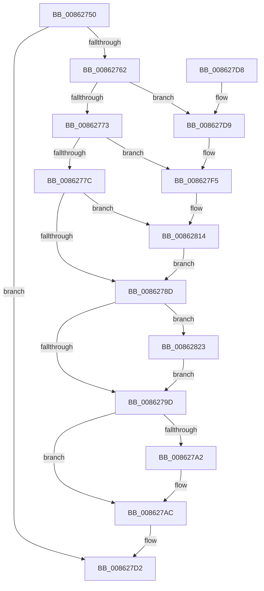

# CmpDecommisssionKcb

- RVA: `0x00862750`–`0x0086282C` (길이 `220` bytes)
- VA: `0x0000000140862750`
- 실행 섹션: `PAGE`
- PDB 이름 있음: `예`; PDB Function 태그: `아니요`
- unwind 정보 RVA: `0x0006B638`
- 디코드: `50`개 명령, `220/220` bytes 표시
- 미해석 바이트: `0` (있으면 어셈블리에 `.byte`로 보존)

> 이 문서는 커널 이미지의 기계어와 PDB 기호를 분석해 생성했습니다. 4번과 5번은 함수 원형과 자료형을 바이너리 사용 방식에서 추정한 C 해석이며 원본 소스 복구 결과는 아닙니다.

## 1. Dependencies

- 직접 호출 지점: **5**; 고유 호출 대상: **4**
- 직접 호출자로 확인된 함수: **6**
- RIP 상대 이미지 참조: **3**

### Outgoing calls
- `0x008627A7` → [CmpFreePoolWithTag](../../text/44/CmpFreePoolWithTag_function_004489E0.md) (function, `0x004489E0`)
- `0x008627C5` → [ExFreeToLookasideListEx](../../text/38/ExFreeToLookasideListEx_function_0038ACC0.md) (function, `0x0038ACC0`)
- `0x008627EF` → [KeBugCheckEx](../../text/4F/KeBugCheckEx_function_004FD660.md) (function, `0x004FD660`)
- `0x0086280E` → [KeBugCheckEx](../../text/4F/KeBugCheckEx_function_004FD660.md) (function, `0x004FD660`)
- `0x00862819` → [ExFreePoolWithTag](../../poolcode/B8/ExFreePoolWithTag_function_00B82870.md) (function, `0x00B82870`)

### Direct callers
- [CmpPerformCompleteKcbCacheLookup](../84/CmpPerformCompleteKcbCacheLookup_function_0084FD20.md) at `0x00850680`
- [CmpPerformCompleteKcbCacheLookup](../84/CmpPerformCompleteKcbCacheLookup_function_0084FD20.md) at `0x00851014`
- [sub_008515D5](../85/Unknown_function_008515D5.md) at `0x00851860`
- [CmpCommitDiscardReplacePost](CmpCommitDiscardReplacePost_function_008624D4.md) at `0x00862641`
- [CmpCleanUpKCBCacheTable](../9B/CmpCleanUpKCBCacheTable_function_009B0478.md) at `0x009B053C`
- [CmpSearchKeyControlBlockTreeEx](../A6/CmpSearchKeyControlBlockTreeEx_function_00A65548.md) at `0x00A65617`
- [CmpUnlockKcb](../../pagecmrc/BC/CmpUnlockKcb_function_00BC92C0.md) at `0x00BC9323`

### Static image references
- `0x00862762` → RVA `0x00FDA430` (`PAGEDATA`; read/write)
- `0x008627B3` → RVA `0x00E2CAC0` (`.data`; read)
- `0x008627CA` → RVA `0x00FDA450` (`PAGEDATA`; read/write)

## 2. Other-region calls and transfers

- 다른 실행 섹션으로 향하는 call: **5**
  - `0x008627A7` → [CmpFreePoolWithTag](../../text/44/CmpFreePoolWithTag_function_004489E0.md) (`PAGE` → `.text`)
  - `0x008627C5` → [ExFreeToLookasideListEx](../../text/38/ExFreeToLookasideListEx_function_0038ACC0.md) (`PAGE` → `.text`)
  - `0x008627EF` → [KeBugCheckEx](../../text/4F/KeBugCheckEx_function_004FD660.md) (`PAGE` → `.text`)
  - `0x0086280E` → [KeBugCheckEx](../../text/4F/KeBugCheckEx_function_004FD660.md) (`PAGE` → `.text`)
  - `0x00862819` → [ExFreePoolWithTag](../../poolcode/B8/ExFreePoolWithTag_function_00B82870.md) (`PAGE` → `POOLCODE`)
- 별도 외부 분기/꼬리 이동을 확인하지 못했습니다.

## 3. Assembly (complete function range)

```asm
00862750  40 53                           push rbx
00862752  48 83 EC 30                     sub rsp, 0x30
00862756  F7 41 08 00 00 08 00            test dword ptr [rcx + 8], 0x80000
0086275D  48 8B D9                        mov rbx, rcx
00862760  74 70                           je 0x1408627d2
00862762  F0 48 FF 0D C6 7C 77 00         lock dec qword ptr [rip + 0x777cc6]
0086276A  48 8D 41 78                     lea rax, [rcx + 0x78]
0086276E  48 39 00                        cmp qword ptr [rax], rax
00862771  75 66                           jne 0x1408627d9
00862773  F7 41 08 00 00 01 00            test dword ptr [rcx + 8], 0x10000
0086277A  75 79                           jne 0x1408627f5
0086277C  48 8B 89 C8 00 00 00            mov rcx, qword ptr [rcx + 0xc8]
00862783  48 83 F9 02                     cmp rcx, 2
00862787  0F 83 87 00 00 00               jae 0x140862814
0086278D  48 8B 8B 28 01 00 00            mov rcx, qword ptr [rbx + 0x128]
00862794  F6 C1 01                        test cl, 1
00862797  0F 85 86 00 00 00               jne 0x140862823
0086279D  48 85 C9                        test rcx, rcx
008627A0  74 0A                           je 0x1408627ac
008627A2  BA 43 4D 4E 62                  mov edx, 0x624e4d43
008627A7  E8 34 62 BE FF                  call 0x1404489e0
008627AC  81 4B 08 00 00 01 00            or dword ptr [rbx + 8], 0x10000
008627B3  48 8D 0D 06 A3 5C 00            lea rcx, [rip + 0x5ca306]
008627BA  48 8B D3                        mov rdx, rbx
008627BD  48 C7 43 20 00 00 00 00         mov qword ptr [rbx + 0x20], 0
008627C5  E8 F6 84 B2 FF                  call 0x14038acc0
008627CA  F0 48 FF 0D 7E 7C 77 00         lock dec qword ptr [rip + 0x777c7e]
008627D2  48 83 C4 30                     add rsp, 0x30
008627D6  5B                              pop rbx
008627D7  C3                              ret
008627D8  CC                              int3
008627D9  45 33 C9                        xor r9d, r9d
008627DC  48 C7 44 24 20 00 00 00 00      mov qword ptr [rsp + 0x20], 0
008627E5  4C 8B C3                        mov r8, rbx
008627E8  41 8D 51 11                     lea edx, [r9 + 0x11]
008627EC  8D 4A 40                        lea ecx, [rdx + 0x40]
008627EF  E8 6C AE C9 FF                  call 0x1404fd660
008627F4  CC                              int3
008627F5  41 B9 01 00 00 00               mov r9d, 1
008627FB  48 C7 44 24 20 00 00 00 00      mov qword ptr [rsp + 0x20], 0
00862804  4C 8B C3                        mov r8, rbx
00862807  41 8D 51 10                     lea edx, [r9 + 0x10]
0086280B  8D 4A 40                        lea ecx, [rdx + 0x40]
0086280E  E8 4D AE C9 FF                  call 0x1404fd660
00862813  CC                              int3
00862814  BA 43 4D 4E 62                  mov edx, 0x624e4d43
00862819  E8 52 00 32 00                  call 0x140b82870
0086281E  E9 6A FF FF FF                  jmp 0x14086278d
00862823  48 83 E1 FE                     and rcx, 0xfffffffffffffffe
00862827  E9 71 FF FF FF                  jmp 0x14086279d
```

## 4. C-style interpretation (structured pseudocode)

```c
__int64 __fastcall CmpDecommisssionKcb(__int64 a1, __int64 a2, __int64 a3, int a4)
{
    __int64 result;
    __int64 v_rsp;
    unsigned __int64 v_stack_p20;

    v_rsp = (v_rsp) - (48);
    if (((*(unsigned int *)(a1 + 8)) & (0x80000ULL)) == 0) goto loc_008627D2;
    if ((*(unsigned __int64 *)(a1 + 120)) != (a1 + 120)) goto loc_008627D9;
    if (((*(unsigned int *)(a1 + 8)) & (0x10000ULL)) != 0) goto loc_008627F5;
    if ((*(unsigned __int64 *)(a1 + 200)) >= 2) goto loc_00862814;
loc_0086278D:
    if ((((unsigned __int8)(*(unsigned __int64 *)(a1 + 296))) & (1)) != 0) goto loc_00862823;
loc_0086279D:
    result = a1 + 120;
    if (*(unsigned __int64 *)(a1 + 296) != 0) {
        a2 = 0x624E4D43ULL;
        result = CmpFreePoolWithTag(*(unsigned __int64 *)(a1 + 296), a2, a3, a4);
    }
    *(unsigned __int64 *)(a1 + 32) = 0;
    result = ExFreeToLookasideListEx(v_rip + 6071046, a1, a3, a4);
loc_008627D2:
    v_rsp = (v_rsp) + (48);
    return result;
loc_008627D9:
    a4 = 0;
    v_stack_p20 = 0;
    result = KeBugCheckEx(a4 + 17 + 64, a4 + 17, a1, a4);
loc_008627F5:
    v_stack_p20 = 0;
    result = KeBugCheckEx(1 + 16 + 64, 1 + 16, a1, 1);
loc_00862814:
    result = ExFreePoolWithTag(1 + 16 + 64, (unsigned int)(0x624E4D43ULL), a1, 1);
    goto loc_0086278D;
loc_00862823:
    a1 = (1 + 16 + 64) & (-2);
    goto loc_0086279D;
}
```

## 5. (Beta) C Style

```c
int64_t CmpDecommisssionKcb(void *Arg1, int64_t Arg2, int64_t Arg3, int32_t Arg4)
{
    uint8_t *arg1 = (uint8_t *)Arg1;

    int64_t result;
    int64_t local_rsp;
    uint64_t v_stack_p20;

    local_rsp = (local_rsp) - (48);
    if (((*(uint32_t *)(arg1 + 0x8)) & (0x80000ULL)) == 0) goto loc_008627D2;
    if ((*(uint64_t *)(arg1 + 0x78)) != (Arg1 + 120)) goto loc_008627D9;
    if (((*(uint32_t *)(arg1 + 0x8)) & (0x10000ULL)) != 0) goto loc_008627F5;
    if ((*(uint64_t *)(arg1 + 0xC8)) >= 2) goto loc_00862814;
loc_0086278D:
    if ((((uint8_t)(*(uint64_t *)(arg1 + 0x128))) & (1)) != 0) goto loc_00862823;
loc_0086279D:
    result = Arg1 + 120;
    if (*(uint64_t *)(arg1 + 0x128) != 0) {
        Arg2 = 0x624E4D43ULL;
        result = CmpFreePoolWithTag(*(uint64_t *)(arg1 + 0x128), Arg2, Arg3, Arg4);
    }
    *(uint64_t *)(arg1 + 0x20) = 0;
    result = ExFreeToLookasideListEx(v_rip + 6071046, Arg1, Arg3, Arg4);
loc_008627D2:
    local_rsp = (local_rsp) + (48);
    return result;
loc_008627D9:
    Arg4 = 0;
    v_stack_p20 = 0;
    result = KeBugCheckEx(Arg4 + 17 + 64, Arg4 + 17, Arg1, Arg4);
loc_008627F5:
    v_stack_p20 = 0;
    result = KeBugCheckEx(1 + 16 + 64, 1 + 16, Arg1, 1);
loc_00862814:
    result = ExFreePoolWithTag(1 + 16 + 64, (uint32_t)(0x624E4D43ULL), Arg1, 1);
    goto loc_0086278D;
loc_00862823:
    Arg1 = (1 + 16 + 64) & (-2);
    goto loc_0086279D;
}
```

### 관측된 메모리 오프셋

구조체 형식이 확인되지 않은 접근은 인자 기준의 오프셋으로만 기록했습니다.

| 기준 인자 | 오프셋 표현 | 폭 (bit) | 접근 |
|---|---:|---:|---|
| `Arg1` | `+ 0x0` | `64` | `R` |
| `Arg1` | `+ 0x8` | `32` | `R` |
| `Arg1` | `+ 0x8` | `32` | `R/W` |
| `Arg1` | `+ 0x20` | `64` | `W` |
| `Arg1` | `+ 0x78` | `64` | `R` |
| `Arg1` | `+ 0xC8` | `64` | `R` |
| `Arg1` | `+ 0x128` | `64` | `R` |

## 6. Execution-region graph

[열기: 2D/3D 그래프와 함수 탐색 컨트롤 패널](../../../control-panel.html?section=page&rva=0x00862750&view=graph)

- 2D 그래프는 위에서 아래로 흐르고, 3D 그래프는 빈 공간을 드래그해 회전합니다. Shift+드래그는 이동, 휠은 확대·축소, 함수 노드 선택은 대상 보고서 이동입니다.

### Static fallback


