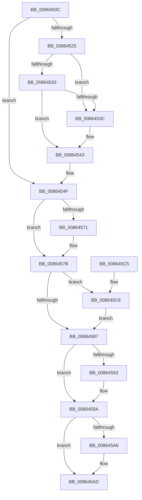

# CmpDeleteHive

- RVA: `0x0086450C`–`0x008645D2` (길이 `198` bytes)
- VA: `0x000000014086450C`
- 실행 섹션: `PAGE`
- PDB 이름 있음: `예`; PDB Function 태그: `아니요`
- unwind 정보 RVA: `0x00068790`
- 디코드: `53`개 명령, `198/198` bytes 표시
- 미해석 바이트: `0` (있으면 어셈블리에 `.byte`로 보존)

> 이 문서는 커널 이미지의 기계어와 PDB 기호를 분석해 생성했습니다. 4번과 5번은 함수 원형과 자료형을 바이너리 사용 방식에서 추정한 C 해석이며 원본 소스 복구 결과는 아닙니다.

## 1. Dependencies

- 직접 호출 지점: **9**; 고유 호출 대상: **6**
- 직접 호출자로 확인된 함수: **10**
- RIP 상대 이미지 참조: **0**

### Outgoing calls
- `0x00864525` → [CmpLockHiveListExclusive](../A7/CmpLockHiveListExclusive_function_00A72240.md) (function, `0x00A72240`)
- `0x0086454A` → [CmpUnlockHiveList](../84/CmpUnlockHiveList_function_0084E424.md) (function, `0x0084E424`)
- `0x00864558` → [HvFreeDirtyData](../9B/HvFreeDirtyData_function_009B2678.md) (function, `0x009B2678`)
- `0x00864560` → [CmpDeleteKcbCache](../A7/CmpDeleteKcbCache_function_00A70184.md) (function, `0x00A70184`)
- `0x00864576` → [ExFreePoolWithTag](../../poolcode/B8/ExFreePoolWithTag_function_00B82870.md) (function, `0x00B82870`)
- `0x00864595` → [ExFreePoolWithTag](../../poolcode/B8/ExFreePoolWithTag_function_00B82870.md) (function, `0x00B82870`)
- `0x008645A8` → [ExFreePoolWithTag](../../poolcode/B8/ExFreePoolWithTag_function_00B82870.md) (function, `0x00B82870`)
- `0x008645B5` → [CmpFree](../84/CmpFree_function_0084D8F0.md) (function, `0x0084D8F0`)
- `0x008645CB` → [ExFreePoolWithTag](../../poolcode/B8/ExFreePoolWithTag_function_00B82870.md) (function, `0x00B82870`)

### Direct callers
- [CmpGetNextHive](../84/CmpGetNextHive_function_0084E330.md) at `0x0084E39C`
- [CmpPerformCompleteKcbCacheLookup](../84/CmpPerformCompleteKcbCacheLookup_function_0084FD20.md) at `0x00850010`
- [CmpPerformCompleteKcbCacheLookup](../84/CmpPerformCompleteKcbCacheLookup_function_0084FD20.md) at `0x0085033E`
- [CmpPerformCompleteKcbCacheLookup](../84/CmpPerformCompleteKcbCacheLookup_function_0084FD20.md) at `0x00850423`
- [CmpPerformCompleteKcbCacheLookup](../84/CmpPerformCompleteKcbCacheLookup_function_0084FD20.md) at `0x00850767`
- [CmpPerformCompleteKcbCacheLookup](../84/CmpPerformCompleteKcbCacheLookup_function_0084FD20.md) at `0x00850D9B`
- [CmpPerformCompleteKcbCacheLookup](../84/CmpPerformCompleteKcbCacheLookup_function_0084FD20.md) at `0x00850F8B`
- [sub_008515D5](../85/Unknown_function_008515D5.md) at `0x0085192B`
- [CmpWalkOneLevel](../85/CmpWalkOneLevel_function_00852BA0.md) at `0x008531F3`
- [CmpWalkOneLevel](../85/CmpWalkOneLevel_function_00852BA0.md) at `0x008538B8`
- [sub_0085E7B7](../85/Unknown_function_0085E7B7.md) at `0x0085E923`
- [CmpDereferenceHive](CmpDereferenceHive_function_008632B0.md) at `0x008632C6`
- [CmpUnlockHashEntryByKcb](CmpUnlockHashEntryByKcb_function_00864370.md) at `0x00864437`
- [CmpUnlockHashEntry](CmpUnlockHashEntry_function_00864460.md) at `0x008644E8`
- [sub_0086560A](Unknown_function_0086560A.md) at `0x00865B08`
- [CmpDelayCloseWorker](../9D/CmpDelayCloseWorker_function_009DB8E0.md) at `0x009DBBF7`

### Static image references
- 디코드된 RIP-relative 메모리 참조가 없습니다.

## 2. Other-region calls and transfers

- 다른 실행 섹션으로 향하는 call: **4**
  - `0x00864576` → [ExFreePoolWithTag](../../poolcode/B8/ExFreePoolWithTag_function_00B82870.md) (`PAGE` → `POOLCODE`)
  - `0x00864595` → [ExFreePoolWithTag](../../poolcode/B8/ExFreePoolWithTag_function_00B82870.md) (`PAGE` → `POOLCODE`)
  - `0x008645A8` → [ExFreePoolWithTag](../../poolcode/B8/ExFreePoolWithTag_function_00B82870.md) (`PAGE` → `POOLCODE`)
  - `0x008645CB` → [ExFreePoolWithTag](../../poolcode/B8/ExFreePoolWithTag_function_00B82870.md) (`PAGE` → `POOLCODE`)
- 별도 외부 분기/꼬리 이동을 확인하지 못했습니다.

## 3. Assembly (complete function range)

```asm
0086450C  48 89 5C 24 08                  mov qword ptr [rsp + 8], rbx
00864511  57                              push rdi
00864512  48 83 EC 20                     sub rsp, 0x20
00864516  48 8D B9 48 06 00 00            lea rdi, [rcx + 0x648]
0086451D  48 8B D9                        mov rbx, rcx
00864520  48 39 3F                        cmp qword ptr [rdi], rdi
00864523  74 2A                           je 0x14086454f
00864525  E8 16 DD 20 00                  call 0x140a72240
0086452A  48 8B 0F                        mov rcx, qword ptr [rdi]
0086452D  48 39 79 08                     cmp qword ptr [rcx + 8], rdi
00864531  75 09                           jne 0x14086453c
00864533  48 8B 47 08                     mov rax, qword ptr [rdi + 8]
00864537  48 39 38                        cmp qword ptr [rax], rdi
0086453A  74 07                           je 0x140864543
0086453C  B9 03 00 00 00                  mov ecx, 3
00864541  CD 29                           int 0x29
00864543  48 89 08                        mov qword ptr [rax], rcx
00864546  48 89 41 08                     mov qword ptr [rcx + 8], rax
0086454A  E8 D5 9E FE FF                  call 0x14084e424
0086454F  48 8B CB                        mov rcx, rbx
00864552  C7 03 E0 BE D0 BA               mov dword ptr [rbx], 0xbad0bee0
00864558  E8 1B E1 14 00                  call 0x1409b2678
0086455D  48 8B CB                        mov rcx, rbx
00864560  E8 1F BC 20 00                  call 0x140a70184
00864565  48 8B 8B 38 07 00 00            mov rcx, qword ptr [rbx + 0x738]
0086456C  48 85 C9                        test rcx, rcx
0086456F  74 0A                           je 0x14086457b
00864571  BA 43 4D 4E 62                  mov edx, 0x624e4d43
00864576  E8 F5 E2 31 00                  call 0x140b82870
0086457B  48 8B 8B 28 07 00 00            mov rcx, qword ptr [rbx + 0x728]
00864582  48 85 C9                        test rcx, rcx
00864585  75 3F                           jne 0x1408645c6
00864587  48 8B 8B 48 07 00 00            mov rcx, qword ptr [rbx + 0x748]
0086458E  48 85 C9                        test rcx, rcx
00864591  74 07                           je 0x14086459a
00864593  33 D2                           xor edx, edx
00864595  E8 D6 E2 31 00                  call 0x140b82870
0086459A  48 8B 8B D0 12 00 00            mov rcx, qword ptr [rbx + 0x12d0]
008645A1  48 85 C9                        test rcx, rcx
008645A4  74 07                           je 0x1408645ad
008645A6  33 D2                           xor edx, edx
008645A8  E8 C3 E2 31 00                  call 0x140b82870
008645AD  BA D8 12 00 00                  mov edx, 0x12d8
008645B2  48 8B CB                        mov rcx, rbx
008645B5  E8 36 93 FE FF                  call 0x14084d8f0
008645BA  48 8B 5C 24 30                  mov rbx, qword ptr [rsp + 0x30]
008645BF  48 83 C4 20                     add rsp, 0x20
008645C3  5F                              pop rdi
008645C4  C3                              ret
008645C5  CC                              int3
008645C6  BA 43 4D 20 20                  mov edx, 0x20204d43
008645CB  E8 A0 E2 31 00                  call 0x140b82870
008645D0  EB B5                           jmp 0x140864587
```

## 4. C-style interpretation (structured pseudocode)

```c
__int64 __fastcall CmpDeleteHive(__int64 a1)
{
    __int64 result;
    __int64 v_rsp;
    unsigned __int64 v_stack_p8;

    v_stack_p8 = v_rbx;
    v_rsp = (v_rsp) - (32);
    if ((*(unsigned __int64 *)(a1 + 1608)) == (a1 + 1608)) goto loc_0086454F;
    result = CmpLockHiveListExclusive(a1, a2, a3, a4);
    if ((*(unsigned __int64 *)(*(unsigned __int64 *)(a1 + 1608) + 8)) != (a1 + 1608)) goto loc_0086453C;
    if ((*(unsigned __int64 *)(*(unsigned __int64 *)(a1 + 1608 + 8))) != (a1 + 1608)) {
        a1 = 3;
    }
    *(unsigned __int64 *)(*(unsigned __int64 *)(a1 + 1608 + 8)) = a1;
    *(unsigned __int64 *)(a1 + 8) = *(unsigned __int64 *)(a1 + 1608 + 8);
    result = CmpUnlockHiveList(a1, a2, a3, a4);
loc_0086454F:
    *(unsigned int *)(a1) = 0xBAD0BEE0ULL;
    result = HvFreeDirtyData(a1, a2, a3, a4);
    result = CmpDeleteKcbCache(a1, a2, a3, a4);
    if (*(unsigned __int64 *)(a1 + 1848) != 0) {
        a2 = 0x624E4D43ULL;
        result = ExFreePoolWithTag(*(unsigned __int64 *)(a1 + 1848), a2, a3, a4);
    }
    if (*(unsigned __int64 *)(a1 + 1832) != 0) goto loc_008645C6;
loc_00864587:
    if (*(unsigned __int64 *)(a1 + 1864) != 0) {
        a2 = 0;
        result = ExFreePoolWithTag(*(unsigned __int64 *)(a1 + 1864), a2, a3, a4);
    }
    if (*(unsigned __int64 *)(a1 + 4816) != 0) {
        a2 = 0;
        result = ExFreePoolWithTag(*(unsigned __int64 *)(a1 + 4816), a2, a3, a4);
    }
    result = CmpFree(a1, (unsigned int)(0x12D8ULL), a3, a4);
    v_rsp = (v_rsp) + (32);
    return result;
loc_008645C6:
    result = ExFreePoolWithTag(a1, (unsigned int)(0x20204D43ULL), a3, a4);
    goto loc_00864587;
}
```

## 5. (Beta) C Style

```c
int64_t CmpDeleteHive(void *Arg1)
{
    uint8_t *arg1 = (uint8_t *)Arg1;

    int64_t result;
    int64_t local_rsp;
    uint64_t v_stack_p8;

    v_stack_p8 = local_rbx;
    local_rsp = (local_rsp) - (32);
    if ((*(uint64_t *)(arg1 + 0x648)) == (Arg1 + 1608)) goto loc_0086454F;
    result = CmpLockHiveListExclusive(Arg1, a2, a3, a4);
    if ((*(uint64_t *)(*(uint64_t *)(arg1 + 0x648) + 0x8)) != (Arg1 + 1608)) goto loc_0086453C;
    if ((*(uint64_t *)(*(uint64_t *)(arg1 + 0x648 + 0x8))) != (Arg1 + 1608)) {
        Arg1 = 3;
    }
    *(void **)(*(uint64_t *)(arg1 + 0x648 + 0x8)) = Arg1;
    *(uint64_t *)(arg1 + 0x8) = *(uint64_t *)(arg1 + 0x648 + 0x8);
    result = CmpUnlockHiveList(Arg1, a2, a3, a4);
loc_0086454F:
    *(uint32_t *)(arg1) = 0xBAD0BEE0ULL;
    result = HvFreeDirtyData(Arg1, a2, a3, a4);
    result = CmpDeleteKcbCache(Arg1, a2, a3, a4);
    if (*(uint64_t *)(arg1 + 0x738) != 0) {
        a2 = 0x624E4D43ULL;
        result = ExFreePoolWithTag(*(uint64_t *)(arg1 + 0x738), a2, a3, a4);
    }
    if (*(uint64_t *)(arg1 + 0x728) != 0) goto loc_008645C6;
loc_00864587:
    if (*(uint64_t *)(arg1 + 0x748) != 0) {
        a2 = 0;
        result = ExFreePoolWithTag(*(uint64_t *)(arg1 + 0x748), a2, a3, a4);
    }
    if (*(uint64_t *)(arg1 + 0x12D0) != 0) {
        a2 = 0;
        result = ExFreePoolWithTag(*(uint64_t *)(arg1 + 0x12D0), a2, a3, a4);
    }
    result = CmpFree(Arg1, (uint32_t)(0x12D8ULL), a3, a4);
    local_rsp = (local_rsp) + (32);
    return result;
loc_008645C6:
    result = ExFreePoolWithTag(Arg1, (uint32_t)(0x20204D43ULL), a3, a4);
    goto loc_00864587;
}
```

### 관측된 메모리 오프셋

구조체 형식이 확인되지 않은 접근은 인자 기준의 오프셋으로만 기록했습니다.

| 기준 인자 | 오프셋 표현 | 폭 (bit) | 접근 |
|---|---:|---:|---|
| `Arg1` | `+ 0x0` | `32` | `W` |
| `Arg1` | `+ 0x0` | `64` | `R` |
| `Arg1` | `+ 0x8` | `64` | `R` |
| `Arg1` | `+ 0x648` | `64` | `R` |
| `Arg1` | `+ 0x728` | `64` | `R` |
| `Arg1` | `+ 0x738` | `64` | `R` |
| `Arg1` | `+ 0x748` | `64` | `R` |
| `Arg1` | `+ 0x12D0` | `64` | `R` |

## 6. Execution-region graph

[열기: 2D/3D 그래프와 함수 탐색 컨트롤 패널](../../../control-panel.html?section=page&rva=0x0086450C&view=graph)

- 2D 그래프는 위에서 아래로 흐르고, 3D 그래프는 빈 공간을 드래그해 회전합니다. Shift+드래그는 이동, 휠은 확대·축소, 함수 노드 선택은 대상 보고서 이동입니다.

### Static fallback


