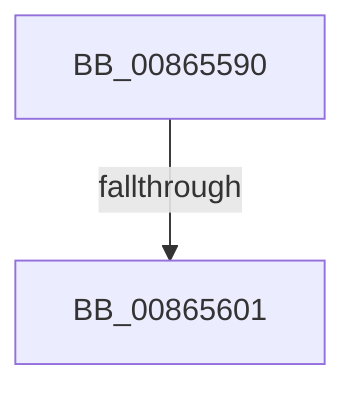

# CmpDeleteKeyObject

- RVA: `0x00865590`–`0x0086560A` (길이 `122` bytes)
- VA: `0x0000000140865590`
- 실행 섹션: `PAGE`
- PDB 이름 있음: `예`; PDB Function 태그: `아니요`
- unwind 정보 RVA: `0x0006BB14`
- 디코드: `33`개 명령, `122/122` bytes 표시
- 미해석 바이트: `0` (있으면 어셈블리에 `.byte`로 보존)

> 이 문서는 커널 이미지의 기계어와 PDB 기호를 분석해 생성했습니다. 4번과 5번은 함수 원형과 자료형을 바이너리 사용 방식에서 추정한 C 해석이며 원본 소스 복구 결과는 아닙니다.

## 1. Dependencies

- 직접 호출 지점: **2**; 고유 호출 대상: **2**
- 직접 호출자로 확인된 함수: **1**
- RIP 상대 이미지 참조: **0**

### Outgoing calls
- `0x008655D8` → [CmpInitializeThreadInfo](../../text/3F/CmpInitializeThreadInfo_function_003FBE70.md) (function, `0x003FBE70`)
- `0x008655F1` → [CmpInitializeDelayDerefContext](../../text/42/CmpInitializeDelayDerefContext_function_0042A7F0.md) (function, `0x0042A7F0`)

### Direct callers
- [ObpRemoveObjectRoutine](ObpRemoveObjectRoutine_function_00864A60.md) at `0x00864B20`

### Static image references
- 디코드된 RIP-relative 메모리 참조가 없습니다.

## 2. Other-region calls and transfers

- 다른 실행 섹션으로 향하는 call: **2**
  - `0x008655D8` → [CmpInitializeThreadInfo](../../text/3F/CmpInitializeThreadInfo_function_003FBE70.md) (`PAGE` → `.text`)
  - `0x008655F1` → [CmpInitializeDelayDerefContext](../../text/42/CmpInitializeDelayDerefContext_function_0042A7F0.md) (`PAGE` → `.text`)
- call이 아닌 외부 분기/꼬리 이동: **1**
  - `0x008655FB` → [sub_00865C54](Unknown_function_00865C54.md) (`tail-transfer`)

## 3. Assembly (complete function range)

```asm
00865590  40 55                           push rbp
00865592  53                              push rbx
00865593  56                              push rsi
00865594  41 54                           push r12
00865596  41 55                           push r13
00865598  48 8D 6C 24 C9                  lea rbp, [rsp - 0x37]
0086559D  48 81 EC F0 00 00 00            sub rsp, 0xf0
008655A4  0F 57 C0                        xorps xmm0, xmm0
008655A7  0F 57 C9                        xorps xmm1, xmm1
008655AA  33 C0                           xor eax, eax
008655AC  48 8B D9                        mov rbx, rcx
008655AF  45 33 ED                        xor r13d, r13d
008655B2  48 89 45 C7                     mov qword ptr [rbp - 0x39], rax
008655B6  45 32 E4                        xor r12b, r12b
008655B9  48 8D 4D B7                     lea rcx, [rbp - 0x49]
008655BD  0F 11 45 B7                     movups xmmword ptr [rbp - 0x49], xmm0
008655C1  41 8B F5                        mov esi, r13d
008655C4  44 88 65 67                     mov byte ptr [rbp + 0x67], r12b
008655C8  0F 11 45 97                     movups xmmword ptr [rbp - 0x69], xmm0
008655CC  0F 11 4D 17                     movups xmmword ptr [rbp + 0x17], xmm1
008655D0  0F 11 4D 27                     movups xmmword ptr [rbp + 0x27], xmm1
008655D4  0F 11 45 CF                     movups xmmword ptr [rbp - 0x31], xmm0
008655D8  E8 93 68 B9 FF                  call 0x1403fbe70
008655DD  48 8D 4D A7                     lea rcx, [rbp - 0x59]
008655E1  48 89 4D AF                     mov qword ptr [rbp - 0x51], rcx
008655E5  48 8D 45 A7                     lea rax, [rbp - 0x59]
008655E9  48 8D 4D CF                     lea rcx, [rbp - 0x31]
008655ED  48 89 45 A7                     mov qword ptr [rbp - 0x59], rax
008655F1  E8 FA 51 BC FF                  call 0x14042a7f0
008655F6  8B 43 30                        mov eax, dword ptr [rbx + 0x30]
008655F9  A8 04                           test al, 4
008655FB  0F 85 53 06 00 00               jne 0x140865c54
00865601  65 48 8B 04 25 88 01 00 00      mov rax, qword ptr gs:[0x188]
```

## 4. C-style interpretation (structured pseudocode)

```c
__int64 __fastcall CmpDeleteKeyObject(__int64 a1)
{
    __int64 result;
    __int64 v_r12;
    __int64 v_r13;
    __int64 v_rsp;
    unsigned __int64 v_stack_m38;
    unsigned __int64 v_stack_m48;
    unsigned __int64 v_stack_m5F;
    unsigned __int64 v_stack_m90;
    unsigned __int64 v_stack_m98;
    unsigned __int64 v_stack_mA8;
    unsigned __int64 v_stack_mB0;
    unsigned __int64 v_stack_mB8;
    unsigned __int64 v_stack_mC8;
    unsigned __int8 v_stack_p8;

    v_rsp = (v_rsp) - (240);
    result = 0;
    v_r13 = 0;
    v_stack_m98 = 0;
    v_r12 = 0;
    v_stack_mA8 = v_xmm0;
    v_stack_p8 = 0;
    v_stack_mC8 = v_xmm0;
    v_stack_m48 = v_xmm1;
    v_stack_m38 = v_xmm1;
    v_stack_m90 = v_xmm0;
    result = CmpInitializeThreadInfo(v_stack_mA8, a2, a3, a4);
    v_stack_mB0 = v_stack_mB8;
    v_stack_mB8 = v_stack_mB8;
    result = CmpInitializeDelayDerefContext(v_stack_m90, a2, a3, a4);
    return *(unsigned __int64 *)(gs_base + (0 + 392));
}
```

## 5. (Beta) C Style

```c
int64_t CmpDeleteKeyObject(void *Arg1)
{
    uint8_t *arg1 = (uint8_t *)Arg1;

    int64_t result;
    int64_t local_r12;
    int64_t local_r13;
    int64_t local_rsp;
    uint64_t v_stack_m38;
    uint64_t v_stack_m48;
    uint64_t v_stack_m5F;
    uint64_t v_stack_m90;
    uint64_t v_stack_m98;
    uint64_t v_stack_mA8;
    uint64_t v_stack_mB0;
    uint64_t v_stack_mB8;
    uint64_t v_stack_mC8;
    uint8_t v_stack_p8;

    local_rsp = (local_rsp) - (240);
    result = 0;
    local_r13 = 0;
    v_stack_m98 = 0;
    local_r12 = 0;
    v_stack_mA8 = v_xmm0;
    v_stack_p8 = 0;
    v_stack_mC8 = v_xmm0;
    v_stack_m48 = v_xmm1;
    v_stack_m38 = v_xmm1;
    v_stack_m90 = v_xmm0;
    result = CmpInitializeThreadInfo(v_stack_mA8, a2, a3, a4);
    v_stack_mB0 = v_stack_mB8;
    v_stack_mB8 = v_stack_mB8;
    result = CmpInitializeDelayDerefContext(v_stack_m90, a2, a3, a4);
    return *(uint64_t *)(gs_base + (0 + 0x188));
}
```

### 관측된 메모리 오프셋

구조체 형식이 확인되지 않은 접근은 인자 기준의 오프셋으로만 기록했습니다.

| 기준 인자 | 오프셋 표현 | 폭 (bit) | 접근 |
|---|---:|---:|---|
| `Arg1` | `+ 0x30` | `32` | `R` |

## 6. Execution-region graph

[열기: 2D/3D 그래프와 함수 탐색 컨트롤 패널](../../../control-panel.html?section=page&rva=0x00865590&view=graph)

- 2D 그래프는 위에서 아래로 흐르고, 3D 그래프는 빈 공간을 드래그해 회전합니다. Shift+드래그는 이동, 휠은 확대·축소, 함수 노드 선택은 대상 보고서 이동입니다.

### Static fallback


