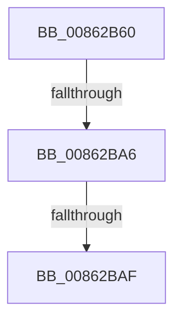

# CmpDereferenceKeyControlBlockWithLock

- RVA: `0x00862B60`–`0x00862BB9` (길이 `89` bytes)
- VA: `0x0000000140862B60`
- 실행 섹션: `PAGE`
- PDB 이름 있음: `예`; PDB Function 태그: `아니요`
- unwind 정보 RVA: `0x0006B6C4`
- 디코드: `19`개 명령, `89/89` bytes 표시
- 미해석 바이트: `0` (있으면 어셈블리에 `.byte`로 보존)

> 이 문서는 커널 이미지의 기계어와 PDB 기호를 분석해 생성했습니다. 4번과 5번은 함수 원형과 자료형을 바이너리 사용 방식에서 추정한 C 해석이며 원본 소스 복구 결과는 아닙니다.

## 1. Dependencies

- 직접 호출 지점: **0**; 고유 호출 대상: **0**
- 직접 호출자로 확인된 함수: **7**
- RIP 상대 이미지 참조: **1**

### Outgoing calls
- 직접 디코드된 call 명령이 없습니다.

### Direct callers
- [sub_0041B9B6](../../text/41/Unknown_function_0041B9B6.md) at `0x0041BA36`
- [CmRenameKey](../7E/CmRenameKey_function_007E8F48.md) at `0x007E9602`
- [CmRenameKey](../7E/CmRenameKey_function_007E8F48.md) at `0x007E9E55`
- [CmRenameKey](../7E/CmRenameKey_function_007E8F48.md) at `0x007EA13D`
- [CmRenameKey](../7E/CmRenameKey_function_007E8F48.md) at `0x007EA155`
- [CmpUnfreezeHive](../7E/CmpUnfreezeHive_function_007EA778.md) at `0x007EA7AE`
- [CmpCleanupDiscardReplacePost](../7F/CmpCleanupDiscardReplacePost_function_007F1480.md) at `0x007F14B2`
- [CmpCleanupDiscardReplacePost](../7F/CmpCleanupDiscardReplacePost_function_007F1480.md) at `0x007F14C1`
- [CmpPrepareDiscardReplacePost](../7F/CmpPrepareDiscardReplacePost_function_007F16B0.md) at `0x007F1720`
- [CmpCommitDiscardReplacePost](CmpCommitDiscardReplacePost_function_008624D4.md) at `0x0086266F`
- [CmpCommitDiscardReplacePost](CmpCommitDiscardReplacePost_function_008624D4.md) at `0x0086267D`
- [CmpTransMgrFreeVolatileData](../87/CmpTransMgrFreeVolatileData_function_00874BDC.md) at `0x00874CCD`

### Static image references
- `0x00862B6D` → RVA `0x00E0A740` (`.data`; read)

## 2. Other-region calls and transfers

- 다른 실행 섹션으로 향하는 call: **0**
- call이 아닌 외부 분기/꼬리 이동: **2**
  - `0x00862BA0` → [sub_0086322A](Unknown_function_0086322A.md) (`tail-transfer`)
  - `0x00862BA9` → [sub_0086301E](Unknown_function_0086301E.md) (`tail-transfer`)

## 3. Assembly (complete function range)

```asm
00862B60  4C 8B DC                        mov r11, rsp
00862B63  53                              push rbx
00862B64  41 57                           push r15
00862B66  48 81 EC B8 00 00 00            sub rsp, 0xb8
00862B6D  48 8B 05 CC 7B 5A 00            mov rax, qword ptr [rip + 0x5a7bcc]
00862B74  48 33 C4                        xor rax, rsp
00862B77  48 89 84 24 90 00 00 00         mov qword ptr [rsp + 0x90], rax
00862B7F  48 8B D9                        mov rbx, rcx
00862B82  45 0F B6 C8                     movzx r9d, r8b
00862B86  48 8B 49 20                     mov rcx, qword ptr [rcx + 0x20]
00862B8A  4C 8B FA                        mov r15, rdx
00862B8D  48 C7 C0 FF FF FF FF            mov rax, 0xffffffffffffffff
00862B94  F0 48 0F C1 03                  lock xadd qword ptr [rbx], rax
00862B99  48 FF C8                        dec rax
00862B9C  48 83 F8 02                     cmp rax, 2
00862BA0  0F 84 84 06 00 00               je 0x14086322a
00862BA6  48 85 C0                        test rax, rax
00862BA9  0F 85 6F 04 00 00               jne 0x14086301e
00862BAF  F7 83 B8 00 00 00 00 00 04 00   test dword ptr [rbx + 0xb8], 0x40000
```

## 4. C-style interpretation (structured pseudocode)

```c
__int64 __fastcall CmpDereferenceKeyControlBlockWithLock(__int64 a1, __int64 a2, unsigned __int8 a3)
{
    __int64 result;
    __int64 v_rsp;
    unsigned __int64 v_stack_m38;

    v_rsp = (v_rsp) - (184);
    result = (*(unsigned __int64 *)(v_rip + 5929932)) ^ (v_rsp);
    v_stack_m38 = result;
    result = (-1) - 1;
    return result;
}
```

## 5. (Beta) C Style

```c
int64_t CmpDereferenceKeyControlBlockWithLock(void *Arg1, int64_t Arg2, uint8_t Arg3)
{
    uint8_t *arg1 = (uint8_t *)Arg1;

    int64_t result;
    int64_t local_rsp;
    uint64_t v_stack_m38;

    local_rsp = (local_rsp) - (184);
    result = (*(uint64_t *)(v_rip + 0x5A7BCC)) ^ (local_rsp);
    v_stack_m38 = result;
    result = (-1) - 1;
    return result;
}
```

### 관측된 메모리 오프셋

구조체 형식이 확인되지 않은 접근은 인자 기준의 오프셋으로만 기록했습니다.

| 기준 인자 | 오프셋 표현 | 폭 (bit) | 접근 |
|---|---:|---:|---|
| `Arg1` | `+ 0x0` | `64` | `R/W` |
| `Arg1` | `+ 0x20` | `64` | `R` |
| `Arg1` | `+ 0xB8` | `32` | `R` |

## 6. Execution-region graph

[열기: 2D/3D 그래프와 함수 탐색 컨트롤 패널](../../../control-panel.html?section=page&rva=0x00862B60&view=graph)

- 2D 그래프는 위에서 아래로 흐르고, 3D 그래프는 빈 공간을 드래그해 회전합니다. Shift+드래그는 이동, 휠은 확대·축소, 함수 노드 선택은 대상 보고서 이동입니다.

### Static fallback


