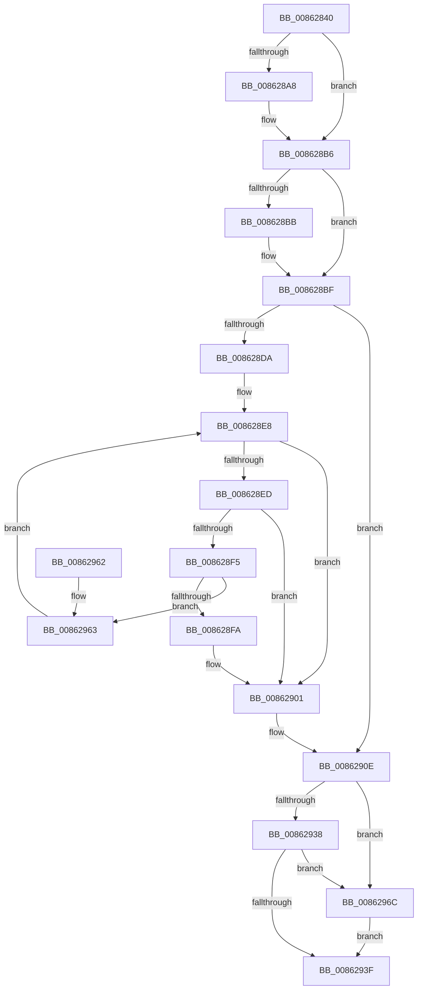

# CmpDereferenceNameControlBlockWithLock

- RVA: `0x00862840`–`0x00862976` (길이 `310` bytes)
- VA: `0x0000000140862840`
- 실행 섹션: `PAGE`
- PDB 이름 있음: `예`; PDB Function 태그: `아니요`
- unwind 정보 RVA: `0x0006B644`
- 디코드: `88`개 명령, `310/310` bytes 표시
- 미해석 바이트: `0` (있으면 어셈블리에 `.byte`로 보존)

> 이 문서는 커널 이미지의 기계어와 PDB 기호를 분석해 생성했습니다. 4번과 5번은 함수 원형과 자료형을 바이너리 사용 방식에서 추정한 C 해석이며 원본 소스 복구 결과는 아닙니다.

## 1. Dependencies

- 직접 호출 지점: **5**; 고유 호출 대상: **5**
- 직접 호출자로 확인된 함수: **6**
- RIP 상대 이미지 참조: **1**

### Outgoing calls
- `0x00862898` → [KeAbPreAcquire](../../text/21/KeAbPreAcquire_function_00210230.md) (function, `0x00210230`)
- `0x008628B1` → [ExfAcquirePushLockExclusiveEx](../../text/20/ExfAcquirePushLockExclusiveEx_function_0020FC90.md) (function, `0x0020FC90`)
- `0x00862909` → [CmpFreePoolWithTag](../../text/44/CmpFreePoolWithTag_function_004489E0.md) (function, `0x004489E0`)
- `0x00862942` → [KeAbPostRelease](../../text/2E/KeAbPostRelease_function_002E1600.md) (function, `0x002E1600`)
- `0x0086296F` → [ExfReleasePushLock](../../text/26/ExfReleasePushLock_function_002638D0.md) (function, `0x002638D0`)

### Direct callers
- [CmRenameKey](../7E/CmRenameKey_function_007E8F48.md) at `0x007EA125`
- [CmpCloneToUnbackedKcb](../7E/CmpCloneToUnbackedKcb_function_007EA9A8.md) at `0x007EAA87`
- [sub_008515D5](../85/Unknown_function_008515D5.md) at `0x008516AD`
- [CmpCreateKeyControlBlock](../85/CmpCreateKeyControlBlock_function_00851DB0.md) at `0x00852539`
- [sub_00861FEC](Unknown_function_00861FEC.md) at `0x0086200B`
- [sub_00862D60](Unknown_function_00862D60.md) at `0x00862D7F`

### Static image references
- `0x00862861` → RVA `0x00EF5978` (`.data`; read)

## 2. Other-region calls and transfers

- 다른 실행 섹션으로 향하는 call: **5**
  - `0x00862898` → [KeAbPreAcquire](../../text/21/KeAbPreAcquire_function_00210230.md) (`PAGE` → `.text`)
  - `0x008628B1` → [ExfAcquirePushLockExclusiveEx](../../text/20/ExfAcquirePushLockExclusiveEx_function_0020FC90.md) (`PAGE` → `.text`)
  - `0x00862909` → [CmpFreePoolWithTag](../../text/44/CmpFreePoolWithTag_function_004489E0.md) (`PAGE` → `.text`)
  - `0x00862942` → [KeAbPostRelease](../../text/2E/KeAbPostRelease_function_002E1600.md) (`PAGE` → `.text`)
  - `0x0086296F` → [ExfReleasePushLock](../../text/26/ExfReleasePushLock_function_002638D0.md) (`PAGE` → `.text`)
- 별도 외부 분기/꼬리 이동을 확인하지 못했습니다.

## 3. Assembly (complete function range)

```asm
00862840  48 89 5C 24 08                  mov qword ptr [rsp + 8], rbx
00862845  48 89 74 24 10                  mov qword ptr [rsp + 0x10], rsi
0086284A  48 89 7C 24 18                  mov qword ptr [rsp + 0x18], rdi
0086284F  4C 89 74 24 20                  mov qword ptr [rsp + 0x20], r14
00862854  41 57                           push r15
00862856  48 83 EC 20                     sub rsp, 0x20
0086285A  8B 41 08                        mov eax, dword ptr [rcx + 8]
0086285D  4C 8D 79 08                     lea r15, [rcx + 8]
00862861  48 8B 35 10 31 69 00            mov rsi, qword ptr [rip + 0x693110]
00862868  8B D0                           mov edx, eax
0086286A  C1 EA 09                        shr edx, 9
0086286D  4C 8B F1                        mov r14, rcx
00862870  33 D0                           xor edx, eax
00862872  45 33 C0                        xor r8d, r8d
00862875  69 C2 A3 8A 01 00               imul eax, edx, 0x18aa3
0086287B  8B D0                           mov edx, eax
0086287D  8B F8                           mov edi, eax
0086287F  48 C1 EF 09                     shr rdi, 9
00862883  48 33 FA                        xor rdi, rdx
00862886  33 D2                           xor edx, edx
00862888  81 E7 FF 07 00 00               and edi, 0x7ff
0086288E  48 C1 E7 04                     shl rdi, 4
00862892  48 03 F7                        add rsi, rdi
00862895  48 8B CE                        mov rcx, rsi
00862898  E8 93 D9 9A FF                  call 0x140210230
0086289D  F0 48 0F BA 2E 00               lock bts qword ptr [rsi], 0
008628A3  48 8B D8                        mov rbx, rax
008628A6  73 0E                           jae 0x1408628b6
008628A8  4C 8B C6                        mov r8, rsi
008628AB  48 8B D0                        mov rdx, rax
008628AE  48 8B CE                        mov rcx, rsi
008628B1  E8 DA D3 9A FF                  call 0x14020fc90
008628B6  48 85 DB                        test rbx, rbx
008628B9  74 04                           je 0x1408628bf
008628BB  C6 43 0A 01                     mov byte ptr [rbx + 0xa], 1
008628BF  41 8B 0E                        mov ecx, dword ptr [r14]
008628C2  8B C1                           mov eax, ecx
008628C4  D1 E8                           shr eax, 1
008628C6  83 E1 01                        and ecx, 1
008628C9  8D 04 45 FE FF FF FF            lea eax, [rax*2 - 2]
008628D0  0B C1                           or eax, ecx
008628D2  41 89 06                        mov dword ptr [r14], eax
008628D5  83 F8 02                        cmp eax, 2
008628D8  73 34                           jae 0x14086290e
008628DA  48 8B 0D 97 30 69 00            mov rcx, qword ptr [rip + 0x693097]
008628E1  48 83 C1 08                     add rcx, 8
008628E5  48 03 CF                        add rcx, rdi
008628E8  48 85 C9                        test rcx, rcx
008628EB  74 14                           je 0x140862901
008628ED  48 8B 01                        mov rax, qword ptr [rcx]
008628F0  48 85 C0                        test rax, rax
008628F3  74 0C                           je 0x140862901
008628F5  49 3B C7                        cmp rax, r15
008628F8  75 69                           jne 0x140862963
008628FA  48 8B 40 08                     mov rax, qword ptr [rax + 8]
008628FE  48 89 01                        mov qword ptr [rcx], rax
00862901  BA 43 4D 4E 62                  mov edx, 0x624e4d43
00862906  49 8B CE                        mov rcx, r14
00862909  E8 D2 60 BE FF                  call 0x1404489e0
0086290E  48 8B 1D 63 30 69 00            mov rbx, qword ptr [rip + 0x693063]
00862915  48 03 DF                        add rbx, rdi
00862918  0F 0D 0B                        prefetchw byte ptr [rbx]
0086291B  48 8B 03                        mov rax, qword ptr [rbx]
0086291E  45 33 C0                        xor r8d, r8d
00862921  48 8B C8                        mov rcx, rax
00862924  48 83 E1 F0                     and rcx, 0xfffffffffffffff0
00862928  48 83 F9 10                     cmp rcx, 0x10
0086292C  48 8D 50 F0                     lea rdx, [rax - 0x10]
00862930  49 0F 46 D0                     cmovbe rdx, r8
00862934  A8 02                           test al, 2
00862936  75 34                           jne 0x14086296c
00862938  F0 48 0F B1 13                  lock cmpxchg qword ptr [rbx], rdx
0086293D  75 2D                           jne 0x14086296c
0086293F  48 8B CB                        mov rcx, rbx
00862942  E8 B9 EC A7 FF                  call 0x1402e1600
00862947  48 8B 5C 24 30                  mov rbx, qword ptr [rsp + 0x30]
0086294C  48 8B 74 24 38                  mov rsi, qword ptr [rsp + 0x38]
00862951  48 8B 7C 24 40                  mov rdi, qword ptr [rsp + 0x40]
00862956  4C 8B 74 24 48                  mov r14, qword ptr [rsp + 0x48]
0086295B  48 83 C4 20                     add rsp, 0x20
0086295F  41 5F                           pop r15
00862961  C3                              ret
00862962  CC                              int3
00862963  48 8D 48 08                     lea rcx, [rax + 8]
00862967  E9 7C FF FF FF                  jmp 0x1408628e8
0086296C  48 8B CB                        mov rcx, rbx
0086296F  E8 5C 0F A0 FF                  call 0x1402638d0
00862974  EB C9                           jmp 0x14086293f
```

## 4. C-style interpretation (structured pseudocode)

```c
__int64 __fastcall CmpDereferenceNameControlBlockWithLock(__int64 a1, __int64 a2, int a3)
{
    __int64 result;
    __int64 v_rbx;
    __int64 v_rdi;
    __int64 v_rsi;
    __int64 v_rsp;
    unsigned __int64 v_stack_p10;
    unsigned __int64 v_stack_p18;
    unsigned __int64 v_stack_p20;
    unsigned __int64 v_stack_p8;

    v_stack_p8 = v_rbx;
    v_stack_p10 = v_rsi;
    v_stack_p18 = v_rdi;
    v_stack_p20 = v_r14;
    v_rsp = (v_rsp) - (32);
    a2 = (unsigned int)(((unsigned int)((unsigned int)((unsigned int)(*(unsigned int *)(a1 + 8))))) >> (9));
    a2 = (unsigned int)((a2) ^ ((unsigned int)((unsigned int)(*(unsigned int *)(a1 + 8)))));
    a3 = 0;
    result = (unsigned int)(((unsigned int)(*(unsigned int *)(a1 + 8))) * ((unsigned int)(a2)));
    v_rdi = ((unsigned int)((unsigned int)(result))) >> (9);
    v_rdi = (v_rdi) ^ ((unsigned int)((unsigned int)(result)));
    a2 = 0;
    v_rdi = (unsigned int)((v_rdi) & (0x7FFULL));
    v_rdi = (v_rdi) << (4);
    v_rsi = (*(unsigned __int64 *)(v_rip + 6893840)) + (v_rdi);
    result = KeAbPreAcquire(v_rsi, a2, a3, a4);
    if (!(condition_is_above_or_equal)) {
        a3 = v_rsi;
        a2 = result;
        a1 = v_rsi;
        result = ExfAcquirePushLockExclusiveEx(a1, a2, a3, a4);
    }
    if (result != 0) {
        *(unsigned __int8 *)(result + 10) = 1;
    }
    result = (unsigned int)(((unsigned int)((unsigned int)((unsigned int)(*(unsigned int *)(a1))))) >> (1));
    a1 = (unsigned int)(((unsigned int)(*(unsigned int *)(a1))) & (1));
    result = (unsigned int)((result * 2 - 2) | ((unsigned int)(a1)));
    *(unsigned int *)(a1) = (unsigned int)(result);
    if (((unsigned int)(result)) >= 2) goto loc_0086290E;
    a1 = (*(unsigned __int64 *)(v_rip + 6893719)) + (8);
    a1 = (a1) + (v_rdi);
loc_008628E8:
    if (a1 == 0) goto loc_00862901;
    if (*(unsigned __int64 *)(a1) == 0) goto loc_00862901;
    if ((*(unsigned __int64 *)(a1)) != (a1 + 8)) goto loc_00862963;
    *(unsigned __int64 *)(a1) = *(unsigned __int64 *)(*(unsigned __int64 *)(a1) + 8);
loc_00862901:
    result = CmpFreePoolWithTag(a1, (unsigned int)(0x624E4D43ULL), a3, a4);
loc_0086290E:
    v_rbx = (*(unsigned __int64 *)(v_rip + 6893667)) + (v_rdi);
    a3 = 0;
    a1 = (*(unsigned __int64 *)(v_rbx)) & (-16);
    a2 = *(unsigned __int64 *)(v_rbx) - 16;
    if (a1 <= 16) { a2 = 0; }
    if ((((unsigned __int8)(*(unsigned __int64 *)(v_rbx))) & (2)) != 0) goto loc_0086296C;
    if ((((unsigned __int8)(*(unsigned __int64 *)(v_rbx))) & (2)) != 0) goto loc_0086296C;
loc_0086293F:
    result = KeAbPostRelease(v_rbx, a2, a3, a4);
    v_rsp = (v_rsp) + (32);
    return result;
loc_00862963:
    goto loc_008628E8;
loc_0086296C:
    result = ExfReleasePushLock(v_stack_p8, a2, a3, a4);
    goto loc_0086293F;
}
```

## 5. (Beta) C Style

```c
int64_t CmpDereferenceNameControlBlockWithLock(void *Arg1, int64_t Arg2, int32_t Arg3)
{
    uint8_t *arg1 = (uint8_t *)Arg1;

    int64_t result;
    int64_t local_rbx;
    int64_t local_rdi;
    int64_t local_rsi;
    int64_t local_rsp;
    uint64_t v_stack_p10;
    uint64_t v_stack_p18;
    uint64_t v_stack_p20;
    uint64_t v_stack_p8;

    v_stack_p8 = local_rbx;
    v_stack_p10 = local_rsi;
    v_stack_p18 = local_rdi;
    v_stack_p20 = local_r14;
    local_rsp = (local_rsp) - (32);
    Arg2 = (uint32_t)(((uint32_t)((uint32_t)((uint32_t)(*(uint32_t *)(arg1 + 0x8))))) >> (9));
    Arg2 = (uint32_t)((Arg2) ^ ((uint32_t)((uint32_t)(*(uint32_t *)(arg1 + 0x8)))));
    Arg3 = 0;
    result = (uint32_t)(((uint32_t)(*(uint32_t *)(arg1 + 0x8))) * ((uint32_t)(Arg2)));
    local_rdi = ((uint32_t)((uint32_t)(result))) >> (9);
    local_rdi = (local_rdi) ^ ((uint32_t)((uint32_t)(result)));
    Arg2 = 0;
    local_rdi = (uint32_t)((local_rdi) & (0x7FFULL));
    local_rdi = (local_rdi) << (4);
    local_rsi = (*(uint64_t *)(v_rip + 0x693110)) + (local_rdi);
    result = KeAbPreAcquire(local_rsi, Arg2, Arg3, a4);
    if (!(condition_is_above_or_equal)) {
        Arg3 = local_rsi;
        Arg2 = result;
        Arg1 = local_rsi;
        result = ExfAcquirePushLockExclusiveEx(Arg1, Arg2, Arg3, a4);
    }
    if (result != 0) {
        *(uint8_t *)(result + 0xA) = 1;
    }
    result = (uint32_t)(((uint32_t)((uint32_t)((uint32_t)(*(uint32_t *)(arg1))))) >> (1));
    Arg1 = (uint32_t)(((uint32_t)(*(uint32_t *)(arg1))) & (1));
    result = (uint32_t)((result * 2 - 2) | ((uint32_t)(Arg1)));
    *(uint32_t *)(arg1) = (uint32_t)(result);
    if (((uint32_t)(result)) >= 2) goto loc_0086290E;
    Arg1 = (*(uint64_t *)(v_rip + 0x693097)) + (8);
    Arg1 = (Arg1) + (local_rdi);
loc_008628E8:
    if (Arg1 == NULL) goto loc_00862901;
    if (*(uint64_t *)(arg1) == 0) goto loc_00862901;
    if ((*(uint64_t *)(arg1)) != (Arg1 + 8)) goto loc_00862963;
    *(uint64_t *)(arg1) = *(uint64_t *)(*(uint64_t *)(arg1) + 0x8);
loc_00862901:
    result = CmpFreePoolWithTag(Arg1, (uint32_t)(0x624E4D43ULL), Arg3, a4);
loc_0086290E:
    local_rbx = (*(uint64_t *)(v_rip + 0x693063)) + (local_rdi);
    Arg3 = 0;
    Arg1 = (*(uint64_t *)(local_rbx)) & (-16);
    Arg2 = *(uint64_t *)(local_rbx) - 16;
    if (Arg1 <= 16) { Arg2 = 0; }
    if ((((uint8_t)(*(uint64_t *)(local_rbx))) & (2)) != 0) goto loc_0086296C;
    if ((((uint8_t)(*(uint64_t *)(local_rbx))) & (2)) != 0) goto loc_0086296C;
loc_0086293F:
    result = KeAbPostRelease(local_rbx, Arg2, Arg3, a4);
    local_rsp = (local_rsp) + (32);
    return result;
loc_00862963:
    goto loc_008628E8;
loc_0086296C:
    result = ExfReleasePushLock(v_stack_p8, Arg2, Arg3, a4);
    goto loc_0086293F;
}
```

### 관측된 메모리 오프셋

구조체 형식이 확인되지 않은 접근은 인자 기준의 오프셋으로만 기록했습니다.

| 기준 인자 | 오프셋 표현 | 폭 (bit) | 접근 |
|---|---:|---:|---|
| `Arg1` | `+ 0x0` | `32` | `R` |
| `Arg1` | `+ 0x0` | `32` | `W` |
| `Arg1` | `+ 0x8` | `32` | `R` |
| `Arg1` | `+ 0x8` | `64` | `R` |

## 6. Execution-region graph

[열기: 2D/3D 그래프와 함수 탐색 컨트롤 패널](../../../control-panel.html?section=page&rva=0x00862840&view=graph)

- 2D 그래프는 위에서 아래로 흐르고, 3D 그래프는 빈 공간을 드래그해 회전합니다. Shift+드래그는 이동, 휠은 확대·축소, 함수 노드 선택은 대상 보고서 이동입니다.

### Static fallback


