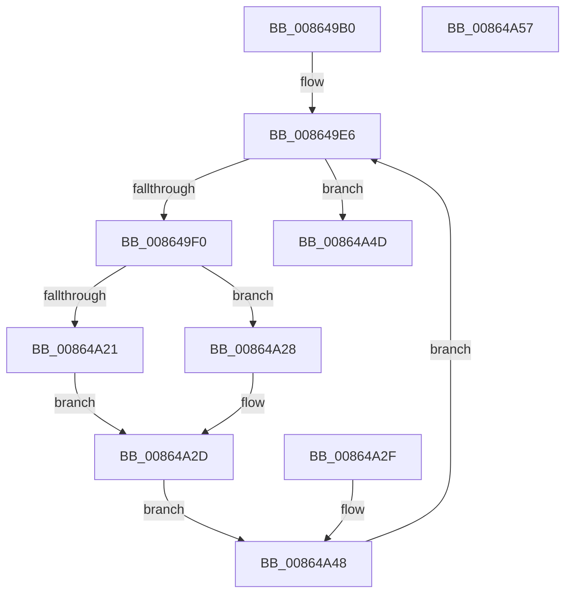

# CmpFireCleanupNotifications

- RVA: `0x008649B0`–`0x00864A58` (길이 `168` bytes)
- VA: `0x00000001408649B0`
- 실행 섹션: `PAGE`
- PDB 이름 있음: `예`; PDB Function 태그: `아니요`
- unwind 정보 RVA: `0x0006B988`
- 디코드: `46`개 명령, `168/168` bytes 표시
- 미해석 바이트: `0` (있으면 어셈블리에 `.byte`로 보존)

> 이 문서는 커널 이미지의 기계어와 PDB 기호를 분석해 생성했습니다. 4번과 5번은 함수 원형과 자료형을 바이너리 사용 방식에서 추정한 C 해석이며 원본 소스 복구 결과는 아닙니다.

## 1. Dependencies

- 직접 호출 지점: **2**; 고유 호출 대상: **2**
- 직접 호출자로 확인된 함수: **1**
- RIP 상대 이미지 참조: **1**

### Outgoing calls
- `0x00864A21` → [VrpRegistryCallback](VrpRegistryCallback_function_00867450.md) (function, `0x00867450`)
- `0x00864A28` → [guard_dispatch_icall](../../text/6B/guard_dispatch_icall_function_006BAAD0.md) (function, `0x006BAAD0`)

### Direct callers
- [sub_0086560A](Unknown_function_0086560A.md) at `0x00865691`

### Static image references
- `0x008649DF` → RVA `0x00867450` (`VrpRegistryCallback`; read)

## 2. Other-region calls and transfers

- 다른 실행 섹션으로 향하는 call: **1**
  - `0x00864A28` → [guard_dispatch_icall](../../text/6B/guard_dispatch_icall_function_006BAAD0.md) (`PAGE` → `.text`)
- 별도 외부 분기/꼬리 이동을 확인하지 못했습니다.

## 3. Assembly (complete function range)

```asm
008649B0  48 89 4C 24 08                  mov qword ptr [rsp + 8], rcx
008649B5  53                              push rbx
008649B6  56                              push rsi
008649B7  57                              push rdi
008649B8  41 56                           push r14
008649BA  48 83 EC 48                     sub rsp, 0x48
008649BE  48 8B F1                        mov rsi, rcx
008649C1  0F 57 C0                        xorps xmm0, xmm0
008649C4  33 C0                           xor eax, eax
008649C6  0F 11 44 24 20                  movups xmmword ptr [rsp + 0x20], xmm0
008649CB  48 89 44 24 30                  mov qword ptr [rsp + 0x30], rax
008649D0  48 8D 79 48                     lea rdi, [rcx + 0x48]
008649D4  48 89 BC 24 88 00 00 00         mov qword ptr [rsp + 0x88], rdi
008649DC  48 8B 1F                        mov rbx, qword ptr [rdi]
008649DF  4C 8D 35 6A 2A 00 00            lea r14, [rip + 0x2a6a]
008649E6  48 89 5C 24 78                  mov qword ptr [rsp + 0x78], rbx
008649EB  48 3B DF                        cmp rbx, rdi
008649EE  74 5D                           je 0x140864a4d
008649F0  48 8B 53 28                     mov rdx, qword ptr [rbx + 0x28]
008649F4  48 89 94 24 80 00 00 00         mov qword ptr [rsp + 0x80], rdx
008649FC  48 89 74 24 20                  mov qword ptr [rsp + 0x20], rsi
00864A01  48 8B 43 38                     mov rax, qword ptr [rbx + 0x38]
00864A05  48 89 44 24 28                  mov qword ptr [rsp + 0x28], rax
00864A0A  48 8B 4A 20                     mov rcx, qword ptr [rdx + 0x20]
00864A0E  48 8B 42 28                     mov rax, qword ptr [rdx + 0x28]
00864A12  4C 8D 44 24 20                  lea r8, [rsp + 0x20]
00864A17  BA 28 00 00 00                  mov edx, 0x28
00864A1C  49 3B C6                        cmp rax, r14
00864A1F  75 07                           jne 0x140864a28
00864A21  E8 2A 2A 00 00                  call 0x140867450
00864A26  EB 05                           jmp 0x140864a2d
00864A28  E8 A3 60 E5 FF                  call 0x1406baad0
00864A2D  EB 19                           jmp 0x140864a48
00864A2F  4C 8D 35 1A 2A 00 00            lea r14, [rip + 0x2a1a]
00864A36  48 8B 74 24 70                  mov rsi, qword ptr [rsp + 0x70]
00864A3B  48 8B 5C 24 78                  mov rbx, qword ptr [rsp + 0x78]
00864A40  48 8B BC 24 88 00 00 00         mov rdi, qword ptr [rsp + 0x88]
00864A48  48 8B 1B                        mov rbx, qword ptr [rbx]
00864A4B  EB 99                           jmp 0x1408649e6
00864A4D  48 83 C4 48                     add rsp, 0x48
00864A51  41 5E                           pop r14
00864A53  5F                              pop rdi
00864A54  5E                              pop rsi
00864A55  5B                              pop rbx
00864A56  C3                              ret
00864A57  CC                              int3
```

## 4. C-style interpretation (structured pseudocode)

```c
__int64 __fastcall CmpFireCleanupNotifications(__int64 a1)
{
    __int64 result;
    __int64 v_rsp;
    unsigned __int64 v_stack_m38;
    unsigned __int64 v_stack_m40;
    unsigned __int64 v_stack_m48;
    unsigned __int64 v_stack_p10;
    unsigned __int64 v_stack_p18;
    unsigned __int64 v_stack_p20;
    unsigned __int64 v_stack_p8;

    v_stack_p8 = a1;
    v_rsp = (v_rsp) - (72);
    result = 0;
    v_stack_m48 = v_xmm0;
    v_stack_m38 = 0;
    v_stack_p20 = a1 + 72;
loc_008649E6:
    v_stack_p10 = *(unsigned __int64 *)(a1 + 72);
    if ((*(unsigned __int64 *)(a1 + 72)) == (a1 + 72)) goto loc_00864A4D;
    v_stack_p18 = *(unsigned __int64 *)(*(unsigned __int64 *)(a1 + 72) + 40);
    v_stack_m48 = a1;
    v_stack_m40 = *(unsigned __int64 *)(*(unsigned __int64 *)(a1 + 72) + 56);
    if ((*(unsigned __int64 *)(*(unsigned __int64 *)(*(unsigned __int64 *)(a1 + 72) + 40) + 40)) != (v_rip + 10858)) goto loc_00864A28;
    result = VrpRegistryCallback(*(unsigned __int64 *)(*(unsigned __int64 *)(*(unsigned __int64 *)(a1 + 72) + 40) + 32), 40, v_stack_m48, a4);
    goto loc_00864A2D;
loc_00864A28:
    result = guard_dispatch_icall(*(unsigned __int64 *)(*(unsigned __int64 *)(*(unsigned __int64 *)(a1 + 72) + 40) + 32), 40, v_stack_m48, a4);
loc_00864A2D:
    goto loc_00864A48;
loc_00864A48:
    goto loc_008649E6;
loc_00864A4D:
    v_rsp = (v_rsp) + (72);
    return result;
}
```

## 5. (Beta) C Style

```c
int64_t CmpFireCleanupNotifications(void *Arg1)
{
    uint8_t *arg1 = (uint8_t *)Arg1;

    int64_t result;
    int64_t local_rsp;
    uint64_t v_stack_m38;
    uint64_t v_stack_m40;
    uint64_t v_stack_m48;
    uint64_t v_stack_p10;
    uint64_t v_stack_p18;
    uint64_t v_stack_p20;
    uint64_t v_stack_p8;

    v_stack_p8 = Arg1;
    local_rsp = (local_rsp) - (72);
    result = 0;
    v_stack_m48 = v_xmm0;
    v_stack_m38 = 0;
    v_stack_p20 = Arg1 + 72;
loc_008649E6:
    v_stack_p10 = *(uint64_t *)(arg1 + 0x48);
    if ((*(uint64_t *)(arg1 + 0x48)) == (Arg1 + 72)) goto loc_00864A4D;
    v_stack_p18 = *(uint64_t *)(*(uint64_t *)(arg1 + 0x48) + 0x28);
    v_stack_m48 = Arg1;
    v_stack_m40 = *(uint64_t *)(*(uint64_t *)(arg1 + 0x48) + 0x38);
    if ((*(uint64_t *)(*(uint64_t *)(*(uint64_t *)(arg1 + 0x48) + 0x28) + 0x28)) != (v_rip + 10858)) goto loc_00864A28;
    result = VrpRegistryCallback(*(uint64_t *)(*(uint64_t *)(*(uint64_t *)(arg1 + 0x48) + 0x28) + 0x20), 40, v_stack_m48, a4);
    goto loc_00864A2D;
loc_00864A28:
    result = guard_dispatch_icall(*(uint64_t *)(*(uint64_t *)(*(uint64_t *)(arg1 + 0x48) + 0x28) + 0x20), 40, v_stack_m48, a4);
loc_00864A2D:
    goto loc_00864A48;
loc_00864A48:
    goto loc_008649E6;
loc_00864A4D:
    local_rsp = (local_rsp) + (72);
    return result;
}
```

### 관측된 메모리 오프셋

구조체 형식이 확인되지 않은 접근은 인자 기준의 오프셋으로만 기록했습니다.

| 기준 인자 | 오프셋 표현 | 폭 (bit) | 접근 |
|---|---:|---:|---|
| `Arg1` | `+ 0x0` | `64` | `R` |
| `Arg1` | `+ 0x48` | `64` | `R` |

## 6. Execution-region graph

[열기: 2D/3D 그래프와 함수 탐색 컨트롤 패널](../../../control-panel.html?section=page&rva=0x008649B0&view=graph)

- 2D 그래프는 위에서 아래로 흐르고, 3D 그래프는 빈 공간을 드래그해 회전합니다. Shift+드래그는 이동, 휠은 확대·축소, 함수 노드 선택은 대상 보고서 이동입니다.

### Static fallback


