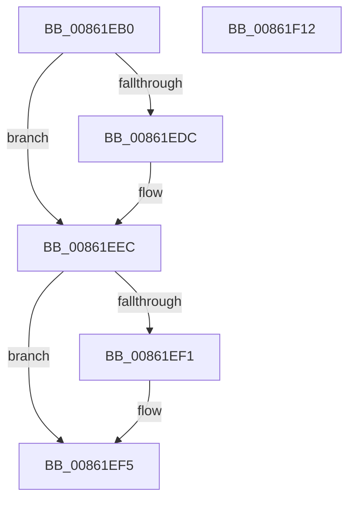

# CmpLockKcbExclusive

- RVA: `0x00861EB0`–`0x00861F13` (길이 `99` bytes)
- VA: `0x0000000140861EB0`
- 실행 섹션: `PAGE`
- PDB 이름 있음: `예`; PDB Function 태그: `아니요`
- unwind 정보 RVA: `0x00060BC4`
- 디코드: `27`개 명령, `99/99` bytes 표시
- 미해석 바이트: `0` (있으면 어셈블리에 `.byte`로 보존)

> 이 문서는 커널 이미지의 기계어와 PDB 기호를 분석해 생성했습니다. 4번과 5번은 함수 원형과 자료형을 바이너리 사용 방식에서 추정한 C 해석이며 원본 소스 복구 결과는 아닙니다.

## 1. Dependencies

- 직접 호출 지점: **2**; 고유 호출 대상: **2**
- 직접 호출자로 확인된 함수: **24**
- RIP 상대 이미지 참조: **0**

### Outgoing calls
- `0x00861ECB` → [KeAbPreAcquire](../../text/21/KeAbPreAcquire_function_00210230.md) (function, `0x00210230`)
- `0x00861EE7` → [ExfAcquirePushLockExclusiveEx](../../text/20/ExfAcquirePushLockExclusiveEx_function_0020FC90.md) (function, `0x0020FC90`)

### Direct callers
- [sub_0041B9B6](../../text/41/Unknown_function_0041B9B6.md) at `0x0041BA18`
- [sub_0041BA7B](../../text/41/Unknown_function_0041BA7B.md) at `0x0041BA93`
- [sub_0041BA7B](../../text/41/Unknown_function_0041BA7B.md) at `0x0041BA9B`
- [CmpRemoveHiveFromNamespace](../../text/49/CmpRemoveHiveFromNamespace_function_0049C4CC.md) at `0x0049C4F9`
- [CmpRemoveHiveFromNamespace](../../text/49/CmpRemoveHiveFromNamespace_function_0049C4CC.md) at `0x0049C501`
- [CmpReplicateKeyToVirtual](../7E/CmpReplicateKeyToVirtual_function_007EBAEC.md) at `0x007EBCC1`
- [CmpGlobalUnlockKeyForWrite](../7E/CmpGlobalUnlockKeyForWrite_function_007EDD80.md) at `0x007EDDBA`
- [CmpEnlistKeyBody](../84/CmpEnlistKeyBody_function_008425C0.md) at `0x0084269D`
- [CmKeyBodyReplicateToVirtual](../84/CmKeyBodyReplicateToVirtual_function_00843FE4.md) at `0x008440F2`
- [CmSetValueKey](../84/CmSetValueKey_function_008457C0.md) at `0x00845CA6`
- [CmSetValueKey](../84/CmSetValueKey_function_008457C0.md) at `0x0084607C`
- [CmSetValueKey](../84/CmSetValueKey_function_008457C0.md) at `0x008463B1`
- [CmSetValueKey](../84/CmSetValueKey_function_008457C0.md) at `0x0084641E`
- [CmpLockKcbStackTopExclusiveRestShared](../84/CmpLockKcbStackTopExclusiveRestShared_function_00846B04.md) at `0x00846B32`
- [CmDeleteKey](../84/CmDeleteKey_function_00848E5C.md) at `0x00849041`
- [CmpCreateKeyControlBlock](../85/CmpCreateKeyControlBlock_function_00851DB0.md) at `0x008524BD`
- [CmpDoParseKey](../85/CmpDoParseKey_function_0085F750.md) at `0x00860550`
- [sub_00865C6D](Unknown_function_00865C6D.md) at `0x00865D0C`
- [sub_008C405D](../8C/Unknown_function_008C405D.md) at `0x008C4143`
- [CmpLockKcbStackExclusive](../94/CmpLockKcbStackExclusive_function_009491C0.md) at `0x009491E3`
- [CmpDelayCloseWorker](../9D/CmpDelayCloseWorker_function_009DB8E0.md) at `0x009DBB19`
- [CmpDelayCloseWorker](../9D/CmpDelayCloseWorker_function_009DB8E0.md) at `0x009DBCA2`
- [CmpDelayCloseWorker](../9D/CmpDelayCloseWorker_function_009DB8E0.md) at `0x009DBCAA`
- [CmLockKeyForWrite](../9E/CmLockKeyForWrite_function_009E7EE8.md) at `0x009E7F29`
- [CmpStartSiloRegistryNamespace](../9E/CmpStartSiloRegistryNamespace_function_009E85D0.md) at `0x009E86F0`
- [CmpEnumerateAllHigherLayerKcbs](../A5/CmpEnumerateAllHigherLayerKcbs_function_00A55234.md) at `0x00A552CA`
- [CmpSearchKeyControlBlockTreeEx](../A6/CmpSearchKeyControlBlockTreeEx_function_00A65548.md) at `0x00A656C5`
- [sub_00B169F2](../B1/Unknown_function_00B169F2.md) at `0x00B16B0A`
- [sub_00B3073E](../B3/Unknown_function_00B3073E.md) at `0x00B307AC`
- [sub_00B37F04](../B3/Unknown_function_00B37F04.md) at `0x00B37FD0`
- [sub_00B49062](../B4/Unknown_function_00B49062.md) at `0x00B490F7`

### Static image references
- 디코드된 RIP-relative 메모리 참조가 없습니다.

## 2. Other-region calls and transfers

- 다른 실행 섹션으로 향하는 call: **2**
  - `0x00861ECB` → [KeAbPreAcquire](../../text/21/KeAbPreAcquire_function_00210230.md) (`PAGE` → `.text`)
  - `0x00861EE7` → [ExfAcquirePushLockExclusiveEx](../../text/20/ExfAcquirePushLockExclusiveEx_function_0020FC90.md) (`PAGE` → `.text`)
- 별도 외부 분기/꼬리 이동을 확인하지 못했습니다.

## 3. Assembly (complete function range)

```asm
00861EB0  48 89 5C 24 08                  mov qword ptr [rsp + 8], rbx
00861EB5  48 89 74 24 10                  mov qword ptr [rsp + 0x10], rsi
00861EBA  57                              push rdi
00861EBB  48 83 EC 20                     sub rsp, 0x20
00861EBF  48 8B F1                        mov rsi, rcx
00861EC2  45 33 C0                        xor r8d, r8d
00861EC5  48 83 C1 30                     add rcx, 0x30
00861EC9  33 D2                           xor edx, edx
00861ECB  E8 60 E3 9A FF                  call 0x140210230
00861ED0  F0 48 0F BA 6E 30 00            lock bts qword ptr [rsi + 0x30], 0
00861ED7  48 8B D8                        mov rbx, rax
00861EDA  73 10                           jae 0x140861eec
00861EDC  4C 8D 46 30                     lea r8, [rsi + 0x30]
00861EE0  48 8B D0                        mov rdx, rax
00861EE3  48 8D 4E 30                     lea rcx, [rsi + 0x30]
00861EE7  E8 A4 DD 9A FF                  call 0x14020fc90
00861EEC  48 85 DB                        test rbx, rbx
00861EEF  74 04                           je 0x140861ef5
00861EF1  C6 43 0A 01                     mov byte ptr [rbx + 0xa], 1
00861EF5  65 48 8B 04 25 88 01 00 00      mov rax, qword ptr gs:[0x188]
00861EFE  48 8B 5C 24 30                  mov rbx, qword ptr [rsp + 0x30]
00861F03  48 89 46 38                     mov qword ptr [rsi + 0x38], rax
00861F07  48 8B 74 24 38                  mov rsi, qword ptr [rsp + 0x38]
00861F0C  48 83 C4 20                     add rsp, 0x20
00861F10  5F                              pop rdi
00861F11  C3                              ret
00861F12  CC                              int3
```

## 4. C-style interpretation (structured pseudocode)

```c
__int64 __fastcall CmpLockKcbExclusive(__int64 a1, int a2, int a3)
{
    __int64 result;
    __int64 v_rsp;
    unsigned __int64 v_stack_p10;
    unsigned __int64 v_stack_p8;

    v_stack_p8 = v_rbx;
    v_stack_p10 = v_rsi;
    v_rsp = (v_rsp) - (32);
    a3 = 0;
    a1 = (a1) + (48);
    a2 = 0;
    result = KeAbPreAcquire(a1, a2, a3, a4);
    if (!(condition_is_above_or_equal)) {
        a3 = a1 + 48;
        a2 = result;
        a1 = a1 + 48;
        result = ExfAcquirePushLockExclusiveEx(a1, a2, a3, a4);
    }
    if (result != 0) {
        *(unsigned __int8 *)(result + 10) = 1;
    }
    *(unsigned __int64 *)(a1 + 56) = *(unsigned __int64 *)(gs_base + (0 + 392));
    v_rsp = (v_rsp) + (32);
    return *(unsigned __int64 *)(gs_base + (0 + 392));
}
```

## 5. (Beta) C Style

```c
int64_t CmpLockKcbExclusive(void *Arg1, int32_t Arg2, int32_t Arg3)
{
    uint8_t *arg1 = (uint8_t *)Arg1;

    int64_t result;
    int64_t local_rsp;
    uint64_t v_stack_p10;
    uint64_t v_stack_p8;

    v_stack_p8 = local_rbx;
    v_stack_p10 = local_rsi;
    local_rsp = (local_rsp) - (32);
    Arg3 = 0;
    Arg1 = (Arg1) + (48);
    Arg2 = 0;
    result = KeAbPreAcquire(Arg1, Arg2, Arg3, a4);
    if (!(condition_is_above_or_equal)) {
        Arg3 = Arg1 + 48;
        Arg2 = result;
        Arg1 = Arg1 + 48;
        result = ExfAcquirePushLockExclusiveEx(Arg1, Arg2, Arg3, a4);
    }
    if (result != 0) {
        *(uint8_t *)(result + 0xA) = 1;
    }
    *(uint64_t *)(arg1 + 0x38) = *(uint64_t *)(gs_base + (0 + 0x188));
    local_rsp = (local_rsp) + (32);
    return *(uint64_t *)(gs_base + (0 + 0x188));
}
```

### 관측된 메모리 오프셋

구조체 형식이 확인되지 않은 접근은 인자 기준의 오프셋으로만 기록했습니다.

| 기준 인자 | 오프셋 표현 | 폭 (bit) | 접근 |
|---|---:|---:|---|
| `Arg1` | `+ 0x30` | `64` | `R` |
| `Arg1` | `+ 0x30` | `64` | `R/W` |
| `Arg1` | `+ 0x38` | `64` | `W` |

## 6. Execution-region graph

[열기: 2D/3D 그래프와 함수 탐색 컨트롤 패널](../../../control-panel.html?section=page&rva=0x00861EB0&view=graph)

- 2D 그래프는 위에서 아래로 흐르고, 3D 그래프는 빈 공간을 드래그해 회전합니다. Shift+드래그는 이동, 휠은 확대·축소, 함수 노드 선택은 대상 보고서 이동입니다.

### Static fallback


