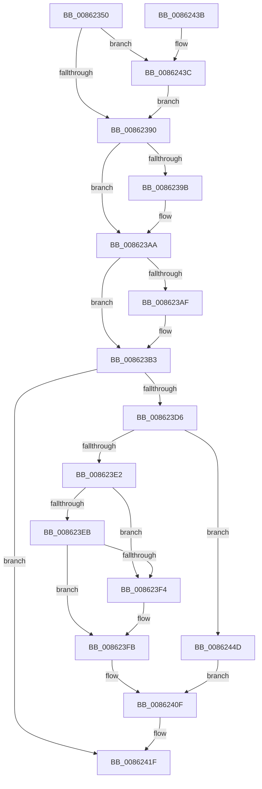

# CmpRemoveFromDelayedClose

- RVA: `0x00862350`–`0x00862459` (길이 `265` bytes)
- VA: `0x0000000140862350`
- 실행 섹션: `PAGE`
- PDB 이름 있음: `예`; PDB Function 태그: `아니요`
- unwind 정보 RVA: `0x0006B600`
- 디코드: `65`개 명령, `265/265` bytes 표시
- 미해석 바이트: `0` (있으면 어셈블리에 `.byte`로 보존)

> 이 문서는 커널 이미지의 기계어와 PDB 기호를 분석해 생성했습니다. 4번과 5번은 함수 원형과 자료형을 바이너리 사용 방식에서 추정한 C 해석이며 원본 소스 복구 결과는 아닙니다.

## 1. Dependencies

- 직접 호출 지점: **4**; 고유 호출 대상: **4**
- 직접 호출자로 확인된 함수: **4**
- RIP 상대 이미지 참조: **7**

### Outgoing calls
- `0x0086236E` → [KeAbPreAcquire](../../text/21/KeAbPreAcquire_function_00210230.md) (function, `0x00210230`)
- `0x008623A5` → [ExpAcquireFastMutexContended](../../text/45/ExpAcquireFastMutexContended_function_00450288.md) (function, `0x00450288`)
- `0x00862426` → [ExReleaseFastMutex](../../text/25/ExReleaseFastMutex_function_002519C0.md) (function, `0x002519C0`)
- `0x00862443` → [KiRaiseIrqlProcessIrqlFlags](../../text/4F/KiRaiseIrqlProcessIrqlFlags_function_004F56FC.md) (function, `0x004F56FC`)

### Direct callers
- [CmpDoParseKey](../85/CmpDoParseKey_function_0085F750.md) at `0x0086055E`
- [CmpCommitDiscardReplacePost](CmpCommitDiscardReplacePost_function_008624D4.md) at `0x0086262E`
- [CmpCleanUpKCBCacheTable](../9B/CmpCleanUpKCBCacheTable_function_009B0478.md) at `0x009B0527`
- [CmpSearchKeyControlBlockTreeEx](../A6/CmpSearchKeyControlBlockTreeEx_function_00A65548.md) at `0x00A655FD`

### Static image references
- `0x00862365` → RVA `0x00EF5880` (`.data`; read)
- `0x00862383` → RVA `0x00FC6D20` (`ALMOSTRO`; read)
- `0x00862390` → RVA `0x00EF5880` (`.data`; read/write)
- `0x008623BC` → RVA `0x00EF5888` (`.data`; write)
- `0x008623C7` → RVA `0x00EF58B0` (`.data`; write)
- `0x008623FB` → RVA `0x00EEFC30` (`.data`; read/write)
- `0x00862408` → RVA `0x00FDA438` (`PAGEDATA`; read/write)

## 2. Other-region calls and transfers

- 다른 실행 섹션으로 향하는 call: **4**
  - `0x0086236E` → [KeAbPreAcquire](../../text/21/KeAbPreAcquire_function_00210230.md) (`PAGE` → `.text`)
  - `0x008623A5` → [ExpAcquireFastMutexContended](../../text/45/ExpAcquireFastMutexContended_function_00450288.md) (`PAGE` → `.text`)
  - `0x00862426` → [ExReleaseFastMutex](../../text/25/ExReleaseFastMutex_function_002519C0.md) (`PAGE` → `.text`)
  - `0x00862443` → [KiRaiseIrqlProcessIrqlFlags](../../text/4F/KiRaiseIrqlProcessIrqlFlags_function_004F56FC.md) (`PAGE` → `.text`)
- 별도 외부 분기/꼬리 이동을 확인하지 못했습니다.

## 3. Assembly (complete function range)

```asm
00862350  48 89 5C 24 08                  mov qword ptr [rsp + 8], rbx
00862355  48 89 74 24 10                  mov qword ptr [rsp + 0x10], rsi
0086235A  57                              push rdi
0086235B  48 83 EC 20                     sub rsp, 0x20
0086235F  48 8B F9                        mov rdi, rcx
00862362  45 33 C0                        xor r8d, r8d
00862365  48 8D 0D 14 35 69 00            lea rcx, [rip + 0x693514]
0086236C  33 D2                           xor edx, edx
0086236E  E8 BD DE 9A FF                  call 0x140210230
00862373  48 8B D8                        mov rbx, rax
00862376  44 0F 20 C6                     mov rsi, cr8
0086237A  B8 01 00 00 00                  mov eax, 1
0086237F  44 0F 22 C0                     mov cr8, rax
00862383  83 3D 96 49 76 00 00            cmp dword ptr [rip + 0x764996], 0
0086238A  0F 85 AC 00 00 00               jne 0x14086243c
00862390  F0 0F BA 35 E7 34 69 00 00      lock btr dword ptr [rip + 0x6934e7], 0
00862399  72 0F                           jb 0x1408623aa
0086239B  48 8B D3                        mov rdx, rbx
0086239E  48 8D 0D DB 34 69 00            lea rcx, [rip + 0x6934db]
008623A5  E8 DE DE BE FF                  call 0x140450288
008623AA  48 85 DB                        test rbx, rbx
008623AD  74 04                           je 0x1408623b3
008623AF  C6 43 0A 01                     mov byte ptr [rbx + 0xa], 1
008623B3  65 48 8B 04 25 88 01 00 00      mov rax, qword ptr gs:[0x188]
008623BC  48 89 05 C5 34 69 00            mov qword ptr [rip + 0x6934c5], rax
008623C3  40 0F B6 C6                     movzx eax, sil
008623C7  89 05 E3 34 69 00               mov dword ptr [rip + 0x6934e3], eax
008623CD  0F B6 4F 40                     movzx ecx, byte ptr [rdi + 0x40]
008623D1  F6 C1 02                        test cl, 2
008623D4  74 49                           je 0x14086241f
008623D6  48 8D 87 E0 00 00 00            lea rax, [rdi + 0xe0]
008623DD  F6 C1 04                        test cl, 4
008623E0  75 6B                           jne 0x14086244d
008623E2  48 8B 10                        mov rdx, qword ptr [rax]
008623E5  48 39 42 08                     cmp qword ptr [rdx + 8], rax
008623E9  75 09                           jne 0x1408623f4
008623EB  48 8B 48 08                     mov rcx, qword ptr [rax + 8]
008623EF  48 39 01                        cmp qword ptr [rcx], rax
008623F2  74 07                           je 0x1408623fb
008623F4  B9 03 00 00 00                  mov ecx, 3
008623F9  CD 29                           int 0x29
008623FB  FF 0D 2F D8 68 00               dec dword ptr [rip + 0x68d82f]
00862401  48 89 11                        mov qword ptr [rcx], rdx
00862404  48 89 4A 08                     mov qword ptr [rdx + 8], rcx
00862408  48 FF 0D 29 80 77 00            dec qword ptr [rip + 0x778029]
0086240F  48 89 40 08                     mov qword ptr [rax + 8], rax
00862413  48 89 00                        mov qword ptr [rax], rax
00862416  F0 83 0C 24 00                  lock or dword ptr [rsp], 0
0086241B  80 67 40 FD                     and byte ptr [rdi + 0x40], 0xfd
0086241F  48 8D 0D 5A 34 69 00            lea rcx, [rip + 0x69345a]
00862426  E8 95 F5 9E FF                  call 0x1402519c0
0086242B  48 8B 5C 24 30                  mov rbx, qword ptr [rsp + 0x30]
00862430  48 8B 74 24 38                  mov rsi, qword ptr [rsp + 0x38]
00862435  48 83 C4 20                     add rsp, 0x20
00862439  5F                              pop rdi
0086243A  C3                              ret
0086243B  CC                              int3
0086243C  0F B6 D0                        movzx edx, al
0086243F  40 0F B6 CE                     movzx ecx, sil
00862443  E8 B4 32 C9 FF                  call 0x1404f56fc
00862448  E9 43 FF FF FF                  jmp 0x140862390
0086244D  48 8B 08                        mov rcx, qword ptr [rax]
00862450  C6 01 01                        mov byte ptr [rcx], 1
00862453  80 67 40 FB                     and byte ptr [rdi + 0x40], 0xfb
00862457  EB B6                           jmp 0x14086240f
```

## 4. C-style interpretation (structured pseudocode)

```c
__int64 __fastcall CmpRemoveFromDelayedClose(__int64 a1, int a2, int a3)
{
    __int64 result;
    __int64 v_rsp;
    unsigned int v_stack_m28;
    unsigned __int64 v_stack_p10;
    unsigned __int64 v_stack_p8;

    v_stack_p8 = v_rbx;
    v_stack_p10 = v_rsi;
    v_rsp = (v_rsp) - (32);
    a3 = 0;
    a2 = 0;
    result = KeAbPreAcquire(v_rip + 6894868, a2, a3, a4);
    if ((*(unsigned int *)(v_rip + 7752086)) != 0) goto loc_0086243C;
loc_00862390:
    result = 1;
    if ((*(unsigned int *)(v_rip + 7752086)) >= 0) {
        a2 = result;
        a1 = v_rip + 6894811;
        result = ExpAcquireFastMutexContended(a1, a2, a3, a4);
    }
    if (result != 0) {
        *(unsigned __int8 *)(result + 10) = 1;
    }
    *(unsigned __int64 *)(v_rip + 6894789) = *(unsigned __int64 *)(gs_base + (0 + 392));
    *(unsigned int *)(v_rip + 6894819) = (unsigned int)((unsigned __int8)(v_cr8));
    if ((((unsigned __int8)(*(unsigned __int8 *)(a1 + 64))) & (2)) == 0) goto loc_0086241F;
    if ((((unsigned __int8)(*(unsigned __int8 *)(a1 + 64))) & (4)) != 0) goto loc_0086244D;
    if ((*(unsigned __int64 *)(*(unsigned __int64 *)(a1 + 224) + 8)) != (a1 + 224)) goto loc_008623F4;
    if ((*(unsigned __int64 *)(*(unsigned __int64 *)(a1 + 224 + 8))) != (a1 + 224)) {
        a1 = 3;
    }
    *(unsigned __int64 *)(a1) = *(unsigned __int64 *)(a1 + 224);
    *(unsigned __int64 *)(*(unsigned __int64 *)(a1 + 224) + 8) = a1;
loc_0086240F:
    *(unsigned __int64 *)(a1 + 224 + 8) = a1 + 224;
    *(unsigned __int64 *)(a1 + 224) = a1 + 224;
loc_0086241F:
    result = ExReleaseFastMutex(v_rip + 6894682, *(unsigned __int64 *)(a1 + 224), a3, a4);
    v_rsp = (v_rsp) + (32);
    return result;
loc_0086243C:
    result = KiRaiseIrqlProcessIrqlFlags((unsigned __int8)(v_stack_p10), (unsigned __int8)(result), a3, a4);
    goto loc_00862390;
loc_0086244D:
    *(unsigned __int8 *)(*(unsigned __int64 *)(result)) = 1;
    goto loc_0086240F;
}
```

## 5. (Beta) C Style

```c
int64_t CmpRemoveFromDelayedClose(void *Arg1, int32_t Arg2, int32_t Arg3)
{
    uint8_t *arg1 = (uint8_t *)Arg1;

    int64_t result;
    int64_t local_rsp;
    uint32_t v_stack_m28;
    uint64_t v_stack_p10;
    uint64_t v_stack_p8;

    v_stack_p8 = local_rbx;
    v_stack_p10 = local_rsi;
    local_rsp = (local_rsp) - (32);
    Arg3 = 0;
    Arg2 = 0;
    result = KeAbPreAcquire(v_rip + 6894868, Arg2, Arg3, a4);
    if ((*(uint32_t *)(v_rip + 0x764996)) != 0) goto loc_0086243C;
loc_00862390:
    result = 1;
    if ((*(uint32_t *)(v_rip + 0x764996)) >= 0) {
        Arg2 = result;
        Arg1 = v_rip + 6894811;
        result = ExpAcquireFastMutexContended(Arg1, Arg2, Arg3, a4);
    }
    if (result != 0) {
        *(uint8_t *)(result + 0xA) = 1;
    }
    *(uint64_t *)(v_rip + 0x6934C5) = *(uint64_t *)(gs_base + (0 + 0x188));
    *(uint32_t *)(v_rip + 0x6934E3) = (uint32_t)((uint8_t)(v_cr8));
    if ((((uint8_t)(*(uint8_t *)(arg1 + 0x40))) & (2)) == 0) goto loc_0086241F;
    if ((((uint8_t)(*(uint8_t *)(arg1 + 0x40))) & (4)) != 0) goto loc_0086244D;
    if ((*(uint64_t *)(*(uint64_t *)(arg1 + 0xE0) + 0x8)) != (Arg1 + 224)) goto loc_008623F4;
    if ((*(uint64_t *)(*(uint64_t *)(arg1 + 0xE0 + 0x8))) != (Arg1 + 224)) {
        Arg1 = 3;
    }
    *(uint64_t *)(arg1) = *(uint64_t *)(arg1 + 0xE0);
    *(void **)(*(uint64_t *)(arg1 + 0xE0) + 0x8) = Arg1;
loc_0086240F:
    *(void **)(arg1 + 0xE0 + 0x8) = Arg1 + 224;
    *(void **)(arg1 + 0xE0) = Arg1 + 224;
loc_0086241F:
    result = ExReleaseFastMutex(v_rip + 6894682, *(uint64_t *)(arg1 + 0xE0), Arg3, a4);
    local_rsp = (local_rsp) + (32);
    return result;
loc_0086243C:
    result = KiRaiseIrqlProcessIrqlFlags((uint8_t)(v_stack_p10), (uint8_t)(result), Arg3, a4);
    goto loc_00862390;
loc_0086244D:
    *(uint8_t *)(*(uint64_t *)(result)) = 1;
    goto loc_0086240F;
}
```

### 관측된 메모리 오프셋

구조체 형식이 확인되지 않은 접근은 인자 기준의 오프셋으로만 기록했습니다.

| 기준 인자 | 오프셋 표현 | 폭 (bit) | 접근 |
|---|---:|---:|---|
| `Arg1` | `+ 0x0` | `64` | `R` |
| `Arg1` | `+ 0x0` | `64` | `W` |
| `Arg1` | `+ 0x8` | `64` | `R` |
| `Arg1` | `+ 0x8` | `64` | `W` |
| `Arg1` | `+ 0x40` | `8` | `R` |
| `Arg1` | `+ 0x40` | `8` | `R/W` |
| `Arg1` | `+ 0xE0` | `64` | `R` |

## 6. Execution-region graph

[열기: 2D/3D 그래프와 함수 탐색 컨트롤 패널](../../../control-panel.html?section=page&rva=0x00862350&view=graph)

- 2D 그래프는 위에서 아래로 흐르고, 3D 그래프는 빈 공간을 드래그해 회전합니다. Shift+드래그는 이동, 휠은 확대·축소, 함수 노드 선택은 대상 보고서 이동입니다.

### Static fallback


