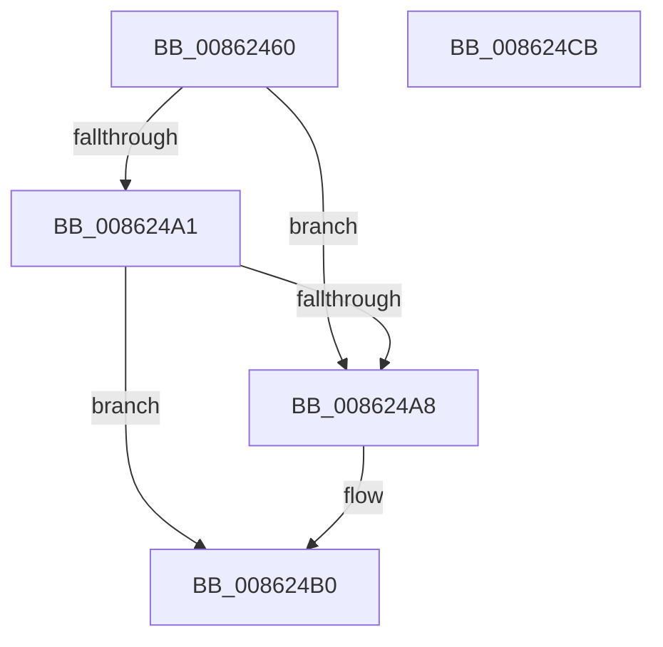

# CmpUnlockHashEntryByIndex

- RVA: `0x00862460`–`0x008624CC` (길이 `108` bytes)
- VA: `0x0000000140862460`
- 실행 섹션: `PAGE`
- PDB 이름 있음: `예`; PDB Function 태그: `아니요`
- unwind 정보 RVA: `0x0005CAAC`
- 디코드: `32`개 명령, `108/108` bytes 표시
- 미해석 바이트: `0` (있으면 어셈블리에 `.byte`로 보존)

> 이 문서는 커널 이미지의 기계어와 PDB 기호를 분석해 생성했습니다. 4번과 5번은 함수 원형과 자료형을 바이너리 사용 방식에서 추정한 C 해석이며 원본 소스 복구 결과는 아닙니다.

## 1. Dependencies

- 직접 호출 지점: **3**; 고유 호출 대상: **3**
- 직접 호출자로 확인된 함수: **3**
- RIP 상대 이미지 참조: **0**

### Outgoing calls
- `0x008624AB` → [ExfReleasePushLock](../../text/26/ExfReleasePushLock_function_002638D0.md) (function, `0x002638D0`)
- `0x008624B3` → [KeAbPostRelease](../../text/2E/KeAbPostRelease_function_002E1600.md) (function, `0x002E1600`)
- `0x008624BB` → [CmpDereferenceHive](CmpDereferenceHive_function_008632B0.md) (function, `0x008632B0`)

### Direct callers
- [CmpDoParseKey](../85/CmpDoParseKey_function_0085F750.md) at `0x0086057E`
- [CmpDoParseKey](../85/CmpDoParseKey_function_0085F750.md) at `0x00861E68`
- [CmpSearchKeyControlBlockTreeEx](../A6/CmpSearchKeyControlBlockTreeEx_function_00A65548.md) at `0x00A656F8`
- [sub_00B3E6EA](../B3/Unknown_function_00B3E6EA.md) at `0x00B3E6FA`

### Static image references
- 디코드된 RIP-relative 메모리 참조가 없습니다.

## 2. Other-region calls and transfers

- 다른 실행 섹션으로 향하는 call: **2**
  - `0x008624AB` → [ExfReleasePushLock](../../text/26/ExfReleasePushLock_function_002638D0.md) (`PAGE` → `.text`)
  - `0x008624B3` → [KeAbPostRelease](../../text/2E/KeAbPostRelease_function_002E1600.md) (`PAGE` → `.text`)
- 별도 외부 분기/꼬리 이동을 확인하지 못했습니다.

## 3. Assembly (complete function range)

```asm
00862460  48 89 5C 24 08                  mov qword ptr [rsp + 8], rbx
00862465  57                              push rdi
00862466  48 83 EC 20                     sub rsp, 0x20
0086246A  4C 8B 81 70 06 00 00            mov r8, qword ptr [rcx + 0x670]
00862471  48 8B F9                        mov rdi, rcx
00862474  8B C2                           mov eax, edx
00862476  33 C9                           xor ecx, ecx
00862478  48 8D 14 40                     lea rdx, [rax + rax*2]
0086247C  49 8D 1C D0                     lea rbx, [r8 + rdx*8]
00862480  48 89 4B 08                     mov qword ptr [rbx + 8], rcx
00862484  0F 0D 0B                        prefetchw byte ptr [rbx]
00862487  48 8B 03                        mov rax, qword ptr [rbx]
0086248A  48 8B D0                        mov rdx, rax
0086248D  48 83 E2 F0                     and rdx, 0xfffffffffffffff0
00862491  48 83 FA 10                     cmp rdx, 0x10
00862495  4C 8D 40 F0                     lea r8, [rax - 0x10]
00862499  4C 0F 46 C1                     cmovbe r8, rcx
0086249D  A8 02                           test al, 2
0086249F  75 07                           jne 0x1408624a8
008624A1  F0 4C 0F B1 03                  lock cmpxchg qword ptr [rbx], r8
008624A6  74 08                           je 0x1408624b0
008624A8  48 8B CB                        mov rcx, rbx
008624AB  E8 20 14 A0 FF                  call 0x1402638d0
008624B0  48 8B CB                        mov rcx, rbx
008624B3  E8 48 F1 A7 FF                  call 0x1402e1600
008624B8  48 8B CF                        mov rcx, rdi
008624BB  E8 F0 0D 00 00                  call 0x1408632b0
008624C0  48 8B 5C 24 30                  mov rbx, qword ptr [rsp + 0x30]
008624C5  48 83 C4 20                     add rsp, 0x20
008624C9  5F                              pop rdi
008624CA  C3                              ret
008624CB  CC                              int3
```

## 4. C-style interpretation (structured pseudocode)

```c
__int64 __fastcall CmpUnlockHashEntryByIndex(__int64 a1, int a2)
{
    __int64 result;
    __int64 v_rsp;
    unsigned __int64 v_stack_p8;

    v_stack_p8 = v_rbx;
    v_rsp = (v_rsp) - (32);
    a1 = 0;
    *(unsigned __int64 *)(*(unsigned __int64 *)(a1 + 1648) + (unsigned int)(a2) + (unsigned int)(a2) * 2 * 8 + 8) = 0;
    a2 = (*(unsigned __int64 *)(*(unsigned __int64 *)(a1 + 1648) + (unsigned int)(a2) + (unsigned int)(a2) * 2 * 8)) & (-16);
    a3 = *(unsigned __int64 *)(*(unsigned __int64 *)(a1 + 1648) + (unsigned int)(a2) + (unsigned int)(a2) * 2 * 8) - 16;
    if (a2 <= 16) { a3 = 0; }
    if ((((unsigned __int8)(*(unsigned __int64 *)(*(unsigned __int64 *)(a1 + 1648) + (unsigned int)(a2) + (unsigned int)(a2) * 2 * 8))) & (2)) != 0) goto loc_008624A8;
    result = *(unsigned __int64 *)(*(unsigned __int64 *)(a1 + 1648) + (unsigned int)(a2) + (unsigned int)(a2) * 2 * 8);
    if ((((unsigned __int8)(*(unsigned __int64 *)(*(unsigned __int64 *)(a1 + 1648) + (unsigned int)(a2) + (unsigned int)(a2) * 2 * 8))) & (2)) != 0) {
        a1 = *(unsigned __int64 *)(a1 + 1648) + (unsigned int)(a2) + (unsigned int)(a2) * 2 * 8;
        result = ExfReleasePushLock(a1, a2, a3, a4);
    }
    result = KeAbPostRelease(*(unsigned __int64 *)(a1 + 1648) + (unsigned int)(a2) + (unsigned int)(a2) * 2 * 8, a2, a3, a4);
    result = CmpDereferenceHive(a1, a2, a3, a4);
    v_rsp = (v_rsp) + (32);
    return result;
}
```

## 5. (Beta) C Style

```c
int64_t CmpUnlockHashEntryByIndex(void *Arg1, void *Arg2)
{
    uint8_t *arg1 = (uint8_t *)Arg1;
    uint8_t *arg2 = (uint8_t *)Arg2;

    int64_t result;
    int64_t local_rsp;
    uint64_t v_stack_p8;

    v_stack_p8 = local_rbx;
    local_rsp = (local_rsp) - (32);
    Arg1 = 0;
    *(uint64_t *)(*(uint64_t *)(arg1 + 0x670) + (uint32_t)(arg2) + (uint32_t)(arg2) * 2 * 8 + 0x8) = 0;
    Arg2 = (*(uint64_t *)(*(uint64_t *)(arg1 + 0x670) + (uint32_t)(arg2) + (uint32_t)(arg2) * 2 * 8)) & (-16);
    a3 = *(uint64_t *)(*(uint64_t *)(arg1 + 0x670) + (uint32_t)(arg2) + (uint32_t)(arg2) * 2 * 8) - 16;
    if (Arg2 <= 16) { a3 = 0; }
    if ((((uint8_t)(*(uint64_t *)(*(uint64_t *)(arg1 + 0x670) + (uint32_t)(arg2) + (uint32_t)(arg2) * 2 * 8))) & (2)) != 0) goto loc_008624A8;
    result = *(uint64_t *)(*(uint64_t *)(arg1 + 0x670) + (uint32_t)(arg2) + (uint32_t)(arg2) * 2 * 8);
    if ((((uint8_t)(*(uint64_t *)(*(uint64_t *)(arg1 + 0x670) + (uint32_t)(arg2) + (uint32_t)(arg2) * 2 * 8))) & (2)) != 0) {
        Arg1 = *(uint64_t *)(arg1 + 0x670) + (uint32_t)(Arg2) + (uint32_t)(Arg2) * 2 * 8;
        result = ExfReleasePushLock(Arg1, Arg2, a3, a4);
    }
    result = KeAbPostRelease(*(uint64_t *)(arg1 + 0x670) + (uint32_t)(Arg2) + (uint32_t)(Arg2) * 2 * 8, Arg2, a3, a4);
    result = CmpDereferenceHive(Arg1, Arg2, a3, a4);
    local_rsp = (local_rsp) + (32);
    return result;
}
```

### 관측된 메모리 오프셋

구조체 형식이 확인되지 않은 접근은 인자 기준의 오프셋으로만 기록했습니다.

| 기준 인자 | 오프셋 표현 | 폭 (bit) | 접근 |
|---|---:|---:|---|
| `Arg1` | `+ 0x670` | `64` | `R` |
| `Arg2` | `+ 0x0 + rax*2` | `64` | `R` |

## 6. Execution-region graph

[열기: 2D/3D 그래프와 함수 탐색 컨트롤 패널](../../../control-panel.html?section=page&rva=0x00862460&view=graph)

- 2D 그래프는 위에서 아래로 흐르고, 3D 그래프는 빈 공간을 드래그해 회전합니다. Shift+드래그는 이동, 휠은 확대·축소, 함수 노드 선택은 대상 보고서 이동입니다.

### Static fallback


