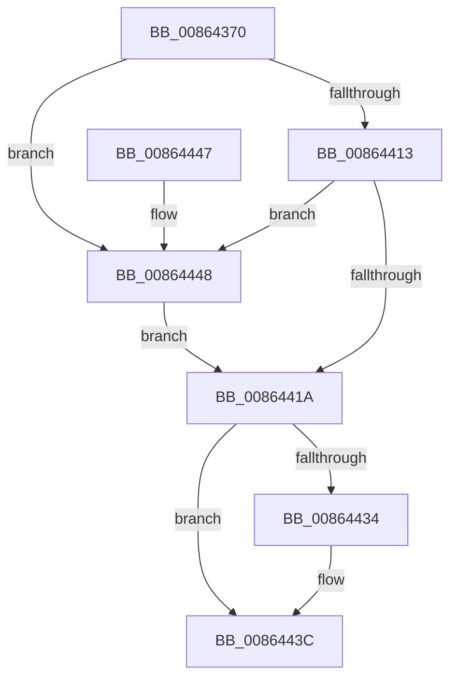

# CmpUnlockHashEntryByKcb

- RVA: `0x00864370`–`0x00864452` (길이 `226` bytes)
- VA: `0x0000000140864370`
- 실행 섹션: `PAGE`
- PDB 이름 있음: `예`; PDB Function 태그: `아니요`
- unwind 정보 RVA: `0x0006B95C`
- 디코드: `64`개 명령, `226/226` bytes 표시
- 미해석 바이트: `0` (있으면 어셈블리에 `.byte`로 보존)

> 이 문서는 커널 이미지의 기계어와 PDB 기호를 분석해 생성했습니다. 4번과 5번은 함수 원형과 자료형을 바이너리 사용 방식에서 추정한 C 해석이며 원본 소스 복구 결과는 아닙니다.

## 1. Dependencies

- 직접 호출 지점: **3**; 고유 호출 대상: **3**
- 직접 호출자로 확인된 함수: **10**
- RIP 상대 이미지 참조: **0**

### Outgoing calls
- `0x0086441D` → [KeAbPostRelease](../../text/2E/KeAbPostRelease_function_002E1600.md) (function, `0x002E1600`)
- `0x00864437` → [CmpDeleteHive](CmpDeleteHive_function_0086450C.md) (function, `0x0086450C`)
- `0x0086444B` → [ExfReleasePushLock](../../text/26/ExfReleasePushLock_function_002638D0.md) (function, `0x002638D0`)

### Direct callers
- [CmDeleteLayeredKey](../../text/41/CmDeleteLayeredKey_function_0041B598.md) at `0x0041B823`
- [CmDeleteLayeredKey](../../text/41/CmDeleteLayeredKey_function_0041B598.md) at `0x0041B8CE`
- [CmDeleteLayeredKey](../../text/41/CmDeleteLayeredKey_function_0041B598.md) at `0x0041B95E`
- [CmpRemoveHiveFromNamespace](../../text/49/CmpRemoveHiveFromNamespace_function_0049C4CC.md) at `0x0049C576`
- [sub_006ED542](../../text/6E/Unknown_function_006ED542.md) at `0x006ED5A6`
- [CmpDoBuildVirtualStack](../7E/CmpDoBuildVirtualStack_function_007EB4C4.md) at `0x007EB72B`
- [CmDeleteKey](../84/CmDeleteKey_function_00848E5C.md) at `0x00849348`
- [CmDeleteKey](../84/CmDeleteKey_function_00848E5C.md) at `0x0084941B`
- [CmDeleteKey](../84/CmDeleteKey_function_00848E5C.md) at `0x00849668`
- [sub_00857A33](../85/Unknown_function_00857A33.md) at `0x00857B32`
- [sub_0085800D](../85/Unknown_function_0085800D.md) at `0x00858018`
- [CmpDoParseKey](../85/CmpDoParseKey_function_0085F750.md) at `0x0085FAC1`
- [CmpDoParseKey](../85/CmpDoParseKey_function_0085F750.md) at `0x008605D1`
- [CmpDoParseKey](../85/CmpDoParseKey_function_0085F750.md) at `0x00860A2D`
- [CmpDoParseKey](../85/CmpDoParseKey_function_0085F750.md) at `0x00860A5E`
- [CmpDoParseKey](../85/CmpDoParseKey_function_0085F750.md) at `0x00860DB3`
- [CmpDoParseKey](../85/CmpDoParseKey_function_0085F750.md) at `0x008615EE`
- [CmpDoParseKey](../85/CmpDoParseKey_function_0085F750.md) at `0x00861D64`
- [sub_00B16440](../B1/Unknown_function_00B16440.md) at `0x00B1647D`
- [sub_00B16F66](../B1/Unknown_function_00B16F66.md) at `0x00B17288`

### Static image references
- 디코드된 RIP-relative 메모리 참조가 없습니다.

## 2. Other-region calls and transfers

- 다른 실행 섹션으로 향하는 call: **2**
  - `0x0086441D` → [KeAbPostRelease](../../text/2E/KeAbPostRelease_function_002E1600.md) (`PAGE` → `.text`)
  - `0x0086444B` → [ExfReleasePushLock](../../text/26/ExfReleasePushLock_function_002638D0.md) (`PAGE` → `.text`)
- 별도 외부 분기/꼬리 이동을 확인하지 못했습니다.

## 3. Assembly (complete function range)

```asm
00864370  48 89 5C 24 08                  mov qword ptr [rsp + 8], rbx
00864375  57                              push rdi
00864376  48 83 EC 20                     sub rsp, 0x20
0086437A  8B 41 10                        mov eax, dword ptr [rcx + 0x10]
0086437D  4C 8B C9                        mov r9, rcx
00864380  48 8B 79 20                     mov rdi, qword ptr [rcx + 0x20]
00864384  8B D0                           mov edx, eax
00864386  C1 EA 09                        shr edx, 9
00864389  45 33 D2                        xor r10d, r10d
0086438C  33 D0                           xor edx, eax
0086438E  69 C2 A3 8A 01 00               imul eax, edx, 0x18aa3
00864394  8B 8F 78 06 00 00               mov ecx, dword ptr [rdi + 0x678]
0086439A  FF C9                           dec ecx
0086439C  8B D0                           mov edx, eax
0086439E  44 8B C0                        mov r8d, eax
008643A1  48 8B 87 70 06 00 00            mov rax, qword ptr [rdi + 0x670]
008643A8  49 C1 E8 09                     shr r8, 9
008643AC  4C 33 C2                        xor r8, rdx
008643AF  4C 23 C1                        and r8, rcx
008643B2  4B 8D 0C 40                     lea rcx, [r8 + r8*2]
008643B6  4C 89 54 C8 08                  mov qword ptr [rax + rcx*8 + 8], r10
008643BB  41 8B 41 10                     mov eax, dword ptr [r9 + 0x10]
008643BF  8B C8                           mov ecx, eax
008643C1  4D 8B 41 20                     mov r8, qword ptr [r9 + 0x20]
008643C5  C1 E9 09                        shr ecx, 9
008643C8  33 C8                           xor ecx, eax
008643CA  69 C1 A3 8A 01 00               imul eax, ecx, 0x18aa3
008643D0  8B C8                           mov ecx, eax
008643D2  8B D0                           mov edx, eax
008643D4  49 8B 80 70 06 00 00            mov rax, qword ptr [r8 + 0x670]
008643DB  48 C1 EA 09                     shr rdx, 9
008643DF  48 33 D1                        xor rdx, rcx
008643E2  41 8B 88 78 06 00 00            mov ecx, dword ptr [r8 + 0x678]
008643E9  FF C9                           dec ecx
008643EB  48 23 D1                        and rdx, rcx
008643EE  48 8D 0C 52                     lea rcx, [rdx + rdx*2]
008643F2  48 8D 1C C8                     lea rbx, [rax + rcx*8]
008643F6  0F 0D 0B                        prefetchw byte ptr [rbx]
008643F9  48 8B 03                        mov rax, qword ptr [rbx]
008643FC  48 8B C8                        mov rcx, rax
008643FF  48 83 E1 F0                     and rcx, 0xfffffffffffffff0
00864403  48 83 F9 10                     cmp rcx, 0x10
00864407  48 8D 50 F0                     lea rdx, [rax - 0x10]
0086440B  49 0F 46 D2                     cmovbe rdx, r10
0086440F  A8 02                           test al, 2
00864411  75 35                           jne 0x140864448
00864413  F0 48 0F B1 13                  lock cmpxchg qword ptr [rbx], rdx
00864418  75 2E                           jne 0x140864448
0086441A  48 8B CB                        mov rcx, rbx
0086441D  E8 DE D1 A7 FF                  call 0x1402e1600
00864422  B8 FF FF FF FF                  mov eax, 0xffffffff
00864427  F0 0F C1 87 88 10 00 00         lock xadd dword ptr [rdi + 0x1088], eax
0086442F  83 F8 01                        cmp eax, 1
00864432  75 08                           jne 0x14086443c
00864434  48 8B CF                        mov rcx, rdi
00864437  E8 D0 00 00 00                  call 0x14086450c
0086443C  48 8B 5C 24 30                  mov rbx, qword ptr [rsp + 0x30]
00864441  48 83 C4 20                     add rsp, 0x20
00864445  5F                              pop rdi
00864446  C3                              ret
00864447  CC                              int3
00864448  48 8B CB                        mov rcx, rbx
0086444B  E8 80 F4 9F FF                  call 0x1402638d0
00864450  EB C8                           jmp 0x14086441a
```

## 4. C-style interpretation (structured pseudocode)

```c
__int64 __fastcall CmpUnlockHashEntryByKcb(__int64 a1)
{
    __int64 result;
    __int64 v_r10;
    __int64 v_rsp;
    unsigned __int64 v_stack_p8;

    v_stack_p8 = v_rbx;
    v_rsp = (v_rsp) - (32);
    a2 = (unsigned int)(((unsigned int)((unsigned int)((unsigned int)(*(unsigned int *)(a1 + 16))))) >> (9));
    v_r10 = 0;
    a2 = (unsigned int)((a2) ^ ((unsigned int)((unsigned int)(*(unsigned int *)(a1 + 16)))));
    result = (unsigned int)(((unsigned int)(*(unsigned int *)(a1 + 16))) * ((unsigned int)(a2)));
    a1 = (unsigned int)(((unsigned int)(*(unsigned int *)(*(unsigned __int64 *)(a1 + 32) + 1656))) - 1);
    a3 = ((unsigned int)((unsigned int)(result))) >> (9);
    a3 = (a3) ^ ((unsigned int)((unsigned int)(result)));
    a3 = (a3) & (a1);
    *(unsigned __int64 *)(*(unsigned __int64 *)(*(unsigned __int64 *)(a1 + 32) + 1648) + a3 + a3 * 2 * 8 + 8) = 0;
    a1 = (unsigned int)(((unsigned int)((unsigned int)((unsigned int)(*(unsigned int *)(a1 + 16))))) >> (9));
    a1 = (unsigned int)((a1) ^ ((unsigned int)((unsigned int)(*(unsigned int *)(a1 + 16)))));
    result = (unsigned int)(((unsigned int)(*(unsigned int *)(a1 + 16))) * ((unsigned int)(a1)));
    a2 = ((unsigned int)((unsigned int)(result))) >> (9);
    a2 = (a2) ^ ((unsigned int)((unsigned int)(result)));
    a1 = (unsigned int)(((unsigned int)(*(unsigned int *)(*(unsigned __int64 *)(a1 + 32) + 1656))) - 1);
    a2 = (a2) & (a1);
    a1 = (*(unsigned __int64 *)(*(unsigned __int64 *)(*(unsigned __int64 *)(a1 + 32) + 1648) + a2 + a2 * 2 * 8)) & (-16);
    a2 = *(unsigned __int64 *)(*(unsigned __int64 *)(*(unsigned __int64 *)(a1 + 32) + 1648) + a2 + a2 * 2 * 8) - 16;
    if (a1 <= 16) { a2 = 0; }
    if ((((unsigned __int8)(*(unsigned __int64 *)(*(unsigned __int64 *)(*(unsigned __int64 *)(a1 + 32) + 1648) + a2 + a2 * 2 * 8))) & (2)) != 0) goto loc_00864448;
    if ((((unsigned __int8)(*(unsigned __int64 *)(*(unsigned __int64 *)(*(unsigned __int64 *)(a1 + 32) + 1648) + a2 + a2 * 2 * 8))) & (2)) != 0) goto loc_00864448;
loc_0086441A:
    result = KeAbPostRelease(*(unsigned __int64 *)(*(unsigned __int64 *)(a1 + 32) + 1648) + a2 + a2 * 2 * 8, a2, *(unsigned __int64 *)(a1 + 32), a1);
    result = (unsigned int)(0xFFFFFFFFULL);
    if (((unsigned int)((unsigned int)(0xFFFFFFFFULL))) == 1) {
        a1 = *(unsigned __int64 *)(a1 + 32);
        result = CmpDeleteHive(a1, a2, *(unsigned __int64 *)(a1 + 32), a1);
    }
    v_rsp = (v_rsp) + (32);
    return result;
loc_00864448:
    result = ExfReleasePushLock(v_stack_p8, a2, *(unsigned __int64 *)(a1 + 32), a1);
    goto loc_0086441A;
}
```

## 5. (Beta) C Style

```c
int64_t CmpUnlockHashEntryByKcb(void *Arg1)
{
    uint8_t *arg1 = (uint8_t *)Arg1;

    int64_t result;
    int64_t local_r10;
    int64_t local_rsp;
    uint64_t v_stack_p8;

    v_stack_p8 = local_rbx;
    local_rsp = (local_rsp) - (32);
    a2 = (uint32_t)(((uint32_t)((uint32_t)((uint32_t)(*(uint32_t *)(arg1 + 0x10))))) >> (9));
    local_r10 = 0;
    a2 = (uint32_t)((a2) ^ ((uint32_t)((uint32_t)(*(uint32_t *)(arg1 + 0x10)))));
    result = (uint32_t)(((uint32_t)(*(uint32_t *)(arg1 + 0x10))) * ((uint32_t)(a2)));
    Arg1 = (uint32_t)(((uint32_t)(*(uint32_t *)(*(uint64_t *)(arg1 + 0x20) + 0x678))) - 1);
    a3 = ((uint32_t)((uint32_t)(result))) >> (9);
    a3 = (a3) ^ ((uint32_t)((uint32_t)(result)));
    a3 = (a3) & (Arg1);
    *(uint64_t *)(*(uint64_t *)(*(uint64_t *)(arg1 + 0x20) + 0x670) + a3 + a3 * 2 * 8 + 0x8) = 0;
    Arg1 = (uint32_t)(((uint32_t)((uint32_t)((uint32_t)(*(uint32_t *)(arg1 + 0x10))))) >> (9));
    Arg1 = (uint32_t)((Arg1) ^ ((uint32_t)((uint32_t)(*(uint32_t *)(arg1 + 0x10)))));
    result = (uint32_t)(((uint32_t)(*(uint32_t *)(arg1 + 0x10))) * ((uint32_t)(Arg1)));
    a2 = ((uint32_t)((uint32_t)(result))) >> (9);
    a2 = (a2) ^ ((uint32_t)((uint32_t)(result)));
    Arg1 = (uint32_t)(((uint32_t)(*(uint32_t *)(*(uint64_t *)(arg1 + 0x20) + 0x678))) - 1);
    a2 = (a2) & (Arg1);
    Arg1 = (*(uint64_t *)(*(uint64_t *)(*(uint64_t *)(arg1 + 0x20) + 0x670) + a2 + a2 * 2 * 8)) & (-16);
    a2 = *(uint64_t *)(*(uint64_t *)(*(uint64_t *)(arg1 + 0x20) + 0x670) + a2 + a2 * 2 * 8) - 16;
    if (Arg1 <= 16) { a2 = 0; }
    if ((((uint8_t)(*(uint64_t *)(*(uint64_t *)(*(uint64_t *)(arg1 + 0x20) + 0x670) + a2 + a2 * 2 * 8))) & (2)) != 0) goto loc_00864448;
    if ((((uint8_t)(*(uint64_t *)(*(uint64_t *)(*(uint64_t *)(arg1 + 0x20) + 0x670) + a2 + a2 * 2 * 8))) & (2)) != 0) goto loc_00864448;
loc_0086441A:
    result = KeAbPostRelease(*(uint64_t *)(*(uint64_t *)(arg1 + 0x20) + 0x670) + a2 + a2 * 2 * 8, a2, *(uint64_t *)(arg1 + 0x20), Arg1);
    result = (uint32_t)(0xFFFFFFFFULL);
    if (((uint32_t)((uint32_t)(0xFFFFFFFFULL))) == 1) {
        Arg1 = *(uint64_t *)(arg1 + 0x20);
        result = CmpDeleteHive(Arg1, a2, *(uint64_t *)(arg1 + 0x20), Arg1);
    }
    local_rsp = (local_rsp) + (32);
    return result;
loc_00864448:
    result = ExfReleasePushLock(v_stack_p8, a2, *(uint64_t *)(arg1 + 0x20), Arg1);
    goto loc_0086441A;
}
```

### 관측된 메모리 오프셋

구조체 형식이 확인되지 않은 접근은 인자 기준의 오프셋으로만 기록했습니다.

| 기준 인자 | 오프셋 표현 | 폭 (bit) | 접근 |
|---|---:|---:|---|
| `Arg1` | `+ 0x10` | `32` | `R` |
| `Arg1` | `+ 0x20` | `64` | `R` |

## 6. Execution-region graph

[열기: 2D/3D 그래프와 함수 탐색 컨트롤 패널](../../../control-panel.html?section=page&rva=0x00864370&view=graph)

- 2D 그래프는 위에서 아래로 흐르고, 3D 그래프는 빈 공간을 드래그해 회전합니다. Shift+드래그는 이동, 휠은 확대·축소, 함수 노드 선택은 대상 보고서 이동입니다.

### Static fallback


